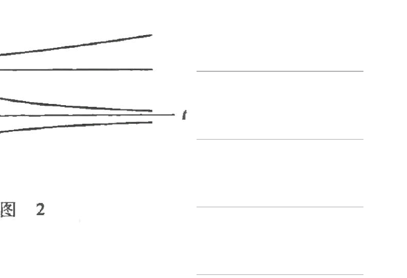
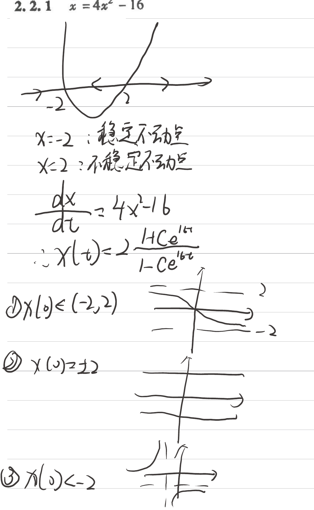
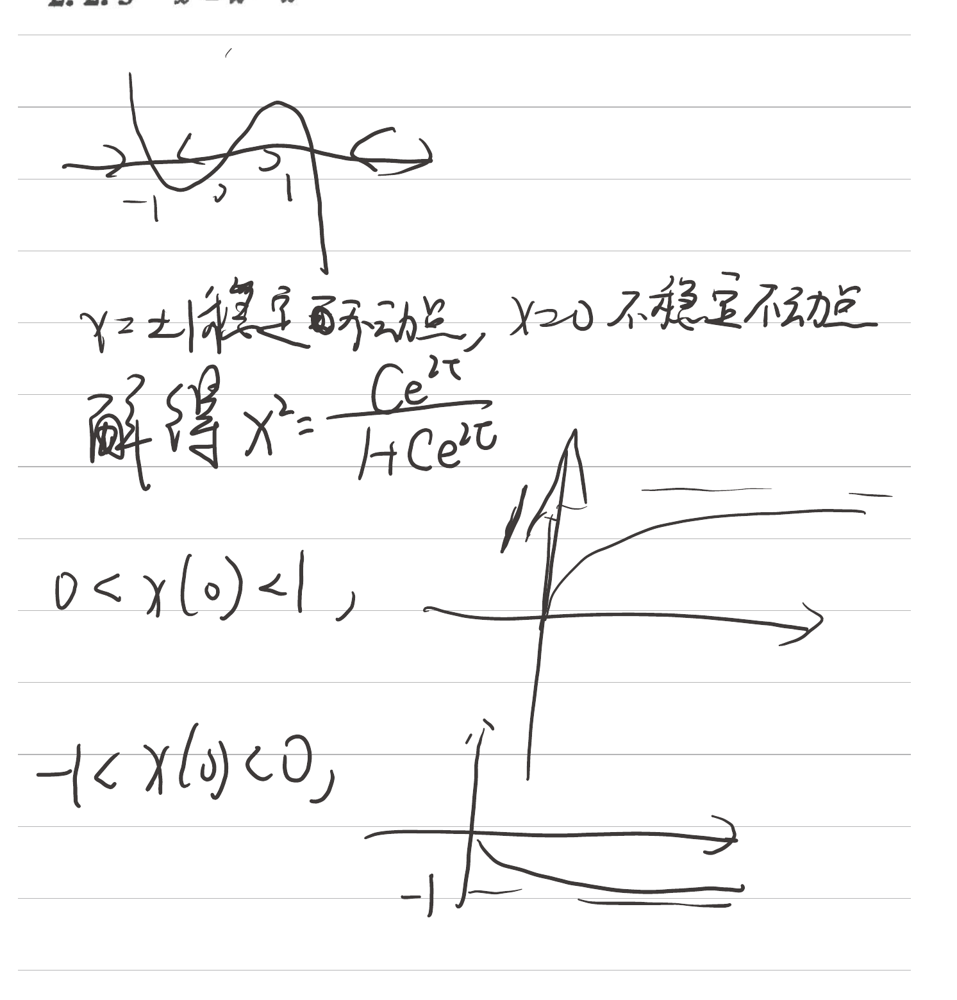
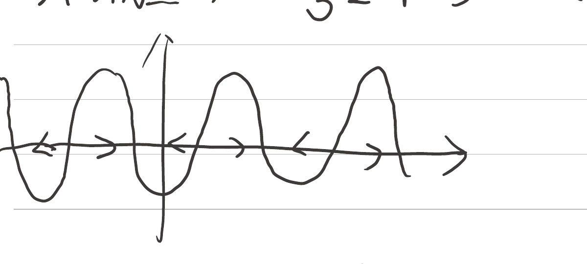
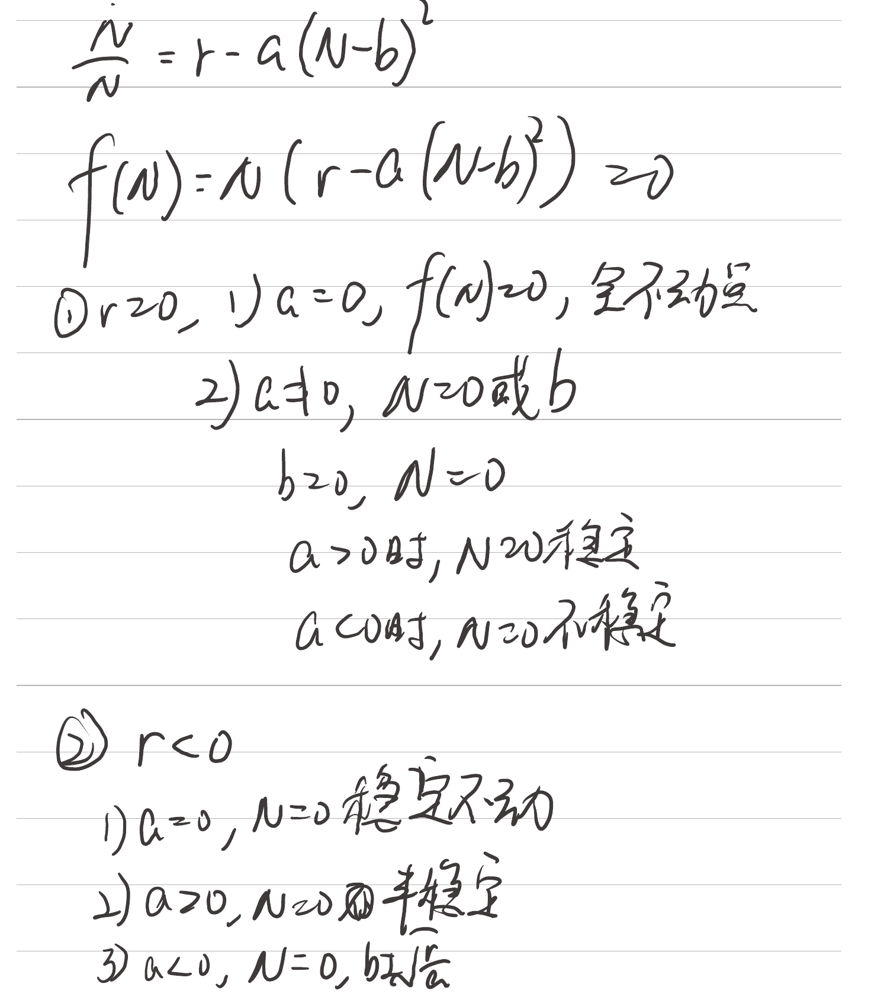
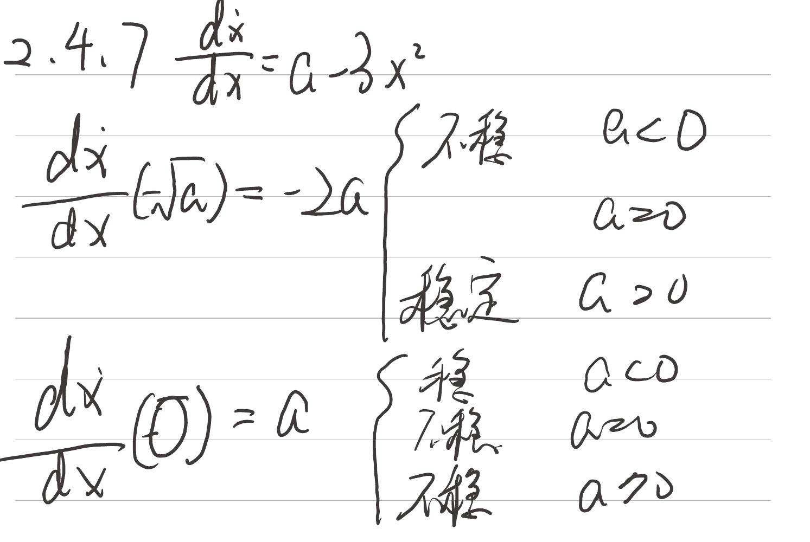
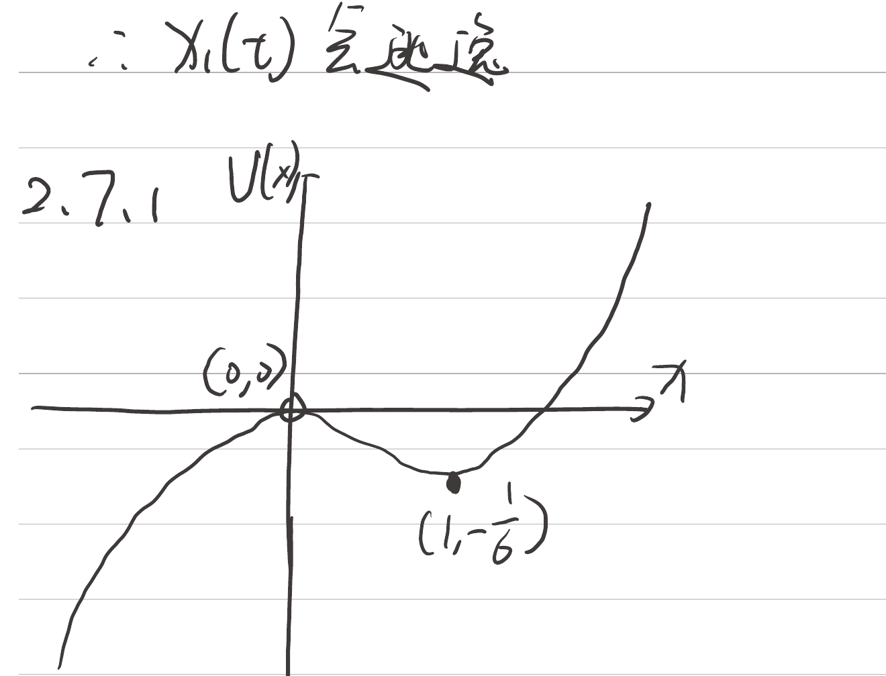
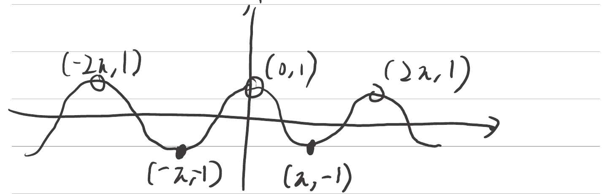
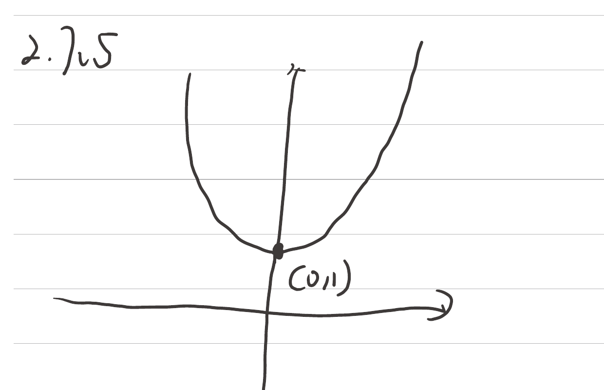

# 动力系统 第 2 章「直线上的流」作业答案（2025 秋）

## 习题 2.1

### 题目

在下面三个练习题中， $\dot x = \sin x$ 可解释为直线上的流。

#### 2.1.4

（ $\dot x = \sin x$ 的精确解）如文中所示， $\dot x = \sin x$ 的解为 $t = \ln\left|\dfrac{\csc x_0 + \cot x_0}{\csc x + \cot x}\right|$，这里 $x_0 = x(0)$ 是 $x$ 的初始值。

a) 给定初始条件 $x_0 = \pi/4$，证明上面的解能利用反函数得到

$$x(t) = 2\arctan\left(\frac{e^t}{1+\sqrt 2}\right)$$

推断当 $t\to\infty$ 时有 $x(t)\to\pi$，如第 2.1 节所说。（要解决该问题，你需要熟悉三角函数恒等式。）

b) 给定任意初始条件 $x_0$，试求 $x(t)$ 的解析解。

### 答案

#### 2.1.4

a) 由 $x_0 = \pi/4$ 得 $\csc x_0 + \cot x_0 = \sqrt 2 + 1$：

$$\ln\left|\frac{\sqrt 2+1}{\csc x+\cot x}\right| = t$$

$$\therefore\ \csc x+\cot x = \frac{\sqrt 2+1}{e^t}$$

$$\therefore\ \frac{1+\cos x}{\sin x} = \frac{\sqrt 2+1}{e^t}$$

$$\therefore\ \frac{2\cos^2\frac{x}{2}}{2\sin\frac{x}{2}\cos\frac{x}{2}} = \frac{\sqrt 2+1}{e^t}$$

$$\therefore\ \tan\frac{x}{2} = \frac{e^t}{\sqrt 2+1}$$

$$\therefore\ x = 2\arctan\left(\frac{e^t}{\sqrt 2+1}\right)$$

$$\lim_{t\to\infty}x(t) = 2\arctan\left(\frac{\lim\limits_{t\to\infty}e^t}{\sqrt 2+1}\right) = 2\cdot\frac{\pi}{2} = \pi$$

b)

$$\tan\frac{x}{2} = \frac{e^t}{\cot x_0+\csc x_0}$$

$$\therefore\ x(t) = 2\arctan\left(\frac{e^t}{\csc x_0+\cot x_0}\right)$$

## 习题 2.2

### 题目

利用图形方法分析以下方程。在每个问题中，画出直线上的向量场，求出所有不动点，对其稳定性分类，并画出对应不同初始条件的 $x(t)$ 的图形。然后花几分钟试求 $x(t)$ 的解析解；若遇到困难，别花费太长时间，因为有几个问题不可能求出其闭式解。

#### 2.2.1

$\dot x = 4x^2 - 16$

#### 2.2.3

$\dot x = x - x^3$

#### 2.2.5

$\dot x = 1 + \frac{1}{2}\cos x$

#### 2.2.6

$\dot x = 1 - 2\cos x$

#### 2.2.10

（不动点）对 (a)~(e) 中的每个问题，求符合所述特性的方程 $\dot x = f(x)$，若没有相应的例子，解释原因（在所有情况中，假定 $f(x)$ 是光滑函数）。

a) 任意实数都是不动点。

b) 每个整数都是不动点，无其他不动点。

c) 恰好有三个不动点，且都稳定。

d) 没有不动点。

e) 恰好有 100 个不动点。

### 答案

#### 2.2.1

不动点： $x = -2$ 为稳定不动点， $x = 2$ 为不稳定不动点。

解析解：由 $\dfrac{dx}{dt} = 4x^2-16$ 解得

$$x(t) = 2\,\frac{1+Ce^{16t}}{1-Ce^{16t}}$$

四种初始条件下的 $x(t)$ 图形：① $x(0)\in(-2,2)$；② $x(0) = \pm 2$；③ $x(0) < -2$；④ $x(0) > 2$。

#### 2.2.3

不动点： $x = \pm 1$ 为稳定不动点， $x = 0$ 为不稳定不动点。

解析解：

$$x^2 = \frac{Ce^{2t}}{1+Ce^{2t}}$$

$x(t)$ 图形分别画了 $0 < x(0) < 1$ 与 $-1 < x(0) < 0$ 两种情形。

#### 2.2.5

无不动点。

#### 2.2.6

不动点： $x = \pm\dfrac{\pi}{3} + 2k\pi,\ k\in\mathbb Z$；其中 $\dfrac{\pi}{3} + 2k\pi$ 为不稳定不动点， $-\dfrac{\pi}{3} + 2k\pi$ 为稳定不动点。

解析解：

$$x = 2\arctan\left(\frac{1}{\sqrt 3}\cdot\frac{1+Ce^{\sqrt 3 t}}{1-Ce^{\sqrt 3 t}}\right)$$

#### 2.2.10

a) $\dot x = 0$

b) $\dot x = \sin 2\pi x$

c) 不可能。设三个稳定不动点为 $a < b < c$，取 $x_0\in(a,b)$，则 $\lim\limits_{t\to+\infty}x(t) = a$ 且 $\lim\limits_{t\to+\infty}x(t) = b$， $\therefore a = b$，矛盾。

d) $\dot x = e^x$

e) $\dot x = \prod\limits_{i=1}^{100}(x-i)$

## 习题 2.3

### 题目

#### 2.3.4

（Allee 效应）对某些生物体的种群，对中等的 $N$ 值，有效增长率 $\dot N/N$ 最大。这称为 Allee 效应（Edelstein-Keshet 1988）。例如，可以想象 $N$ 很小时难以找到配偶，而 $N$ 很大时食物与其他资源的竞争很激烈。

a) 证明 $\dot N/N = r - a(N-b)^2$ 为 Allee 效应提供了例子，若 $r$、 $a$ 与 $b$ 满足某些限制（待定）。

b) 找出系统所有的不动点并对其稳定性分类。

c) 比较解 $N(t)$ 与逻辑斯谛方程的解。其定性的行为有何不同，如果有的话？

### 答案

#### 2.3.4

系统为 $\dot N = N\left(r-a(N-b)^2\right)$，记 $f(N) = N\left(r-a(N-b)^2\right)$，令 $f(N) = 0$。按 $r$ 的符号分三种情形讨论：

① $r \geqslant 0$

1) $a = 0$： $f(N) = 0$，全不动点
2) $a \neq 0$：不动点为 $N = 0$ 或 $N = b$； $b = 0$ 时只有 $N = 0$
   - $a > 0$ 时， $N = 0$ 稳定
   - $a < 0$ 时， $N = 0$ 不稳定

② $r < 0$

1) $a = 0$： $N = 0$ 稳定不动点
2) $a > 0$： $N = 0$ 稳定
3) $a < 0$： $N = 0$ 与 $N = b\pm\sqrt{r/a}$
   - i) $b > \sqrt{r/a}$： $N = b-\sqrt{r/a}$ 稳定， $N = 0$ 与 $N = b+\sqrt{r/a}$ 不稳定
   - ii) $-\sqrt{r/a} < b < \sqrt{r/a}$： $N = 0$ 稳定， $N = b\pm\sqrt{r/a}$ 不稳定
   - iii) $b < -\sqrt{r/a}$： $N = b+\sqrt{r/a}$ 稳定， $N = 0$ 与 $N = b-\sqrt{r/a}$ 不稳定

③ $r > 0$

1) $a = 0$： $N = 0$ 不稳定
2) $a > 0$：i) $b > \sqrt{r/a}$；ii) $b < \sqrt{r/a}$；iii) $-\sqrt{r/a} < b < \sqrt{r/a}$；iv) $b = \sqrt{r/a}$（ $2\sqrt{r/a}$ 稳定， $0$ 半稳定）；v) $b = -\sqrt{r/a}$（ $0$ 半稳定， $-2\sqrt{r/a}$ 稳定）

## 习题 2.4

### 题目

利用线性稳定性分析对下列系统的不动点进行分类。若线性稳定性分析因 $f'(x^*) = 0$ 无法使用，利用图形方法决定其稳定性。

#### 2.4.1

$\dot x = x(1-x)$

#### 2.4.3

$\dot x = \tan x$

#### 2.4.5

$\dot x = 1 - e^{-x^2}$

#### 2.4.7

$\dot x = ax - x^3$，这里 $a$ 可以为正数、负数或者零。讨论各种情况。

#### 2.4.8

利用线性稳定性分析，对 Gompertz 的肿瘤增长模型 $\dot N = -aN\ln(bN)$ 的不动点进行分类。（同练习题 2.3.3 一样， $N(t)$ 与肿瘤中的细胞个数成比例，而且 $a>0$， $b>0$ 为参数。）

### 答案

#### 2.4.1

$$\frac{d\dot x}{dx} = 1-2x$$

$$\frac{d\dot x}{dx}(0) = 1 \Rightarrow \text{不稳定不动点}$$

$$\frac{d\dot x}{dx}(1) = -1 \Rightarrow \text{稳定不动点}$$

#### 2.4.3

$$\frac{d\dot x}{dx} = \sec^2 x$$

$$\frac{d\dot x}{dx}(k\pi) = 1 \Rightarrow \text{不稳定不动点}$$

#### 2.4.5

$$\frac{d\dot x}{dx} = 2xe^{-x^2}$$

$$\frac{d\dot x}{dx}(0) = 0 \Rightarrow$$

#### 2.4.7

$$\frac{d\dot x}{dx} = a-3x^2$$

$$\frac{d\dot x}{dx}(\pm\sqrt a) = -2a \Rightarrow \text{稳定}\ (a>0)$$

$$\frac{d\dot x}{dx}(0) = a \Rightarrow \begin{cases}\text{稳定}, & a<0\\ \text{不稳定}, & a>0\\ \text{稳定}, & a=0\end{cases}$$

#### 2.4.8

$$\dot N = -aN\ln(bN) = 0$$

$$\therefore\ N_1 = 0,\quad N_2 = \frac{1}{b}$$

$N_1 = 0$ 不稳定， $N_2 = \dfrac{1}{b}$ 稳定。

## 习题 2.5

### 题目

#### 2.5.2

（“爆炸”：有限时间内达到无穷）证明 $\dot x = 1 + x^{10}$ 的解对任意初始条件，能在有限时间内逃逸到 $+\infty$。（提示：不要试图求出精确解；而是应将它与 $\dot x = 1 + x^2$ 的解相比较。）

### 答案

#### 2.5.2

$\dot x = 1+x^2$ 的解为 $x = \tan(t+c)$；当 $t \to \dfrac{\pi}{2}-c$ 时， $\tan(t+c) \to +\infty$。

设 $\dot x_1 = 1+x_1^{10}$， $\dot x_2 = 1+x_2^2$，则 $x_1(0) = x_2(0) = x_0$，

$$\therefore\ \dot x_1(t) \ge \dot x_2(t)$$

$$\therefore\ x_1(t) \ge x_2(t)$$

$\therefore x_1(t)$ 会逃逸。

## 习题 2.7

### 题目

对下面每个向量场，画出势函数 $V(x)$ 并判别其所有平衡点及其稳定性。

#### 2.7.1

$\dot x = x(1-x)$

#### 2.7.3

$\dot x = \sin x$

#### 2.7.5

$\dot x = -\sinh x$

### 答案

#### 2.7.1

势函数 $V(x)$ 的图形：极小值在 $(1, -\frac{1}{6})$，另标出原点 $(0,0)$。

#### 2.7.3

势函数 $V(x)$ 的图形：极大值在 $(-2\pi, 1)$、 $(0, 1)$、 $(2\pi, 1)$，极小值在 $(-\pi, -1)$、 $(\pi, -1)$；极大值处画空心圈（不稳定平衡点），极小值处画实心点（稳定平衡点）。

#### 2.7.5

势函数 $V(x)$ 的图形：唯一极小值在 $(0, 1)$（稳定平衡点）。
