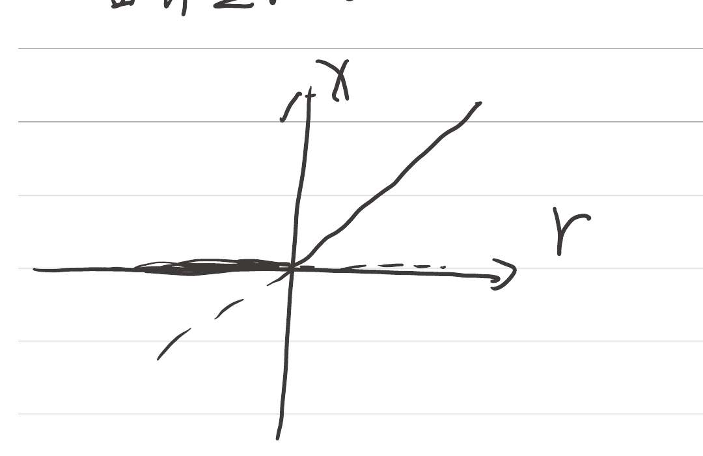
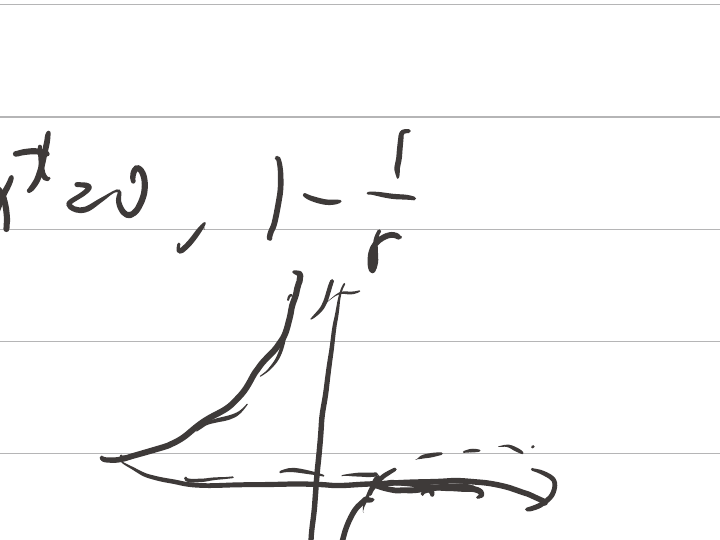
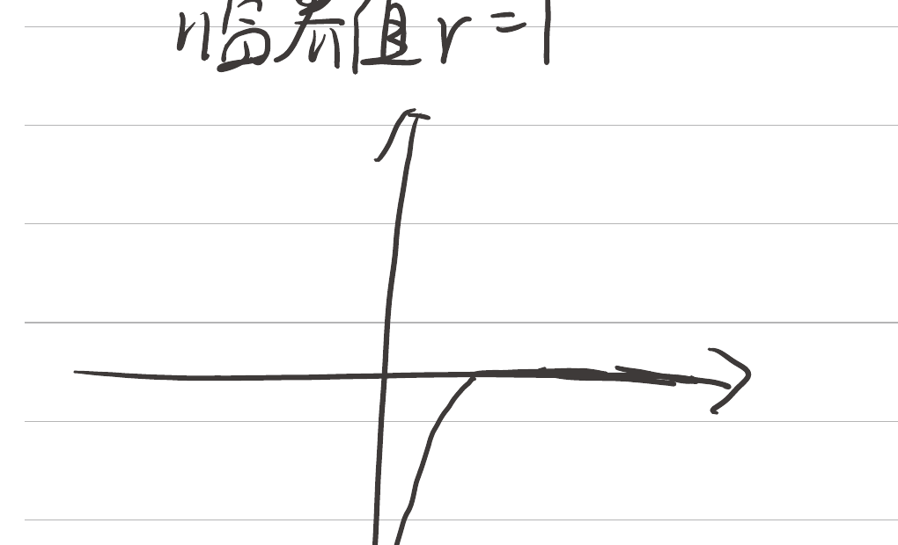
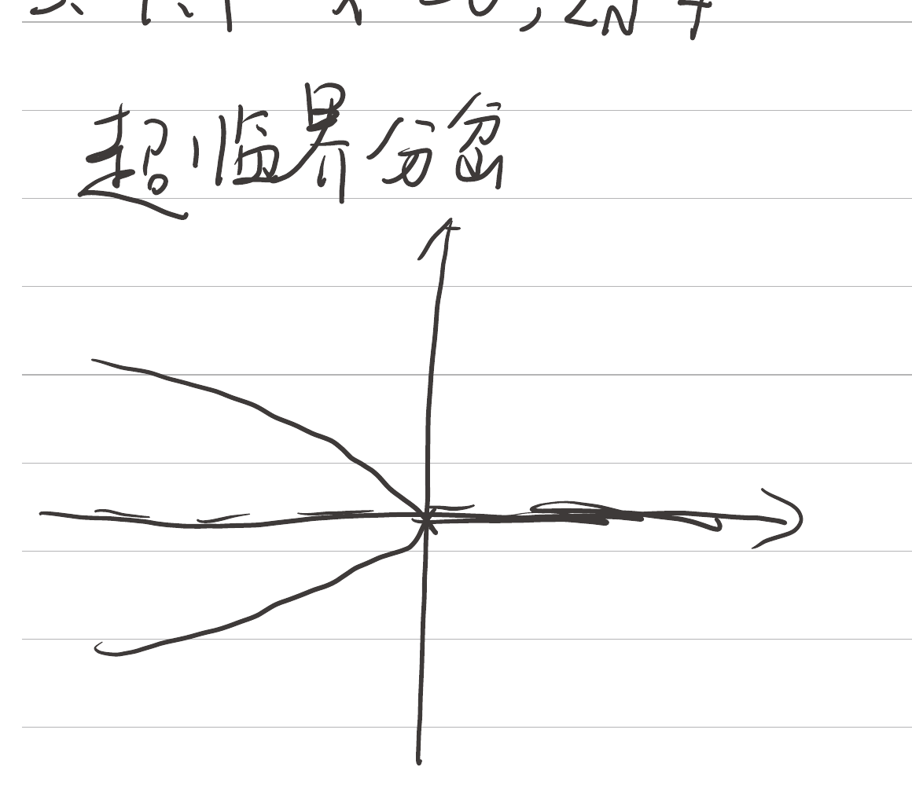
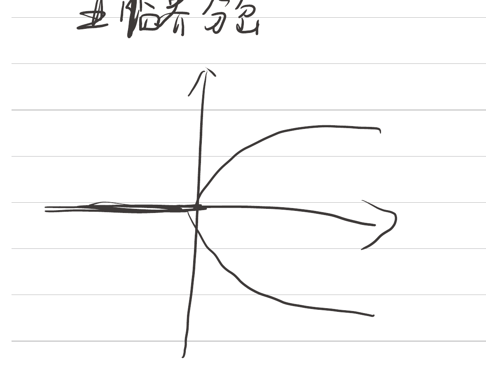
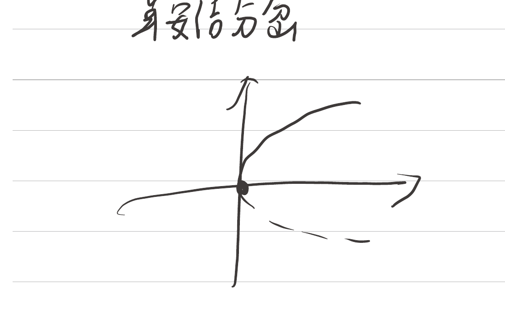
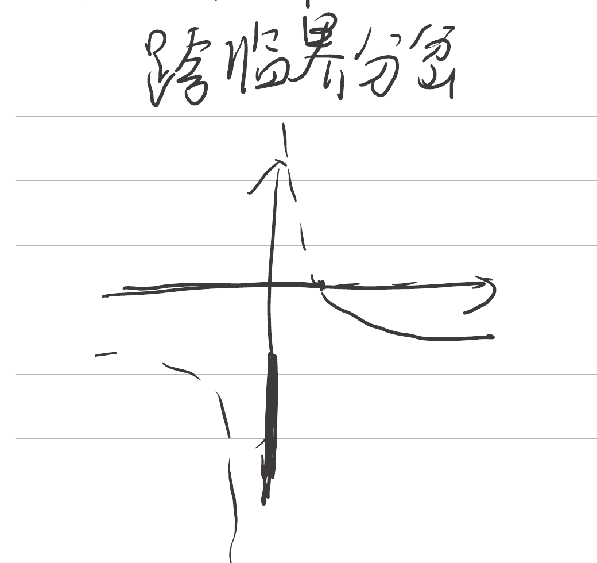
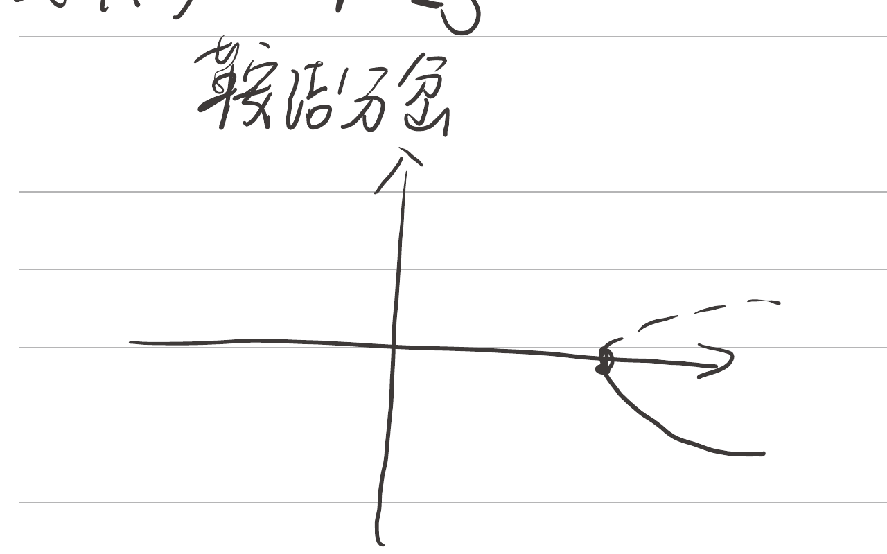

# 动力系统 第 3 章「分岔」作业答案（2025 秋）

## 习题 3.2

### 题目

对下面每道练习题，画出当 $r$ 变化时出现的定性上不同的所有向量场。证明跨临界分岔出现于某个 $r$ 的临界值，待确定。最后，画出不动点 $x^*$ 相对于 $r$ 的分岔图。

#### 3.2.1

$\dot x = rx + x^2$

#### 3.2.2

$\dot x = rx - \ln(1+x)$

#### 3.2.3

$\dot x = x - rx(1-x)$

#### 3.2.4

$\dot x = x(r-e^x)$

### 答案

#### 3.2.1

$\dot x = 0 \Rightarrow x^* = 0$ 或 $-r$；临界值 $r = 0$。

#### 3.2.2

$r = 0$ 时 $x^* = 0$； $r \neq 0$ 时数值求解；临界值 $r = 1$。

#### 3.2.3

不动点 $x^* = 0$ 与 $1 - \dfrac{1}{r}$； $r = 1$ 为临界值。

#### 3.2.4

$x^* = 0$ 与 $\ln r$；临界值 $r = 1$。

## 习题 3.4

### 题目

在下面的例题中，画出当 $r$ 变化时出现的定性上不同的所有向量场。证明叉式分岔出现于某个 $r$ 的临界值（待确定），并判断分岔为超临界的还是亚临界的。最后，画出不动点 $x^*$ 相对于 $r$ 的分岔图。

#### 3.4.1

$\dot x = rx + 4x^3$

#### 3.4.3

$\dot x = rx - 4x^3$

下列练习题可用来检验判断不同分岔的能力——它们很容易混淆！在每种情况下，找出发生分岔的 $r$ 值，并分类为鞍结分岔、跨临界分岔、超临界叉式分岔或者亚临界叉式分岔。最后，画出不动点 $x^*$ 相对于 $r$ 的分岔图。

#### 3.4.5

$\dot x = r - 3x^2$

#### 3.4.6

$\dot x = rx - \dfrac{x}{1+x}$

#### 3.4.7

$\dot x = 5 - re^{-x^2}$

#### 3.4.8

$\dot x = rx - \dfrac{x}{1+x^2}$

### 答案

#### 3.4.1

$x^* = 0$ 与 $\pm\sqrt{-\dfrac{r}{4}}$；亚临界分岔。

#### 3.4.3

$x^* = 0$ 与 $\pm\sqrt{\dfrac{r}{4}}$；超临界分岔。

下列练习题可用来检验判断不同分岔的能力——它们很容易混淆！在每种情况下，找出发生分岔的 $r$ 值，并分类为鞍结分岔、跨临界分岔、超临界叉式分岔或者亚临界叉式分岔。最后，画出不动点 $x^*$ 相对于 $r$ 的分岔图。

#### 3.4.5

$r = 0$；鞍结分岔。

#### 3.4.6

$r = 1$；跨临界分岔。

#### 3.4.7

$r = 5$；鞍结分岔。

#### 3.4.8

$r = 1$；亚临界分岔。
