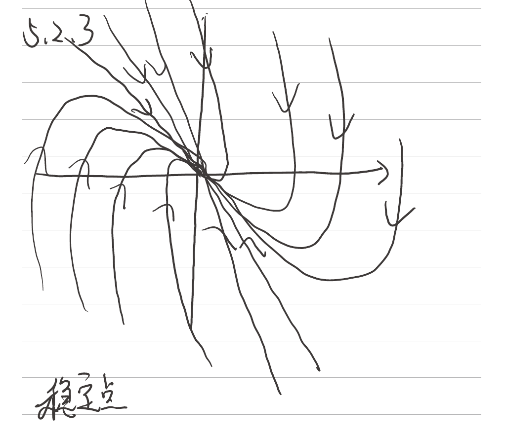
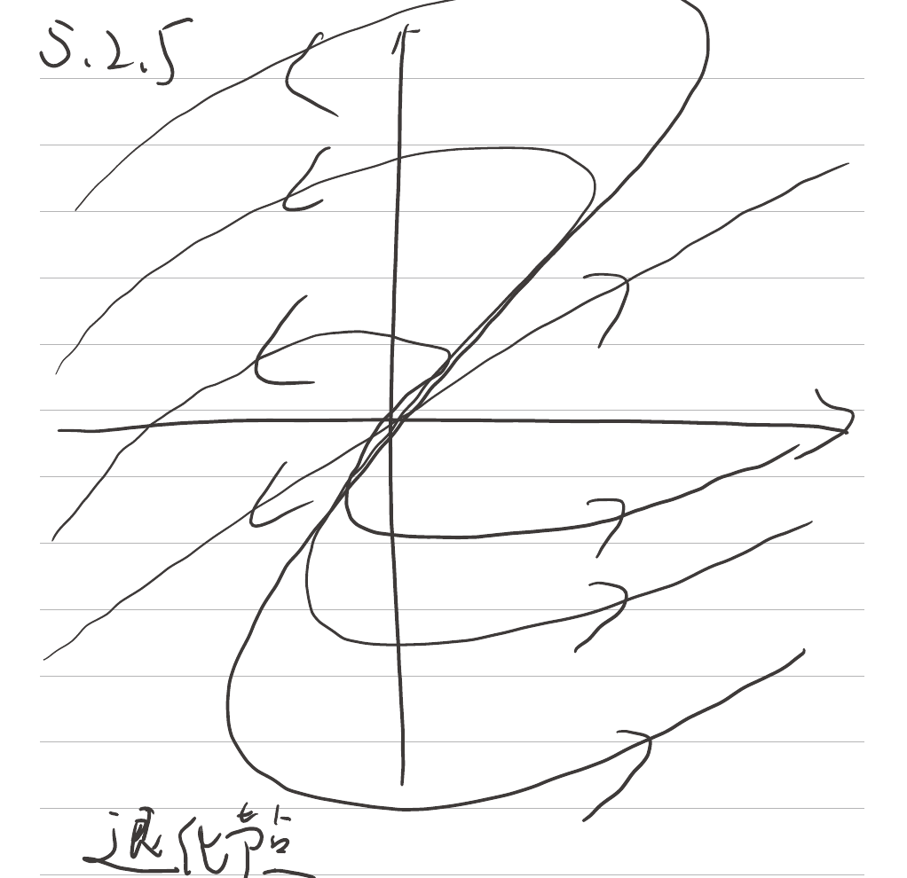
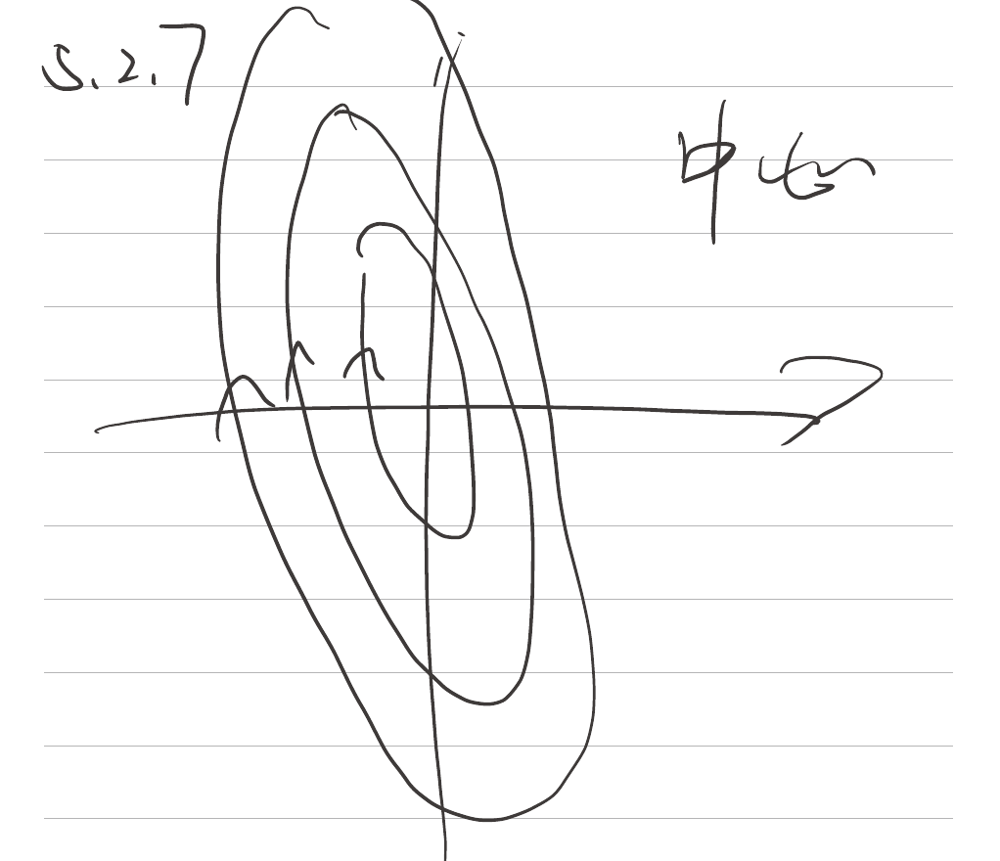
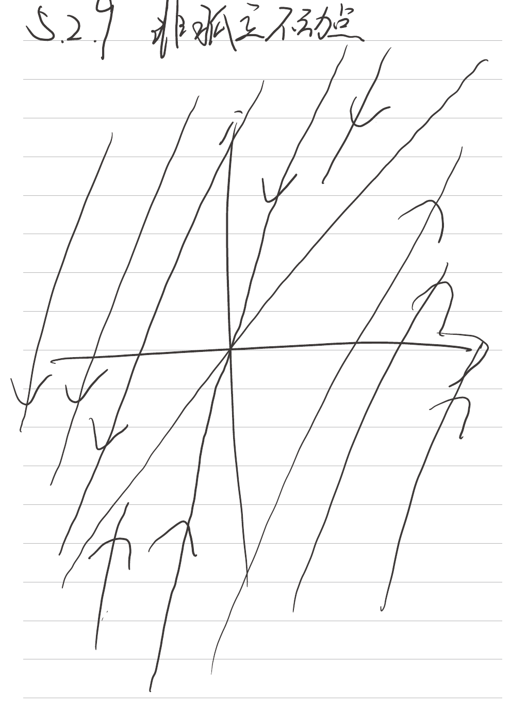

# 动力系统 第5章 线性系统 作业答案（2025秋）

## 5.1 定义与例子

### 题目

#### 5.1.2

考虑系统 $\dot{x} = ax$， $\dot{y} = -y$，式中 $a < -1$。证明当 $t \to \infty$ 时所有的轨迹会与 $y$-方向平行，当 $t \to -\infty$ 时会与 $x$-方向平行。（提示：考察斜率 $\mathrm{d}y/\mathrm{d}x = \dot{y}/\dot{x}$。）

#### 5.1.3

将下列方程写为矩阵形式： $\dot{x} = -y$， $\dot{y} = -x$。

#### 5.1.5

将下列方程写为矩阵形式： $\dot{x} = 0$， $\dot{y} = x + y$。

#### 5.1.10

（吸引与李雅普诺夫稳定）这是各种稳定性的正式定义。考虑系统 $\dot{x} = f(x)$ 的不动点 $x^{*}$。我们称 $x^{*}$ 是**吸引的**，若存在一个 $\delta > 0$，只要 $\|x(0) - x^{*}\| < \delta$ 使得 $\lim\limits_{t \to \infty} x(t) = x^{*}$。

相比而言，李雅普诺夫稳定性需要附近的轨迹始终都保持得很近。我们说 $x^{*}$ 是**李雅普诺夫稳定的**，若对每个 $\varepsilon > 0$，均存在 $\delta > 0$，使得只要 $\|x(0) - x^{*}\| < \delta$，那么对任意 $t \ge 0$ 均有 $\|x(t) - x^{*}\| < \varepsilon$。

最后， $x^{*}$ 是**渐近稳定的**，若它既是吸引的，又是李雅普诺夫稳定的。

对下面每个系统，判定原点是吸引的、李雅普诺夫稳定的、渐近稳定的还是以上都不是。

a) $\dot{x} = y$， $\dot{y} = -4x$

b) $\dot{x} = 2y$， $\dot{y} = x$

c) $\dot{x} = 0$， $\dot{y} = x$

d) $\dot{x} = 0$， $\dot{y} = -y$

e) $\dot{x} = -x$， $\dot{y} = -5y$

f) $\dot{x} = x$， $\dot{y} = y$

### 答案

#### 5.1.2

解得 $x(t) = x_{0}e^{at}$， $y(t) = y_{0}e^{-t}$。

$$\frac{\mathrm{d}y}{\mathrm{d}x} = \frac{\dot{y}}{\dot{x}} = \frac{-y}{ax} = \frac{-y_{0}e^{-t}}{a x_{0} e^{at}} = -\frac{y_{0}}{a x_{0}} e^{-(a+1)t}$$

$t \to +\infty$ 时， $\dfrac{\mathrm{d}y}{\mathrm{d}x} \to \pm\infty$，平行 $y$ 轴。

$t \to -\infty$ 时， $\dfrac{\mathrm{d}y}{\mathrm{d}x} \to 0$，平行 $x$ 轴。

#### 5.1.3

$$\dot{X} = \begin{pmatrix} 0 & -1 \\ -1 & 0 \end{pmatrix} X$$

#### 5.1.5

$$\dot{X} = \begin{pmatrix} 0 & 0 \\ 1 & 1 \end{pmatrix} X$$

#### 5.1.10

a) $\dot{x} = y$， $\dot{y} = -4x$：李雅普诺夫稳定。

b) $\dot{x} = 2y$， $\dot{y} = x$：都不是。

c) $\dot{x} = 0$， $\dot{y} = x$：都不是。

d) $\dot{x} = 0$， $\dot{y} = -y$：李雅普诺夫稳定。

e) $\dot{x} = -x$， $\dot{y} = -5y$：渐近稳定。

f) $\dot{x} = x$， $\dot{y} = y$：都不是。

## 5.2 线性系统的分类

### 题目

#### 5.2.1

考虑系统 $\dot{x} = 4x - y$， $\dot{y} = 2x + y$。

a) 将系统写为 $\dot{x} = Ax$ 的形式。证明特征多项式为 $\lambda^{2} - 5\lambda + 6$，并求 $A$ 的特征值与特征向量。

b) 求出系统的通解。

c) 对原点处不动点进行分类。

d) 求系统在初始条件 $(x_{0}, y_{0}) = (3, 4)$ 下的解。

#### 5.2.3

画出相图，并对下列系统的不动点进行分类。若特征值为实数，在图上标出来。

$$\dot{x} = y, \quad \dot{y} = -2x - 3y$$

#### 5.2.5

画出相图，并对下列系统的不动点进行分类。若特征值为实数，在图上标出来。

$$\dot{x} = 3x - 4y, \quad \dot{y} = x - y$$

#### 5.2.7

画出相图，并对下列系统的不动点进行分类。若特征值为实数，在图上标出来。

$$\dot{x} = 5x + 2y, \quad \dot{y} = -17x - 5y$$

#### 5.2.8

画出相图，并对下列系统的不动点进行分类。若特征值为实数，在图上标出来。

$$\dot{x} = -3x + 4y, \quad \dot{y} = -2x + 3y$$

#### 5.2.9

画出相图，并对下列系统的不动点进行分类。若特征值为实数，在图上标出来。

$$\dot{x} = 4x - 3y, \quad \dot{y} = 8x - 6y$$

#### 5.2.12

（LRC 电路）考虑电路方程 $L\ddot{I} + R\dot{I} + I/C = 0$，其中 $L > 0$， $C > 0$， $R \ge 0$。

a) 把方程重写为二阶线性系统。

b) 证明若 $R > 0$，原点渐近稳定，而若 $R = 0$，原点是中心稳定的。

c) 对原点处的不动点进行分类，依赖于 $R^{2}C - 4L$ 为正数、负数或者零，并画出三种情况下的相图。

### 答案

#### 5.2.1

a) $\lambda_{1} = 2$， $\lambda_{2} = 3$， $v_{1} = (1, 2)$， $v_{2} = (1, 1)$。

b) $x(t) = c_{1}\begin{pmatrix} 1 \\ 2 \end{pmatrix} e^{2t} + c_{2}\begin{pmatrix} 1 \\ 1 \end{pmatrix} e^{3t}$

c) 不稳定结点。

d) $\begin{pmatrix} x \\ y \end{pmatrix} = e^{2t}\begin{pmatrix} 1 \\ 2 \end{pmatrix} + e^{3t}\begin{pmatrix} 2 \\ 2 \end{pmatrix}$

#### 5.2.3

稳定结点。相图见下：

#### 5.2.5

不稳定退化结点。相图见下：

#### 5.2.7

中心。相图见下：

#### 5.2.8

#### 5.2.9

非孤立不动点。相图见下：

#### 5.2.12

a) 令 $x_{1} = I$， $x_{2} = \dot{I}$，则

$$\begin{pmatrix} \dot{x}_{1} \\ \dot{x}_{2} \end{pmatrix} = \begin{pmatrix} 0 & 1 \\ -\dfrac{1}{LC} & -\dfrac{R}{L} \end{pmatrix} \begin{pmatrix} x_{1} \\ x_{2} \end{pmatrix}$$

b) 特征方程 $\lambda^{2} + \dfrac{R}{L}\lambda + \dfrac{1}{LC} = 0$。

$R > 0$ 时两根实部均为 $-R/(2L) < 0$， $\therefore$ 渐近稳定。

$R = 0$ 时 $\lambda = \pm i\sqrt{\dfrac{1}{LC}}$， $\therefore$ 中心稳定。

c) 依 $R^{2}C - 4L$ 的符号分类：

- $R^{2}C - 4L > 0$：稳定结点
- $R^{2}C - 4L = 0$：退化结点
- $R^{2}C - 4L < 0$：稳定焦点（螺旋）

分别对应过阻尼、临界阻尼与欠阻尼。
