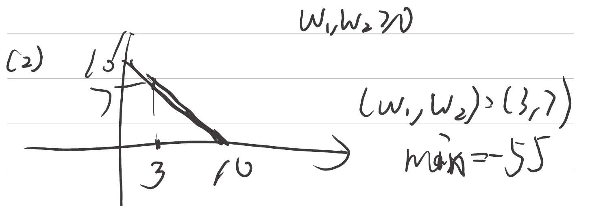
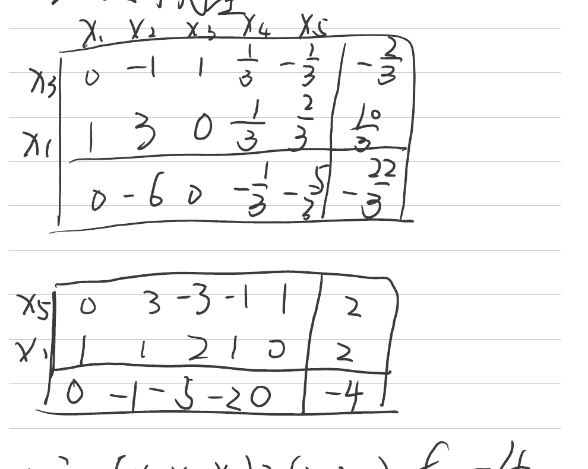
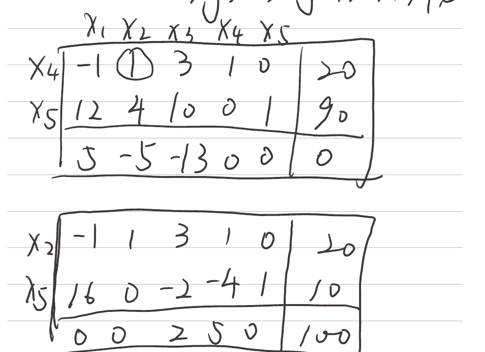
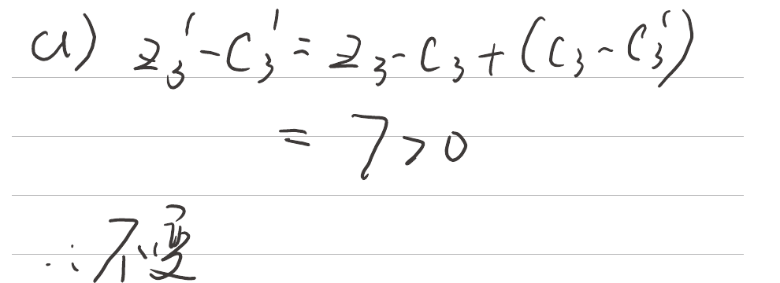
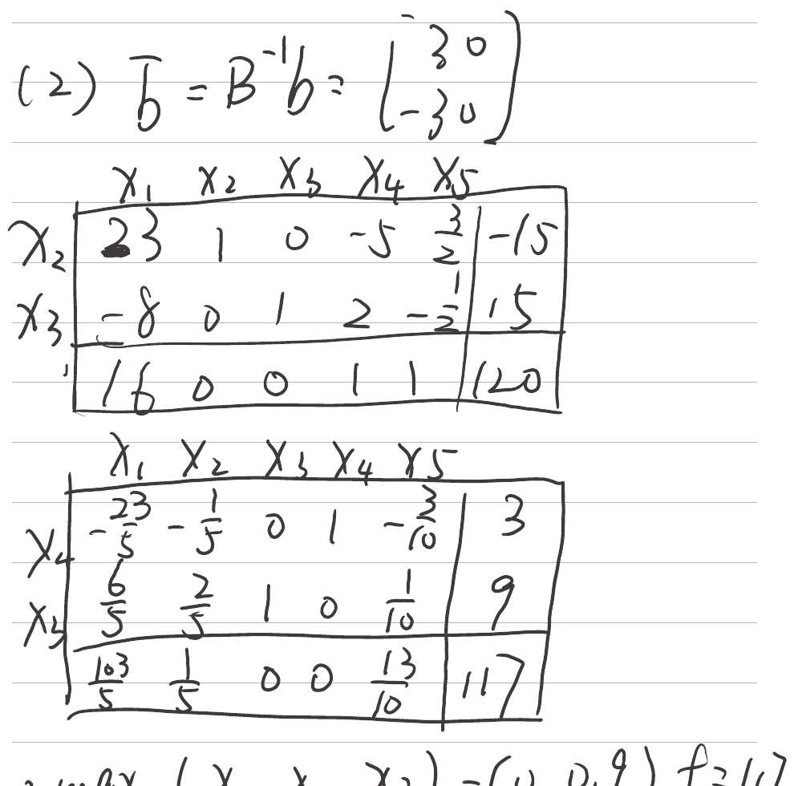
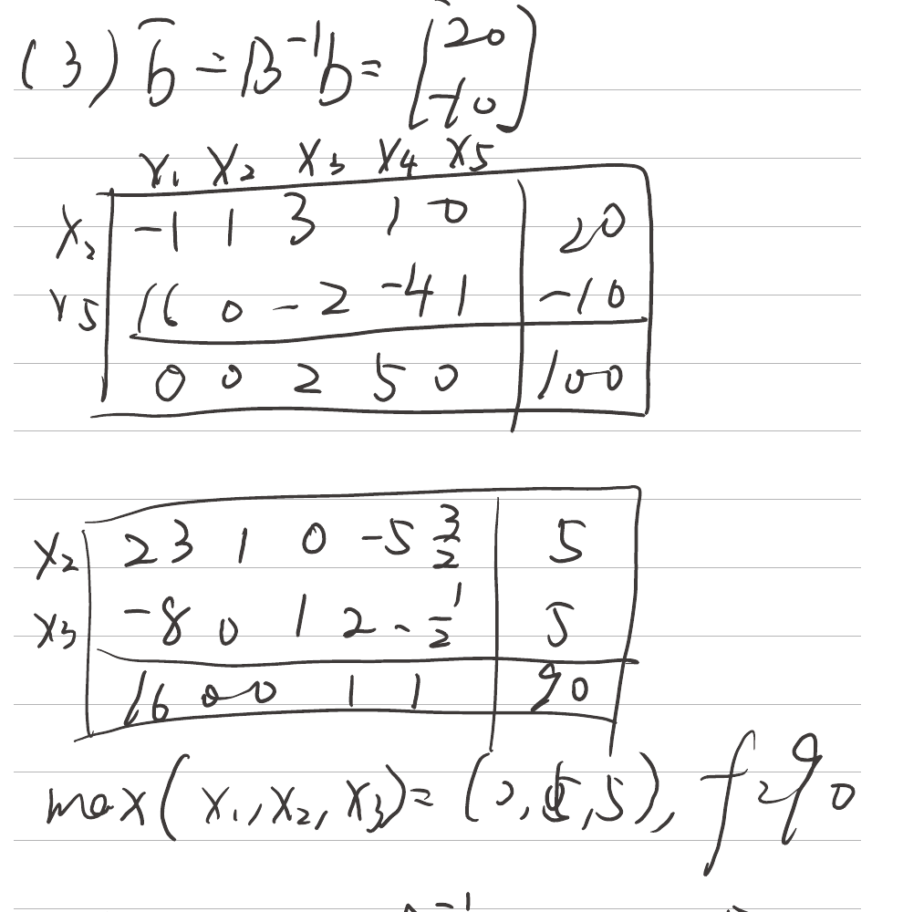
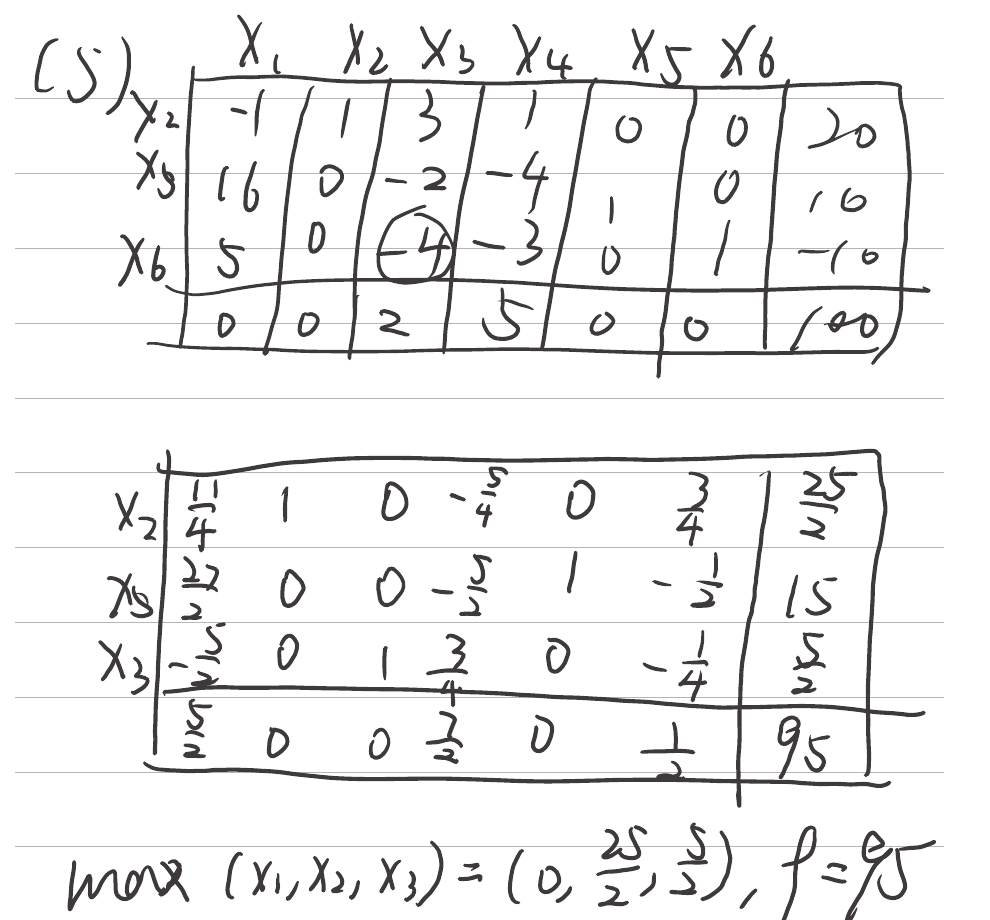
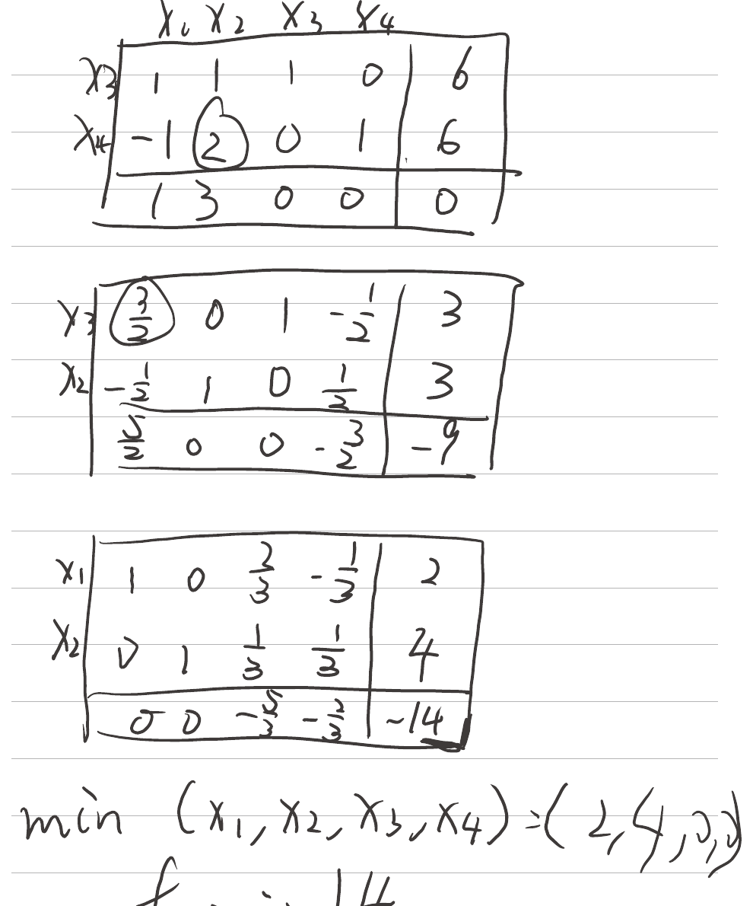
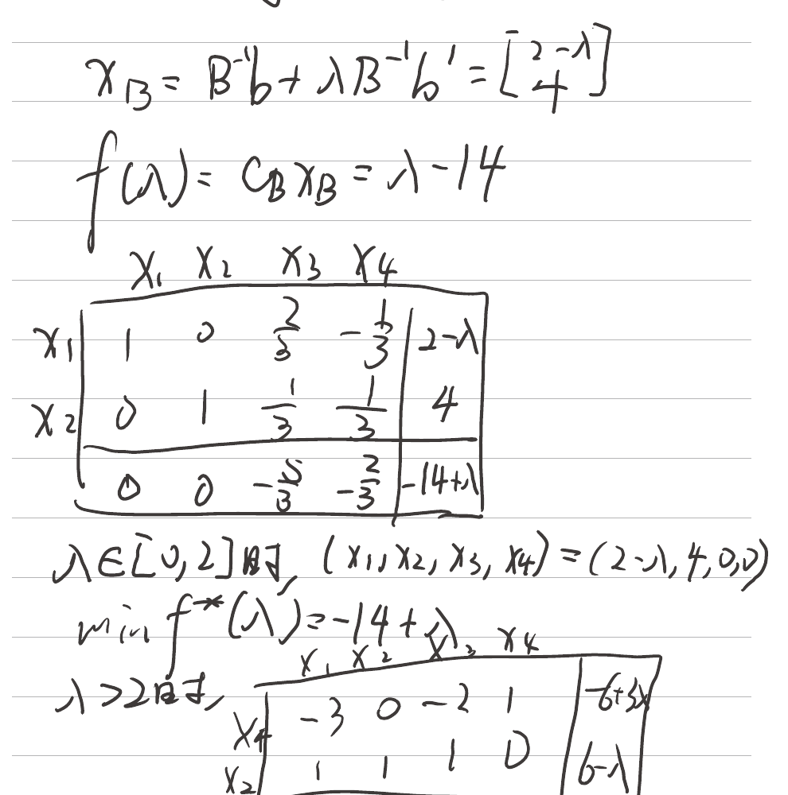

# 最优化方法 第 4 章「对偶原理及灵敏度分析」作业答案（2025 秋）

## 习题

### 题目

#### 1(1)

写出下列原问题的对偶问题：

$$\max\quad 4x_1-3x_2+5x_3$$

$$
\text{s.t.}\quad
\begin{cases}
3x_1+x_2+2x_3\le 15,\\
-x_1+2x_2-7x_3\ge 3,\\
x_1+x_3=1,\\
x_1,x_2,x_3\ge 0.
\end{cases}
$$

#### 1(2)

写出下列原问题的对偶问题：

$$\min\quad -4x_1-5x_2-7x_3+x_4$$

$$
\text{s.t.}\quad
\begin{cases}
x_1+x_2+2x_3-x_4\ge 1,\\
2x_1-6x_2+3x_3+x_4\le -3,\\
x_1+4x_2+3x_3+2x_4=-5,\\
x_1,x_2,x_4\ge 0.
\end{cases}
$$

#### 2

给定原问题

$$\min\quad 4x_1+3x_2+x_3$$

$$
\text{s.t.}\quad
\begin{cases}
x_1-x_2+x_3\ge 1,\\
x_1+2x_2-3x_3\ge 2,\\
x_1,x_2,x_3\ge 0.
\end{cases}
$$

已知对偶问题的最优解 $(w_1,w_2)=\left(\dfrac{5}{3},\dfrac{7}{3}\right)$，利用对偶性质求原问题的最优解。

#### 3(1)

给定下列线性规划问题

$$\max\quad 10x_1+7x_2+30x_3+2x_4$$

$$
\text{s.t.}\quad
\begin{cases}
x_1-6x_3+x_4\le -2,\\
x_1+x_2+5x_3-x_4\le -7,\\
x_2,x_3,x_4\le 0.
\end{cases}
$$

写出上述原问题的对偶问题。

#### 3(2)

用图解法求 3(1) 中对偶问题的最优解。

#### 3(3)

利用对偶问题的最优解及对偶性质求原问题的最优解和目标函数的最优值。

#### 4(1)

给定线性规划问题

$$\min\quad 5x_1+21x_3$$

$$
\text{s.t.}\quad
\begin{cases}
x_1-x_2+6x_3\ge b_1,\\
x_1+x_2+2x_3\ge 1,\\
x_1,x_2,x_3\ge 0,
\end{cases}
$$

其中 $b_1$ 是某一个正数，已知这个问题的一个最优解为 $(x_1,x_2,x_3)=\left(\dfrac{1}{2},0,\dfrac{1}{4}\right)$。

写出对偶问题。

#### 4(2)

求 4(1) 中对偶问题的最优解。

#### 9(1)

给定下列线性规划问题

$$\min\quad -2x_1-x_2+x_3$$

$$
\text{s.t.}\quad
\begin{cases}
x_1+x_2+2x_3\le 6,\\
x_1+4x_2-x_3\le 4,\\
x_1,x_2,x_3\ge 0.
\end{cases}
$$

它的最优单纯形表如下表：

$$
\begin{array}{c|ccccc|c}
 & x_1 & x_2 & x_3 & x_4 & x_5 & \\
\hline
x_3 & 0 & -1 & 1 & \frac{1}{3} & -\frac{1}{3} & \frac{2}{3}\\
x_1 & 1 & 3 & 0 & \frac{1}{3} & \frac{2}{3} & \frac{14}{3}\\
\hline
 & 0 & -6 & 0 & -\frac{1}{3} & -\frac{5}{3} & -\frac{26}{3}
\end{array}
$$

若右端向量 $b=\begin{bmatrix}6\\4\end{bmatrix}$ 改为 $b'=\begin{bmatrix}2\\4\end{bmatrix}$，原来的最优基是否还为最优基？利用原来的最优表求新问题的最优解。

#### 9(2)

若 9(1) 中目标函数的 $x_1$ 系数由 $c_1=-2$ 改为 $c_1'$，那么 $c_1'$ 在什么范围内时原来的最优解也是新问题的最优解？

#### 10

考虑下列线性规划问题

$$\max\quad -5x_1+5x_2+13x_3$$

$$
\text{s.t.}\quad
\begin{cases}
-x_1+x_2+3x_3\le 20,\\
12x_1+4x_2+10x_3\le 90,\\
x_1,x_2,x_3\ge 0.
\end{cases}
$$

先用单纯形方法求出上述问题的最优解。然后对原来问题分别进行下列改变，试用原来问题的最优表求新问题的最优解。

#### 10(1)

目标函数中 $x_3$ 的系数 $c_3$ 由 13 改变为 8。

#### 10(2)

$b_1$ 由 20 改变为 30。

#### 10(3)

$b_2$ 由 90 改变为 70。

#### 10(4)

$A$ 的列 $\begin{bmatrix}-1\\12\end{bmatrix}$ 改变为 $\begin{bmatrix}0\\5\end{bmatrix}$。

#### 10(5)

增加约束条件 $2x_1+3x_2+5x_3\le 50$。

#### 12(1)

考虑下列问题

$$\min\quad -x_1-3x_2$$

$$
\text{s.t.}\quad
\begin{cases}
x_1+x_2\le 6,\\
-x_1+2x_2\le 6,\\
x_1,x_2\ge 0.
\end{cases}
$$

用单纯形方法求出最优解。

#### 12(2)

将 12(1) 的约束右端 $b=\begin{bmatrix}6\\6\end{bmatrix}$ 改变为 $\begin{bmatrix}6\\6\end{bmatrix}+\lambda\begin{bmatrix}-1\\1\end{bmatrix}$， $\lambda\ge 0$，求含参数线性规划的最优解。

### 答案

#### 1(1)

$$\min\quad 15w_1+3w_2+w_3$$

$$
\text{s.t.}\quad
\begin{cases}
3w_1-w_2+2w_3\ge 4,\\
w_1+2w_2\ge -3,\\
2w_1-7w_2+w_3\ge 5,\\
w_1\ge 0,\quad w_2\le 0.
\end{cases}
$$

其中 $w_3$ 无符号限制（对应原问题的等式约束 $x_1+x_3=1$）。

#### 1(2)

$$\max\quad w_1-3w_2-5w_3$$

$$
\text{s.t.}\quad
\begin{cases}
w_1+2w_2+w_3\le -4,\\
w_1-6w_2+4w_3\le -5,\\
2w_1+3w_2+3w_3=-7,\\
-w_1+w_2+2w_3\le 1,\\
w_1\ge 0,\quad w_2\le 0.
\end{cases}
$$

其中 $w_3$ 无符号限制（对应原问题的等式约束 $x_1+4x_2+3x_3+2x_4=-5$）。

#### 2

对偶问题：

$$\max\quad w_1+2w_2$$

$$
\text{s.t.}\quad
\begin{cases}
w_1+w_2\le 4,\\
-w_1+2w_2\le 3,\\
w_1-3w_2\le 1,\\
w_1\ge 0,\quad w_2\ge 0.
\end{cases}
$$

原问题的最优解：

$$x_1=\frac{4}{3},\qquad x_2=\frac{1}{3},\qquad x_3=0.$$

#### 3(1)

$$\min\quad -2w_1-7w_2$$

$$
\text{s.t.}\quad
\begin{cases}
w_1+w_2\ge 10,\\
w_2\le 7,\\
-6w_1+5w_2\le 30,\\
w_1-w_2\le 2,\\
w_1\ge 0,\quad w_2\ge 0.
\end{cases}
$$

#### 3(2)

作直线 $w_1+w_2=10$，图中标出点 $(3,7)$。对偶问题的最优解为

$$(w_1,w_2)=(3,7),\qquad \min=-2\times 3-7\times 7=-55.$$

#### 3(3)

$$x_1=-2,\qquad x_2=-5,\qquad x_3=x_4=0,\qquad \max=-55.$$

#### 4(1)

$$\max\quad b_1w_1+w_2$$

$$
\text{s.t.}\quad
\begin{cases}
w_1+w_2\le 5,\\
-w_1+w_2\le 0,\\
6w_1+2w_2\le 21,\\
w_1\ge 0,\quad w_2\ge 0.
\end{cases}
$$

#### 4(2)

取等号的两条约束为

$$
\begin{cases}
w_1+w_2=5,\\
6w_1+2w_2=21,
\end{cases}
$$

解得

$$w_1=\frac{11}{4},\qquad w_2=\frac{9}{4},\qquad \max=\frac{31}{4}.$$

#### 9(1)

$$\bar b'=B^{-1}b'=\begin{bmatrix}-\dfrac{2}{3}\\[4pt]\dfrac{10}{3}\end{bmatrix},\qquad c_B\bar b'=-\frac{22}{3}.$$

由于 $\bar b'$ 的第一个分量 $-\frac{2}{3}<0$，原来的最优基不是可行基，因而不再是最优基。

新问题的最优解为

$$\min\ (x_1,x_2,x_3)=(2,0,0),\qquad f=-4.$$

#### 9(2)

$$
\begin{cases}
z_1'-c_1'=0,\\
z_2'-c_2'=-6+3(c_1'+2)\le 0,\\
z_3'-c_3'=0\le 0,\\
z_4'-c_4'=-\dfrac{1}{3}+\dfrac{1}{3}(c_1'+2)\le 0,\\
z_5'-c_5'=-\dfrac{5}{3}+\dfrac{2}{3}(c_1'+2)\le 0,
\end{cases}
$$

解得

$$c_1'\le -1.$$

#### 10

原问题的最优解为

$$\max\ (x_1,x_2,x_3)=(0,20,0),\qquad f_{\max}=100.$$

#### 10(1)

$$z_3'-c_3'=z_3-c_3+(c_3-c_3')=7>0,$$

故最优基不变。

#### 10(2)

$$\bar b=B^{-1}b=\begin{bmatrix}30\\-30\end{bmatrix}.$$

$$\max\ (x_1,x_2,x_3)=(0,0,9),\qquad f=117.$$

#### 10(3)

$$\bar b=B^{-1}b=\begin{bmatrix}20\\-70\end{bmatrix}.$$

$$\max\ (x_1,x_2,x_3)=(0,5,5),\qquad f=90.$$

#### 10(4)

$$z_1-c_1=c_BB^{-1}p_1-c_1=5>0,$$

故最优基不变。

#### 10(5)

$$\max\ (x_1,x_2,x_3)=\left(0,\frac{25}{2},\frac{5}{2}\right),\qquad f=95.$$

#### 12(1)

$$\min\ (x_1,x_2,x_3,x_4)=(2,4,0,0),\qquad f_{\min}=-14.$$

#### 12(2)

$$x_B=B^{-1}b+\lambda B^{-1}b'=\begin{bmatrix}2-\lambda\\4\end{bmatrix},\qquad f(\lambda)=c_Bx_B=\lambda-14.$$

- $\lambda\in[0,2]$ 时， $(x_1,x_2,x_3,x_4)=(2-\lambda,4,0,0)$， $\min f^*(\lambda)=-14+\lambda$；
- $\lambda\in[2,6]$ 时， $(x_1,x_2,x_3,x_4)=(0,6-\lambda,0,-6+3\lambda)$， $f^*(\lambda)=-18+3\lambda$；
- $\lambda>6$ 时，无可行解。
