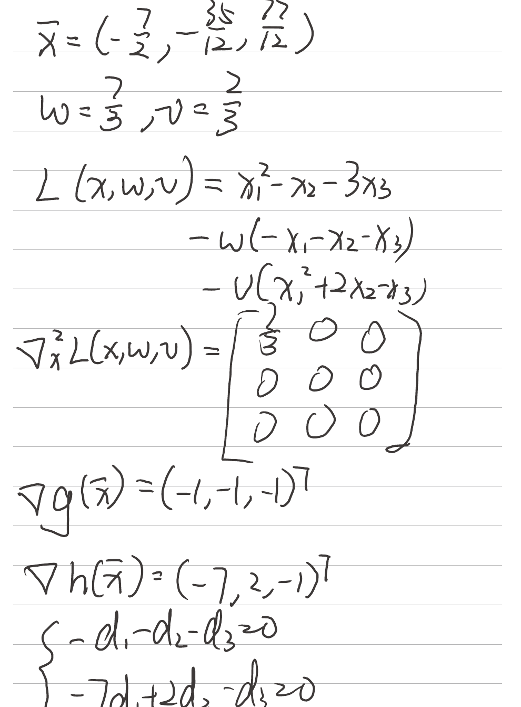
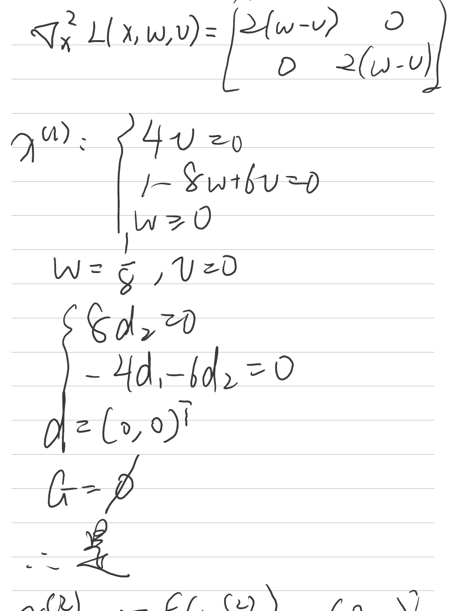
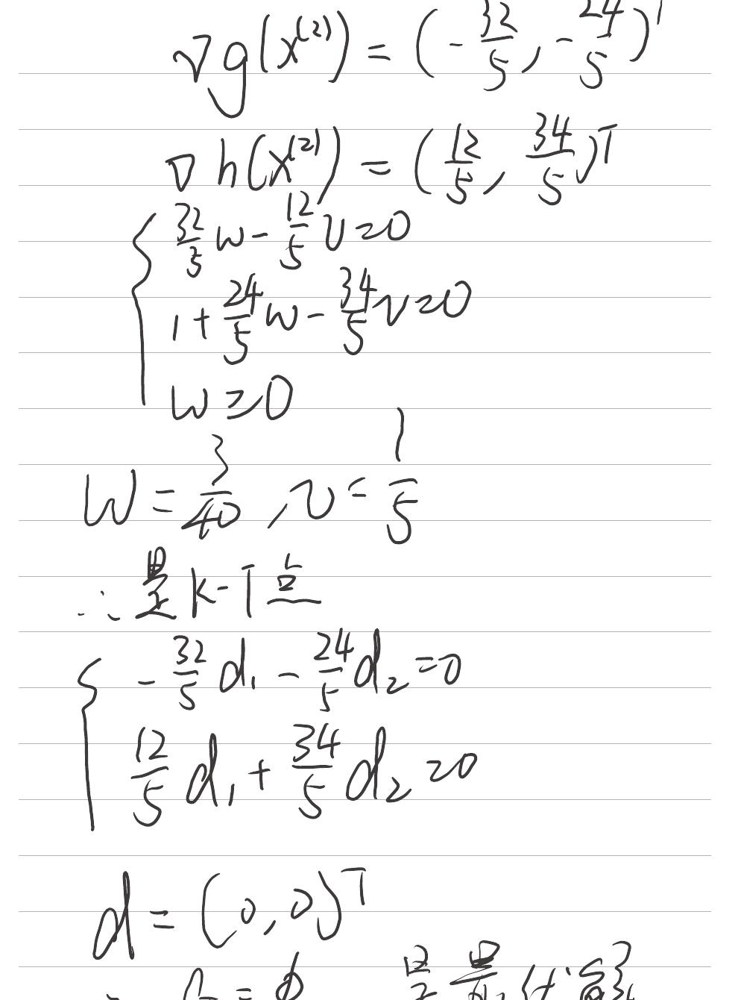
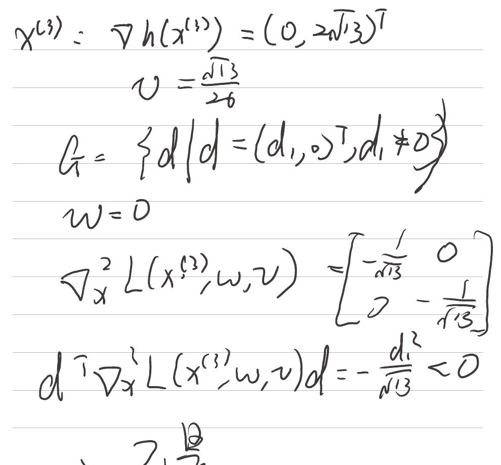
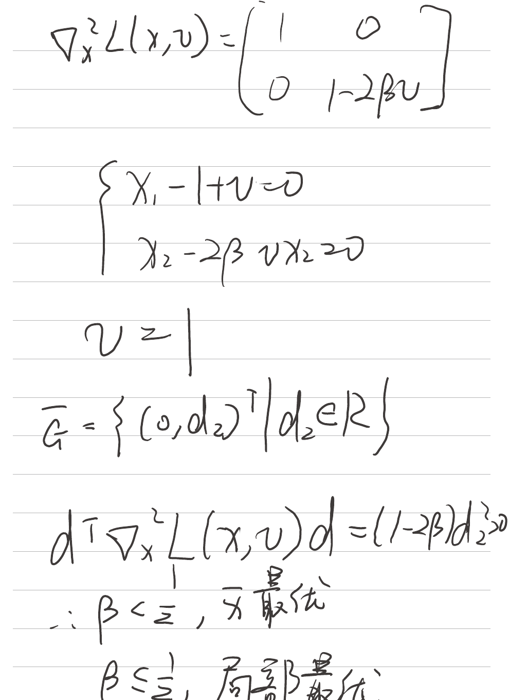

# 最优化方法 第 7 章「最优性条件」作业答案（2025 秋）

## 习题

### 题目

#### 2

考虑非线性规划问题

$$\min\quad (x_1-3)^2+(x_2-2)^2$$

$$
\text{s.t.}\quad
\begin{cases}
x_1^2+x_2^2\le 5,\\
x_1+2x_2=4,\\
x_1,x_2\ge 0.
\end{cases}
$$

检验 $\bar x=(2,1)^{\mathrm T}$ 是否为 K-T 点。

#### 4

给定非线性规划问题

$$\min\quad \left(x_1-\frac{9}{4}\right)^2+(x_2-2)^2$$

$$
\text{s.t.}\quad
\begin{cases}
-x_1^2+x_2\ge 0,\\
-x_1-x_2+6\ge 0,\\
x_1,x_2\ge 0.
\end{cases}
$$

判别下列各点是否为最优解：

$$
x^{(1)}=\begin{bmatrix}\frac{3}{2}\\[3pt]\frac{9}{4}\end{bmatrix},\qquad
x^{(2)}=\begin{bmatrix}\frac{9}{4}\\[3pt]2\end{bmatrix},\qquad
x^{(3)}=\begin{bmatrix}0\\2\end{bmatrix}.
$$

#### 5

用 K-T 条件求解下列问题

$$\min\quad x_1^2-x_2-3x_3$$

$$
\text{s.t.}\quad
\begin{cases}
-x_1-x_2-x_3\ge 0,\\
x_1^2+2x_2-x_3=0.
\end{cases}
$$

#### 8

考虑下列非线性规划问题

$$\min\quad x_2$$

$$
\text{s.t.}\quad
\begin{cases}
-x_1^2-(x_2-4)^2+16\ge 0,\\
(x_1-2)^2+(x_2-3)^2-13=0.
\end{cases}
$$

判别下列各点是否为局部最优解：

$$
x^{(1)}=\begin{bmatrix}0\\0\end{bmatrix},\qquad
x^{(2)}=\begin{bmatrix}\frac{16}{5}\\[3pt]\frac{32}{5}\end{bmatrix},\qquad
x^{(3)}=\begin{bmatrix}2\\3+\sqrt{13}\end{bmatrix}.
$$

#### 9

考虑下列非线性规划问题

$$\min\quad \frac{1}{2}\left[(x_1-1)^2+x_2^2\right]$$

$$\text{s.t.}\quad -x_1+\beta x_2^2=0.$$

讨论 $\beta$ 取何值时 $\bar x=(0,0)^{\mathrm T}$ 是局部最优解？

### 答案

#### 2

把第一个约束写成 $g(x)=-x_1^2-x_2^2+5\ge 0$，等式约束记 $h(x)=x_1+2x_2-4=0$。在 $\bar x=(2,1)^{\mathrm T}$ 处

$$
\nabla f(\bar x)=\begin{bmatrix}-2\\-2\end{bmatrix},\qquad
\nabla g(\bar x)=\begin{bmatrix}-4\\-2\end{bmatrix},\qquad
\nabla h(\bar x)=\begin{bmatrix}1\\2\end{bmatrix}.
$$

K-T 条件为

$$
\begin{bmatrix}-2\\-2\end{bmatrix}
-w\begin{bmatrix}-4\\-2\end{bmatrix}
-v\begin{bmatrix}1\\2\end{bmatrix}
=\begin{bmatrix}0\\0\end{bmatrix},
\qquad w\ge 0.
$$

解得

$$w=\frac{1}{3},\qquad v=-\frac{2}{3}.$$

由于 $w=\frac{1}{3}\ge 0$，故 $\bar x=(2,1)^{\mathrm T}$ 是 K-T 点。

#### 4

这是凸规划，因此只需检验各点是否为 K-T 点。

对 $x^{(1)}=\left(\frac{3}{2},\frac{9}{4}\right)$，起作用的约束只有 $-x_1^2+x_2=0$，K-T 条件为

$$
\begin{cases}
2\left(x_1-\dfrac{9}{4}\right)+2w_1x_1=0,\\[4pt]
2(x_2-2)-w_1=0,\\
w_1\ge 0.
\end{cases}
$$

解得 K-T 乘子 $w_1=\frac{1}{2}$。经检验， $x^{(1)}$ 是最优解。

对 $x^{(2)}=\left(\frac{9}{4},2\right)$：不是最优解。

对 $x^{(3)}=(0,2)$，起作用的约束是 $x_1\ge 0$，K-T 条件为

$$
\begin{cases}
2\left(x_1-\dfrac{9}{4}\right)-w_3=0,\\[4pt]
2(x_2-2)=0,\\
w_3\ge 0.
\end{cases}
$$

解得 $w_3=-\frac{9}{2}$，不满足 $w_3\ge 0$，故 $x^{(3)}$ 不是最优解。

#### 5

记

$$f(x)=x_1^2-x_2-3x_3,\qquad g(x)=-x_1-x_2-x_3,\qquad h(x)=x_1^2+2x_2-x_3,$$

则

$$
\nabla f(x)=(2x_1,-1,-3)^{\mathrm T},\qquad
\nabla g(x)=(-1,-1,-1)^{\mathrm T},\qquad
\nabla h(x)=(2x_1,2,-1)^{\mathrm T}.
$$

一阶必要条件为

$$
\begin{cases}
2x_1+w-2vx_1=0,\\
-1+w-2v=0,\\
-3+w+v=0,\\
w(-x_1-x_2-x_3)=0,\\
w\ge 0,\\
-x_1-x_2-x_3\ge 0,\\
x_1^2+2x_2-x_3=0.
\end{cases}
$$

解得

$$\bar x=\left(-\frac{7}{2},-\frac{35}{12},\frac{77}{12}\right),\qquad w=\frac{7}{3},\qquad v=\frac{2}{3}.$$

Lagrange 函数及其 Hesse 矩阵为

$$L(x,w,v)=x_1^2-x_2-3x_3-w(-x_1-x_2-x_3)-v(x_1^2+2x_2-x_3),$$

$$
\nabla_x^2L(x,w,v)=
\begin{bmatrix}
\frac{2}{3} & 0 & 0\\
0 & 0 & 0\\
0 & 0 & 0
\end{bmatrix}.
$$

在 $\bar x$ 处

$$\nabla g(\bar x)=(-1,-1,-1)^{\mathrm T},\qquad \nabla h(\bar x)=(-7,2,-1)^{\mathrm T},$$

可行方向 $d$ 满足

$$
\begin{cases}
-d_1-d_2-d_3\ge 0,\\
-7d_1+2d_2-d_3=0.
\end{cases}
$$

取 $d=(d_1,2d_1,-3d_1)^{\mathrm T}$，则

$$d^{\mathrm T}\nabla_x^2L(x,w,v)d=\frac{2}{3}d_1^2>0.$$

故

$$\bar x=\left(-\frac{7}{2},-\frac{35}{12},\frac{77}{12}\right),\qquad f(\bar x)=-\frac{49}{12}.$$

#### 8

记

$$f(x)=x_2,\qquad g(x)=-x_1^2-(x_2-4)^2+16,\qquad h(x)=(x_1-2)^2+(x_2-3)^2-13,$$

则

$$
\nabla f(x)=(0,1)^{\mathrm T},\qquad
\nabla g(x)=(-2x_1,-2x_2+8)^{\mathrm T},\qquad
\nabla h(x)=(2x_1-4,2x_2-6)^{\mathrm T},
$$

$$
\nabla_x^2L(x,w,v)=
\begin{bmatrix}
2(w-v) & 0\\
0 & 2(w-v)
\end{bmatrix}.
$$

**（1） $x^{(1)}=(0,0)$**

$$
\begin{cases}
4v=0,\\
1-8w+6v=0,\\
w\ge 0,
\end{cases}
\qquad\Longrightarrow\qquad w=\frac{1}{8},\quad v=0.
$$

临界方向满足

$$
\begin{cases}
8d_2=0,\\
-4d_1-6d_2=0,
\end{cases}
$$

只有 $d=(0,0)^{\mathrm T}$，即 $G=\varnothing$，故 $x^{(1)}$ 是局部最优解。

**（2） $x^{(2)}=\left(\frac{16}{5},\frac{32}{5}\right)$**

$$
\nabla f(x^{(2)})=(0,1)^{\mathrm T},\qquad
\nabla g(x^{(2)})=\left(-\frac{32}{5},-\frac{24}{5}\right)^{\mathrm T},\qquad
\nabla h(x^{(2)})=\left(\frac{12}{5},\frac{34}{5}\right)^{\mathrm T}.
$$

$$
\begin{cases}
\dfrac{32}{5}w-\dfrac{12}{5}v=0,\\[4pt]
1+\dfrac{24}{5}w-\dfrac{34}{5}v=0,\\[4pt]
w\ge 0,
\end{cases}
\qquad\Longrightarrow\qquad w=\frac{3}{40},\quad v=\frac{1}{5}.
$$

故 $x^{(2)}$ 是 K-T 点。临界方向满足

$$
\begin{cases}
-\dfrac{32}{5}d_1-\dfrac{24}{5}d_2=0,\\[4pt]
\dfrac{12}{5}d_1+\dfrac{34}{5}d_2=0,
\end{cases}
$$

只有 $d=(0,0)^{\mathrm T}$，即 $G=\varnothing$，故 $x^{(2)}$ 是局部最优解。

**（3） $x^{(3)}=(2,3+\sqrt{13})$**

$$\nabla h(x^{(3)})=(0,2\sqrt{13})^{\mathrm T},\qquad v=\frac{2\sqrt{13}}{26}.$$

此时 $g(x^{(3)})>0$，该约束不起作用， $w=0$，

$$G=\left\{d\ \middle|\ d=(d_1,0)^{\mathrm T},\ d_1\ne 0\right\},$$

$$
\nabla_x^2L(x^{(3)},w,v)=
\begin{bmatrix}
-\dfrac{1}{\sqrt{13}} & 0\\
0 & -\dfrac{1}{\sqrt{13}}
\end{bmatrix},
\qquad
d^{\mathrm T}\nabla_x^2L(x^{(3)},w,v)d=-\frac{d_1^2}{\sqrt{13}}<0,
$$

故 $x^{(3)}$ 不是局部最优解。

#### 9

记

$$f(x)=\frac{1}{2}\left[(x_1-1)^2+x_2^2\right],\qquad h(x)=-x_1+\beta x_2^2,$$

则

$$\nabla f(x)=(x_1-1,x_2)^{\mathrm T},\qquad \nabla h(x)=(-1,2\beta x_2)^{\mathrm T},$$

$$
\nabla_x^2L(x,v)=
\begin{bmatrix}
1 & 0\\
0 & 1-2\beta v
\end{bmatrix}.
$$

K-T 条件为

$$
\begin{cases}
x_1-1+v=0,\\
x_2-2\beta vx_2=0,
\end{cases}
\qquad\Longrightarrow\qquad v=1.
$$

临界锥为

$$\bar G=\left\{(0,d_2)^{\mathrm T}\ \middle|\ d_2\in\mathbb{R}\right\},$$

$$d^{\mathrm T}\nabla_x^2L(x,v)d=(1-2\beta)d_2^2\ge 0.$$

故

- $\beta<\dfrac{1}{2}$ 时， $\bar x$ 是（严格）最优解；
- $\beta\le\dfrac{1}{2}$ 时， $\bar x$ 是局部最优解。

