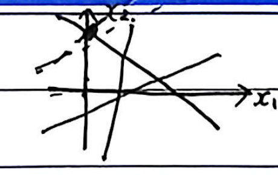
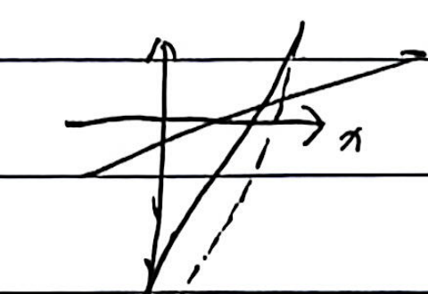
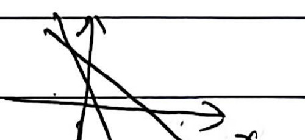
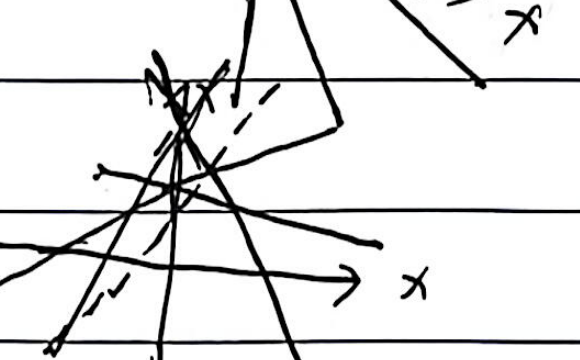
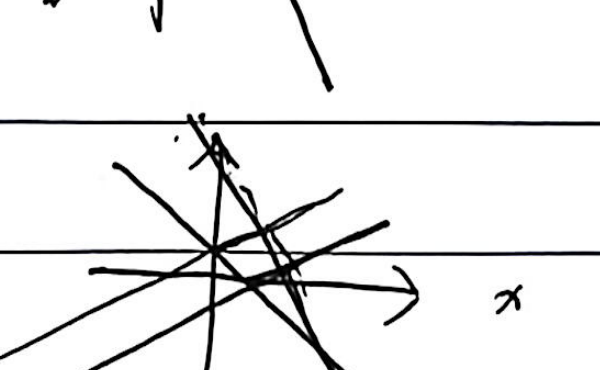
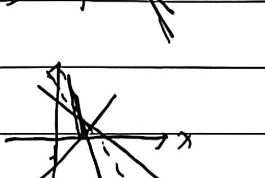
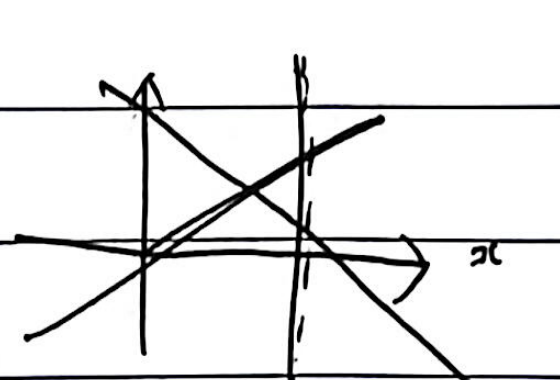

# 最优化方法 第 2、3 章作业答案（2025 秋，同学马集凡）

## 第 2 章 线性规划的基本性质

### 题目

#### 1(1)

用图解法解下列线性规划问题：

$$\min\quad 5x_1-6x_2$$

$$
\text{s.t.}\quad
\begin{cases}
x_1+2x_2\le 10,\\
2x_1-x_2\le 5,\\
x_1-4x_2\le 4,\\
x_1,x_2\ge 0.
\end{cases}
$$

#### 1(2)

$$\min\quad -x_1+x_2$$

$$
\text{s.t.}\quad
\begin{cases}
3x_1-7x_2\ge 8,\\
x_1-x_2\le 5,\\
x_1,x_2\ge 0.
\end{cases}
$$

#### 1(3)

$$\min\quad 13x_1+5x_2$$

$$
\text{s.t.}\quad
\begin{cases}
7x_1+3x_2\ge 19,\\
10x_1+2x_2\le 11,\\
x_1,x_2\ge 0.
\end{cases}
$$

#### 1(4)

$$\max\quad -20x_1+10x_2$$

$$
\text{s.t.}\quad
\begin{cases}
x_1+x_2\ge 10,\\
-10x_1+x_2\le 10,\\
-5x_1+5x_2\le 25,\\
x_1+4x_2\ge 20,\\
x_1,x_2\ge 0.
\end{cases}
$$

#### 1(5)

$$\min\quad -3x_1-2x_2$$

$$
\text{s.t.}\quad
\begin{cases}
3x_1+2x_2\le 6,\\
x_1-2x_2\le 1,\\
x_1+x_2\ge 1,\\
-x_1+2x_2\le 1,\\
x_1,x_2\ge 0.
\end{cases}
$$

#### 1(6)

$$\max\quad 5x_1+4x_2$$

$$
\text{s.t.}\quad
\begin{cases}
-2x_1+x_2\ge -4,\\
x_1+2x_2\le 6,\\
5x_1+3x_2\le 15,\\
x_1,x_2\ge 0.
\end{cases}
$$

#### 1(7)

$$\max\quad 3x_1+x_2$$

$$
\text{s.t.}\quad
\begin{cases}
x_1-x_2\ge 0,\\
x_1+x_2\le 5,\\
6x_1+2x_2\le 21,\\
x_1,x_2\ge 0.
\end{cases}
$$

#### 2(1)

下列问题都存在最优解，试通过求基本可行解来确定各问题的最优解。

$$\max\quad 2x_1+5x_2$$

$$
\text{s.t.}\quad
\begin{cases}
x_1+2x_2+x_3=16,\\
2x_1+x_2+x_4=12,\\
x_j\ge 0,\quad j=1,\cdots,4.
\end{cases}
$$

#### 2(3)

$$\min\quad x_1-x_2$$

$$
\text{s.t.}\quad
\begin{cases}
x_1+x_2+x_3\le 5,\\
-x_1+x_2+2x_3\le 6,\\
x_1,x_2,x_3\ge 0.
\end{cases}
$$

#### 3

设 $x^{(0)}=(x_1^{(0)},x_2^{(0)},\cdots,x_n^{(0)})^{\mathrm T}$ 是 $Ax=b$ 的一个解，其中 $A=(p_1,p_2,\cdots,p_n)$ 是 $m\times n$ 矩阵， $A$ 的秩为 $m$。证明 $x^{(0)}$ 是基本解的充要条件为 $x^{(0)}$ 的非零分量 $x_{i_1}^{(0)},x_{i_2}^{(0)},\cdots,x_{i_s}^{(0)}$ 对应的列 $p_{i_1},p_{i_2},\cdots,p_{i_s}$ 线性无关。

### 答案

#### 1(1)

最优解 $(x_1,x_2)=(0,5)$， $f_{\min}=-30$。

#### 1(2)

最优解 $(x_1,x_2)=(5,0)$， $f_{\min}=-5$。

#### 1(3)

可行域为空集，问题无解。

#### 1(4)

最优解 $(x_1,x_2)=\left(\dfrac{5}{2},\dfrac{15}{2}\right)$， $f_{\max}=25$。

#### 1(5)

最优解 $(x_1,x_2)=\left(\dfrac{7}{4},\dfrac{3}{8}\right)$， $f_{\min}=-6$。

#### 1(6)

最优解 $(x_1,x_2)=\left(\dfrac{12}{7},\dfrac{15}{7}\right)$， $f_{\max}=\dfrac{120}{7}$。

#### 1(7)

最优解 $(x_1,x_2)=\left(\dfrac{7}{2},0\right)$， $f_{\max}=\dfrac{21}{2}$。

#### 2(1)

$$A=\begin{bmatrix}1&2&1&0\\2&1&0&1\end{bmatrix},\quad b=\begin{bmatrix}16\\12\end{bmatrix},\quad c=(2,5,0,0).$$

取 $B=[p_1,p_2]=\begin{bmatrix}1&2\\2&1\end{bmatrix}$，则

$$B^{-1}=\begin{bmatrix}-\dfrac{1}{3}&\dfrac{2}{3}\\\dfrac{2}{3}&-\dfrac{1}{3}\end{bmatrix},\qquad c_B=(2,5),$$

$$Bx_B=b,\qquad x_B=\begin{bmatrix}\dfrac{8}{3}\\\dfrac{20}{3}\end{bmatrix},$$

$$x^{(1)}=\left(\dfrac{8}{3},\dfrac{20}{3},0,0\right)^{\mathrm T},\qquad f=c_Bx_B=\dfrac{116}{3}.$$

再取 $B=[p_1,p_3]$， $B^{-1}=\begin{bmatrix}0&1\\1&-2\end{bmatrix}$， $c_B=(2,0)$，得

$$x_B=\begin{bmatrix}6\\10\end{bmatrix},\qquad x^{(2)}=(6,0,10,0)^{\mathrm T},\qquad f=12.$$

继续考察其余的基：

$$
\begin{array}{c|c}
B & x_B^{\mathrm T} \\
\hline
[p_1,p_4] & (16,-20) \\
[p_2,p_3] & (12,-8) \\
[p_2,p_4] & (8,4) \\
[p_3,p_4] & (16,12) \\
\end{array}
$$

其中 $x_B$ 含负分量的不是基本可行解。

综上，最优解 $\bar x=(0,8,0,4)^{\mathrm T}$，最优值为 $f_{\max}=40$。

#### 2(3)

引入 $x_4,x_5\ge 0$，把约束化为等式：

$$\min\quad x_1-x_2$$

$$
\text{s.t.}\quad
\begin{cases}
x_1+x_2+x_3+x_4=5,\\
x_1+x_2+2x_3+x_5=6,\\
x_j\ge 0.
\end{cases}
$$

$$A=\begin{bmatrix}1&1&1&1&0\\1&1&2&0&1\end{bmatrix},\quad b=\begin{bmatrix}5\\6\end{bmatrix},\quad c=(1,-1,0,0,0).$$

逐一取 $A$ 的两个列组成基，求对应的基本解（ $A$ 有 5 列，共 $C_5^2=10$ 个组合）：

$$
\begin{array}{c|c|c|c}
B & x_B^{\mathrm T} & \text{基本可行解} & f \\
\hline
[p_1,p_2] & \text{—} & \text{不是基（}p_1=p_2\text{）} & \text{—} \\
[p_1,p_3] & (4,1) & \text{是} & 4 \\
[p_1,p_4] & (6,-1) & \text{否} & \text{—} \\
[p_1,p_5] & (5,1) & \text{是} & 5 \\
[p_2,p_3] & (4,1) & \text{是} & -4 \\
[p_2,p_4] & (6,-1) & \text{否} & \text{—} \\
[p_2,p_5] & (5,1) & \text{是} & -5 \\
[p_3,p_4] & (3,2) & \text{是} & 0 \\
[p_3,p_5] & (5,-4) & \text{否} & \text{—} \\
[p_4,p_5] & (5,6) & \text{是} & 0 \\
\end{array}
$$

最优解 $\bar x=(0,5,0,0,1)^{\mathrm T}$， $f_{\min}=-5$。

#### 3

必要性：设 $x^{(0)}$ 是基本解，对应的基为 $B=[p_{\beta_1},p_{\beta_2},\cdots,p_{\beta_m}]$。则 $x^{(0)}$ 的非零分量对应的列

$$\{p_{i_1},p_{i_2},\cdots,p_{i_s}\}\subset\{p_{\beta_1},p_{\beta_2},\cdots,p_{\beta_m}\}.$$

由于基 $B$ 的列向量组线性无关，其任意子集也线性无关，故 $p_{i_1},p_{i_2},\cdots,p_{i_s}$ 线性无关。

充分性：设 $x^{(0)}$ 的非零分量对应的列 $p_{i_1},\cdots,p_{i_s}$ 线性无关。由 $r(A)=m$ 知 $s\le m$，故可把 $p_{i_1},\cdots,p_{i_s}$ 扩充为 $A$ 的一组基

$$B=(p_{i_1},\cdots,p_{i_s},p_{i_{s+1}},\cdots,p_{i_m}).$$

记 $x^{(0)}=\begin{bmatrix}x_B^{(0)}\\x_N^{(0)}\end{bmatrix}=\begin{bmatrix}B^{-1}b\\0\end{bmatrix}$，即 $x^{(0)}$ 是对应于基 $B$ 的基本解。

## 第 3 章 单纯形方法

### 题目

#### 1(1)

用单纯形方法解下列线性规划问题：

$$\min\quad -9x_1-16x_2$$

$$
\text{s.t.}\quad
\begin{cases}
x_1+4x_2+x_3=80,\\
2x_1+3x_2+x_4=90,\\
x_j\ge 0,\quad j=1,\cdots,4.
\end{cases}
$$

#### 1(2)

$$\max\quad x_1+3x_2$$

$$
\text{s.t.}\quad
\begin{cases}
2x_1+3x_2+x_3=6,\\
-x_1+x_2+x_4=1,\\
x_j\ge 0,\quad j=1,\cdots,4.
\end{cases}
$$

#### 1(3)

$$\max\quad -x_1+3x_2+x_3$$

$$
\text{s.t.}\quad
\begin{cases}
3x_1-x_2+2x_3\le 7,\\
-2x_1+4x_2\le 12,\\
-4x_1+3x_2+8x_3\le 10,\\
x_1,x_2,x_3\ge 0.
\end{cases}
$$

#### 1(4)

$$\min\quad 3x_1-5x_2-2x_3-x_4$$

$$
\text{s.t.}\quad
\begin{cases}
x_1+x_2+x_3\le 4,\\
4x_1-x_2+x_3+2x_4\le 6,\\
-x_1+x_2+2x_3+3x_4\le 12,\\
x_j\ge 0,\quad j=1,\cdots,4.
\end{cases}
$$

#### 1(5)

$$\min\quad -3x_1-x_2$$

$$
\text{s.t.}\quad
\begin{cases}
3x_1+3x_2+x_3=30,\\
4x_1-4x_2+x_4=16,\\
2x_1-x_2\le 12,\\
x_j\ge 0,\quad j=1,\cdots,4.
\end{cases}
$$

#### 3

证明用单纯形方法求解线性规划问题时，在主元消去前后对应同一变量的判别数有下列关系：

$$(z_j-c_j)"=(z_j-c_j)-\frac{y_{rj}}{y_{rk}}(z_k-c_k),$$

其中 $(z_j-c_j)"$ 是主元消去后的判别数，其余是主元消去前的数据， $y_{rk}$ 为主元。

### 答案

#### 1(1)

取初始基 $B=[p_3,p_4]$，单纯形表如下（判别数用 $z_j-c_j$， $\min$ 问题全部 $\le 0$ 时最优）。

$$
\begin{array}{c|cccc|c}
 & x_1 & x_2 & x_3 & x_4 & \\
\hline
x_3 & 1 & 4 & 1 & 0 & 80\\
x_4 & 2 & 3 & 0 & 1 & 90\\
\hline
 & 9 & 16 & 0 & 0 & 0
\end{array}
$$

主元取 $x_2$ 列的 $4$（ $\min\{80/4,90/3\}=20$），换基后：

$$
\begin{array}{c|cccc|c}
 & x_1 & x_2 & x_3 & x_4 & \\
\hline
x_2 & \dfrac{1}{4} & 1 & \dfrac{1}{4} & 0 & 20\\
x_4 & \dfrac{5}{4} & 0 & -\dfrac{3}{4} & 1 & 30\\
\hline
 & 5 & 0 & -4 & 0 & -320
\end{array}
$$

主元取 $x_1$ 列的 $5/4$（ $\min\{20/(1/4),30/(5/4)\}=24$），换基后：

$$
\begin{array}{c|cccc|c}
 & x_1 & x_2 & x_3 & x_4 & \\
\hline
x_2 & 0 & 1 & \dfrac{2}{5} & -\dfrac{1}{5} & 14\\
x_1 & 1 & 0 & -\dfrac{3}{5} & \dfrac{4}{5} & 24\\
\hline
 & 0 & 0 & -1 & -4 & -440
\end{array}
$$

最优解 $\bar x=(24,14,0,0)^{\mathrm T}$， $f_{\min}=-440$。

#### 1(2)

取初始基 $B=[p_3,p_4]$。原稿按 $\min$ 形式（目标函数取 $-x_1-3x_2$）列表，判别数用 $z_j-c_j$。

$$
\begin{array}{c|cccc|c}
 & x_1 & x_2 & x_3 & x_4 & \\
\hline
x_3 & 2 & 3 & 1 & 0 & 6\\
x_4 & -1 & 1 & 0 & 1 & 1\\
\hline
 & -1 & -3 & 0 & 0 & 0
\end{array}
$$

$$
\begin{array}{c|cccc|c}
 & x_1 & x_2 & x_3 & x_4 & \\
\hline
x_3 & 5 & 0 & 1 & -3 & 3\\
x_2 & -1 & 1 & 0 & 1 & 1\\
\hline
 & -4 & 0 & 0 & 3 & 3
\end{array}
$$

$$
\begin{array}{c|cccc|c}
 & x_1 & x_2 & x_3 & x_4 & \\
\hline
x_1 & 1 & 0 & \dfrac{1}{5} & -\dfrac{3}{5} & \dfrac{3}{5}\\
x_2 & 0 & 1 & \dfrac{1}{5} & \dfrac{2}{5} & \dfrac{8}{5}\\
\hline
 & 0 & 0 & \dfrac{4}{5} & \dfrac{3}{5} & \dfrac{27}{5}
\end{array}
$$

最优解 $\bar x=\left(\dfrac{3}{5},\dfrac{8}{5},0,0\right)^{\mathrm T}$。原稿写 $f_{\max}<8$。

#### 1(3)

引入松弛变量 $x_4,x_5,x_6$，取初始基 $B=[p_4,p_5,p_6]$。原稿按 $\min$ 形式列表。

$$
\begin{array}{c|cccccc|c}
 & x_1 & x_2 & x_3 & x_4 & x_5 & x_6 & \\
\hline
x_4 & 3 & -1 & 2 & 1 & 0 & 0 & 7\\
x_5 & -2 & 4 & 0 & 0 & 1 & 0 & 12\\
x_6 & -4 & 3 & 8 & 0 & 0 & 1 & 10\\
\hline
 & 1 & -3 & -1 & 0 & 0 & 0 & 0
\end{array}
$$

$$
\begin{array}{c|cccccc|c}
 & x_1 & x_2 & x_3 & x_4 & x_5 & x_6 & \\
\hline
x_4 & \dfrac{5}{2} & 0 & 2 & 1 & \dfrac{1}{4} & 0 & 10\\
x_2 & -\dfrac{1}{2} & 1 & 0 & 0 & \dfrac{1}{4} & 0 & 3\\
x_6 & -\dfrac{5}{2} & 0 & 8 & 0 & -\dfrac{3}{4} & 1 & 1\\
\hline
 & -\dfrac{1}{2} & 0 & -1 & 0 & \dfrac{3}{4} & 0 & 9
\end{array}
$$

$$
\begin{array}{c|cccccc|c}
 & x_1 & x_2 & x_3 & x_4 & x_5 & x_6 & \\
\hline
x_4 & \dfrac{25}{8} & 0 & 0 & 1 & \dfrac{7}{16} & -\dfrac{1}{4} & \dfrac{39}{4}\\
x_2 & -\dfrac{1}{2} & 1 & 0 & 0 & \dfrac{1}{4} & 0 & 3\\
x_3 & -\dfrac{5}{16} & 0 & 1 & 0 & -\dfrac{3}{32} & \dfrac{1}{8} & \dfrac{1}{8}\\
\hline
 & -\dfrac{22}{3} & 0 & 0 & 0 & \dfrac{21}{32} & \dfrac{1}{8} & \dfrac{73}{8}
\end{array}
$$

$$
\begin{array}{c|cccccc|c}
 & x_1 & x_2 & x_3 & x_4 & x_5 & x_6 & \\
\hline
x_1 & 1 & 0 & 0 & \dfrac{8}{25} & \dfrac{7}{50} & -\dfrac{2}{25} & \dfrac{78}{25}\\
x_2 & 0 & 1 & 0 & \dfrac{4}{25} & \dfrac{8}{25} & -\dfrac{1}{25} & \dfrac{114}{25}\\
x_3 & 0 & 0 & 1 & \dfrac{1}{10} & -\dfrac{1}{20} & \dfrac{1}{10} & \dfrac{11}{10}\\
\hline
 & 0 & 0 & 0 & \dfrac{13}{50} & \dfrac{29}{100} & \dfrac{3}{50} & \dfrac{583}{50}
\end{array}
$$

最优解 $\bar x=\left(\dfrac{78}{25},\dfrac{114}{25},\dfrac{11}{10},0,0,0\right)^{\mathrm T}$， $f_{\max}=\dfrac{583}{50}$。

#### 1(4)

引入松弛变量 $x_5,x_6,x_7$，取初始基 $B=[p_5,p_6,p_7]$。

$$
\begin{array}{c|ccccccc|c}
 & x_1 & x_2 & x_3 & x_4 & x_5 & x_6 & x_7 & \\
\hline
x_5 & 1 & 1 & 1 & 0 & 1 & 0 & 0 & 4\\
x_6 & 4 & -1 & 1 & 2 & 0 & 1 & 0 & 6\\
x_7 & -1 & 1 & 2 & 3 & 0 & 0 & 1 & 12\\
\hline
 & -3 & 5 & 2 & 1 & 0 & 0 & 0 & 0
\end{array}
$$

$$
\begin{array}{c|ccccccc|c}
 & x_1 & x_2 & x_3 & x_4 & x_5 & x_6 & x_7 & \\
\hline
x_2 & 1 & 1 & 1 & 0 & 1 & 0 & 0 & 4\\
x_6 & 5 & 0 & 2 & 2 & 1 & 1 & 0 & 10\\
x_7 & -2 & 0 & 1 & 3 & -1 & 0 & 1 & 8\\
\hline
 & -8 & 0 & -3 & 1 & -5 & 0 & 0 & -20
\end{array}
$$

$$
\begin{array}{c|ccccccc|c}
 & x_1 & x_2 & x_3 & x_4 & x_5 & x_6 & x_7 & \\
\hline
x_2 & 1 & 1 & 1 & 0 & 1 & 0 & 0 & 4\\
x_6 & \dfrac{19}{3} & 0 & \dfrac{4}{3} & 0 & \dfrac{5}{3} & 1 & -\dfrac{2}{3} & \dfrac{14}{3}\\
x_4 & -\dfrac{2}{3} & 0 & \dfrac{1}{3} & 1 & -\dfrac{1}{3} & 0 & \dfrac{1}{3} & \dfrac{8}{3}\\
\hline
 & -\dfrac{22}{3} & 0 & -\dfrac{10}{3} & 0 & -\dfrac{14}{3} & 0 & -\dfrac{1}{3} & -\dfrac{68}{3}
\end{array}
$$

最优解 $\bar x=\left(0,4,0,\dfrac{8}{3},0,\dfrac{14}{3},0\right)^{\mathrm T}$， $f_{\min}=-\dfrac{68}{3}$。

#### 1(5)

引入松弛变量 $x_5$，取初始基 $B=[p_3,p_4,p_5]$。

$$
\begin{array}{c|ccccc|c}
 & x_1 & x_2 & x_3 & x_4 & x_5 & \\
\hline
x_3 & 3 & 3 & 1 & 0 & 0 & 30\\
x_4 & 4 & -4 & 0 & 1 & 0 & 16\\
x_5 & 2 & -1 & 0 & 0 & 1 & 12\\
\hline
 & 3 & 1 & 0 & 0 & 0 & 0
\end{array}
$$

$$
\begin{array}{c|ccccc|c}
 & x_1 & x_2 & x_3 & x_4 & x_5 & \\
\hline
x_3 & 0 & 6 & 1 & -\dfrac{3}{4} & 0 & 18\\
x_1 & 1 & -1 & 0 & \dfrac{1}{4} & 0 & 4\\
x_5 & 0 & 1 & 0 & -\dfrac{1}{2} & 1 & 4\\
\hline
 & 0 & 4 & 0 & -\dfrac{3}{4} & 0 & -12
\end{array}
$$

$$
\begin{array}{c|ccccc|c}
 & x_1 & x_2 & x_3 & x_4 & x_5 & \\
\hline
x_2 & 0 & 1 & \dfrac{1}{6} & -\dfrac{1}{8} & 0 & 3\\
x_1 & 1 & 0 & \dfrac{1}{6} & \dfrac{1}{8} & 0 & 7\\
x_5 & 0 & 0 & -\dfrac{1}{6} & -\dfrac{3}{8} & 1 & 1\\
\hline
 & 0 & 0 & -\dfrac{2}{3} & -\dfrac{1}{4} & 0 & -24
\end{array}
$$

最优解 $\bar x=(7,3,0,0,1)^{\mathrm T}$， $f_{\min}=-24$。

#### 3

设 $A=[p_1,\cdots,p_n]$，主元消去后的矩阵记作 $B$，并记 $b"=x_B$， $c_B"$。主元消去前后有

$$Bp_j=y_j,\qquad B"p_j=y_j".$$

主元消去时第 $r$ 行为主元行，第 $k$ 列为进基列，故

$$
\begin{cases}
y_{ij}"=y_{ij}-\dfrac{y_{ik}}{y_{rk}}y_{rj},\quad i\ne r,\\
y_{rj}"=\dfrac{y_{rj}}{y_{rk}}.
\end{cases}
$$

于是主元消去后的判别数为

$$
\begin{aligned}
(z_j-c_j)"&=c_B"B^{-1}p_j-c_j=c_B"y_j"-c_j\\
&=\sum_{i\ne r}c_{B_i}\left(y_{ij}-\frac{y_{ik}}{y_{rk}}y_{rj}\right)+c_k\frac{y_{rj}}{y_{rk}}-c_j\\
&=(z_j-c_j)-c_{B_r}y_{rj}-\sum_{i\ne r}c_{B_i}\frac{y_{ik}}{y_{rk}}y_{rj}+c_k\frac{y_{rj}}{y_{rk}}\\
&=(z_j-c_j)-\frac{y_{rj}}{y_{rk}}\left(\sum_{i=1}^{m}c_{B_i}y_{ik}-c_k\right)\\
&=(z_j-c_j)-\frac{y_{rj}}{y_{rk}}(z_k-c_k).
\end{aligned}
$$
