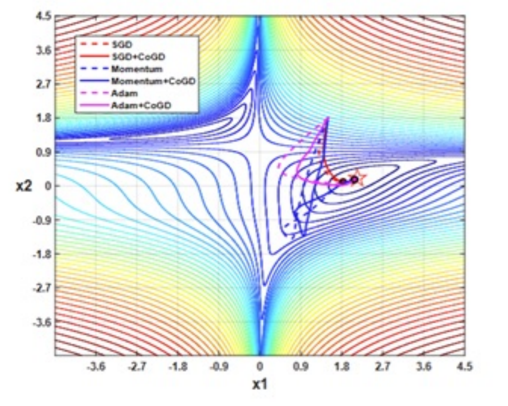

# 机器学习 梯度下降作业1题目（2025秋）

## 作业 1：协同梯度下降

截止日期：第 9 周截至。

### 题目（原文）

A baseline problem is first used as an example to illustrate the superiority of our algorithm. The problem is the optimization of Beale function under constraint of $F(x_1, x_2) = beale(x_1, x_2) + \lVert x_1 \rVert + x_2^2$. The Beale function has the same form as Eq. 1 and can be regraded as a bilinear optimization problem with respect to variables $x_1 x_2$. During optimization, the learning rate $\eta_2$ is set as 0.001, 0.005, 0.1 for ‘SGD’, ‘Momentum’ and ‘Adam’ respectively. The thresholds $\alpha_{x_1}$ and $\alpha_{x_2}$ for CoGD are set to 1 and 0.5. $\beta = 0.001\eta_2 c^t$ with

$$\frac{\partial x_2}{\partial x_1} \approx \frac{\Delta x_2}{\Delta x_1}$$

where $\Delta$ denotes the difference of variable over the epoch. $\frac{\Delta x_2}{\Delta x_1} = 1$, when $\Delta x_2$ or $x_2$ approaches zero. The total number of iterations is 200.

Beale 函数定义：

$$Beale(x_1, x_2) = (1.5 - x_1 + x_1 x_2)^2 + (2.25 - x_1 + x_1 x_2^2)^2 + (2.625 - x_1 + x_1 x_2^3)^2$$

### 要求

- 梯度下降法完成 Beale 函数优化，截止日期第 9 周末。
- 不做要求内容：自学完成协同梯度下降法（CoGradient Descent）。

### 原图

Fig. 4: Comparison of classical gradient algorithm with CoGD. The background is the contour map of Beale functions. The algorithms with CoGD have short optimization paths compared with their counterparts, which shows that CoGD facilitates efficient and sufficient training. 图中对比曲线包括 SGD、SGD+CoGD、Momentum、Momentum+CoGD、Adam、Adam+CoGD。
