# 深度学习大作业实验报告

## Task 1

### 一、实验基本设置

1. 模型采用自行实现的线性层 **MyLinear** 与 **ReLU** 非线性激活函数构建 6 层全连接神经网络。损失函数采用交叉熵损失，优化器为 **Adam** 。

2. 本实验在 **MNIST** 上进行，训练轮数统一设置为 **20 epochs**，测试集用于评估模型的泛化性能。

3. 实验主要考察以下两类超参数：

   - **学习率（lr）**：0.001 与 0.005

   - **批大小（bs）**：64 与 128

### 二、训练日志

```log
2025-12-29 18:36:03,808 | ============================================================
2025-12-29 18:36:03,809 | Experiment Started
2025-12-29 18:36:03,809 | Time: 2025-12-29 18:36:03.809404
2025-12-29 18:36:03,810 | Hyperparameters:
2025-12-29 18:36:03,810 |   batch_size: 64
2025-12-29 18:36:03,811 |   learning_rate: 0.001
2025-12-29 18:36:03,812 |   epochs: 20
2025-12-29 18:36:03,813 | ============================================================
2025-12-29 18:36:18,614 | Train Epoch 1: Loss=0.2931, Accuracy=90.90%
2025-12-29 18:36:20,024 | Test Epoch 1: Loss=0.1682, Accuracy=95.00%
2025-12-29 18:36:36,505 | Train Epoch 2: Loss=0.1069, Accuracy=96.85%
2025-12-29 18:36:37,895 | Test Epoch 2: Loss=0.0976, Accuracy=96.87%
2025-12-29 18:36:55,231 | Train Epoch 3: Loss=0.0781, Accuracy=97.65%
2025-12-29 18:36:56,705 | Test Epoch 3: Loss=0.0834, Accuracy=97.58%
2025-12-29 18:37:12,836 | Train Epoch 4: Loss=0.0608, Accuracy=98.17%
2025-12-29 18:37:14,248 | Test Epoch 4: Loss=0.0859, Accuracy=97.65%
2025-12-29 18:37:31,201 | Train Epoch 5: Loss=0.0493, Accuracy=98.50%
2025-12-29 18:37:32,871 | Test Epoch 5: Loss=0.0974, Accuracy=97.50%
2025-12-29 18:37:49,240 | Train Epoch 6: Loss=0.0420, Accuracy=98.78%
2025-12-29 18:37:50,686 | Test Epoch 6: Loss=0.0849, Accuracy=97.87%
2025-12-29 18:38:12,687 | Train Epoch 7: Loss=0.0365, Accuracy=98.91%
2025-12-29 18:38:15,127 | Test Epoch 7: Loss=0.0905, Accuracy=97.78%
2025-12-29 18:38:43,605 | Train Epoch 8: Loss=0.0332, Accuracy=99.00%
2025-12-29 18:38:46,126 | Test Epoch 8: Loss=0.0824, Accuracy=97.89%
2025-12-29 18:39:14,018 | Train Epoch 9: Loss=0.0261, Accuracy=99.19%
2025-12-29 18:39:15,969 | Test Epoch 9: Loss=0.0954, Accuracy=97.97%
2025-12-29 18:39:37,761 | Train Epoch 10: Loss=0.0259, Accuracy=99.23%
2025-12-29 18:39:40,769 | Test Epoch 10: Loss=0.0845, Accuracy=97.99%
2025-12-29 18:40:00,835 | Train Epoch 11: Loss=0.0247, Accuracy=99.28%
2025-12-29 18:40:02,251 | Test Epoch 11: Loss=0.0695, Accuracy=98.34%
2025-12-29 18:40:23,015 | Train Epoch 12: Loss=0.0207, Accuracy=99.39%
2025-12-29 18:40:24,383 | Test Epoch 12: Loss=0.0873, Accuracy=98.01%
2025-12-29 18:40:41,441 | Train Epoch 13: Loss=0.0202, Accuracy=99.42%
2025-12-29 18:40:42,815 | Test Epoch 13: Loss=0.0744, Accuracy=98.21%
2025-12-29 18:40:59,803 | Train Epoch 14: Loss=0.0158, Accuracy=99.53%
2025-12-29 18:41:01,176 | Test Epoch 14: Loss=0.0804, Accuracy=98.21%
2025-12-29 18:41:18,203 | Train Epoch 15: Loss=0.0188, Accuracy=99.46%
2025-12-29 18:41:19,694 | Test Epoch 15: Loss=0.0863, Accuracy=98.25%
2025-12-29 18:41:37,203 | Train Epoch 16: Loss=0.0166, Accuracy=99.49%
2025-12-29 18:41:38,576 | Test Epoch 16: Loss=0.0984, Accuracy=98.35%
2025-12-29 18:41:56,428 | Train Epoch 17: Loss=0.0136, Accuracy=99.63%
2025-12-29 18:41:57,803 | Test Epoch 17: Loss=0.0955, Accuracy=98.03%
2025-12-29 18:42:16,548 | Train Epoch 18: Loss=0.0148, Accuracy=99.60%
2025-12-29 18:42:18,492 | Test Epoch 18: Loss=0.0972, Accuracy=98.10%
2025-12-29 18:42:46,016 | Train Epoch 19: Loss=0.0137, Accuracy=99.63%
2025-12-29 18:42:51,377 | Test Epoch 19: Loss=0.0953, Accuracy=97.80%
2025-12-29 18:43:45,348 | Train Epoch 20: Loss=0.0129, Accuracy=99.61%
2025-12-29 18:43:50,717 | Test Epoch 20: Loss=0.0916, Accuracy=98.14%
2025-12-29 18:43:51,974 | ============================================================
2025-12-29 18:43:51,979 | Experiment Started
2025-12-29 18:43:51,980 | Time: 2025-12-29 18:43:51.980609
2025-12-29 18:43:51,981 | Hyperparameters:
2025-12-29 18:43:51,981 |   batch_size: 64
2025-12-29 18:43:51,983 |   learning_rate: 0.005
2025-12-29 18:43:51,987 |   epochs: 20
2025-12-29 18:43:51,988 | ============================================================
2025-12-29 18:44:43,122 | Train Epoch 1: Loss=0.3153, Accuracy=90.71%
2025-12-29 18:44:48,471 | Test Epoch 1: Loss=0.2149, Accuracy=94.11%
2025-12-29 18:45:49,698 | Train Epoch 2: Loss=0.1601, Accuracy=95.94%
2025-12-29 18:45:54,948 | Test Epoch 2: Loss=0.1581, Accuracy=95.98%
2025-12-29 18:46:56,684 | Train Epoch 3: Loss=0.1259, Accuracy=96.74%
2025-12-29 18:47:01,920 | Test Epoch 3: Loss=0.1212, Accuracy=97.01%
2025-12-29 18:48:03,720 | Train Epoch 4: Loss=0.1167, Accuracy=97.10%
2025-12-29 18:48:09,251 | Test Epoch 4: Loss=0.1509, Accuracy=96.69%
2025-12-29 18:49:12,645 | Train Epoch 5: Loss=0.1082, Accuracy=97.42%
2025-12-29 18:49:18,164 | Test Epoch 5: Loss=0.1494, Accuracy=96.59%
2025-12-29 18:50:22,145 | Train Epoch 6: Loss=0.0940, Accuracy=97.63%
2025-12-29 18:50:27,700 | Test Epoch 6: Loss=0.1275, Accuracy=97.14%
2025-12-29 18:51:31,283 | Train Epoch 7: Loss=0.1013, Accuracy=97.58%
2025-12-29 18:51:33,467 | Test Epoch 7: Loss=0.1224, Accuracy=97.50%
2025-12-29 18:51:58,029 | Train Epoch 8: Loss=0.0795, Accuracy=98.11%
2025-12-29 18:51:59,461 | Test Epoch 8: Loss=0.1358, Accuracy=97.13%
2025-12-29 18:52:30,380 | Train Epoch 9: Loss=0.0795, Accuracy=98.07%
2025-12-29 18:52:32,462 | Test Epoch 9: Loss=0.1376, Accuracy=97.44%
2025-12-29 18:53:06,753 | Train Epoch 10: Loss=0.0818, Accuracy=98.03%
2025-12-29 18:53:09,183 | Test Epoch 10: Loss=0.1276, Accuracy=97.60%
2025-12-29 18:53:43,552 | Train Epoch 11: Loss=0.0930, Accuracy=97.81%
2025-12-29 18:53:44,954 | Test Epoch 11: Loss=0.1239, Accuracy=97.56%
2025-12-29 18:54:13,729 | Train Epoch 12: Loss=0.0707, Accuracy=98.31%
2025-12-29 18:54:16,011 | Test Epoch 12: Loss=0.1377, Accuracy=97.57%
2025-12-29 18:54:51,436 | Train Epoch 13: Loss=0.0860, Accuracy=98.14%
2025-12-29 18:54:54,035 | Test Epoch 13: Loss=0.1320, Accuracy=97.44%
2025-12-29 18:55:28,461 | Train Epoch 14: Loss=0.0639, Accuracy=98.54%
2025-12-29 18:55:31,339 | Test Epoch 14: Loss=0.1155, Accuracy=97.82%
2025-12-29 18:56:05,282 | Train Epoch 15: Loss=0.0605, Accuracy=98.57%
2025-12-29 18:56:07,330 | Test Epoch 15: Loss=0.1326, Accuracy=97.50%
2025-12-29 18:56:41,168 | Train Epoch 16: Loss=0.0625, Accuracy=98.54%
2025-12-29 18:56:43,641 | Test Epoch 16: Loss=0.1075, Accuracy=97.58%
2025-12-29 18:57:17,192 | Train Epoch 17: Loss=0.0617, Accuracy=98.58%
2025-12-29 18:57:19,187 | Test Epoch 17: Loss=0.1308, Accuracy=97.47%
2025-12-29 18:57:55,726 | Train Epoch 18: Loss=0.0695, Accuracy=98.39%
2025-12-29 18:57:58,229 | Test Epoch 18: Loss=0.1560, Accuracy=97.34%
2025-12-29 18:58:32,558 | Train Epoch 19: Loss=0.0595, Accuracy=98.67%
2025-12-29 18:58:33,977 | Test Epoch 19: Loss=0.1667, Accuracy=96.78%
2025-12-29 18:59:03,409 | Train Epoch 20: Loss=0.0619, Accuracy=98.64%
2025-12-29 18:59:05,818 | Test Epoch 20: Loss=0.1392, Accuracy=97.61%
2025-12-29 18:59:06,410 | ============================================================
2025-12-29 18:59:06,411 | Experiment Started
2025-12-29 18:59:06,411 | Time: 2025-12-29 18:59:06.411052
2025-12-29 18:59:06,411 | Hyperparameters:
2025-12-29 18:59:06,411 |   batch_size: 64
2025-12-29 18:59:06,411 |   learning_rate: 0.001
2025-12-29 18:59:06,411 |   epochs: 20
2025-12-29 18:59:06,412 | ============================================================
2025-12-29 18:59:30,754 | Train Epoch 1: Loss=0.3011, Accuracy=90.56%
2025-12-29 18:59:32,290 | Test Epoch 1: Loss=0.1624, Accuracy=95.16%
2025-12-29 18:59:58,578 | Train Epoch 2: Loss=0.1099, Accuracy=96.67%
2025-12-29 19:00:00,784 | Test Epoch 2: Loss=0.1122, Accuracy=96.63%
2025-12-29 19:00:29,088 | Train Epoch 3: Loss=0.0770, Accuracy=97.72%
2025-12-29 19:00:30,843 | Test Epoch 3: Loss=0.1014, Accuracy=96.97%
2025-12-29 19:00:58,490 | Train Epoch 4: Loss=0.0621, Accuracy=98.13%
2025-12-29 19:01:00,772 | Test Epoch 4: Loss=0.0825, Accuracy=97.67%
2025-12-29 19:01:28,573 | Train Epoch 5: Loss=0.0487, Accuracy=98.50%
2025-12-29 19:01:30,874 | Test Epoch 5: Loss=0.0821, Accuracy=97.68%
2025-12-29 19:01:58,774 | Train Epoch 6: Loss=0.0424, Accuracy=98.68%
2025-12-29 19:02:00,961 | Test Epoch 6: Loss=0.0766, Accuracy=97.90%
2025-12-29 19:02:27,827 | Train Epoch 7: Loss=0.0363, Accuracy=98.93%
2025-12-29 19:02:29,660 | Test Epoch 7: Loss=0.0741, Accuracy=97.91%
2025-12-29 19:02:56,345 | Train Epoch 8: Loss=0.0318, Accuracy=99.09%
2025-12-29 19:02:58,521 | Test Epoch 8: Loss=0.0881, Accuracy=97.67%
2025-12-29 19:03:34,305 | Train Epoch 9: Loss=0.0285, Accuracy=99.13%
2025-12-29 19:03:39,307 | Test Epoch 9: Loss=0.0768, Accuracy=98.19%
2025-12-29 19:04:32,229 | Train Epoch 10: Loss=0.0271, Accuracy=99.19%
2025-12-29 19:04:36,996 | Test Epoch 10: Loss=0.0765, Accuracy=98.12%
2025-12-29 19:05:30,142 | Train Epoch 11: Loss=0.0229, Accuracy=99.36%
2025-12-29 19:05:34,789 | Test Epoch 11: Loss=0.0793, Accuracy=98.16%
2025-12-29 19:06:28,236 | Train Epoch 12: Loss=0.0211, Accuracy=99.35%
2025-12-29 19:06:33,110 | Test Epoch 12: Loss=0.1026, Accuracy=97.97%
2025-12-29 19:07:26,100 | Train Epoch 13: Loss=0.0230, Accuracy=99.31%
2025-12-29 19:07:31,029 | Test Epoch 13: Loss=0.0925, Accuracy=98.04%
2025-12-29 19:08:25,356 | Train Epoch 14: Loss=0.0179, Accuracy=99.50%
2025-12-29 19:08:31,392 | Test Epoch 14: Loss=0.0782, Accuracy=98.30%
2025-12-29 19:09:24,962 | Train Epoch 15: Loss=0.0163, Accuracy=99.51%
2025-12-29 19:09:30,227 | Test Epoch 15: Loss=0.0956, Accuracy=98.16%
2025-12-29 19:10:23,458 | Train Epoch 16: Loss=0.0155, Accuracy=99.51%
2025-12-29 19:10:28,314 | Test Epoch 16: Loss=0.0985, Accuracy=98.13%
2025-12-29 19:11:20,102 | Train Epoch 17: Loss=0.0175, Accuracy=99.50%
2025-12-29 19:11:21,502 | Test Epoch 17: Loss=0.0923, Accuracy=97.98%
2025-12-29 19:11:39,238 | Train Epoch 18: Loss=0.0136, Accuracy=99.63%
2025-12-29 19:11:40,614 | Test Epoch 18: Loss=0.0894, Accuracy=98.22%
2025-12-29 19:11:57,792 | Train Epoch 19: Loss=0.0153, Accuracy=99.57%
2025-12-29 19:11:59,186 | Test Epoch 19: Loss=0.0833, Accuracy=98.22%
2025-12-29 19:12:16,423 | Train Epoch 20: Loss=0.0110, Accuracy=99.67%
2025-12-29 19:12:17,775 | Test Epoch 20: Loss=0.0934, Accuracy=98.21%
2025-12-29 19:12:18,102 | ============================================================
2025-12-29 19:12:18,102 | Experiment Started
2025-12-29 19:12:18,102 | Time: 2025-12-29 19:12:18.102919
2025-12-29 19:12:18,103 | Hyperparameters:
2025-12-29 19:12:18,104 |   batch_size: 128
2025-12-29 19:12:18,104 |   learning_rate: 0.001
2025-12-29 19:12:18,104 |   epochs: 20
2025-12-29 19:12:18,104 | ============================================================
2025-12-29 19:12:29,007 | Train Epoch 1: Loss=0.3413, Accuracy=89.40%
2025-12-29 19:12:30,386 | Test Epoch 1: Loss=0.1421, Accuracy=95.47%
2025-12-29 19:12:41,744 | Train Epoch 2: Loss=0.1096, Accuracy=96.63%
2025-12-29 19:12:43,179 | Test Epoch 2: Loss=0.1010, Accuracy=97.01%
2025-12-29 19:12:54,800 | Train Epoch 3: Loss=0.0778, Accuracy=97.58%
2025-12-29 19:12:56,139 | Test Epoch 3: Loss=0.0882, Accuracy=97.40%
2025-12-29 19:13:07,629 | Train Epoch 4: Loss=0.0582, Accuracy=98.19%
2025-12-29 19:13:08,981 | Test Epoch 4: Loss=0.0802, Accuracy=97.75%
2025-12-29 19:13:20,521 | Train Epoch 5: Loss=0.0453, Accuracy=98.56%
2025-12-29 19:13:21,869 | Test Epoch 5: Loss=0.0730, Accuracy=97.67%
2025-12-29 19:13:33,672 | Train Epoch 6: Loss=0.0383, Accuracy=98.80%
2025-12-29 19:13:35,027 | Test Epoch 6: Loss=0.0663, Accuracy=98.24%
2025-12-29 19:13:46,753 | Train Epoch 7: Loss=0.0328, Accuracy=98.97%
2025-12-29 19:13:48,106 | Test Epoch 7: Loss=0.0866, Accuracy=97.52%
2025-12-29 19:13:59,838 | Train Epoch 8: Loss=0.0326, Accuracy=98.97%
2025-12-29 19:14:01,268 | Test Epoch 8: Loss=0.0789, Accuracy=97.68%
2025-12-29 19:14:13,066 | Train Epoch 9: Loss=0.0263, Accuracy=99.17%
2025-12-29 19:14:14,429 | Test Epoch 9: Loss=0.0778, Accuracy=98.09%
2025-12-29 19:14:26,067 | Train Epoch 10: Loss=0.0240, Accuracy=99.26%
2025-12-29 19:14:27,479 | Test Epoch 10: Loss=0.0851, Accuracy=97.63%
2025-12-29 19:14:39,161 | Train Epoch 11: Loss=0.0191, Accuracy=99.41%
2025-12-29 19:14:40,560 | Test Epoch 11: Loss=0.0911, Accuracy=98.02%
2025-12-29 19:14:52,296 | Train Epoch 12: Loss=0.0178, Accuracy=99.43%
2025-12-29 19:14:53,715 | Test Epoch 12: Loss=0.0818, Accuracy=98.04%
2025-12-29 19:15:05,345 | Train Epoch 13: Loss=0.0209, Accuracy=99.37%
2025-12-29 19:15:06,740 | Test Epoch 13: Loss=0.0843, Accuracy=97.99%
2025-12-29 19:15:18,446 | Train Epoch 14: Loss=0.0167, Accuracy=99.45%
2025-12-29 19:15:19,869 | Test Epoch 14: Loss=0.0879, Accuracy=98.03%
2025-12-29 19:15:31,927 | Train Epoch 15: Loss=0.0160, Accuracy=99.50%
2025-12-29 19:15:34,266 | Test Epoch 15: Loss=0.0853, Accuracy=97.89%
2025-12-29 19:15:56,912 | Train Epoch 16: Loss=0.0134, Accuracy=99.59%
2025-12-29 19:15:59,161 | Test Epoch 16: Loss=0.0889, Accuracy=98.08%
2025-12-29 19:16:21,923 | Train Epoch 17: Loss=0.0131, Accuracy=99.60%
2025-12-29 19:16:23,936 | Test Epoch 17: Loss=0.0976, Accuracy=97.95%
2025-12-29 19:16:38,323 | Train Epoch 18: Loss=0.0141, Accuracy=99.59%
2025-12-29 19:16:39,728 | Test Epoch 18: Loss=0.0840, Accuracy=98.25%
2025-12-29 19:17:02,501 | Train Epoch 19: Loss=0.0142, Accuracy=99.58%
2025-12-29 19:17:04,901 | Test Epoch 19: Loss=0.0796, Accuracy=98.12%
2025-12-29 19:17:27,561 | Train Epoch 20: Loss=0.0099, Accuracy=99.71%
2025-12-29 19:17:29,940 | Test Epoch 20: Loss=0.0890, Accuracy=98.23%
```

### 三、不同 lr 对模型性能的影响（固定 bs = 64）

1. 训练与测试过程分析

    当固定 bs 为 64 时，分别使用学习率 lr = 0.001 与 lr = 0.005 进行训练。

   - **lr = 0.001**：

     - 训练 loss 随 epoch 稳定下降，从约 0.29 降至 0.01 左右；

     - 训练准确率在第 2-3 个 epoch 即超过 96%，最终达到约 99.6%；

     - 测试准确率稳定在 98% 左右，波动较小，表现出良好的泛化能力。

   - **lr = 0.005**：

     - 初期收敛速度略快，但训练 loss 波动更明显；

     - 训练准确率整体低于 lr=0.001 的情况，最终约 98.6%；

     - 测试集 loss 与 acc 出现一定振荡，后期测试准确率略有下降。

  这表明，在本实验设置下，较大的学习率虽然能够加快早期收敛，但会带来一定的不稳定性，对最终性能产生负面影响。

1. 学习率对 Loss 的影响（固定 bs=64）

    <div style="text-align: center;">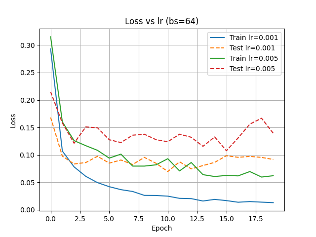</div>

    <center>图 1：不同学习率下的训练集与测试集 Loss 曲线（bs=64）</center>

    可以观察到：

    - lr = 0.001 的训练 loss 曲线更加平滑，测试集 loss 收敛稳定；

    - lr = 0.005 的训练 loss 和测试 loss 波动明显，存在过拟合或震荡风险。

2. 学习率对 Acc 的影响（固定 bs=64）

    <div style="text-align: center;">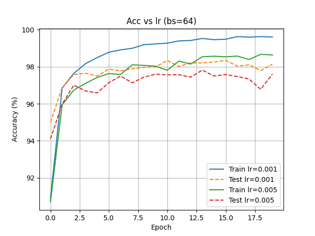</div>

    <center>图 2：不同学习率下的训练集与测试集 Acc 曲线（bs=64）</center>

    可以观察到：

    - lr = 0.001 在训练集与测试集上均取得**更高且更稳定的准确率**；

    - lr = 0.005 的训练准确率波动较大，测试准确率在后期略有回落，泛化能力稍弱。

### 四、不同 bs 对模型性能的影响（固定 lr = 0.001）

1. 训练与测试过程分析

    当固定学习率为 lr = 0.001 时，对比 bs 为 64 与 128 的训练效果。

   - **bs = 64**：

     - 测试准确率整体略高；

     - 测试准确率最终稳定在约 98.2%。

   - **bs = 128**：

     - 训练准确率、loss曲线与 bs=64 几乎持平；

     - 最终测试准确率与 bs=64 接近，但整体略低。

    这说明在本实验中，较小的 bs 有助于模型获得稍好的泛化性能，但代价是单 epoch 的训练时间稍长，整体差异不大。

2. bs 对 Loss 的影响（固定 lr=0.001）
    <div style="text-align: center;">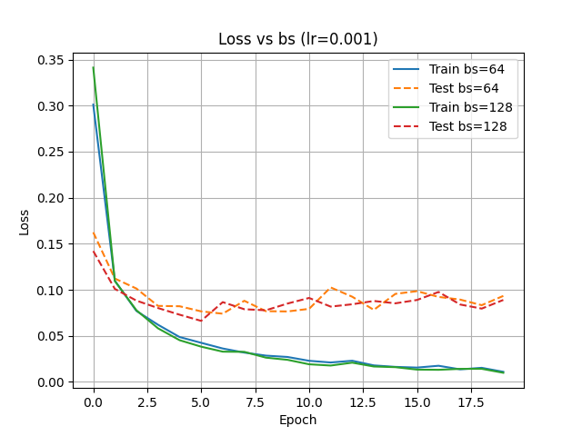</div>

    <center>图 3：不同 bs 下的训练集与测试集 Loss 曲线（lr=0.001）</center>

    可以观察到：

   - bs = 64 和 bs = 128 的训练 loss 几乎重合；

   - bs = 64 和 bs = 128 的测试 loss 均有波动，但浮动相差不大。

3. bs 对 Acc 的影响（固定 lr=0.001）

    <div style="text-align: center;">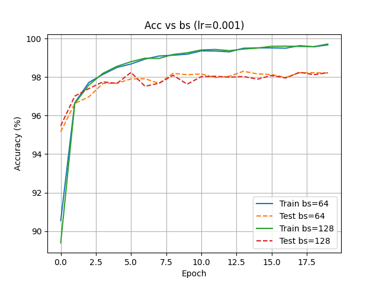</div>

    <center>图 4：不同 batch size 下的训练集与测试集 Acc 曲线（lr=0.001）</center>

    可以观察到：

      - bs = 64 在测试集上的准确率整体略高，波动较小；

      - bs = 128 的准确率峰值稍低，波动更大。

### 五、结论

1. 学习率对模型性能影响显著

   - 过大的学习率（如 0.005）会导致训练与测试过程不稳定；

   - 在本实验中，lr = 0.001 是更优的选择。

2. bs 对训练速度与泛化能力存在权衡

   - 较小 bs（64）有助于提高模型泛化性能；

   - 较大 bs（128）训练更快，但最终性能略逊。
3. 在 **MNIST** 数据集和当前网络结构下，推荐的超参数组合为：

    $$
    learning rate=0.001, batch size=64
    $$

    该组合在训练稳定性、收敛速度和测试准确率之间取得了较好的平衡。

## Task 2-1

### 一、实验基本设置

- 模型采用自行实现的线性层 MyLinear 与自定义 BatchNorm 层 MyBatchNorm1d ，构建 **32 层深度残差 MLP**。每个 ResBlock 包含 **MyLinear + MyBatchNorm1d + ReLU + MyLinear + MyBatchNorm1d + 残差 + ReLU** 的结构。损失函数采用**交叉熵**，优化器为 **Adam** 。

- 数据集为 **MNIST** ，输入为 28×28 灰度图像，训练轮数设置为 **10 epochs**，学习率 **lr 设置为 0.001**，批次大小 **bs 设置为 256**。测试集用于评估模型的泛化性能。

### 二、训练与测试过程分析

- 训练 log 如下：

  ```log
  Epoch 1/10 | Loss: 0.4395 | Train Acc: 86.65% | Test Acc: 94.82%
  Epoch 2/10 | Loss: 0.1486 | Train Acc: 95.48% | Test Acc: 96.13%
  Epoch 3/10 | Loss: 0.1083 | Train Acc: 96.70% | Test Acc: 96.53%
  Epoch 4/10 | Loss: 0.0841 | Train Acc: 97.39% | Test Acc: 95.80%
  Epoch 5/10 | Loss: 0.0740 | Train Acc: 97.67% | Test Acc: 97.12%
  Epoch 6/10 | Loss: 0.0627 | Train Acc: 98.02% | Test Acc: 97.25%
  Epoch 7/10 | Loss: 0.0551 | Train Acc: 98.26% | Test Acc: 97.33%
  Epoch 8/10 | Loss: 0.0528 | Train Acc: 98.35% | Test Acc: 97.03%
  Epoch 9/10 | Loss: 0.0446 | Train Acc: 98.60% | Test Acc: 97.44%
  Epoch 10/10 | Loss: 0.0394 | Train Acc: 98.75% | Test Acc: 97.36%
  ```

- 分析可以得出：

  - 训练 loss 随 epoch 平稳下降，说明模型逐渐收敛；

  - 训练准确率在第 2-3 个 epoch 即超过 95%，最终达到 98.75%，收敛良好；

  - 测试准确率最高达 97.44%，表明模型具有较好的泛化能力。

### 三、Loss 与 Acc 曲线

<div style="text-align: center;"> 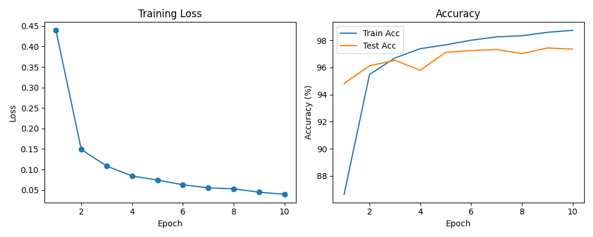 </div> <center>图 5：Loss 曲线与 Acc 曲线</center>

- 可以观察到训练 loss 平滑下降，模型收敛稳定。

- 训练准确率持续上升，测试准确率基本稳定在 97% 左右，说明模型具有良好的泛化性能。

## Task 2-2

### 一、实验基本设置

- 本实验基于 Task 2-1 中实现的 32 层深度残差 MLP 网络结构。

- 数据集仍采用 **MNIST** ，输入为 28×28 的灰度图像，统一展平成 784 维向量。

- 所有实验统一设置：
  - **训练轮数**：10 epochs

  - **批大小**：256

  - **损失函数**：交叉熵损失（CrossEntropyLoss）

- 本任务主要考察以下三类因素对深层网络训练与性能的影响：

  1. 优化器类型

  2. 权重初始化方法

  3. 激活函数选择

### 二、训练日志

```log
2025-12-30 00:00:11,862 | INFO | === Optimizer Experiment ===
2025-12-30 00:00:11,862 | INFO | Running SGD...
2025-12-30 00:00:29,122 | INFO | SGD Epoch 1: Train Acc 87.99%, Test Acc 95.15%
2025-12-30 00:00:46,608 | INFO | SGD Epoch 2: Train Acc 95.62%, Test Acc 96.11%
2025-12-30 00:01:09,798 | INFO | SGD Epoch 3: Train Acc 96.72%, Test Acc 96.75%
2025-12-30 00:01:26,930 | INFO | SGD Epoch 4: Train Acc 97.39%, Test Acc 96.66%
2025-12-30 00:01:43,802 | INFO | SGD Epoch 5: Train Acc 97.87%, Test Acc 96.78%
2025-12-30 00:02:08,274 | INFO | SGD Epoch 6: Train Acc 98.20%, Test Acc 97.19%
2025-12-30 00:02:25,624 | INFO | SGD Epoch 7: Train Acc 98.50%, Test Acc 97.18%
2025-12-30 00:03:17,876 | INFO | SGD Epoch 8: Train Acc 98.71%, Test Acc 97.29%
2025-12-30 00:04:10,293 | INFO | SGD Epoch 9: Train Acc 98.72%, Test Acc 97.08%
2025-12-30 00:05:11,928 | INFO | SGD Epoch 10: Train Acc 98.88%, Test Acc 97.49%
2025-12-30 00:05:11,929 | INFO | Running Adam...
2025-12-30 00:06:18,528 | INFO | Adam Epoch 1: Train Acc 86.86%, Test Acc 94.62%
2025-12-30 00:06:55,369 | INFO | Adam Epoch 2: Train Acc 95.48%, Test Acc 95.98%
2025-12-30 00:07:13,637 | INFO | Adam Epoch 3: Train Acc 96.78%, Test Acc 96.22%
2025-12-30 00:07:34,089 | INFO | Adam Epoch 4: Train Acc 97.40%, Test Acc 96.86%
2025-12-30 00:09:09,892 | INFO | Adam Epoch 5: Train Acc 97.83%, Test Acc 96.78%
2025-12-30 00:10:19,596 | INFO | Adam Epoch 6: Train Acc 98.06%, Test Acc 97.33%
2025-12-30 00:11:27,327 | INFO | Adam Epoch 7: Train Acc 98.30%, Test Acc 97.05%
2025-12-30 00:12:35,889 | INFO | Adam Epoch 8: Train Acc 98.44%, Test Acc 97.18%
2025-12-30 00:13:43,834 | INFO | Adam Epoch 9: Train Acc 98.65%, Test Acc 97.18%
2025-12-30 00:14:51,017 | INFO | Adam Epoch 10: Train Acc 98.65%, Test Acc 97.41%
2025-12-30 00:14:51,017 | INFO | Running RMSprop...
2025-12-30 00:15:55,291 | INFO | RMSprop Epoch 1: Train Acc 90.49%, Test Acc 95.30%
2025-12-30 00:16:59,712 | INFO | RMSprop Epoch 2: Train Acc 95.78%, Test Acc 95.94%
2025-12-30 00:18:04,540 | INFO | RMSprop Epoch 3: Train Acc 96.77%, Test Acc 96.70%
2025-12-30 00:19:09,435 | INFO | RMSprop Epoch 4: Train Acc 97.34%, Test Acc 96.85%
2025-12-30 00:20:15,165 | INFO | RMSprop Epoch 5: Train Acc 97.78%, Test Acc 96.85%
2025-12-30 00:20:49,476 | INFO | RMSprop Epoch 6: Train Acc 98.02%, Test Acc 96.13%
2025-12-30 00:21:07,380 | INFO | RMSprop Epoch 7: Train Acc 98.27%, Test Acc 95.91%
2025-12-30 00:21:25,431 | INFO | RMSprop Epoch 8: Train Acc 98.49%, Test Acc 97.41%
2025-12-30 00:21:42,691 | INFO | RMSprop Epoch 9: Train Acc 98.60%, Test Acc 97.46%
2025-12-30 00:22:00,122 | INFO | RMSprop Epoch 10: Train Acc 98.78%, Test Acc 96.87%
2025-12-30 00:22:00,941 | INFO | === Initialization Experiment ===
2025-12-30 00:22:00,941 | INFO | Running Kaiming Init...
2025-12-30 00:22:18,790 | INFO | Kaiming Epoch 1: Train Acc 63.76%, Test Acc 80.66%
2025-12-30 00:22:36,452 | INFO | Kaiming Epoch 2: Train Acc 84.21%, Test Acc 87.98%
2025-12-30 00:22:54,653 | INFO | Kaiming Epoch 3: Train Acc 89.16%, Test Acc 90.68%
2025-12-30 00:23:12,751 | INFO | Kaiming Epoch 4: Train Acc 91.46%, Test Acc 92.10%
2025-12-30 00:23:34,143 | INFO | Kaiming Epoch 5: Train Acc 93.18%, Test Acc 93.15%
2025-12-30 00:23:52,168 | INFO | Kaiming Epoch 6: Train Acc 94.17%, Test Acc 93.54%
2025-12-30 00:24:10,224 | INFO | Kaiming Epoch 7: Train Acc 95.08%, Test Acc 94.06%
2025-12-30 00:24:28,119 | INFO | Kaiming Epoch 8: Train Acc 95.62%, Test Acc 94.30%
2025-12-30 00:24:49,423 | INFO | Kaiming Epoch 9: Train Acc 96.27%, Test Acc 94.75%
2025-12-30 00:25:50,594 | INFO | Kaiming Epoch 10: Train Acc 96.57%, Test Acc 94.75%
2025-12-30 00:25:50,594 | INFO | Running Xavier Init...
2025-12-30 00:26:08,505 | INFO | Xavier Epoch 1: Train Acc 77.76%, Test Acc 91.55%
2025-12-30 00:26:27,616 | INFO | Xavier Epoch 2: Train Acc 92.95%, Test Acc 94.27%
2025-12-30 00:26:45,273 | INFO | Xavier Epoch 3: Train Acc 95.03%, Test Acc 95.16%
2025-12-30 00:27:03,121 | INFO | Xavier Epoch 4: Train Acc 96.23%, Test Acc 95.61%
2025-12-30 00:27:32,902 | INFO | Xavier Epoch 5: Train Acc 96.92%, Test Acc 96.14%
2025-12-30 00:27:50,894 | INFO | Xavier Epoch 6: Train Acc 97.39%, Test Acc 96.28%
2025-12-30 00:28:09,381 | INFO | Xavier Epoch 7: Train Acc 97.62%, Test Acc 96.48%
2025-12-30 00:28:27,441 | INFO | Xavier Epoch 8: Train Acc 97.92%, Test Acc 96.10%
2025-12-30 00:28:45,802 | INFO | Xavier Epoch 9: Train Acc 98.12%, Test Acc 96.38%
2025-12-30 00:29:05,820 | INFO | Xavier Epoch 10: Train Acc 98.24%, Test Acc 96.44%
2025-12-30 00:29:05,820 | INFO | Running Normal Init...
2025-12-30 00:29:24,038 | INFO | Normal Epoch 1: Train Acc 91.17%, Test Acc 95.32%
2025-12-30 00:29:42,627 | INFO | Normal Epoch 2: Train Acc 96.04%, Test Acc 96.81%
2025-12-30 00:30:00,677 | INFO | Normal Epoch 3: Train Acc 96.98%, Test Acc 96.98%
2025-12-30 00:30:18,864 | INFO | Normal Epoch 4: Train Acc 97.48%, Test Acc 97.18%
2025-12-30 00:30:37,019 | INFO | Normal Epoch 5: Train Acc 97.82%, Test Acc 97.14%
2025-12-30 00:30:54,890 | INFO | Normal Epoch 6: Train Acc 98.04%, Test Acc 97.46%
2025-12-30 00:31:13,192 | INFO | Normal Epoch 7: Train Acc 98.35%, Test Acc 97.57%
2025-12-30 00:31:31,122 | INFO | Normal Epoch 8: Train Acc 98.39%, Test Acc 97.35%
2025-12-30 00:31:49,106 | INFO | Normal Epoch 9: Train Acc 98.71%, Test Acc 97.71%
2025-12-30 00:32:07,021 | INFO | Normal Epoch 10: Train Acc 98.74%, Test Acc 97.64%
2025-12-30 00:32:07,021 | INFO | Running Zero Init...
2025-12-30 00:32:25,051 | INFO | Zero Epoch 1: Train Acc 11.22%, Test Acc 11.35%
2025-12-30 00:32:43,281 | INFO | Zero Epoch 2: Train Acc 11.24%, Test Acc 11.35%
2025-12-30 00:33:01,158 | INFO | Zero Epoch 3: Train Acc 11.24%, Test Acc 11.35%
2025-12-30 00:33:19,472 | INFO | Zero Epoch 4: Train Acc 11.24%, Test Acc 11.35%
2025-12-30 00:33:37,504 | INFO | Zero Epoch 5: Train Acc 11.24%, Test Acc 11.35%
2025-12-30 00:33:55,926 | INFO | Zero Epoch 6: Train Acc 11.24%, Test Acc 11.35%
2025-12-30 00:34:13,902 | INFO | Zero Epoch 7: Train Acc 11.24%, Test Acc 11.35%
2025-12-30 00:34:31,938 | INFO | Zero Epoch 8: Train Acc 11.24%, Test Acc 11.35%
2025-12-30 00:34:50,112 | INFO | Zero Epoch 9: Train Acc 11.24%, Test Acc 11.35%
2025-12-30 00:35:08,189 | INFO | Zero Epoch 10: Train Acc 11.24%, Test Acc 11.35%
2025-12-30 00:35:08,616 | INFO | === Activation Experiment ===
2025-12-30 00:35:08,616 | INFO | Running ReLU Activation...
2025-12-30 00:35:40,426 | INFO | ReLU Epoch 1: Train Acc 86.59%, Test Acc 94.80%
2025-12-30 00:36:14,397 | INFO | ReLU Epoch 2: Train Acc 95.53%, Test Acc 95.95%
2025-12-30 00:36:49,194 | INFO | ReLU Epoch 3: Train Acc 96.82%, Test Acc 96.25%
2025-12-30 00:37:09,153 | INFO | ReLU Epoch 4: Train Acc 97.35%, Test Acc 96.75%
2025-12-30 00:37:26,856 | INFO | ReLU Epoch 5: Train Acc 97.75%, Test Acc 97.24%
2025-12-30 00:37:45,193 | INFO | ReLU Epoch 6: Train Acc 98.11%, Test Acc 97.49%
2025-12-30 00:38:03,293 | INFO | ReLU Epoch 7: Train Acc 98.25%, Test Acc 97.34%
2025-12-30 00:38:22,270 | INFO | ReLU Epoch 8: Train Acc 98.31%, Test Acc 97.43%
2025-12-30 00:38:40,726 | INFO | ReLU Epoch 9: Train Acc 98.66%, Test Acc 97.35%
2025-12-30 00:38:59,338 | INFO | ReLU Epoch 10: Train Acc 98.70%, Test Acc 97.41%
2025-12-30 00:38:59,338 | INFO | Running Sigmoid Activation...
2025-12-30 00:39:17,727 | INFO | Sigmoid Epoch 1: Train Acc 86.86%, Test Acc 90.69%
2025-12-30 00:39:36,641 | INFO | Sigmoid Epoch 2: Train Acc 92.70%, Test Acc 93.82%
2025-12-30 00:40:36,150 | INFO | Sigmoid Epoch 3: Train Acc 93.99%, Test Acc 94.52%
2025-12-30 00:41:42,396 | INFO | Sigmoid Epoch 4: Train Acc 94.78%, Test Acc 94.49%
2025-12-30 00:42:02,851 | INFO | Sigmoid Epoch 5: Train Acc 95.22%, Test Acc 94.97%
2025-12-30 00:42:21,415 | INFO | Sigmoid Epoch 6: Train Acc 95.40%, Test Acc 94.82%
2025-12-30 00:42:39,703 | INFO | Sigmoid Epoch 7: Train Acc 95.84%, Test Acc 94.35%
2025-12-30 00:43:11,744 | INFO | Sigmoid Epoch 8: Train Acc 96.14%, Test Acc 95.42%
2025-12-30 00:43:30,399 | INFO | Sigmoid Epoch 9: Train Acc 96.40%, Test Acc 94.16%
2025-12-30 00:43:49,801 | INFO | Sigmoid Epoch 10: Train Acc 96.66%, Test Acc 95.40%
2025-12-30 00:43:49,801 | INFO | Running Tanh Activation...
2025-12-30 00:44:09,535 | INFO | Tanh Epoch 1: Train Acc 79.46%, Test Acc 90.94%
2025-12-30 00:44:28,369 | INFO | Tanh Epoch 2: Train Acc 92.09%, Test Acc 93.52%
2025-12-30 00:45:19,288 | INFO | Tanh Epoch 3: Train Acc 93.71%, Test Acc 93.97%
2025-12-30 00:46:06,360 | INFO | Tanh Epoch 4: Train Acc 94.78%, Test Acc 95.00%
2025-12-30 00:46:42,014 | INFO | Tanh Epoch 5: Train Acc 95.75%, Test Acc 95.21%
2025-12-30 00:47:19,360 | INFO | Tanh Epoch 6: Train Acc 95.89%, Test Acc 95.24%
2025-12-30 00:48:18,628 | INFO | Tanh Epoch 7: Train Acc 96.19%, Test Acc 95.70%
2025-12-30 00:49:00,381 | INFO | Tanh Epoch 8: Train Acc 96.73%, Test Acc 95.80%
2025-12-30 00:49:18,834 | INFO | Tanh Epoch 9: Train Acc 96.75%, Test Acc 96.22%
2025-12-30 00:49:37,211 | INFO | Tanh Epoch 10: Train Acc 97.17%, Test Acc 96.08%
```

### 三、不同优化器对模型性能的影响

1. 训练与测试过程分析

    在该实验中，分别使用 **SGD（带动量）、Adam** 和 **RMSprop** 对模型进行训练，其余超参数保持一致。

   - **SGD**：

      - 训练准确率稳步提升，从第 1 个 epoch 的 87.99% 提升至第 10 个 epoch 的 98.88%；

      - 测试准确率最终达到 97.49%，整体曲线较为平滑；

      - 训练过程稳定，但前期收敛速度略慢于自适应优化器。

   - **Adam**：

       - 前 2–3 个 epoch 内训练准确率迅速超过 95%；

       - 最终测试准确率达到 97.41%；

       - 收敛速度快，整体表现稳定。

   - **RMSprop** ：

       - 前期训练准确率提升较快；

       - 测试准确率在后期出现一定波动，最终为 96.87%；

       - 稳定性略逊于 SGD 与 Adam。

    综合来看，三种优化器均能在深层残差 MLP 中实现有效训练，但 **SGD 与 Adam 在稳定性和最终性能上略优**。

2. 不同优化器下的 Loss 与 Acc 曲线

<div style="text-align: center;"> 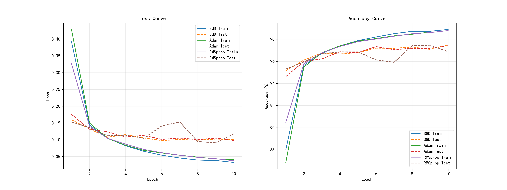 </div>

<center>图 6：不同优化器下训练集与测试集 Loss 与 Acc 曲线</center>

- Loss 分析：

  - Adam 与 RMSprop 在前期 loss 下降速度更快；

  - SGD 的 loss 下降更加平滑，后期表现稳定；

  - 三者最终均能收敛到较低的 loss 区间。

- Acc 分析：

  - 三种优化器的训练准确率最终均接近 99%；

  - 测试准确率均稳定在 97% 左右；

  - Adam 与 SGD 的泛化性能略优于 RMSprop。

### 四、不同权重初始化方法对模型性能的影响

1. 训练与测试过程分析

    本实验比较了 **Kaiming** 、 **Xavier** 、 **Normal**(0, 0.01) 与 **Zero** 初始化。

   - **Kaiming 初始化**：

     - 前期训练较慢；

     - 最终测试准确率约 94.75%；

     - 在深层网络中表现稳定，但收敛速度偏慢。

   - **Xavier 初始化**：

     - 训练初期表现优于 Kaiming；

     - 最终测试准确率约 96.44%；

     - 整体稳定性较好。

   - **Normal 初始化**：

     - 前期训练和测试准确率均较高；

     - 最终测试准确率达到 97.64%，为本实验中表现最优；

     - 表明在该网络结构下，小方差正态初始化效果较好。

   - **Zero 初始化**：

     - 训练与测试准确率始终维持在约 11%；

     - 模型完全无法学习，梯度无法有效传播。

    该结果验证了 不恰当的初始化（如全零）会导致深层网络训练失败。

2. 不同初始化方法下的 Loss 与 Acc 曲线

    <div style="text-align: center;"> 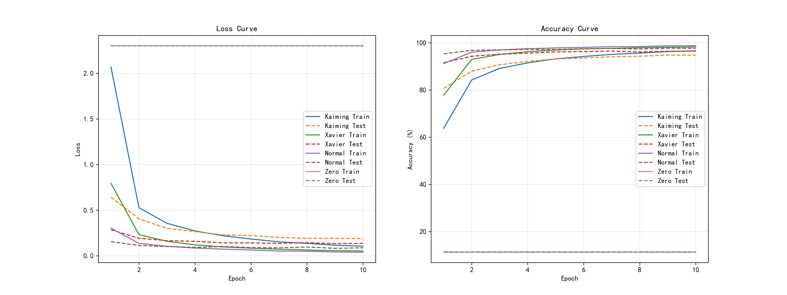 </div>

    <center>图 7：不同权重初始化方法下的 Loss 与 Acc 曲线</center>

   - Zero 初始化的 loss 与 acc 几乎无变化；

   - Normal、Xavier 与 Kaiming 初始化均能成功收敛；

   - **Normal 初始化在收敛速度和最终性能上表现最佳**。

### 五、不同激活函数对模型性能的影响

1. 训练与测试过程分析

    本实验对比了 **ReLU** 、 **Sigmoid** 与 **Tanh** 三种激活函数。

   - **ReLU**：

     - 收敛速度最快；

     - 最终测试准确率达到 97.41%；

     - 训练过程稳定，是三者中表现最优的激活函数。

   - **Sigmoid**：

     - 训练准确率与测试准确率明显低于 ReLU；

     - 最终测试准确率约 95.40%；

     - 受梯度消失影响，深层网络训练受限。

   - **Tanh**：

     - 表现介于 ReLU 与 Sigmoid 之间；

     - 最终测试准确率约 96.08%；

     - 相比 Sigmoid 略有改善，但仍不及 ReLU。

2. 不同激活函数下的 Loss 与 Acc 曲线

    <div style="text-align: center;"> 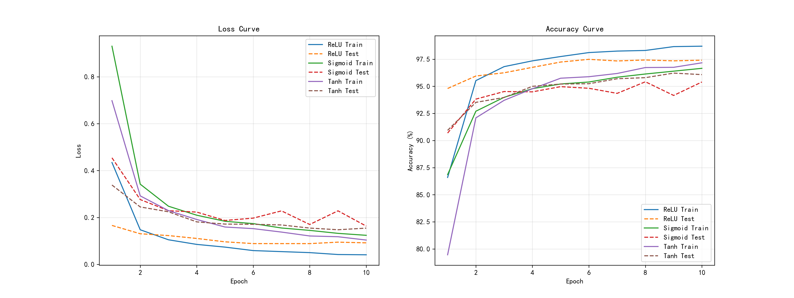 </div>

    <center>图 8：不同激活函数下的 Loss 与 Acc 曲线</center>

    - ReLU 的 loss 下降最快且最稳定；

    - Sigmoid 与 Tanh 在深层网络中训练速度较慢；

    - ReLU 在收敛速度与最终性能上均占优。

### 六、结论

- 优化器选择对收敛速度和稳定性具有重要影响

  - Adam 与 SGD 在本实验中表现最优；

  - RMSprop 在后期测试集上存在一定波动。

- 权重初始化是深层网络成功训练的关键因素

  - Zero 初始化会导致模型完全无法学习；

  - Normal 与 Xavier 初始化在该网络结构下效果更佳。

- 激活函数对深层网络性能影响显著

  - ReLU 在收敛速度、稳定性和最终准确率上均明显优于 Sigmoid 与 Tanh；

  - Sigmoid 不适合深层全连接网络。

- 综合实验结果，在 MNIST 数据集和当前 32 层残差 MLP 结构下，推荐配置为：

  $$
  Optimizer = Adam 或 SGD, Initialization = Normal/Xavier, Activation = ReLU
  $$

  该组合在训练稳定性、收敛速度和泛化性能之间取得了较好的平衡。

## Task 2-3

### 一、实验基本设置

- **数据集**：CIFAR-10

- **模型**：

  - DeepMLP：32 层 ResMLP（输入 3072，隐藏 512，Zero Gamma 残差块）

  - DeepCNN：10 层以上卷积网络，带 BN 和 ReLU

- **优化器**：**SGD**

- **损失函数**：**交叉熵**

- **训练轮数**：

  - MLP：80 epoch，学习率 0.1

  - CNN：50 epoch，学习率 0.01

- **批大小**：

  - 训练：256

  - 测试：1000

### 二、训练日志

1. CNN日志

```log
2025-12-30 02:31:45,085 | INFO | Experiment started
2025-12-30 02:31:49,354 | INFO | Epoch 001 | Loss: 1.5199 | Train Acc: 43.39% | Test Acc: 56.42% | LR: 0.00999
2025-12-30 02:31:53,155 | INFO | Epoch 002 | Loss: 1.0190 | Train Acc: 63.47% | Test Acc: 68.07% | LR: 0.00996
2025-12-30 02:31:56,903 | INFO | Epoch 003 | Loss: 0.8110 | Train Acc: 71.56% | Test Acc: 71.28% | LR: 0.00991
2025-12-30 02:32:00,495 | INFO | Epoch 004 | Loss: 0.6956 | Train Acc: 75.86% | Test Acc: 71.42% | LR: 0.00984
2025-12-30 02:32:04,218 | INFO | Epoch 005 | Loss: 0.6233 | Train Acc: 78.55% | Test Acc: 78.45% | LR: 0.00976
2025-12-30 02:32:07,835 | INFO | Epoch 006 | Loss: 0.5632 | Train Acc: 80.60% | Test Acc: 77.40% | LR: 0.00965
2025-12-30 02:32:11,513 | INFO | Epoch 007 | Loss: 0.5179 | Train Acc: 82.24% | Test Acc: 74.32% | LR: 0.00952
2025-12-30 02:32:15,264 | INFO | Epoch 008 | Loss: 0.4905 | Train Acc: 83.21% | Test Acc: 80.79% | LR: 0.00938
2025-12-30 02:32:19,007 | INFO | Epoch 009 | Loss: 0.4588 | Train Acc: 84.29% | Test Acc: 79.80% | LR: 0.00922
2025-12-30 02:32:22,732 | INFO | Epoch 010 | Loss: 0.4284 | Train Acc: 85.13% | Test Acc: 82.79% | LR: 0.00905
2025-12-30 02:32:26,514 | INFO | Epoch 011 | Loss: 0.4055 | Train Acc: 86.21% | Test Acc: 82.66% | LR: 0.00885
2025-12-30 02:32:30,331 | INFO | Epoch 012 | Loss: 0.3803 | Train Acc: 86.91% | Test Acc: 83.98% | LR: 0.00864
2025-12-30 02:32:34,022 | INFO | Epoch 013 | Loss: 0.3627 | Train Acc: 87.54% | Test Acc: 82.69% | LR: 0.00842
2025-12-30 02:32:37,715 | INFO | Epoch 014 | Loss: 0.3432 | Train Acc: 88.30% | Test Acc: 81.66% | LR: 0.00819
2025-12-30 02:32:41,572 | INFO | Epoch 015 | Loss: 0.3269 | Train Acc: 88.68% | Test Acc: 85.41% | LR: 0.00794
2025-12-30 02:32:45,258 | INFO | Epoch 016 | Loss: 0.3164 | Train Acc: 89.05% | Test Acc: 84.88% | LR: 0.00768
2025-12-30 02:32:48,934 | INFO | Epoch 017 | Loss: 0.3031 | Train Acc: 89.50% | Test Acc: 81.67% | LR: 0.00741
2025-12-30 02:32:52,748 | INFO | Epoch 018 | Loss: 0.2864 | Train Acc: 90.07% | Test Acc: 86.20% | LR: 0.00713
2025-12-30 02:32:56,438 | INFO | Epoch 019 | Loss: 0.2732 | Train Acc: 90.54% | Test Acc: 85.32% | LR: 0.00684
2025-12-30 02:33:00,179 | INFO | Epoch 020 | Loss: 0.2584 | Train Acc: 91.05% | Test Acc: 86.66% | LR: 0.00655
2025-12-30 02:33:03,885 | INFO | Epoch 021 | Loss: 0.2475 | Train Acc: 91.30% | Test Acc: 87.65% | LR: 0.00624
2025-12-30 02:33:07,588 | INFO | Epoch 022 | Loss: 0.2327 | Train Acc: 92.01% | Test Acc: 86.72% | LR: 0.00594
2025-12-30 02:33:11,328 | INFO | Epoch 023 | Loss: 0.2242 | Train Acc: 92.19% | Test Acc: 87.24% | LR: 0.00563
2025-12-30 02:33:15,039 | INFO | Epoch 024 | Loss: 0.2099 | Train Acc: 92.76% | Test Acc: 88.03% | LR: 0.00531
2025-12-30 02:33:18,687 | INFO | Epoch 025 | Loss: 0.2033 | Train Acc: 93.07% | Test Acc: 87.47% | LR: 0.00500
2025-12-30 02:33:22,589 | INFO | Epoch 026 | Loss: 0.1863 | Train Acc: 93.55% | Test Acc: 87.70% | LR: 0.00469
2025-12-30 02:33:26,401 | INFO | Epoch 027 | Loss: 0.1799 | Train Acc: 93.80% | Test Acc: 87.99% | LR: 0.00437
2025-12-30 02:33:30,005 | INFO | Epoch 028 | Loss: 0.1732 | Train Acc: 93.98% | Test Acc: 88.53% | LR: 0.00406
2025-12-30 02:33:33,684 | INFO | Epoch 029 | Loss: 0.1645 | Train Acc: 94.23% | Test Acc: 87.83% | LR: 0.00376
2025-12-30 02:33:37,542 | INFO | Epoch 030 | Loss: 0.1566 | Train Acc: 94.55% | Test Acc: 88.57% | LR: 0.00345
2025-12-30 02:33:41,221 | INFO | Epoch 031 | Loss: 0.1419 | Train Acc: 94.97% | Test Acc: 88.34% | LR: 0.00316
2025-12-30 02:33:44,910 | INFO | Epoch 032 | Loss: 0.1390 | Train Acc: 95.21% | Test Acc: 88.26% | LR: 0.00287
2025-12-30 02:33:48,672 | INFO | Epoch 033 | Loss: 0.1312 | Train Acc: 95.44% | Test Acc: 88.83% | LR: 0.00259
2025-12-30 02:33:52,424 | INFO | Epoch 034 | Loss: 0.1219 | Train Acc: 95.76% | Test Acc: 89.11% | LR: 0.00232
2025-12-30 02:33:56,223 | INFO | Epoch 035 | Loss: 0.1161 | Train Acc: 95.84% | Test Acc: 89.14% | LR: 0.00206
2025-12-30 02:34:00,161 | INFO | Epoch 036 | Loss: 0.1062 | Train Acc: 96.30% | Test Acc: 88.89% | LR: 0.00181
2025-12-30 02:34:03,949 | INFO | Epoch 037 | Loss: 0.1012 | Train Acc: 96.41% | Test Acc: 89.21% | LR: 0.00158
2025-12-30 02:34:08,301 | INFO | Epoch 038 | Loss: 0.0968 | Train Acc: 96.59% | Test Acc: 89.68% | LR: 0.00136
2025-12-30 02:34:12,540 | INFO | Epoch 039 | Loss: 0.0906 | Train Acc: 96.87% | Test Acc: 89.54% | LR: 0.00115
2025-12-30 02:34:16,199 | INFO | Epoch 040 | Loss: 0.0858 | Train Acc: 96.95% | Test Acc: 89.77% | LR: 0.00095
2025-12-30 02:34:19,943 | INFO | Epoch 041 | Loss: 0.0806 | Train Acc: 97.16% | Test Acc: 89.75% | LR: 0.00078
2025-12-30 02:34:23,595 | INFO | Epoch 042 | Loss: 0.0793 | Train Acc: 97.25% | Test Acc: 89.68% | LR: 0.00062
2025-12-30 02:34:27,260 | INFO | Epoch 043 | Loss: 0.0748 | Train Acc: 97.40% | Test Acc: 89.83% | LR: 0.00048
2025-12-30 02:34:30,968 | INFO | Epoch 044 | Loss: 0.0699 | Train Acc: 97.59% | Test Acc: 89.72% | LR: 0.00035
2025-12-30 02:34:34,674 | INFO | Epoch 045 | Loss: 0.0715 | Train Acc: 97.54% | Test Acc: 89.93% | LR: 0.00024
2025-12-30 02:34:38,394 | INFO | Epoch 046 | Loss: 0.0678 | Train Acc: 97.65% | Test Acc: 90.03% | LR: 0.00016
2025-12-30 02:34:42,069 | INFO | Epoch 047 | Loss: 0.0662 | Train Acc: 97.72% | Test Acc: 89.85% | LR: 0.00009
2025-12-30 02:34:45,839 | INFO | Epoch 048 | Loss: 0.0665 | Train Acc: 97.73% | Test Acc: 89.84% | LR: 0.00004
2025-12-30 02:34:49,632 | INFO | Epoch 049 | Loss: 0.0664 | Train Acc: 97.74% | Test Acc: 89.86% | LR: 0.00001
2025-12-30 02:34:53,389 | INFO | Epoch 050 | Loss: 0.0671 | Train Acc: 97.72% | Test Acc: 89.82% | LR: 0.00000
2025-12-30 02:34:53,391 | INFO | Training finished
```

1. MLP 训练日志

```log
2025-12-30 02:34:53,461 | INFO | Experiment started
2025-12-30 02:34:59,470 | INFO | Epoch 001 | Loss: 1.8212 | Train Acc: 34.80% | Test Acc: 41.38% | LR: 0.09996
2025-12-30 02:35:05,261 | INFO | Epoch 002 | Loss: 1.6017 | Train Acc: 42.25% | Test Acc: 46.08% | LR: 0.09985
2025-12-30 02:35:10,761 | INFO | Epoch 003 | Loss: 1.5244 | Train Acc: 45.04% | Test Acc: 47.26% | LR: 0.09965
2025-12-30 02:35:16,673 | INFO | Epoch 004 | Loss: 1.4780 | Train Acc: 46.49% | Test Acc: 49.90% | LR: 0.09938
2025-12-30 02:35:22,320 | INFO | Epoch 005 | Loss: 1.4371 | Train Acc: 48.27% | Test Acc: 51.30% | LR: 0.09904
2025-12-30 02:35:28,122 | INFO | Epoch 006 | Loss: 1.4080 | Train Acc: 49.24% | Test Acc: 52.94% | LR: 0.09862
2025-12-30 02:35:33,759 | INFO | Epoch 007 | Loss: 1.3829 | Train Acc: 50.20% | Test Acc: 52.11% | LR: 0.09812
2025-12-30 02:35:39,694 | INFO | Epoch 008 | Loss: 1.3553 | Train Acc: 51.10% | Test Acc: 52.80% | LR: 0.09755
2025-12-30 02:35:45,321 | INFO | Epoch 009 | Loss: 1.3356 | Train Acc: 51.86% | Test Acc: 53.89% | LR: 0.09691
2025-12-30 02:35:51,302 | INFO | Epoch 010 | Loss: 1.3190 | Train Acc: 52.42% | Test Acc: 53.58% | LR: 0.09619
2025-12-30 02:35:57,280 | INFO | Epoch 011 | Loss: 1.3025 | Train Acc: 52.90% | Test Acc: 53.93% | LR: 0.09541
2025-12-30 02:36:03,062 | INFO | Epoch 012 | Loss: 1.2879 | Train Acc: 53.67% | Test Acc: 54.77% | LR: 0.09455
2025-12-30 02:36:08,875 | INFO | Epoch 013 | Loss: 1.2735 | Train Acc: 54.30% | Test Acc: 54.27% | LR: 0.09362
2025-12-30 02:36:14,625 | INFO | Epoch 014 | Loss: 1.2536 | Train Acc: 54.67% | Test Acc: 56.24% | LR: 0.09263
2025-12-30 02:36:20,453 | INFO | Epoch 015 | Loss: 1.2437 | Train Acc: 55.44% | Test Acc: 55.87% | LR: 0.09157
2025-12-30 02:36:26,200 | INFO | Epoch 016 | Loss: 1.2293 | Train Acc: 55.87% | Test Acc: 56.60% | LR: 0.09045
2025-12-30 02:36:31,818 | INFO | Epoch 017 | Loss: 1.2114 | Train Acc: 56.34% | Test Acc: 56.80% | LR: 0.08927
2025-12-30 02:36:37,161 | INFO | Epoch 018 | Loss: 1.1991 | Train Acc: 56.63% | Test Acc: 57.53% | LR: 0.08802
2025-12-30 02:36:42,933 | INFO | Epoch 019 | Loss: 1.1805 | Train Acc: 57.35% | Test Acc: 57.71% | LR: 0.08672
2025-12-30 02:36:48,706 | INFO | Epoch 020 | Loss: 1.1697 | Train Acc: 58.13% | Test Acc: 57.99% | LR: 0.08536
2025-12-30 02:36:54,475 | INFO | Epoch 021 | Loss: 1.1636 | Train Acc: 58.05% | Test Acc: 57.51% | LR: 0.08394
2025-12-30 02:37:00,403 | INFO | Epoch 022 | Loss: 1.1484 | Train Acc: 58.89% | Test Acc: 57.86% | LR: 0.08247
2025-12-30 02:37:06,300 | INFO | Epoch 023 | Loss: 1.1340 | Train Acc: 59.13% | Test Acc: 57.86% | LR: 0.08095
2025-12-30 02:37:12,149 | INFO | Epoch 024 | Loss: 1.1209 | Train Acc: 59.48% | Test Acc: 58.64% | LR: 0.07939
2025-12-30 02:37:17,893 | INFO | Epoch 025 | Loss: 1.1126 | Train Acc: 60.10% | Test Acc: 58.92% | LR: 0.07778
2025-12-30 02:37:23,207 | INFO | Epoch 026 | Loss: 1.0986 | Train Acc: 60.63% | Test Acc: 58.84% | LR: 0.07612
2025-12-30 02:37:28,269 | INFO | Epoch 027 | Loss: 1.0867 | Train Acc: 61.09% | Test Acc: 59.00% | LR: 0.07443
2025-12-30 02:37:33,615 | INFO | Epoch 028 | Loss: 1.0746 | Train Acc: 61.38% | Test Acc: 59.62% | LR: 0.07270
2025-12-30 02:37:38,577 | INFO | Epoch 029 | Loss: 1.0591 | Train Acc: 62.16% | Test Acc: 58.88% | LR: 0.07093
2025-12-30 02:37:43,720 | INFO | Epoch 030 | Loss: 1.0511 | Train Acc: 62.27% | Test Acc: 59.97% | LR: 0.06913
2025-12-30 02:37:48,962 | INFO | Epoch 031 | Loss: 1.0337 | Train Acc: 62.80% | Test Acc: 60.00% | LR: 0.06731
2025-12-30 02:37:54,003 | INFO | Epoch 032 | Loss: 1.0183 | Train Acc: 63.42% | Test Acc: 59.52% | LR: 0.06545
2025-12-30 02:37:59,119 | INFO | Epoch 033 | Loss: 1.0028 | Train Acc: 63.91% | Test Acc: 59.81% | LR: 0.06357
2025-12-30 02:38:04,282 | INFO | Epoch 034 | Loss: 0.9912 | Train Acc: 64.26% | Test Acc: 60.25% | LR: 0.06167
2025-12-30 02:38:09,545 | INFO | Epoch 035 | Loss: 0.9737 | Train Acc: 64.98% | Test Acc: 60.63% | LR: 0.05975
2025-12-30 02:38:14,703 | INFO | Epoch 036 | Loss: 0.9627 | Train Acc: 65.55% | Test Acc: 60.83% | LR: 0.05782
2025-12-30 02:38:20,127 | INFO | Epoch 037 | Loss: 0.9480 | Train Acc: 65.61% | Test Acc: 60.50% | LR: 0.05588
2025-12-30 02:38:25,222 | INFO | Epoch 038 | Loss: 0.9355 | Train Acc: 66.36% | Test Acc: 60.73% | LR: 0.05392
2025-12-30 02:38:30,307 | INFO | Epoch 039 | Loss: 0.9161 | Train Acc: 66.85% | Test Acc: 60.75% | LR: 0.05196
2025-12-30 02:38:35,591 | INFO | Epoch 040 | Loss: 0.9029 | Train Acc: 67.62% | Test Acc: 60.85% | LR: 0.05000
2025-12-30 02:38:40,689 | INFO | Epoch 041 | Loss: 0.8813 | Train Acc: 68.23% | Test Acc: 61.07% | LR: 0.04804
2025-12-30 02:38:46,390 | INFO | Epoch 042 | Loss: 0.8656 | Train Acc: 68.89% | Test Acc: 60.29% | LR: 0.04608
2025-12-30 02:38:51,622 | INFO | Epoch 043 | Loss: 0.8498 | Train Acc: 69.13% | Test Acc: 61.21% | LR: 0.04412
2025-12-30 02:38:56,731 | INFO | Epoch 044 | Loss: 0.8254 | Train Acc: 70.03% | Test Acc: 61.40% | LR: 0.04218
2025-12-30 02:39:01,693 | INFO | Epoch 045 | Loss: 0.8114 | Train Acc: 70.76% | Test Acc: 61.27% | LR: 0.04025
2025-12-30 02:39:06,959 | INFO | Epoch 046 | Loss: 0.7883 | Train Acc: 71.51% | Test Acc: 60.73% | LR: 0.03833
2025-12-30 02:39:12,352 | INFO | Epoch 047 | Loss: 0.7717 | Train Acc: 72.26% | Test Acc: 61.47% | LR: 0.03643
2025-12-30 02:39:17,551 | INFO | Epoch 048 | Loss: 0.7470 | Train Acc: 72.99% | Test Acc: 61.50% | LR: 0.03455
2025-12-30 02:39:22,531 | INFO | Epoch 049 | Loss: 0.7280 | Train Acc: 73.62% | Test Acc: 61.71% | LR: 0.03269
2025-12-30 02:39:27,986 | INFO | Epoch 050 | Loss: 0.7021 | Train Acc: 74.45% | Test Acc: 61.68% | LR: 0.03087
2025-12-30 02:39:33,774 | INFO | Epoch 051 | Loss: 0.6780 | Train Acc: 75.51% | Test Acc: 60.87% | LR: 0.02907
2025-12-30 02:39:39,297 | INFO | Epoch 052 | Loss: 0.6504 | Train Acc: 76.44% | Test Acc: 61.09% | LR: 0.02730
2025-12-30 02:39:44,674 | INFO | Epoch 053 | Loss: 0.6300 | Train Acc: 77.34% | Test Acc: 61.50% | LR: 0.02557
2025-12-30 02:39:49,762 | INFO | Epoch 054 | Loss: 0.6009 | Train Acc: 78.30% | Test Acc: 60.79% | LR: 0.02388
2025-12-30 02:39:54,740 | INFO | Epoch 055 | Loss: 0.5794 | Train Acc: 79.14% | Test Acc: 61.40% | LR: 0.02222
2025-12-30 02:40:00,590 | INFO | Epoch 056 | Loss: 0.5530 | Train Acc: 80.06% | Test Acc: 61.35% | LR: 0.02061
2025-12-30 02:40:05,524 | INFO | Epoch 057 | Loss: 0.5273 | Train Acc: 80.95% | Test Acc: 61.54% | LR: 0.01905
2025-12-30 02:40:11,026 | INFO | Epoch 058 | Loss: 0.4917 | Train Acc: 82.39% | Test Acc: 61.17% | LR: 0.01753
2025-12-30 02:40:15,961 | INFO | Epoch 059 | Loss: 0.4748 | Train Acc: 83.01% | Test Acc: 61.04% | LR: 0.01606
2025-12-30 02:40:21,154 | INFO | Epoch 060 | Loss: 0.4448 | Train Acc: 83.94% | Test Acc: 61.43% | LR: 0.01464
2025-12-30 02:40:26,210 | INFO | Epoch 061 | Loss: 0.4076 | Train Acc: 85.47% | Test Acc: 61.55% | LR: 0.01328
2025-12-30 02:40:31,363 | INFO | Epoch 062 | Loss: 0.3828 | Train Acc: 86.43% | Test Acc: 61.52% | LR: 0.01198
2025-12-30 02:40:36,431 | INFO | Epoch 063 | Loss: 0.3543 | Train Acc: 87.39% | Test Acc: 61.34% | LR: 0.01073
2025-12-30 02:40:41,671 | INFO | Epoch 064 | Loss: 0.3314 | Train Acc: 88.26% | Test Acc: 61.16% | LR: 0.00955
2025-12-30 02:40:47,208 | INFO | Epoch 065 | Loss: 0.2978 | Train Acc: 89.53% | Test Acc: 61.35% | LR: 0.00843
2025-12-30 02:40:52,481 | INFO | Epoch 066 | Loss: 0.2829 | Train Acc: 90.14% | Test Acc: 61.58% | LR: 0.00737
2025-12-30 02:40:57,973 | INFO | Epoch 067 | Loss: 0.2595 | Train Acc: 91.10% | Test Acc: 61.11% | LR: 0.00638
2025-12-30 02:41:03,084 | INFO | Epoch 068 | Loss: 0.2328 | Train Acc: 92.11% | Test Acc: 61.82% | LR: 0.00545
2025-12-30 02:41:08,127 | INFO | Epoch 069 | Loss: 0.2131 | Train Acc: 92.77% | Test Acc: 61.68% | LR: 0.00459
2025-12-30 02:41:13,421 | INFO | Epoch 070 | Loss: 0.1952 | Train Acc: 93.54% | Test Acc: 61.23% | LR: 0.00381
2025-12-30 02:41:18,285 | INFO | Epoch 071 | Loss: 0.1804 | Train Acc: 93.97% | Test Acc: 61.65% | LR: 0.00309
2025-12-30 02:41:23,360 | INFO | Epoch 072 | Loss: 0.1672 | Train Acc: 94.43% | Test Acc: 61.67% | LR: 0.00245
2025-12-30 02:41:28,793 | INFO | Epoch 073 | Loss: 0.1572 | Train Acc: 94.98% | Test Acc: 61.68% | LR: 0.00188
2025-12-30 02:41:33,855 | INFO | Epoch 074 | Loss: 0.1455 | Train Acc: 95.24% | Test Acc: 61.65% | LR: 0.00138
2025-12-30 02:41:38,958 | INFO | Epoch 075 | Loss: 0.1391 | Train Acc: 95.60% | Test Acc: 61.72% | LR: 0.00096
2025-12-30 02:41:43,965 | INFO | Epoch 076 | Loss: 0.1336 | Train Acc: 95.77% | Test Acc: 62.10% | LR: 0.00062
2025-12-30 02:41:48,993 | INFO | Epoch 077 | Loss: 0.1315 | Train Acc: 95.90% | Test Acc: 61.85% | LR: 0.00035
2025-12-30 02:41:53,999 | INFO | Epoch 078 | Loss: 0.1268 | Train Acc: 96.09% | Test Acc: 61.93% | LR: 0.00015
2025-12-30 02:41:59,143 | INFO | Epoch 079 | Loss: 0.1231 | Train Acc: 96.11% | Test Acc: 61.87% | LR: 0.00004
2025-12-30 02:42:04,224 | INFO | Epoch 080 | Loss: 0.1232 | Train Acc: 96.07% | Test Acc: 61.88% | LR: 0.00000
2025-12-30 02:42:04,226 | INFO | Training finished
```

### 三、Loss 与 Acc 曲线分析

<div style="text-align: center;"> 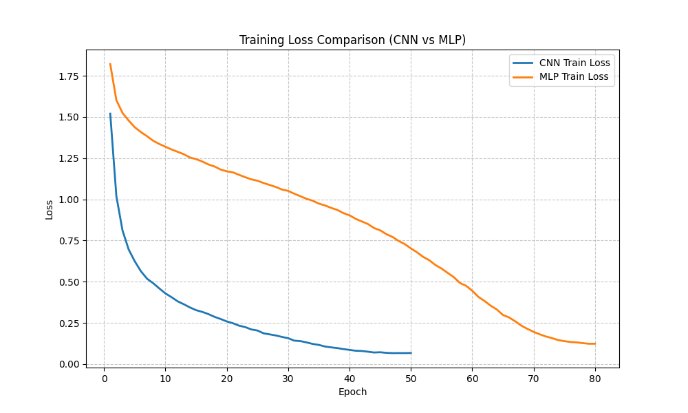 </div> <center>图 9：训练集与验证集 Loss 曲线</center>

从 loss 曲线来看，CNN 的训练 loss 下降速度明显快于 MLP。

- CNN 在前 10 个 epoch 内就从 1.52 降到 0.43，而 MLP 同期仅从 1.82 降到 1.32。

- CNN loss 在 20~30 epoch 后趋于平稳并低于 0.2，而 MLP 即使训练到 80 epoch，loss 仍在 0.12 左右徘徊。

整体趋势显示 CNN 收敛速度快且最终 loss 值较低，表明 **CNN 在 CIFAR-10 上更容易捕捉到图像特征，从而实现更高的训练效果**。

<div style="text-align: center;"> 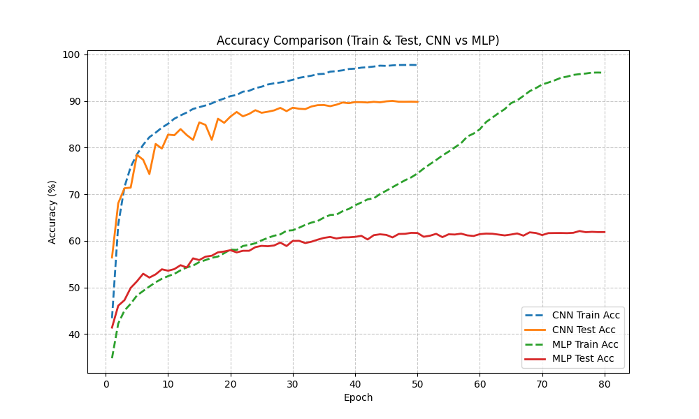 </div> <center>图 10：训练集与验证集 Loss 曲线</center>

从训练精度和测试精度曲线来看：

- CNN：Train Acc 从 43% 快速上升到接近 97%，测试精度从 56% 上升到约 90%，说明 CNN 能很好地拟合训练数据且泛化能力强。

- MLP：Train Acc 从 34% 上升到 96%，测试精度仅从 41% 提升到 62%，显示 MLP 在训练集上拟合能力较好，但泛化到测试集时效果有限。

整体趋势：CNN 的训练与测试曲线更接近，曲线平滑且收敛迅速；MLP 曲线差距较大，说明过拟合现象较明显。

### 四、MLP 与 CNN 对比分析

结合 loss 和 acc 曲线可以得出：

- 收敛速度：CNN 收敛明显比 MLP 快，10~20 个 epoch 内已达到较低 loss 与高准确率，而 MLP 需要近 80 个 epoch 才接近收敛。

- 最终性能：CNN 测试精度约 90%，MLP 仅约 62%，差距明显。

- 特征提取能力：CNN 利用卷积结构能够捕捉局部空间特征，适合图像分类；MLP 是全连接结构，对局部特征不敏感，导致泛化能力不足。

- 过拟合情况：MLP 训练精度远高于测试精度，CNN 则训练/测试曲线更接近，过拟合现象较轻。

结论：在 CIFAR-10 图像分类任务中，**CNN 在收敛速度、最终精度和泛化能力上均优于深层 MLP**。

## Task 3

### 一、实验目标与任务说明

- 本任务为开放型实验，目标是自行构建图像数据集，并训练一个深度学习模型完成多分类任务，同时实现完整的训练、评估与预测展示流程。

- 本实验选择食品图像分类任务，对三类常见食品进行识别：**汉堡（Hamburger）、馅饼（Pie）、寿司（Sushi）**

### 二、数据集构成与预处理

1. 数据集来源与组成

    本实验数据集为自行收集并整理的图像数据集，包含不同拍摄角度、背景、光照条件下的食品图片，具有一定现实复杂性。数据集采用 ImageFolder 标准结构组织如下：
  
      ```kotlin
      dataset/
      ├── train/
      │   ├── hamburger/
      │   ├── pie/
      │   └── sushi/
      └── val/
          ├── hamburger/
          ├── pie/
          └── sushi/
      ```

     - 训练集（train）：用于模型参数学习；

     - 验证集（val）：用于评估模型泛化能力。

2. 图像预处理（preprocess\.py）

    为保证数据质量和模型输入一致性，实验中对所有图像进行了统一预处理：

   - 非 RGB 图像统一转换为 RGB；

   - 所有图像强制缩放至 224 × 224；

   - 自动删除损坏或无法读取的图片。

    该步骤通过 preprocess\.py 脚本一次性完成，为后续训练提供规范化输入。

### 三、模型结构与训练设置

1. 模型结构

    实验采用 **ResNet-18** 作为基础网络结构：

      - 使用 ImageNet 预训练权重进行迁移学习；

      - 替换最后的全连接层，使输出维度为 3（对应三类食品）；

      - 网络整体结构稳定、参数量适中，适合小规模自建数据集。

2. 训练配置

   - **损失函数**：交叉熵损失（CrossEntropyLoss）

   - **优化器**：SGD（momentum = 0.9）

   - **学习率**：0.001

   - **Batch Size**：32

   - **训练轮数**：10 epochs

3. 数据增强策略

    为提升模型泛化能力，训练阶段引入了轻量级数据增强：

   - 随机水平翻转（RandomHorizontalFlip）

   - 随机旋转（RandomRotation）

    验证集不使用任何增强操作。

### 四、训练日志

```log
2025-12-30 02:12:08,783 | INFO | ========== Training Started ==========
2025-12-30 02:12:08,785 | INFO | Device: cuda:0
2025-12-30 02:12:08,786 | INFO | Epochs: 10, Batch size: 32
2025-12-30 02:12:08,850 | INFO | Class names: ['hamburger', 'pie', 'sushi']
2025-12-30 02:12:12,937 | INFO | Epoch 1/10
2025-12-30 02:12:21,157 | INFO | TRAIN | Loss: 0.8309 | Acc: 0.6067
2025-12-30 02:12:23,140 | INFO | VAL | Loss: 0.4494 | Acc: 0.8533
2025-12-30 02:12:23,141 | INFO | Epoch 2/10
2025-12-30 02:12:27,211 | INFO | TRAIN | Loss: 0.4284 | Acc: 0.8375
2025-12-30 02:12:28,005 | INFO | VAL | Loss: 0.3101 | Acc: 0.9100
2025-12-30 02:12:28,008 | INFO | Epoch 3/10
2025-12-30 02:12:32,904 | INFO | TRAIN | Loss: 0.2795 | Acc: 0.9075
2025-12-30 02:12:33,719 | INFO | VAL | Loss: 0.2533 | Acc: 0.9200
2025-12-30 02:12:33,721 | INFO | Epoch 4/10
2025-12-30 02:12:37,941 | INFO | TRAIN | Loss: 0.2293 | Acc: 0.9258
2025-12-30 02:12:38,712 | INFO | VAL | Loss: 0.2529 | Acc: 0.9167
2025-12-30 02:12:38,713 | INFO | Epoch 5/10
2025-12-30 02:12:42,843 | INFO | TRAIN | Loss: 0.1547 | Acc: 0.9525
2025-12-30 02:12:43,708 | INFO | VAL | Loss: 0.2238 | Acc: 0.9133
2025-12-30 02:12:43,710 | INFO | Epoch 6/10
2025-12-30 02:12:47,543 | INFO | TRAIN | Loss: 0.1276 | Acc: 0.9667
2025-12-30 02:12:48,309 | INFO | VAL | Loss: 0.2176 | Acc: 0.9267
2025-12-30 02:12:48,310 | INFO | Epoch 7/10
2025-12-30 02:12:52,441 | INFO | TRAIN | Loss: 0.1139 | Acc: 0.9692
2025-12-30 02:12:53,315 | INFO | VAL | Loss: 0.2050 | Acc: 0.9267
2025-12-30 02:12:53,317 | INFO | Epoch 8/10
2025-12-30 02:12:57,555 | INFO | TRAIN | Loss: 0.0821 | Acc: 0.9767
2025-12-30 02:12:58,407 | INFO | VAL | Loss: 0.1966 | Acc: 0.9333
2025-12-30 02:12:58,408 | INFO | Epoch 9/10
2025-12-30 02:13:02,422 | INFO | TRAIN | Loss: 0.0685 | Acc: 0.9817
2025-12-30 02:13:03,295 | INFO | VAL | Loss: 0.2099 | Acc: 0.9133
2025-12-30 02:13:03,297 | INFO | Epoch 10/10
2025-12-30 02:13:07,326 | INFO | TRAIN | Loss: 0.0603 | Acc: 0.9833
2025-12-30 02:13:08,228 | INFO | VAL | Loss: 0.2035 | Acc: 0.9300
2025-12-30 02:13:08,495 | INFO | Model saved as food_model_final.pth
2025-12-30 02:13:08,662 | INFO | Training finished successfully.
```

### 五、Loss 与 Accuracy 曲线分析

1. Loss 曲线

    <div style="text-align: center;"> 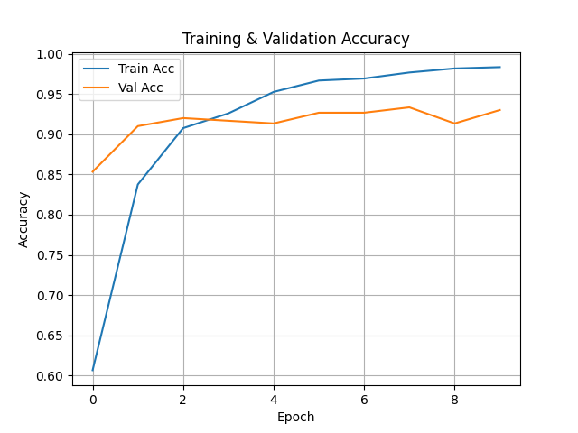 </div> <center>图 9：训练集与验证集 Loss 曲线</center>

     - 训练 loss 随 epoch 稳定下降，表明模型逐步收敛；

     - 验证 loss 与训练 loss 走势一致，未出现明显发散；

     - 未观察到明显过拟合现象。

2. Accuracy 曲线

    <div style="text-align: center;"> 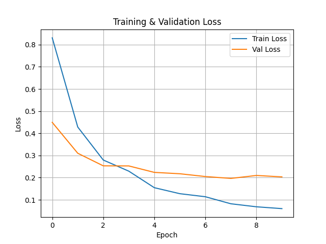 </div> <center>图 11：训练集与验证集 Accuracy 曲线</center>

    - 训练准确率持续上升；

    - 验证准确率在后期趋于稳定；

    - 模型在自建数据集上表现出较好的泛化能力。

### 六、模型预测与 GUI 演示（app\.py）

  为展示模型的实际应用效果，本实验基于 tkinter 实现了一个简易图形界面（GUI），支持：

- 图片路径选择；

- 拖拽图片输入；

- 实时显示预测类别与置信度。

1. 简单样例预测

<div style="text-align: center;">
  
  
  
</div>

<center>图 12：简单样例预测结果</center>

- 模型能够正确识别食品类别；

- 预测置信度较高，说明模型对典型样本学习充分。

1. 困难样例预测

<div style="text-align: center;">
  
  
  
</div>

<center>图 13：困难样例预测结果</center>

- 在使用较难分辨的图像时，模型的反应可分析出一些模型的特征依据：
  
  - 寿司应具有丰富多彩的颜色：比如对于汉堡、寿司、饼均存在的图会被识别为寿司；

  - 寿司应具有白色的米饭部分：比如对于魔丸表情和素描寿司均识别为寿司。
