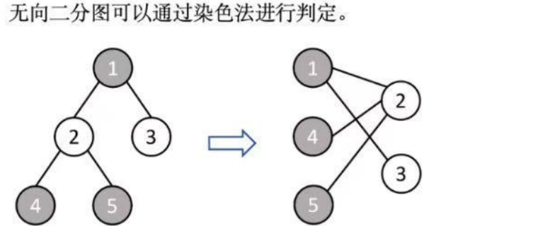
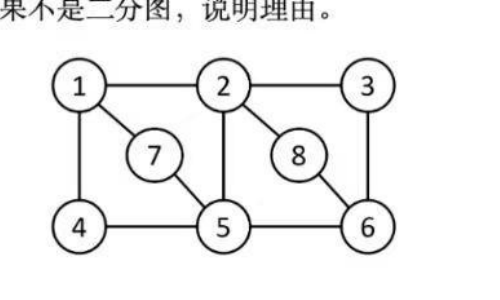
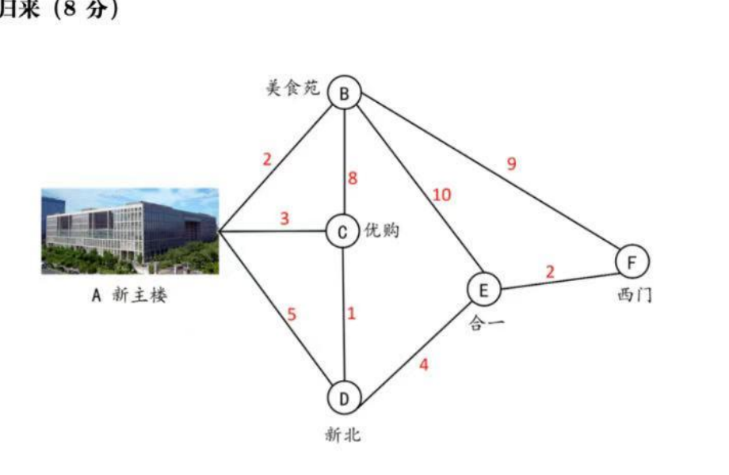
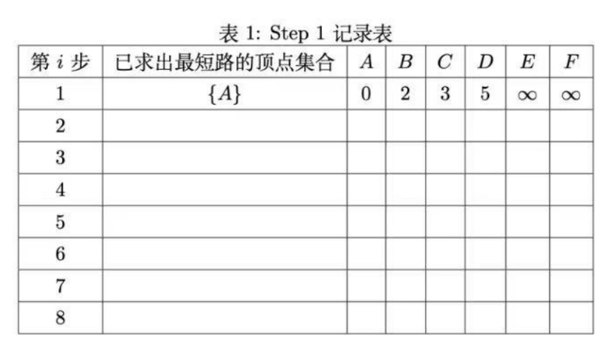
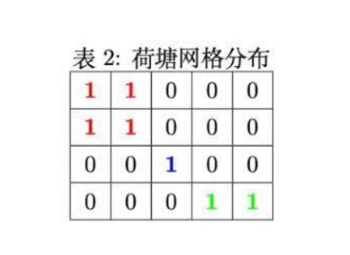

# 算法设计与分析 2021–2022 学年第二学期期末试卷（来源待确认）参考答案

北京航空航天大学人工智能研究院 · 2022 年春季《算法设计与分析》考卷 · 日期：2022.06.27

## 一、判断题（共 15 分，每题 3 分）

### 题目

正确：T，错误：F。请判断 T/F，并作简要解释。

1. （　）对任意渐近非负函数 $f(n)$，满足 $f(n)+o(f(n))=\Theta(f(n))$。
2. （　）如果一个动态规划问题，满足最优子结构的性质，则其局部最优解也是全局最优。
3. （　）令 $T$ 是带权无向图 $G$ 的最小生成树。则对任意点对 $(s,t)$， $s\ne t$，在 $G$ 中从 $s$ 到 $t$ 的最短路径也是在 $T$ 中从 $s$ 到 $t$ 的最短路径。
4. （　）存在一个多项式时间复杂度的算法，它能找到有向图 $G$ 中从源点 $s$ 到汇点 $t$ 的最小割。
5. （　）如果在有向图 $G$ 中加入一条新的边， $G$ 中的强连通分量的数量不变。

### 答案

1. **T**。若 $g=o(f)$，则 $g<f$，故 $f+o(f)=\Theta(f)$。
2. **F**。最优子结构说的是“全局最优 $\Rightarrow$ 局部（子问题）最优”，即“局部最优 $\Rightarrow$ 全局最优”不成立；还需满足无后效性等条件。
3. **F**。最小生成树只保证总权重最小，不保证任意点对间的路径都是最短路；否则求多源最短路只需一棵生成树，与已知结论矛盾。
4. **T**。由最大流最小割定理，网络最大流的多项式时间算法（如 Edmonds-Karp， $O(VE^2)$）即可给出最小割。
5. **F**。加入一条新边可能把两个原本独立的强连通分量合并，强连通分量数量会减少。

## 二、简答题（共 20 分，每题 4 分）

### 题目

请分点回答；突出要点，简明扼要，条理清晰。

#### 1. 求时间复杂度

(a) $T(n)=2T(n/8)+\sqrt{n}$

(b) $T(n)=T(n/2)+T(\sqrt{n})+n$

(c) $T(n)=7T(n/2)+\Theta(n^2)$

(d) $T(n)=T(n-1)+\Theta(n)$

#### 2. 图算法的时间复杂度

直接写出以下图算法的时间复杂度。其中，假设图的顶点数是 $n$，边数是 $\Theta(n)$。（6 选 4，多做取前 4 个）

(a) Dijkstra（优先队列）求单源最短路

(b) Kruskal 求最小生成树

(c) Prim（优先队列）求最小生成树

(d) Kosaraju 求强连通分量

(e) 匈牙利算法求二分图最大匹配

(f) Edmonds-Karp (EK) 求网络流最大流

#### 3. 二分图判定与最大匹配

如图 1 中所示，无向二分图可以通过染色法进行判定。



请使用提示方法，判定图 2 是否是二分图。1）如是，改画成二分图，并找出从 X 到 Y 的最大匹配。2）如果不是二分图，说明理由。



#### 4. 分治、动态规划、贪心的基本思想

简要说明分治、动态规划、贪心的基本思想。

#### 5. P、NP、NPC 问题

简要解释 P、NP、NPC 问题。

### 答案

#### 1. 求时间复杂度

(a) $\log_8 2=\tfrac13$。 $n^{\log_8 2}=n^{1/3}$，而 $f(n)=\sqrt n=\Omega(n^{1/3+\varepsilon})$（取 $\varepsilon=\tfrac16$），且 $2f(n/8)=\tfrac{1}{\sqrt2}f(n)<f(n)$，属主定理第 3 种情形，故 $T(n)=\Theta(\sqrt n)$。

(b) $n$ 的下降远比 1 快，可略去低阶项，故 $T(n)\approx T(n/2)+n$，即 $\log_2 1<1$，得 $\Theta(n)$。若已猜 $T(n)=\Theta(n)$，则 $T(\sqrt n)=o(\sqrt n)$ 可归入 $n$ 中。严格来说，先猜 $T(n)=\Theta(n)$，后找常数 $c$ 证之。

(c) $\log_2 7>2$，故 $T(n)=\Theta\left(n^{\log_2 7}\right)$。

(d) $T(n)=\Theta(n)+\Theta(n-1)+\cdots+\Theta(1)=\Theta\!\left(\dfrac{(n+1)n}{2}\right)=\Theta(n^2)$。

#### 2. 图算法的时间复杂度

（顶点数 $n$，边数 $\Theta(n)$）

(a) Dijkstra（优先队列）求单源最短路： $O(n\log n)$

(b) Kruskal 求最小生成树： $O(n\log n)$

(c) Prim（优先队列）求最小生成树： $O(n\log n)$

(d) Kosaraju 求强连通分量： $O(V+E)=O(n)$

(e) 匈牙利算法求二分图最大匹配： $O(V\cdot E)=O(n^2)$

(f) Edmonds-Karp (EK) 求网络流最大流： $O(V\cdot E^2)=O(n^3)$

#### 3. 二分图判定与最大匹配

是二分图（可用染色法判定）。改画成二分图后，一侧为 $\{1,5,8,3\}$，另一侧为 $\{2,7,4,6\}$。

最大匹配为 4：

$$
8-2,\qquad 1-7,\qquad 5-4,\qquad 3-6 .
$$

#### 4. 分治、动态规划、贪心的基本思想

- 分治：分为不重叠子问题，解决，合并。
- 动态规划：分为重叠子问题，找最优子结构 $\Rightarrow$ 递推 $\Rightarrow$ 返解。
- 贪心：单步子问题，局部贪 $\Rightarrow$ 证正确性。

#### 5. P、NP、NPC 问题

- P： $\mathrm{poly}(n)$ 可解。
- NP：存在 $\mathrm{poly}(n)$ 可验证。
- NPC： $\pi\in\mathrm{NP}$，且所有 NP 问题可在 $\mathrm{poly}(n)$ 内归约为 $\pi$。

## 三、算法运行实例题（1 题，共 8 分）

### 题目

#### 1. 自习归来（8 分）



如图 3 是一张北航小地图。当前，Alex 正在新主楼（A）自习，他想知道从 $A$ 到 $B,C,D,E,F$ 的最短距离。请使用 Dijkstra 算法帮帮 Alex。请在表 1 中，计算第 $i$ 步时当前的求得的最短距离，将迭代过程补充完整。



### 答案

#### 1. 自习归来（8 分）

| 第 $i$ 步 | 已求出最短路的顶点集合 | $A$ | $B$ | $C$ | $D$ | $E$ | $F$ |
| --- | --- | --- | --- | --- | --- | --- | --- |
| 1 | $\{A\}$ | 0 | 2 | 3 | 5 | $\infty$ | $\infty$ |
| 2 | $\{A,B\}$ | 0 | 2 | 3 | 5 | 12 | 11 |
| 3 | $\{A,B,C\}$ | 0 | 2 | 3 | 4 | 12 | 11 |
| 4 | $\{A,B,C,D\}$ | 0 | 2 | 3 | 4 | 8 | 11 |
| 5 | $\{A,B,C,D,E\}$ | 0 | 2 | 3 | 4 | 8 | 10 |
| 6 | $A\sim F$ | 0 | 2 | 3 | 4 | 8 | 10 |

即 $A$ 到 $B,C,D,E,F$ 的最短距离分别为 $2,3,4,8,10$。

## 四、算法设计与分析题（4 题，共 57 分）

### 题目

均需要简要说明算法思路，给出伪代码、并分析时间复杂度。

#### 1. 新北食堂（12 分）

众所周知，新北食堂二楼有一个自助点餐区，各道菜排成一排。Alex 准备大吃一顿。每道菜都有对应的愉悦值。但有一个限制条件，Alex 不能够拿相邻两道菜。

给定列表 $dishes[1\ldots n]$ 表示每道菜的愉悦值，请计算 Alex 本次能够取到的最大愉悦值。（保证至少有一道菜）

样例输入： $dishes=[1,2,3,1]$；输出：4；解释：拿第 1 和第 3 道菜，有最大愉悦值 $1+3=4$。

#### 2. 回文记忆（12 分）

给定一个字符串 $S$，如“上上海海自自来来水”，我们可以通过这些字符 $c\in S$ 构造出一个回文串：“上海自来水来自海上”。求用 $S$ 中字符构造出的最长的回文串的长度。

样例输入： $S=\text{“}abHHHHdd\text{”}$；输出：7；解释：可以构造出最长回文串“ $HHdadHH$”，其长度为 7。

#### 3. 绿园荷塘（13 分）

Alex 化身小天鹅，身处绿园荷塘。荷塘是由 1（荷叶）和 0（水）组成的二维网格，请计算出荷塘中连成片的荷叶（称其为荷叶片）数量。荷叶片总是被水包围，且每个荷叶片只能由水平方向或竖直方向上相邻的荷叶连接形成。此外，可以假设绿园荷塘边界的四条边都被水包围。

样例：输入一个网格列表 $grid=[[1,1,0,0,0],[1,1,0,0,0],[0,0,1,0,0],[0,0,0,1,1]]$，输出：3，解释如表 2 所示，包含了三个荷叶片。



#### 4. 妙妙对（20 分）

给定一个集合 $S$， $S$ 中含有 $n$ 个互异的实数，其中 $n=2^k+1$， $k\ge 0$。称满足公式 (1) 条件的 $x,y\in S$ 为妙妙对 $(x,y)$。

$$
|x-y|\le\frac{1}{n-1}\left(\max_{z\in S}z-\min_{z\in S}z\right)\tag{1}
$$

直观上，妙妙对 $(x,y)$ 的距离 $|x-y|$，最大即为 $S'$ 中相邻两数距离的平均值，其中 $S'$ 是 $S$ 排序后的结果。

(a)（4 分）判断下述结论是否成立，如果成立请简要证明，如果不成立请说明理由。任意含有 $n\ge 2$ 个实数的集合 $S$ 中，一定存在至少一个妙妙对。

(b)（4 分）假设将集合 $S$ 通过比较与 $p$（ $p\in S$）的大小关系，分成两个子集 $S_1$ 和 $S_2$。 $S_1=\{x\in S\mid x\le p\}$， $S_2=\{x\in S\mid x\ge p\}$。

请证明：(i) 所有在 $S_1$ 中的妙妙对 $(x,y)$ 也是 $S$ 中的妙妙对；或者 (ii) 所有在 $S_2$ 中的妙妙对 $(x,y)$ 也是 $S$ 中的妙妙对。(i) 与 (ii) 必满足其一。

并请给出一个时间复杂度尽可能低的策略，求出 $k\in\{1,2\}$，使得在 $S_k$ 中的妙妙对 $(x,y)$ 也是 $S$ 中的妙妙对。

(c)（12 分）请给出一个时间复杂度尽可能低的算法，找到 $S$ 中的任意一个妙妙对。说明算法思路，给出伪代码，并分析时间复杂度。

### 答案

#### 1. 新北食堂（12 分）

思路：把不相邻取菜看作二分图上的最大权独立集。黑白染色（奇数号染黑、偶数号染白）构建二分图，再转化为流网络：源点 $S\to L$、 $R\to T$，容量为该菜的愉悦值；相邻两菜之间连容量为 $\infty$ 的边，方向 $L\to R$。于是问题转化为“取点使 $L,R$ 之间有边至少取走一个”，即最小割，故

$$
ans=\sum_i dish[i]-\text{最小割}=\sum_i dish[i]-\text{最大流}.
$$

伪代码：菜编号为奇 $\Rightarrow L$，为偶 $\Rightarrow R$，构建流网络，相邻编号连边、方向 $L\to R$，求最大流。

复杂度：若用 Ford-Fulkerson， $T=O(V\cdot f^*)=O(n\cdot f^*)$；若用 EK， $T=O(VE^2)=O(n^3)$（因 $E\ge n-1$）。

**动态规划解法（更优）**：设 $D[i]$ 表示前 $i$ 道菜可取得的最大愉悦值，边界 $D[0]=0$、 $D[1]=dishes[1]$，状态转移方程为

$$
D[i]=\max\big(D[i-1],\,D[i-2]+dishes[i]\big)\quad (2\le i\le n),
$$

并用 $rec[i]$ 记录第 $i$ 道菜是否被选取，时间复杂度 $O(n)$。

#### 2. 回文记忆（12 分）

统计字符数。设各字符频数为 $c_1,c_2,\dots$，则

$$
ans=\sum_{c_i\ \text{为偶}}c_i+\sum_{c_i\ \text{为奇}}(c_i-1)+\begin{cases}1,&\text{存在奇频数字符}\\0,&\text{否则}\end{cases}
$$

即遍历一次统计字符频数，按上式求和即为 $ans$。 $O(n)$， $n$ 为字符数。

#### 3. 绿园荷塘（13 分）

DFS。将值为“1”的点作为起点，相邻为 1 的点有方向。遍历 DFS 所有点，找连通图数量，即为 $ans$。先将所有点视为未访问（white）， $ans=0$。

```text
ans <- 0
DFS(G):
    if color[v] == white:
        Visit(v)
        ans <- ans + 1

Visit(v):
    color[v] <- Gray
    for u in Adj(v):
        if color[u] == white: Visit(u)
    color[v] <- Black
```

复杂度：点 $O(mn)$，边 $O(mn)$，故 $T=O(V+E)=O(mn)$， $mn$ 为池塘行列之积。

#### 4. 妙妙对（20 分）

(a) 成立。研究排序后的集合 $S'$，相邻两数之差中最小者必为妙妙对： $S'$ 的相邻差之和为 $\max S-\min S$，共 $n-1$ 个差，故其最小值不超过平均值 $\dfrac{1}{n-1}\left(\max_{z\in S}z-\min_{z\in S}z\right)$，即满足式 (1)。

(b) 把 $S$ 升序排成 $S'$，关注 $S_1,S_2$ 内部的相邻元素差序列 $A,B$。设 $m=\min S$， $M=\max S$， $n_1=|S_1|$， $n_2=|S_2|$，则

$$
\mathrm{aver}(A)=\frac{p-m}{n_1-1},\qquad
\mathrm{aver}(B)=\frac{M-p}{n_2-1},
$$

而 $\mathrm{aver}(S)=\dfrac{M-m}{n-1}$ 是 $\mathrm{aver}(A)$ 与 $\mathrm{aver}(B)$ 关于 $(n_1-1),(n_2-1)$ 的加权平均（因 $(n_1-1)+(n_2-1)=n-1$）。若 $\mathrm{aver}(A)\le \mathrm{aver}(B)$，则 $\mathrm{aver}(S)\ge \mathrm{aver}(A)$， $S_1$ 中的妙妙对必为 $S$ 中的妙妙对；反之则 $S_2$ 中的妙妙对必为 $S$ 中的妙妙对。故 (i) 与 (ii) 必满足其一。

策略：① 排序；② 求差序列；③ 求 average 并判断， $O(n\log n)$。优化后不必排序，从定义出发直接扫描 $S$ 求出 $m,M,n_1,n_2$，若 $\mathrm{aver}(A)\le \mathrm{aver}(B)$ 则 $k=1$，反之 $k=2$，即扫描一遍 $S$ 即可， $O(n)$。

(c) 分治。找中位数 $p$，同 (b) 分成两个集合，用 $O(n)$ 时间判断 $k=1$ 或 $k=2$，递归进入 $S_k$；随机选择主元，期望复杂度为 $O(n)$。

```text
Find_Pair(S):
    if |S| == 2: return S 中的两个元素
    p <- Select_Median(S)                  // O(n) 线性时间选择
    S1 <- {x in S : x <= p};  S2 <- {x in S : x >= p}
    m <- min S;  M <- max S;  n1 <- |S1|;  n2 <- |S2|
    averA <- (p - m) / (n1 - 1)
    averB <- (M - p) / (n2 - 1)
    if averA <= averB: return Find_Pair(S1)
    else:              return Find_Pair(S2)
```

递归式 $T(n)=T(n/2)+\Theta(n)=\Theta(n)$。
