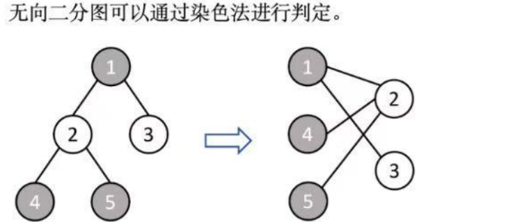
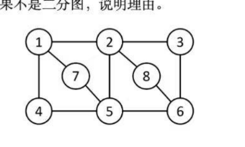
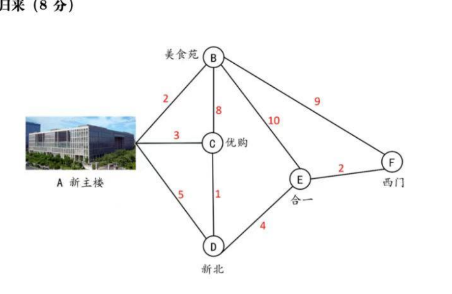
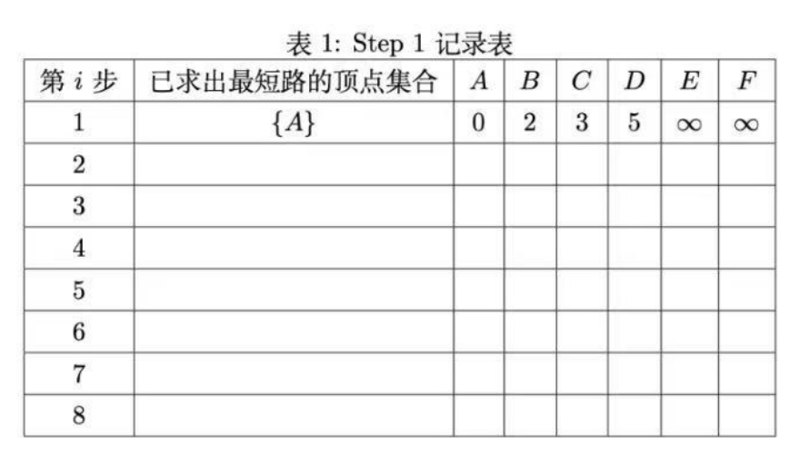
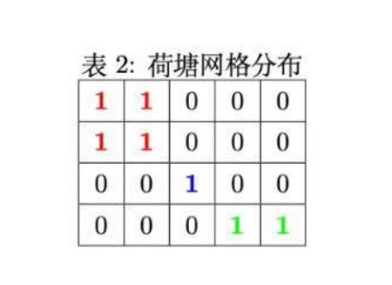

# 算法设计与分析 2021–2022 学年第二学期期末试卷（来源待确认）

北京航空航天大学人工智能研究院 · 2022 年春季《算法设计与分析》考卷 · 考试用时：120 分钟 · 日期：2022.06.27

## 一、判断题（共 15 分，每题 3 分）

正确：T，错误：F。请判断 T/F，并作简要解释。

1. （　）对任意渐近非负函数 $f(n)$，满足 $f(n)+o(f(n))=\Theta(f(n))$。
2. （　）如果一个动态规划问题，满足最优子结构的性质，则其局部最优解也是全局最优。
3. （　）令 $T$ 是带权无向图 $G$ 的最小生成树。则对任意点对 $(s,t)$， $s\ne t$，在 $G$ 中从 $s$ 到 $t$ 的最短路径也是在 $T$ 中从 $s$ 到 $t$ 的最短路径。
4. （　）存在一个多项式时间复杂度的算法，它能找到有向图 $G$ 中从源点 $s$ 到汇点 $t$ 的最小割。
5. （　）如果在有向图 $G$ 中加入一条新的边， $G$ 中的强连通分量的数量不变。

## 二、简答题（共 20 分，每题 4 分）

请分点回答；突出要点，简明扼要，条理清晰。

### 1. 求时间复杂度

(a) $T(n)=2T(n/8)+\sqrt{n}$

(b) $T(n)=T(n/2)+T(\sqrt{n})+n$

(c) $T(n)=7T(n/2)+\Theta(n^2)$

(d) $T(n)=T(n-1)+\Theta(n)$

### 2. 图算法的时间复杂度

直接写出以下图算法的时间复杂度。其中，假设图的顶点数是 $n$，边数是 $\Theta(n)$。（6 选 4，多做取前 4 个）

(a) Dijkstra（优先队列）求单源最短路

(b) Kruskal 求最小生成树

(c) Prim（优先队列）求最小生成树

(d) Kosaraju 求强连通分量

(e) 匈牙利算法求二分图最大匹配

(f) Edmonds-Karp (EK) 求网络流最大流

### 3. 二分图判定与最大匹配

如图 1 中所示，无向二分图可以通过染色法进行判定。

请使用提示方法，判定图 2 是否是二分图。1）如是，改画成二分图，并找出从 X 到 Y 的最大匹配。2）如果不是二分图，说明理由。

### 4. 分治、动态规划、贪心的基本思想

简要说明分治、动态规划、贪心的基本思想。

### 5. P、NP、NPC 问题

简要解释 P、NP、NPC 问题。

## 三、算法运行实例题（1 题，共 8 分）

### 1. 自习归来（8 分）

如图 3 是一张北航小地图。当前，Alex 正在新主楼（A）自习，他想知道从 $A$ 到 $B,C,D,E,F$ 的最短距离。请使用 Dijkstra 算法帮帮 Alex。请在表 1 中，计算第 $i$ 步时当前的求得的最短距离，将迭代过程补充完整。

## 四、算法设计与分析题（4 题，共 57 分）

均需要简要说明算法思路，给出伪代码、并分析时间复杂度。

### 1. 新北食堂（12 分）

众所周知，新北食堂二楼有一个自助点餐区，各道菜排成一排。Alex 准备大吃一顿。每道菜都有对应的愉悦值。但有一个限制条件，Alex 不能够拿相邻两道菜。

给定列表 $dishes[1\ldots n]$ 表示每道菜的愉悦值，请计算 Alex 本次能够取到的最大愉悦值。（保证至少有一道菜）

样例输入： $dishes=[1,2,3,1]$；输出：4；解释：拿第 1 和第 3 道菜，有最大愉悦值 $1+3=4$。

### 2. 回文记忆（12 分）

给定一个字符串 $S$，如“上上海海自自来来水”，我们可以通过这些字符 $c\in S$ 构造出一个回文串：“上海自来水来自海上”。求用 $S$ 中字符构造出的最长的回文串的长度。

样例输入： $S=\text{“}abHHHHdd\text{”}$；输出：7；解释：可以构造出最长回文串“ $HHdadHH$”，其长度为 7。

### 3. 绿园荷塘（13 分）

Alex 化身小天鹅，身处绿园荷塘。荷塘是由 1（荷叶）和 0（水）组成的二维网格，请计算出荷塘中连成片的荷叶（称其为荷叶片）数量。荷叶片总是被水包围，且每个荷叶片只能由水平方向或竖直方向上相邻的荷叶连接形成。此外，可以假设绿园荷塘边界的四条边都被水包围。

样例：输入一个网格列表 $grid=[[1,1,0,0,0],[1,1,0,0,0],[0,0,1,0,0],[0,0,0,1,1]]$，输出：3，解释如表 2 所示，包含了三个荷叶片。

### 4. 妙妙对（20 分）

给定一个集合 $S$， $S$ 中含有 $n$ 个互异的实数，其中 $n=2^k+1$， $k\ge 0$。称满足公式 (1) 条件的 $x,y\in S$ 为妙妙对 $(x,y)$。

$$
|x-y|\le\frac{1}{n-1}\left(\max_{z\in S}z-\min_{z\in S}z\right)\tag{1}
$$

直观上，妙妙对 $(x,y)$ 的距离 $|x-y|$，最大即为 $S'$ 中相邻两数距离的平均值，其中 $S'$ 是 $S$ 排序后的结果。

(a)（4 分）判断下述结论是否成立，如果成立请简要证明，如果不成立请说明理由。任意含有 $n\ge 2$ 个实数的集合 $S$ 中，一定存在至少一个妙妙对。

(b)（4 分）假设将集合 $S$ 通过比较与 $p$（ $p\in S$）的大小关系，分成两个子集 $S_1$ 和 $S_2$。 $S_1=\{x\in S\mid x\le p\}$， $S_2=\{x\in S\mid x\ge p\}$。

请证明：(i) 所有在 $S_1$ 中的妙妙对 $(x,y)$ 也是 $S$ 中的妙妙对；或者 (ii) 所有在 $S_2$ 中的妙妙对 $(x,y)$ 也是 $S$ 中的妙妙对。(i) 与 (ii) 必满足其一。

并请给出一个时间复杂度尽可能低的策略，求出 $k\in\{1,2\}$，使得在 $S_k$ 中的妙妙对 $(x,y)$ 也是 $S$ 中的妙妙对。

(c)（12 分）请给出一个时间复杂度尽可能低的算法，找到 $S$ 中的任意一个妙妙对。说明算法思路，给出伪代码，并分析时间复杂度。
