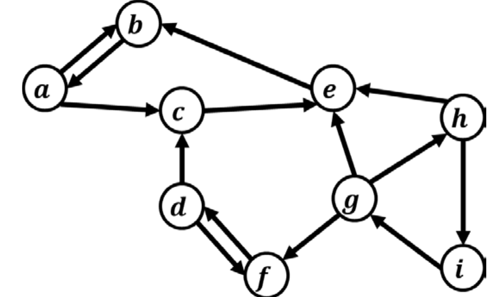
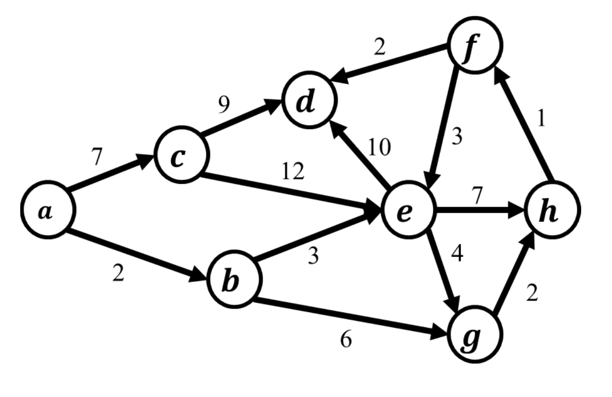

# 算法设计与分析 2022–2023 学年第一学期期末试卷（A 卷）参考答案

## 一、填空题（每小题 3 分，共 12 分）

### 题目

从如下 5 个选项中选择与结果对应的一个选项，仅给出答案即可，无需证明。

(a) $\Theta(1)$　(b) $\Theta(n)$　(c) $\Theta(n\log n)$　(d) $\Theta(n^{\log_2 3})$　(e) $\Theta(n^2)$

**1.** $\sum_{i=2022}^{n}\frac{n}{i}$ 为__________

**2.** 递归式 $T(n) = 3T(n/2) + \log n$， $T(1) = 1$ 的解为__________

**3.** 在包含 $2^{10}$ 个元素的数组上进行快速排序算法，其运行时间为__________

**4.** 对于包含 $n$ 个顶点的无向完全图，其最小生成树的边数为__________

### 答案

**1.** (c)， $n\sum \frac{1}{i}$、 $n \cdot \log n$。

**2.** (d)， $\log_2 3$、 $\log n < n^{\log_2 3 - \varepsilon}$。

**3.** 未作答，卷面只写了两个问号。

**4.** $n - 1$。

**1.** $\sum_{i=2022}^{n} \frac{n}{i} = n(H_n - H_{2021}) = \Theta(n \log n)$，选 (c)，与答题纸一致。

**2.** 主定理第 3 种情形： $f(n) = \log n = O(n^{\log_2 3 - \varepsilon})$，故 $T(n) = \Theta(n^{\log_2 3})$，选 (d)，与答题纸一致。

**3.** 元素个数固定为 $2^{10}$，是常数，运行时间不随任何规模参数增长，故为 $\Theta(1)$，选 (a)。若出题本意是问“ $n$ 个元素上快速排序的平均运行时间”，则为 $\Theta(n \log n)$，选 (c)。题面只写“包含 $2^{10}$ 个元素的数组”，此处按字面取 (a)。

**4.** 任何含 $n$ 个顶点的树都有 $n-1$ 条边，最小生成树是树，故为 $n-1$，与答题纸一致。

## 二、判断题（每小题 3 分，共 12 分）

### 题目

对下面的每个描述，请判断其是正确或错误，或无法判断正误。对于你判为错误或无法判断正误的描述，请说明它为何是错的或为何无法判断。

**1.** 任何 NPC 问题和任何 NP-Hard 问题都是 NP 问题。

**2.** $P$ 问题 $\cap$ $NPC$ 问题 $= \varnothing$。

**3.** 对于任意一个包含 $n$ 个点的图 $G(V, E)$，如果能在 $O(n^9)$ 时间求出其最大独立集，那么所有的 $NPC$ 问题都可以在多项式时间复杂度内被解决。

**4.** 给定一个包含 $n$ 个点的图 $G$，判断图 $G$ 中是否包含大小为 5 的团无法在多项式时间内被解决。

### 答案

**1.** 错（×）。理由：NP 难—— $\forall \pi' \in NP$ 可归化为 $\pi$，归化后不一定解于 poly 时间。

**2.** 无法判断。二种情况未知：① $P = NP = NPC$；② $P \neq NP$ 时 $P \cap NPC = \varnothing$。

**3.** 对（✓）。理由：最大独立集是 NPC 问题（指数级），若优化版可在 $n^9$ 解决，则决策版亦可 $\Rightarrow$ NPC $\Rightarrow$ $P = NP$。

**4.** 错（×）。理由：团即全连接图， $C_n^5$ 枚举 $\Rightarrow$ poly( $n$)。

**1.** NPC $\subseteq$ NP，但 NP-Hard 不一定属于 NP（例如停机问题），故该描述错。

**2.** 结论依赖 $P$ 是否等于 $NP$：若 $P = NP$ 则 $P = NPC$，交集非空；若 $P \neq NP$，由 $P \subseteq NP$ 与 NPC 的 NP-完全性可证 $P \cap NPC = \varnothing$。 $P$ 与 $NP$ 是否相等尚未解决，故无法判断。

**3.** 最大独立集的判定版本“图中是否存在大小为 $k$ 的独立集”是 NPC 问题；若能在 $O(n^9)$ 求出最大独立集（优化版本），则可用它解判定版本，从而每个 NPC 问题都可在多项式时间内被解决。该描述正确。

**4.** 判断是否存在大小为 5 的团，只需枚举全部 $\binom{n}{5} = O(n^5)$ 个 5 元顶点子集并检查是否两两相邻，是多项式时间算法，故该描述错。

## 三、强连通分量运行实例（10 分）

### 题目

在如下图所示的有向图 $G$ 上从点 $a$ 开始模拟强连通分量算法的运行过程。



**1.** 按照强连通分量算法在反向图 $G^R$ 执行深度优先搜索（DFS），并根据各顶点的完成时刻顺序 $L$ 填写如下表格。

| 顶点完成时间次序 | 1 | 2 | 3 | 4 | 5 | 6 | 7 | 8 | 9 |
| --- | --- | --- | --- | --- | --- | --- | --- | --- | --- |
| 对应顶点 | | | | | | | | | |

**2.** 在图 $G$ 上再执行一次 DFS 得到每个强连通分量。请写出此 DFS 的执行过程中各顶点的发现时间与完成时间，以及每个强连通分量所包含的顶点集。

| 顶点标号 | $a$ | $b$ | $c$ | $d$ | $e$ | $f$ | $g$ | $h$ | $i$ |
| --- | --- | --- | --- | --- | --- | --- | --- | --- | --- |
| 发现时间 | | | | | | | | | |
| 完成时间 | | | | | | | | | |

强连通分量为：

### 答案

**1.** $L$ 依次为： $h, i, g, f, d, c, e, b, a$。

| 顶点完成时间次序 | 1 | 2 | 3 | 4 | 5 | 6 | 7 | 8 | 9 |
| --- | --- | --- | --- | --- | --- | --- | --- | --- | --- |
| 对应顶点 | $h$ | $i$ | $g$ | $f$ | $d$ | $c$ | $e$ | $b$ | $a$ |

**2.** 表格与强连通分量如下。

| 顶点标号 | $a$ | $b$ | $c$ | $d$ | $e$ | $f$ | $g$ | $h$ | $i$ |
| --- | --- | --- | --- | --- | --- | --- | --- | --- | --- |
| 发现时间 | 1 | 2 | 4 | 9 | 5 | 10 | 13 | 14 | 15 |
| 完成时间 | 8 | 3 | 7 | 12 | 6 | 11 | 18 | 17 | 16 |

强连通分量为： $\{a, b, c, e\}$、 $\{d, f\}$、 $\{g, h, i\}$。

图 $G$ 的边（读图所得，共 14 条）： $a\to b$、 $b\to a$、 $a\to c$、 $c\to e$、 $e\to b$、 $d\to c$、 $d\to f$、 $f\to d$、 $g\to e$、 $g\to f$、 $g\to h$、 $h\to e$、 $h\to i$、 $i\to g$。

在 $G^R$ 上从 $a$ 起 DFS，各顶点完成时刻为 $a = 18$、 $b = 17$、 $c = 15$、 $d = 14$、 $e = 16$、 $f = 13$、 $g = 12$、 $h = 10$、 $i = 11$；按完成时刻升序即得表中次序。

第二次 DFS 按 $L$ 的逆序 $a, b, e, c, d, f, g, i, h$ 依次处理未访问顶点，得上表的发现/完成时间与三个强连通分量。

## 四、Dijkstra 算法运行实例（10 分）

### 题目

**1.** 在如下图所示的有向图上模拟 Dijkstra 算法的运行过程计算出点 $a$ 到其他点的最短路径，完成下表。对每个点 $v$，表中的 $v.d$ 表示 Dijkstra 算法执行过程中点 $v$ 应存储的信息，表格的前两行已给出。



| | $a.d$ | $b.d$ | $c.d$ | $d.d$ | $e.d$ | $f.d$ | $g.d$ | $h.d$ |
| --- | --- | --- | --- | --- | --- | --- | --- | --- |
| $-$ | $\infty$ | $\infty$ | $\infty$ | $\infty$ | $\infty$ | $\infty$ | $\infty$ | $\infty$ |
| $a$ | 0 | 2 | 7 | $\infty$ | $\infty$ | $\infty$ | $\infty$ | $\infty$ |
| | | | | | | | | |
| | | | | | | | | |
| | | | | | | | | |
| | | | | | | | | |
| | | | | | | | | |
| | | | | | | | | |

**2.** 如果将从点 $c$ 到点 $e$ 的边权重改为 $-12$，能否继续使用 Dijkstra 算法计算单源最短路径？若不能，请列举出一种可行的算法（写出算法名称即可）。

### 答案

**1.** 表格（行标为每步选中的顶点）：

| | $a.d$ | $b.d$ | $c.d$ | $d.d$ | $e.d$ | $f.d$ | $g.d$ | $h.d$ |
| --- | --- | --- | --- | --- | --- | --- | --- | --- |
| $a$ | 0 | 2 | 7 | $\infty$ | $\infty$ | $\infty$ | $\infty$ | $\infty$ |
| $b$ | 0 | 2 | 7 | $\infty$ | 5 | $\infty$ | 8 | $\infty$ |
| $e$ | 0 | 2 | 7 | 15 | 5 | $\infty$ | 9 | 12 |
| $c$ | 0 | 2 | 7 | 15 | 5 | $\infty$ | 9 | 12 |
| $g$ | 0 | 2 | 7 | 15 | 5 | $\infty$ | 9 | 11 |
| $h$ | 0 | 2 | 7 | 15 | 5 | 12 | 9 | 11 |
| $f$ | | | | 14 | | 12 | | |
| $d$ | | | | | | | | |

**2.** 不同（不能）。Dijkstra 不正确。B-F 算法（ $|V| - 1$ 次轮，每轮所有边松弛）/ Bellman-Ford。

| | $a.d$ | $b.d$ | $c.d$ | $d.d$ | $e.d$ | $f.d$ | $g.d$ | $h.d$ |
| --- | --- | --- | --- | --- | --- | --- | --- | --- |
| $-$ | $\infty$ | $\infty$ | $\infty$ | $\infty$ | $\infty$ | $\infty$ | $\infty$ | $\infty$ |
| $a$ | 0 | 2 | 7 | $\infty$ | $\infty$ | $\infty$ | $\infty$ | $\infty$ |
| $b$ | 0 | 2 | 7 | $\infty$ | 5 | $\infty$ | 8 | $\infty$ |
| $e$ | 0 | 2 | 7 | 15 | 5 | $\infty$ | 8 | 12 |
| $c$ | 0 | 2 | 7 | 15 | 5 | $\infty$ | 8 | 12 |
| $g$ | 0 | 2 | 7 | 15 | 5 | $\infty$ | 8 | 10 |
| $h$ | 0 | 2 | 7 | 15 | 5 | 11 | 8 | 10 |
| $f$ | 0 | 2 | 7 | 13 | 5 | 11 | 8 | 10 |

最终 $a$ 到各点的最短距离： $a = 0$、 $b = 2$、 $c = 7$、 $d = 13$、 $e = 5$、 $f = 11$、 $g = 8$、 $h = 10$。

图中的边权（读图所得）： $a\to c = 7$、 $a\to b = 2$、 $c\to d = 9$、 $c\to e = 12$、 $b\to e = 3$、 $b\to g = 6$、 $f\to d = 2$、 $f\to e = 3$、 $e\to d = 10$、 $e\to h = 7$、 $e\to g = 4$、 $h\to f = 1$、 $g\to h = 2$。

第 2 小题：不能。出现负权边后，Dijkstra 每次“取出当前 $d$ 最小的顶点并认为其已确定”的贪心依据不再成立——一个已确定的顶点可能经由后面的负权边得到更短的路径，从而被错误地固定。可改用 Bellman-Ford 算法（ $|V| - 1$ 轮，每轮对所有边松弛， $O(|V||E|)$）；若图是 DAG，也可按拓扑序松弛， $O(|V| + |E|)$。

## 五、区间覆盖问题（12 分）

### 题目

给定数轴 $X$ 上 $n$ 个不同点的集合 $\{x_1, x_2 \dots x_n\}$，现希望使用若干个长度为 $l$ 的闭区间来覆盖所有的点，请设计算法找到最少的闭区间个数及此时各个闭区间的范围。写出该算法伪代码，并分析其时间复杂度。时间复杂度为 $O(n \log n)$ 的算法可得满分，时间复杂度高于 $O(n \log n)$ 的算法也会酌情给分。

### 答案

贪心。先将点列升序， $O(n \log n)$。对于左侧未覆盖的最小点，将区间的左端点设在此处，之后循环（考察当前点是否仍在该区间 $l$ 末端覆盖的范围内）。正确性：① 区间右移则需要其它区间来覆盖此点，区间数增多；② 区间左移则浪费，因此左端点取未覆盖的最小点。

```text
Interval_Cover(X[1..n], l):
    sort X ascending
    i <- 1; S <- {}
    while i <= n:
        s <- X[i]                       // 当前最左未覆盖点
        S <- S + {[s, s + l]}
        while i <= n and X[i] <= s + l:
            i <- i + 1
    return S
```

复杂度：排序 $O(n \log n)$，其后只做一遍线性扫描 $O(n)$，总时间 $O(n \log n)$，除排序外只用 $O(1)$ 额外空间。

正确性：设 $x$ 为当前最左未覆盖点。任何可行解都必须有一个区间覆盖 $x$，把该区间的左端点右移到 $x$ 后，它能覆盖的右侧点集不会变小（右移只会让原本在其右侧的点继续落在 $[x, x+l]$ 内，原本在 $x$ 左侧的点已全部被覆盖），故存在一个最优解包含区间 $[x, x+l]$。贪心选择安全，对剩余点重复即可得到最优解。

## 六、寻找非零位问题（14 分）

### 题目

给定一个长度为 $n$ 的数组 $A[1..n]$，其包含的元素为若干个连续的 0 后面接若干个连续的 1（例如 0000011）。题目保证 $A$ 中至少包含一个 0 和一个 1。

**1.** 请设计一个时间复杂度为 $O(\log n)$ 的算法来找出数组 $A$ 中**第一个 1 的位置**并给出算法伪代码。（即找出位置 $k$ 满足 $A[k - 1] = 0, A[k] = 1$）

**2.** 假定数组 $A$ 中 1 的个数 $m$ 远小于数组长度 $n$，请设计一个时间复杂度为 $O(\log m)$ 的算法来找出数组 $A$ 中第一个 1 的位置并给出算法伪代码。

### 答案

**1.** 二分找分界点。

**2.** 从后往前找，每次步长翻倍，初始为“1”，直到下一步走到 0 停止（停到“1”处）；之后每次循环步长 $\div 2$，若是 1 则走，否则 continue，直到步长为 0，此时停到 $A[k]$。

**1.** 数组形如 $0\dots 01\dots 1$，对下标二分：

```text
First_One_LogN(A[1..n]):
    lo <- 1; hi <- n                  // 答案 k 始终在 [lo, hi] 内
    while lo < hi:
        mid <- (lo + hi) / 2
        if A[mid] == 0: lo <- mid + 1
        else:           hi <- mid
    return lo
```

每次循环查询一个元素， $O(1)$；区间每次减半，共 $O(\log n)$ 次查询。

**2.** 第一个 1 的位置 $k = n - m + 1$ 靠近右端，从 $n$ 向左倍增探测先确定一个 $O(m)$ 长的区间，再在其中二分：

```text
First_One_LogM(A[1..n]):
    hi <- n                           // 已知 A[hi] = 1
    step <- 1
    while hi - step >= 1 and A[hi - step] == 1:
        hi <- hi - step
        step <- step * 2
    lo <- max(hi - step + 1, 1)       // 已知 A[lo - 1] = 0（下标合法时）
    while lo < hi:
        mid <- (lo + hi) / 2
        if A[mid] == 0: lo <- mid + 1
        else:           hi <- mid
    return lo
```

倍增阶段共 $O(\log m)$ 步（因为从 $n$ 往左走 $m$ 步就遇到 0），此时区间长度为 $O(m)$，二分又是 $O(\log m)$ 步，合计 $O(\log m)$ 次查询。这与答题纸描述的思路一致。

## 七、最大汇聚度生成树问题（14 分）

### 题目

定义一棵树 $T = (V^T, E^T)$ 的汇聚度 $D$ 为该树中连边最多的点的度数，即：

$$
D = \max_{v \in V^T} Degree(v)
$$

现给定一个连通无向图 $G = (V, E)$，请设计算法找到 $G$ 的一个生成树 $T'$，并使得该树的**汇聚度 $D$ 最大**。写出该算法的伪代码，并分析其时间复杂度。时间复杂度为 $O(|V| + |E|)$ 的算法可得满分，时间复杂度高于 $O(|V| + |E|)$ 的算法也会酌情给分。

### 答案

先找到图中最大度数点 $v$（若多个任选一个） $\to O(V + E)$，遍历边加度、遍历点找 max。之后从 $v$ 开始 BFS 生成树，过程中将点与边加入 $T$ 中（首次访问邻居时加入，color = white）。

任何生成树中顶点 $u$ 的度都不超过 $G$ 中 $u$ 的度，故汇聚度的上界是 $\Delta = \max_{v \in V} \deg_G(v)$。取一个达到 $\Delta$ 的顶点 $r$ 作为根做 BFS（或 DFS）生成树，则 $r$ 与它在 $G$ 中的全部 $\deg_G(r)$ 个邻居都会在树中连边， $r$ 的度恰为 $\Delta$，达到上界，故该生成树最优。

```text
Max_Congestion_Spanning_Tree(G = (V, E)):
    for each v in V: deg[v] <- 0
    for each (u, v) in E:
        deg[u] <- deg[u] + 1
        deg[v] <- deg[v] + 1
    r <- V 中 deg 最大的顶点（并列时任取一个）
    T <- {}
    color[v] <- white for each v in V
    color[r] <- gray
    Q <- empty queue;  Q.push(r)
    while Q not empty:
        u <- Q.pop()
        for each w in Adj(u):
            if color[w] == white:
                color[w] <- gray
                T <- T + {(u, w)}
                Q.push(w)
        color[u] <- black
    return T
```

复杂度：求度数与找最大度点 $O(|V| + |E|)$，BFS $O(|V| + |E|)$，合计 $O(|V| + |E|)$。

## 八、分糖果问题（16 分）

### 题目

老师手中有 $n$ 袋糖果，其中第 $i$ 袋中有 $a_i$ 颗糖，且满足 $\sum a_i = m$。老师希望在不拆开糖果袋的前提下把这 $n$ 袋糖果分给同学。

**1.** 老师希望把糖果均分给两位同学（题目保证 $m$ 是 2 的倍数），请设计算法判断能否完成这一任务。如果无法完成，即返回 NO；如果可以完成，**请输出分配糖果的方案**。写出该算法的伪代码，并分析其时间复杂度。时间复杂度为 $O(mn)$ 的算法可得满分，复杂度高于 $O(mn)$ 的算法也会酌情给分。

**2.** 老师希望把糖果均分给三位同学（题目保证 $m$ 是 3 的倍数），请设计算法判断能否完成这一任务。如果无法完成，即返回 NO；如果可以完成，即返回 YES。写出该算法的伪代码，并分析其时间复杂度。时间复杂度为 $O(m^2 n)$ 的算法可得满分，复杂度高于 $O(m^2 n)$ 的算法也会酌情给分。

### 答案

**1.** 相当于从 $n$ 个数中选数使之和为 $m/2$，判断是否可行。依次考虑糖果袋 $i$（ $1 \to n$），记 $D(j)$ 为从已考虑的袋中是否可凑成 $j$ 颗糖，初始 $D(0) =$ True，其余为 False。注意 $j$ 倒序考虑（ $m/2 \to a_i$，因为小于 $a_i$ 的 $j$ 不会更新），取值为 True/False。最终看 $D(m/2) =$ True。

```text
for i (1 -> n):
    for j (m/2 -> a(i)):
        若 D(j - a(i)) = True 则 D(j) = True
```

记录 $prev(j)$： $j$ 是从哪转移来的，即 $j - a(i)$； $used(j)$：达到 $j$ 使用的糖果编号 $i$。若 $D[m/2] =$ True： $cur = m/2$；while (cur > 0)：将 $used(cur)$ 给 A； $cur = prev(cur)$。剩下给 B。

**1.** 这是 0-1 背包的可行性版本加上方案的记录，答题纸的做法正确。整理成伪代码：

```text
Split_Two(A[1..n], m):
    t <- m / 2
    D[0..t] <- False;  D[0] <- True
    prev[0..t] <- 0;   used[0..t] <- 0
    for i <- 1 to n:
        for j <- t downto A[i]:
            if not D[j] and D[j - A[i]]:
                D[j] <- True
                prev[j] <- j - A[i]
                used[j] <- i
    if not D[t]: return NO
    S <- {};  cur <- t
    while cur > 0:
        S <- S + {used[cur]}
        cur <- prev[cur]
    return S（给第一位同学的袋号，其余袋给第二位同学）
```

复杂度：状态数 $n \times (t + 1) = O(mn)$，每状态 $O(1)$ 转移，合计 $O(mn)$；回溯方案 $O(n)$。

**2.** 三人均分要求把袋子分成三组、每组和为 $m/3$。用 $dp[i][j][k]$ 表示前 $i$ 袋能否使第一位同学拿到 $j$ 颗、第二位同学拿到 $k$ 颗（第三位同学自动拿到 $m - j - k$ 颗）：

```text
Split_Three(A[1..n], m):
    t <- m / 3
    dp[0..t][0..t] <- False;  dp[0][0] <- True
    for i <- 1 to n:
        nd <- dp 的副本（全部置 False）
        for j <- 0 to t:
            for k <- 0 to t:
                if dp[j][k]:
                    nd[j][k] <- True                        // 本袋不给前两位
                    if j + A[i] <= t: nd[j + A[i]][k] <- True
                    if k + A[i] <= t: nd[j][k + A[i]] <- True
        dp <- nd
    if dp[t][t]: return YES
    return NO
```

复杂度：状态数 $O(n \cdot t^2) = O(m^2 n)$，每状态 3 种 $O(1)$ 转移，合计 $O(m^2 n)$，达到满分要求。
