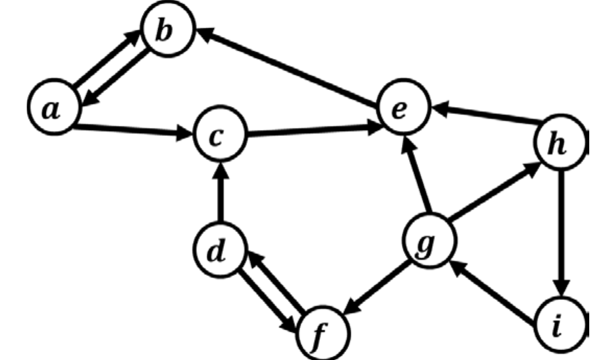
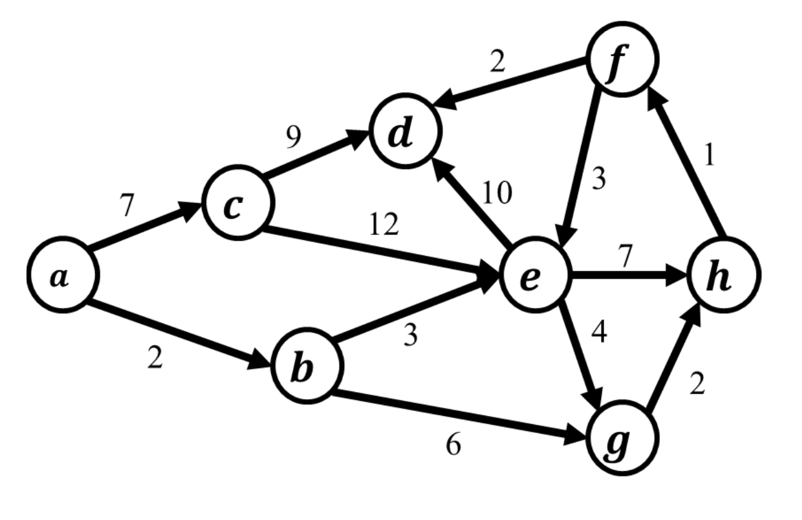

# 算法设计与分析 2022–2023 学年第一学期期末试卷（A 卷）

## 一、填空题（每小题 3 分，共 12 分）

从如下 5 个选项中选择与结果对应的一个选项，仅给出答案即可，无需证明。

(a) $\Theta(1)$　(b) $\Theta(n)$　(c) $\Theta(n\log n)$　(d) $\Theta(n^{\log_2 3})$　(e) $\Theta(n^2)$

**1.** $\sum_{i=2022}^{n}\frac{n}{i}$ 为__________

**2.** 递归式 $T(n) = 3T(n/2) + \log n$， $T(1) = 1$ 的解为__________

**3.** 在包含 $2^{10}$ 个元素的数组上进行快速排序算法，其运行时间为__________

**4.** 对于包含 $n$ 个顶点的无向完全图，其最小生成树的边数为__________

## 二、判断题（每小题 3 分，共 12 分）

对下面的每个描述，请判断其是正确或错误，或无法判断正误。对于你判为错误或无法判断正误的描述，请说明它为何是错的或为何无法判断。

**1.** 任何 NPC 问题和任何 NP-Hard 问题都是 NP 问题。

**2.** $P$ 问题 $\cap$ $NPC$ 问题 $= \varnothing$。

**3.** 对于任意一个包含 $n$ 个点的图 $G(V, E)$，如果能在 $O(n^9)$ 时间求出其最大独立集，那么所有的 $NPC$ 问题都可以在多项式时间复杂度内被解决。

**4.** 给定一个包含 $n$ 个点的图 $G$，判断图 $G$ 中是否包含大小为 5 的团无法在多项式时间内被解决。

## 三、强连通分量运行实例（10 分）

在如下图所示的有向图 $G$ 上从点 $a$ 开始模拟强连通分量算法的运行过程。

**1.** 按照强连通分量算法在反向图 $G^R$ 执行深度优先搜索（DFS），并根据各顶点的完成时刻顺序 $L$ 填写如下表格。

| 顶点完成时间次序 | 1 | 2 | 3 | 4 | 5 | 6 | 7 | 8 | 9 |
| --- | --- | --- | --- | --- | --- | --- | --- | --- | --- |
| 对应顶点 | | | | | | | | | |

**2.** 在图 $G$ 上再执行一次 DFS 得到每个强连通分量。请写出此 DFS 的执行过程中各顶点的发现时间与完成时间，以及每个强连通分量所包含的顶点集。

| 顶点标号 | $a$ | $b$ | $c$ | $d$ | $e$ | $f$ | $g$ | $h$ | $i$ |
| --- | --- | --- | --- | --- | --- | --- | --- | --- | --- |
| 发现时间 | | | | | | | | | |
| 完成时间 | | | | | | | | | |

强连通分量为：

## 四、Dijkstra 算法运行实例（10 分）

**1.** 在如下图所示的有向图上模拟 Dijkstra 算法的运行过程计算出点 $a$ 到其他点的最短路径，完成下表。对每个点 $v$，表中的 $v.d$ 表示 Dijkstra 算法执行过程中点 $v$ 应存储的信息，表格的前两行已给出。

| | $a.d$ | $b.d$ | $c.d$ | $d.d$ | $e.d$ | $f.d$ | $g.d$ | $h.d$ |
| --- | --- | --- | --- | --- | --- | --- | --- | --- |
| $-$ | $\infty$ | $\infty$ | $\infty$ | $\infty$ | $\infty$ | $\infty$ | $\infty$ | $\infty$ |
| $a$ | 0 | 2 | 7 | $\infty$ | $\infty$ | $\infty$ | $\infty$ | $\infty$ |
| | | | | | | | | |
| | | | | | | | | |
| | | | | | | | | |
| | | | | | | | | |
| | | | | | | | | |
| | | | | | | | | |

**2.** 如果将从点 $c$ 到点 $e$ 的边权重改为 $-12$，能否继续使用 Dijkstra 算法计算单源最短路径？若不能，请列举出一种可行的算法（写出算法名称即可）。

## 五、区间覆盖问题（12 分）

给定数轴 $X$ 上 $n$ 个不同点的集合 $\{x_1, x_2 \dots x_n\}$，现希望使用若干个长度为 $l$ 的闭区间来覆盖所有的点，请设计算法找到最少的闭区间个数及此时各个闭区间的范围。写出该算法伪代码，并分析其时间复杂度。时间复杂度为 $O(n \log n)$ 的算法可得满分，时间复杂度高于 $O(n \log n)$ 的算法也会酌情给分。

## 六、寻找非零位问题（14 分）

给定一个长度为 $n$ 的数组 $A[1..n]$，其包含的元素为若干个连续的 0 后面接若干个连续的 1（例如 0000011）。题目保证 $A$ 中至少包含一个 0 和一个 1。

**1.** 请设计一个时间复杂度为 $O(\log n)$ 的算法来找出数组 $A$ 中**第一个 1 的位置**并给出算法伪代码。（即找出位置 $k$ 满足 $A[k - 1] = 0, A[k] = 1$）

**2.** 假定数组 $A$ 中 1 的个数 $m$ 远小于数组长度 $n$，请设计一个时间复杂度为 $O(\log m)$ 的算法来找出数组 $A$ 中第一个 1 的位置并给出算法伪代码。

## 七、最大汇聚度生成树问题（14 分）

定义一棵树 $T = (V^T, E^T)$ 的汇聚度 $D$ 为该树中连边最多的点的度数，即：

$$
D = \max_{v \in V^T} Degree(v)
$$

现给定一个连通无向图 $G = (V, E)$，请设计算法找到 $G$ 的一个生成树 $T'$，并使得该树的**汇聚度 $D$ 最大**。写出该算法的伪代码，并分析其时间复杂度。时间复杂度为 $O(|V| + |E|)$ 的算法可得满分，时间复杂度高于 $O(|V| + |E|)$ 的算法也会酌情给分。

## 八、分糖果问题（16 分）

老师手中有 $n$ 袋糖果，其中第 $i$ 袋中有 $a_i$ 颗糖，且满足 $\sum a_i = m$。老师希望在不拆开糖果袋的前提下把这 $n$ 袋糖果分给同学。

**1.** 老师希望把糖果均分给两位同学（题目保证 $m$ 是 2 的倍数），请设计算法判断能否完成这一任务。如果无法完成，即返回 NO；如果可以完成，**请输出分配糖果的方案**。写出该算法的伪代码，并分析其时间复杂度。时间复杂度为 $O(mn)$ 的算法可得满分，复杂度高于 $O(mn)$ 的算法也会酌情给分。

**2.** 老师希望把糖果均分给三位同学（题目保证 $m$ 是 3 的倍数），请设计算法判断能否完成这一任务。如果无法完成，即返回 NO；如果可以完成，即返回 YES。写出该算法的伪代码，并分析其时间复杂度。时间复杂度为 $O(m^2 n)$ 的算法可得满分，复杂度高于 $O(m^2 n)$ 的算法也会酌情给分。
