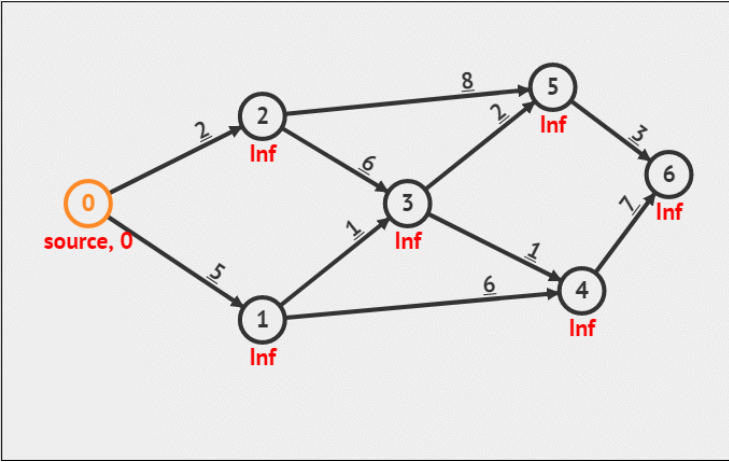

# 算法设计与分析 2025 秋 42 系期末考试参考答案

## 一、填空

### 题目

1. 基于比较的排序算法“最坏情况”的时间复杂度下界是__________。

2. 贪心算法具有__________性质。

3. P问题是指能在__________时间内解决的判定问题。

4. 根据主定理， $ T(n) = aT(n/b) + f(n) $，当 $ f(n) = O(n^{\log_b a - \epsilon}) $ 时， $ T(n) = $__________。

5. $ V = O(\sqrt{n}) , E = O(n) $ 时， Edmunds Karp 算法的复杂度为__________。

### 答案

#### 1. 基于比较的排序算法“最坏情况”的时间复杂度下界是__________

$\Omega(n\log n)$。

$n$ 个元素共有 $n!$ 种排列，比较排序的决策树至少有 $n!$ 个叶子，故树高至少为 $\log_2(n!) = \Theta(n\log n)$。

#### 2. 贪心算法具有__________性质

**贪心选择性质**（同时问题还需具备最优子结构性质）。

贪心选择性质指：问题的整体最优解可以通过一系列局部最优（贪心）的选择得到，即每一步只做当前看来最好的选择，不必考虑子问题的解。

#### 3. P 问题是指能在__________时间内解决的判定问题

**多项式**（polynomial）时间。

#### 4. 根据主定理， $T(n) = aT(n/b) + f(n)$，当 $f(n) = O(n^{\log_b a - \epsilon})$ 时， $T(n) =$__________

$T(n) = \Theta\left(n^{\log_b a}\right)$（主定理第 1 种情形）。

#### 5. $V = O(\sqrt{n})$、 $E = O(n)$ 时，Edmonds-Karp 算法的复杂度为__________

$O(n^{2.5})$。

Edmonds-Karp 算法的时间复杂度为 $O(VE^2)$，代入 $V=O(\sqrt n)$、 $E=O(n)$ 得

$$
O\left(\sqrt n \cdot n^2\right) = O\left(n^{2.5}\right)
$$

## 二、复杂度分析

### 题目

1. $T(n) = T(n - 2) + n^2$

2. $T(n) = T(n / 2) + T(n / 4) + T(n / 8) + n$

3. $T(n) = 2T(n / 7) + n ^ 3$

4. $ T(n) = T(\sqrt{n}) +\log{n} $

5. $T(n) = 2T(n / 2) + n\log{n}$

### 答案

#### 1. $T(n) = T(n - 2) + n^2$

$\Theta(n^3)$。

递推展开 $n/2$ 层：

$$
T(n) = \sum_{i=0}^{n/2-1}(n-2i)^2 = \sum_{j=0}^{n/2-1}(2j)^2 = 4\sum_{j=0}^{n/2-1}j^2 = \Theta(n^3)
$$

#### 2. $T(n) = T(n/2) + T(n/4) + T(n/8) + n$

$\Theta(n)$。

用代入法验证：设 $T(n) = cn$，则

$$
cn = c\cdot\frac n2 + c\cdot\frac n4 + c\cdot\frac n8 + n = \frac{7}{8}cn + n
$$

解得 $\frac{1}{8}cn = n$，即 $c = 8$。存在常数 $c$ 使等式成立，故 $T(n) = \Theta(n)$。

（用 Akra-Bazzi 定理亦可：求 $p$ 使 $(1/2)^p+(1/4)^p+(1/8)^p=1$，得 $p\approx 0.879 < 1$，而 $g(n)=n=\Theta(n^1)$，故 $T(n)=\Theta(n)$。）

#### 3. $T(n) = 2T(n/7) + n^3$

$\Theta(n^3)$。

主定理： $a=2$， $b=7$， $n^{\log_7 2} = n^{0.356}$。而 $f(n) = n^3 = \Omega\left(n^{0.356+\epsilon}\right)$（取 $\epsilon = 2$），且

$$
2f(n/7) = 2\cdot\frac{n^3}{343} = \frac{n^3}{171.5} \le c\,f(n),\quad c = \frac{1}{171.5} < 1
$$

满足主定理第 3 种情形，故 $T(n) = \Theta(n^3)$。

#### 4. $T(n) = T(\sqrt{n}) + \log n$

$\Theta(\log n)$。

令 $m = \log n$（即 $n = 2^m$）， $\sqrt n = 2^{m/2}$。设 $S(m) = T(2^m)$，则原递推化为

$$
S(m) = S(m/2) + m
$$

由主定理（ $a=1$， $b=2$， $f(m)=m=\Omega(m^{0+1})$，第 3 种情形）得 $S(m) = \Theta(m)$，故

$$
T(n) = \Theta(\log n)
$$

也可直接展开验证：递推深度为 $\log_2 \log n$，第 $i$ 层的代价为 $\log n / 2^i$，总和为 $\sum_{i\ge 0}\frac{\log n}{2^i} = 2\log n = \Theta(\log n)$。

#### 5. $T(n) = 2T(n/2) + n\log n$

$\Theta(n\log^2 n)$。

主定理： $a=2$， $b=2$， $n^{\log_2 2} = n$，而 $f(n) = n\log n = \Theta\left(n^{\log_b a}\log^1 n\right)$，属于主定理第 2 种情形（ $k=1$），故

$$
T(n) = \Theta\left(n\log^{1+1} n\right) = \Theta\left(n\log^2 n\right)
$$

## 三、简答题

### 题目

1. 简述 $ BFS $ 的原理，并给出一个实际应用的例子。

2. 简述 $ 0-1 $ 背包和分数背包的区别，并说明贪心算法为何适用于分数背包问题但不适用于0-1背包问题。

3. 简述 $ P $ 、 $ NP $ 、 $ NPC $ 问题的定义，并给出证明一个问题是 $ NPC $ 问题的一般步骤。

### 答案

#### 1. 简述 BFS 的原理，并给出一个实际应用的例子

**原理：** 广度优先搜索（Breadth-First Search）从起始顶点出发，先访问所有与它距离为 1 的顶点，再访问所有距离为 2 的顶点，依次逐层向外扩展，直到遍历完所有可达顶点或找到目标。实现上使用一个先进先出（FIFO）队列：把起点入队并标记为已访问；每次从队首取出一个顶点，遍历它的所有未访问邻接点，把它们标记为已访问并入队；队列为空时结束。BFS 借助队列保证"先被发现的顶点先被扩展"，因此顶点是按到起点的距离（边数）由小到大被访问的。

在**无权图**中，BFS 第一次访问到某顶点时所经过的层数就是起点到该顶点的最短路径长度，因此 BFS 可用于求无权图单源最短路。

**时间复杂度：** 邻接表存储时为 $O(V+E)$；邻接矩阵存储时为 $O(V^2)$。

**应用例子：** 社交网络中求两个人的最短关系链（最少经过几个中间人）；或在网格地图中求起点到终点的最少步数（见第五大题第 3 小题）；也可用于网页爬虫按层抓取、求解迷宫最短路径等。

#### 2. 简述 0-1 背包和分数背包的区别，并说明贪心算法为何适用于分数背包问题但不适用于 0-1 背包问题

**区别：** 0-1 背包中每件物品只有"整件装入"和"不装"两种选择，物品不可分割；分数背包（部分背包）允许把一件物品按任意比例切分后装入，只按实际装入的比例计算价值。

**贪心适用于分数背包的原因：** 分数背包具有贪心选择性质。把物品按单位重量价值 $v_i/w_i$ 从大到小排序，依次尽量多装：装完整件还有剩余容量时，把下一件物品按比例装入剩余容量。由于物品可切分，"先把单位价值最高的装满"这一局部最优选择一定不会使最终结果变差——若最优解中单位价值更高的物品没装满而单位价值更低的物品却装了，把后者换成前者（按重量）不会降低总价值。因此按 $v_i/w_i$ 降序贪心即可得到最优解，时间复杂度为 $O(n\log n)$（排序主导）。

**贪心不适用于 0-1 背包的原因：** 0-1 背包中物品不可分割，按 $v_i/w_i$ 贪心会在"装入一件单位价值高但重量大"的物品后，剩余容量无法再被有效利用，从而错过由若干件单位价值略低但重量小的物品组成的更优组合。例如容量 $W=10$，物品为 $(w,v)=(6,12)$、 $(5,8)$、 $(5,8)$：按单位价值贪心（ $12/6=2$ 最大）先装第一件，剩余容量 4 装不下任何物品，总价值 12；而最优解是装后两件，总价值 16。贪心选择性质在 0-1 背包中不成立，因此必须用动态规划求解。

#### 3. 简述 P、NP、NPC 问题的定义，并给出证明一个问题是 NPC 问题的一般步骤

**定义：**

- **P（Polynomial）类：** 所有能在多项式时间内被**确定性**算法解决的判定问题（答案为"是/否"的问题）的集合。
- **NP（Nondeterministic Polynomial）类：** 所有能在多项式时间内被**验证**的判定问题的集合。即：对该问题的一个"是"实例，存在一个多项式长度的证书（certificate），使确定性算法能在多项式时间内验证该证书的正确性。等价地说，NP 是能被非确定性图灵机在多项式时间内解决的问题类。显然 $P \subseteq NP$。
- **NPC（NP-Complete）类：** NP 中最难的一类问题。若问题 $L$ 满足：① $L \in NP$；② 对任意 $L' \in NP$ 都有 $L' \le_p L$（ $L'$ 可多项式时间归约到 $L$），则称 $L$ 是 NP 完全的。只要有一个 NPC 问题存在多项式时间算法，则 $NP = P$。

**证明一个问题是 NPC 的一般步骤：**

1. **证明 $L \in NP$：** 说明该问题的"是"实例存在一个多项式长度的证书，并且该证书可在多项式时间内被验证。
2. **证明 $L$ 是 NP 难的：** 选取一个**已知的 NPC 问题** $L'$（如 SAT、3-SAT、团问题、顶点覆盖、哈密顿回路、子集和等），构造一个从 $L'$ 到 $L$ 的**多项式时间归约** $L' \le_p L$，即给出一个多项式时间的变换，把 $L'$ 的任意实例映射为 $L$ 的实例，并证明" $L'$ 的实例为是 $\iff$ 变换后 $L$ 的实例为是"。
3. 由 1 和 2 得出 $L$ 是 NPC 问题。

## 四、流程题（非原题，仅供参考）

### 题目

根据 $ dijkstra $ 算法的求解流程，填空下列表格：



| Steps | 0 | 1 | 2 | 3 | 4 | 5 | 6 | Selected Node |
| --- | --- | --- | --- | --- | --- | --- | --- | --- |
| 1 | 0 | $+\infty$ | $+\infty$ | $+\infty$ | $+\infty$ | $+\infty$ | $+\infty$ | 0 |
| 2 | | | | | | | | |
| 3 | | | | | | | | |
| 4 | | | | | | | | |
| 5 | | | | | | | | |
| 6 | | | | | | | | |
| 7 | | | | | | | | |

### 答案

图中各边为 $0\to2$（2）、 $0\to1$（5）、 $2\to3$（6）、 $2\to5$（8）、 $1\to3$（1）、 $1\to4$（6）、 $3\to5$（2）、 $3\to4$（1）、 $5\to6$（3）、 $4\to6$（1）。以 0 为源点执行 Dijkstra 算法，每行给出该步开始时的距离标号与本步选中的结点：

| Steps | 0 | 1 | 2 | 3 | 4 | 5 | 6 | Selected Node |
| --- | --- | --- | --- | --- | --- | --- | --- | --- |
| 1 | 0 | $+\infty$ | $+\infty$ | $+\infty$ | $+\infty$ | $+\infty$ | $+\infty$ | 0 |
| 2 | 0 | 5 | 2 | $+\infty$ | $+\infty$ | $+\infty$ | $+\infty$ | 2 |
| 3 | 0 | 5 | 2 | 8 | $+\infty$ | 10 | $+\infty$ | 1 |
| 4 | 0 | 5 | 2 | 6 | 11 | 10 | $+\infty$ | 3 |
| 5 | 0 | 5 | 2 | 6 | 7 | 8 | $+\infty$ | 4 |
| 6 | 0 | 5 | 2 | 6 | 7 | 8 | 8 | 5 |
| 7 | 0 | 5 | 2 | 6 | 7 | 8 | 8 | 6 |

过程说明：

- 第 1 步选中 0，更新 $d[1]=5$、 $d[2]=2$。
- 第 2 步在未确定结点中 $d[2]=2$ 最小，选中 2，更新 $d[3]=2+6=8$、 $d[5]=2+8=10$。
- 第 3 步 $d[1]=5$ 最小，选中 1，更新 $d[3]=\min(8,5+1)=6$、 $d[4]=5+6=11$。
- 第 4 步 $d[3]=6$ 最小，选中 3，更新 $d[5]=\min(10,6+2)=8$、 $d[4]=\min(11,6+1)=7$。
- 第 5 步 $d[4]=7$ 最小，选中 4，更新 $d[6]=7+1=8$。
- 第 6 步 $d[5]=8$ 最小（与 $d[6]=8$ 并列，取编号小者），选中 5， $d[6]=\min(8,8+3)=8$ 不变。
- 第 7 步选中 6，算法结束。

最终最短距离： $d[1]=5$、 $d[2]=2$、 $d[3]=6$、 $d[4]=7$、 $d[5]=8$、 $d[6]=8$。

## 五、算法设计题

### 题目

1. 给定一个包含 $ n $ 个整数的数组 $ r[1...n] $ ，为 $ n $ 个同学的得分，下面为每个同学分糖果的规则：

   1. 每个同学至少分得一个糖果。

   2. 相邻的同学中，得分高的同学必须比得分低的同学分得更多的糖果。

   请设计一个算法，计算出最少需要多少个糖果才能满足上述规则。请给出算法思路、伪代码和时间复杂度分析。

2. 给定一个矩阵 $ A_{n \times n} $ ，其中每一行从上到下和每一列从左到右都是递增排序的，即 $ A_{ij} < A_{i+1,j} $ 且 $ A_{ij} < A_{i,j+1} $ ，题目保证任意 $ A_{ij} $ 互不相等。题目确保矩阵中存在一个点 $ A_{ij} $ ，使得 $ A_{ij} = i + j $ ，请给出一个算法**快速**找到该点。请给出算法思路、伪代码和时间复杂度分析。

3. 给定一个 $ n $ 行 $ m $ 列的二维网格 $ M $ ，其中一部分单元格有障碍物，无法通行。每个单元格只能从上下左右四个方向进入。

   1. 给定起点 $ S(x_s, y_s) $ 和终点 $ T(x_t, y_t) $ ，请设计一个算法，计算从起点到终点的最短路径长度。如果无法到达终点，返回 -1 。请给出算法思路和时间复杂度分析。

   2. 给定 $ k $ 个点对，求是否有 $ k $ 条互不相交的路径连接对应点对，如果有则给出一种可行方案。请设计一个算法解决该问题，并给出算法思路和时间复杂度分析。
   经验证，该问题为NPC问题，故修改题干如下：给定 **$ k $ 个起点、 $ k $ 个终点** ，求是否有 $ k $ 条互不相交的路径连接**任意一对**起点和终点，且每个起点或终点被使用且仅被使用一次。

4. 给定一个背包容量为 $ W $ 的背包和 $ n $ 件物品，每件物品有重量 $ w_i $ 和价值 $ v_i $ 。

   1. 计算在不超过背包容量的前提下，能够获得的最大总价值。请给出算法思路和时间复杂度分析。

   2. 若相邻物品不能同时选择，计算在不超过背包容量的前提下，能够获得的最大总价值。请给出算法思路和时间复杂度分析。

*L.D.J 记忆版*，特别鸣谢：zzy、wxj、lqc、wzy、jyf、lmz。

### 答案

#### 1. 分糖果问题

**算法思路（两趟贪心）：**

- 第一趟从左到右：只考虑"比左邻居得分高"这一约束，令 $c[1]=1$；对 $i=2..n$，若 $r[i] > r[i-1]$ 则 $c[i] = c[i-1]+1$，否则 $c[i]=1$。这样保证了每个同学比左邻居分高时糖果数严格更多。
- 第二趟从右到左：补上"比右邻居得分高"的约束。对 $i=n-1..1$，若 $r[i] > r[i+1]$ 则 $c[i] = \max(c[i],\ c[i+1]+1)$。取 $\max$ 是为了不破坏第一趟已经满足的左侧约束。
- 答案为 $\sum_{i=1}^{n} c[i]$。

**正确性要点：** 第一趟后所有"左低右高"的相邻对都满足约束；第二趟只可能把 $c[i]$ 调大，而调大 $c[i]$ 不会破坏"左低右高"（它使 $c[i]$ 更大于 $c[i-1]$，若 $r[i]>r[i-1]$ 则约束更满足；若 $r[i]<r[i-1]$ 则该对由第一趟保证 $c[i]\le c[i-1]$，而第二趟只可能让 $c[i]$ 增大到 $c[i+1]+1$；第 $i-1$ 步随即处理 $c[i-1]$，由 $r[i-1]>r[i]$ 得 $c[i-1]\ge c[i]+1$，该约束仍成立）。严格证明可用交换论证：任何可行解的糖果数都逐项不小于本算法给出的 $c[i]$，故本算法达到下界。

**伪代码：**

```text
Candy(r[1..n]):
    c[1..n] ← 1
    for i ← 2 to n do
        if r[i] > r[i-1] then c[i] ← c[i-1] + 1
        else c[i] ← 1
    for i ← n-1 downto 1 do
        if r[i] > r[i+1] then c[i] ← max(c[i], c[i+1] + 1)
    return sum(c[1..n])
```

**复杂度分析：** 两趟独立的线性扫描，时间复杂度 $O(n)$；辅助数组 $c$ 占用 $O(n)$ 空间（若只求总数也可用 $O(n)$，因为第二趟需要从右往左访问 $c[i+1]$）。

#### 2. 在行列均递增的矩阵中快速找到满足 $A_{ij} = i + j$ 的点

**算法思路（阶梯搜索 / staircase search）：** 构造辅助量

$$
B_{ij} = A_{ij} - i - j
$$

在补充假设“元素为整数”的前提下，由 $A_{ij} < A_{i,j+1}$ 得 $A_{i,j+1} \ge A_{ij}+1$，于是

$$
B_{i,j+1} = A_{i,j+1} - i - (j+1) \ge A_{ij} + 1 - i - j - 1 = B_{ij}
$$

同理 $B_{i+1,j} \ge B_{ij}$。因此 $B$ 是一个**行、列都非递减**的矩阵，我们要找的就是 $B_{ij}=0$ 的位置。

从**右上角** $(i,j)=(1,n)$ 出发：

- 若 $B_{ij} = 0$，找到目标，返回 $(i,j)$；
- 若 $B_{ij} > 0$：由于 $B$ 沿列非递减，第 $j$ 列中第 $i$ 行及其下方都 $>0$，整段排除，故**向左移动一列**（ $j \leftarrow j-1$）；
- 若 $B_{ij} < 0$：由于 $B$ 沿行非递减，第 $i$ 行中第 $j$ 列及其左方都 $<0$，整段排除，故**向下移动一行**（ $i \leftarrow i+1$）。

每一步都排除一行或一列，因此最多走 $n-1+n-1$ 步。

**伪代码：**

```text
FindPoint(A[1..n][1..n]):
    i ← 1;  j ← n
    while i ≤ n and j ≥ 1 do
        v ← A[i][j] - i - j
        if v = 0 then return (i, j)
        else if v > 0 then j ← j - 1
        else i ← i + 1
    return 不存在
```

**复杂度分析：** 每轮循环 $i$ 单调增、 $j$ 单调减，总迭代次数不超过 $2n-1$，时间复杂度 $O(n)$，额外空间 $O(1)$。相比逐行二分（ $O(n\log n)$）和暴力枚举（ $O(n^2)$）都更优，符合题目"快速"的要求。

#### 3. 网格中的路径问题

给定 $n$ 行 $m$ 列的二维网格 $M$，部分单元格有障碍物不可通行，每个单元格只能从上下左右四个方向进入。

##### （1）求起点 $S$ 到终点 $T$ 的最短路径长度，不可达返回 -1

**算法思路：** 网格中每走一步的代价都是 1，因此这是一个**无权图最短路**问题，用**广度优先搜索（BFS）**即可。把每个非障碍单元格视为一个顶点，相邻的可通行单元格之间连一条长度为 1 的边。从 $S$ 开始 BFS，用二维数组 $dist$ 记录起点到每个单元格的最短步数（初始为 $+\infty$， $dist[S]=0$）；每次从队列取出一个单元格，检查其上下左右四个邻居，若邻居可通行且尚未被访问，则令 $dist[\text{邻居}] = dist[\text{当前}] + 1$ 并入队。BFS 按距离由小到大扩展，因此第一次到达 $T$ 时的 $dist[T]$ 就是最短路径长度；若 BFS 结束仍未到达 $T$，返回 -1。

**伪代码：**

```text
ShortestPath(M, S, T):
    for each cell u: dist[u] ← +∞
    dist[S] ← 0
    Q ← empty queue;  Q.push(S)
    while Q not empty do
        u ← Q.pop()
        if u = T then return dist[T]
        for each v in 上下左右四邻(u) do
            if v 在网格内 and M[v] 可通行 and dist[v] = +∞ then
                dist[v] ← dist[u] + 1
                Q.push(v)
    return -1
```

**复杂度分析：** 每个单元格最多入队一次，出队时检查 4 个方向，故时间复杂度 $O(nm)$；距离数组与队列占用 $O(nm)$ 空间。

##### （2）给定 $k$ 个起点、 $k$ 个终点，求是否存在 $k$ 条互不相交的路径连接任意一对起点与终点，且每个起点或终点被使用且仅被使用一次

**算法思路（顶点不相交路径 → 最大流）：** 题目要求 $k$ 条**互不相交**（顶点不相交）的路径，且每个起点/终点恰好被用一次。这是经典的**顶点不相交路径**问题，可用**拆点（node splitting）+ 最大流**解决。

1. **拆点建图：** 对网格中每个可通行单元格 $u$，拆成入点 $u_{in}$ 和出点 $u_{out}$，连一条有向边 $u_{in} \to u_{out}$，容量为 1。这条容量为 1 的边保证每个单元格最多被一条路径经过，从而实现顶点不相交。
2. **连移动边：** 对每一对上下左右相邻的可通行单元格 $u,v$，连边 $u_{out} \to v_{in}$ 和 $v_{out} \to u_{in}$，容量均为 1（也可以设为 $+\infty$，因为瓶颈由拆点边控制）。
3. **接源汇：** 新增超级源点 $s$ 与超级汇点 $t$。对每个起点 $p$，连边 $s \to p_{in}$，容量 1；对每个终点 $q$，连边 $q_{out} \to t$，容量 1。容量为 1 保证每个起点/终点最多被使用一次；又因为流量为 $k$ 时 $k$ 条 $s\to t$ 路径各自占用一个起点和一个终点，故“每个起点或终点被使用且仅被使用一次”自动成立。
4. **求最大流：** 用 BFS 找增广路的 Edmonds-Karp 算法（或 Dinic）求 $s$ 到 $t$ 的最大流 $F$。
5. **判定与构造：** 若 $F = k$，则存在满足要求的 $k$ 条互不相交路径。此时在残量网络中从 $s$ 出发沿流量为 1 的边反复追踪 $s \to t$ 路径，每追出一条就把它经过的边从图中删去（保证互不相交），共追出 $k$ 条，即得可行方案。若 $F < k$，则不存在这样的方案。

**为什么任意匹配是多项式可解的：** 由于不再限定"第 $i$ 个起点必须连第 $i$ 个终点"，流量可以自由地把任意起点与任意终点配对，判定问题就退化为一个最大流问题；而原题（给定 $k$ 个固定点对）需要在指定配对下寻找不相交路径，这类问题（如 2-顶点不相交路径问题）一般是 NP 完全的。

**复杂度分析：** 图中顶点数为 $O(nm)$、边数为 $O(nm)$，最大流值不超过 $k$。用 Edmonds-Karp 最多增广 $k$ 次，每次 BFS 为 $O(nm)$，故时间复杂度为 $O(k\cdot nm)$；若用 Dinic 算法，在单位容量图上可进一步优化。空间复杂度 $O(nm)$。

#### 4. 背包问题

给定容量 $W$ 的背包和 $n$ 件物品，第 $i$ 件物品重量 $w_i$、价值 $v_i$。

##### （1）0-1 背包：不超过容量的最大总价值

**算法思路（动态规划）：** 设 $dp[i][w]$ 表示只考虑前 $i$ 件物品、背包容量为 $w$ 时能取得的最大总价值。对第 $i$ 件物品有"不选"和"选"两种决策：

$$
dp[i][w] = \max\bigl(dp[i-1][w],\ dp[i-1][w-w_i] + v_i\bigr),\quad w \ge w_i
$$

当 $w < w_i$ 时只能不选， $dp[i][w] = dp[i-1][w]$。边界为 $dp[0][w] = 0$（前 0 件物品价值为 0）。答案为 $dp[n][W]$。

**伪代码：**

```text
Knapsack(w[1..n], v[1..n], W):
    dp[0..n][0..W] ← 0
    for i ← 1 to n do
        for w ← 0 to W do
            dp[i][w] ← dp[i-1][w]
            if w ≥ w[i] then
                dp[i][w] ← max(dp[i][w], dp[i-1][w - w[i]] + v[i])
    return dp[n][W]
```

**复杂度分析：** 状态数为 $(n+1)(W+1)$，每个状态 $O(1)$ 转移，时间复杂度 $O(nW)$，空间复杂度 $O(nW)$。由于 $dp[i]$ 只依赖 $dp[i-1]$，可用一维滚动数组把空间降到 $O(W)$（内层循环需从大到小枚举 $w$）。

##### （2）相邻物品不能同时选择时的最大总价值

**算法思路（动态规划）：** 在状态中额外体现"第 $i$ 件物品是否被选"，或等价地修改转移来源。设 $dp[i][w]$ 为前 $i$ 件物品、容量 $w$ 的最大价值，且相邻物品不能同时选：

- **不选第 $i$ 件：** $dp[i][w] \leftarrow dp[i-1][w]$（此时第 $i-1$ 件可选可不选，由 $dp[i-1]$ 自行决定）
- **选第 $i$ 件：** 由于第 $i-1$ 件不能选，只能从 $dp[i-2]$ 转移，即 $dp[i][w] \leftarrow dp[i-2][w-w_i] + v_i$

$$
dp[i][w] = \max\bigl(dp[i-1][w],\ dp[i-2][w-w_i] + v_i\bigr),\quad w \ge w_i
$$

边界： $dp[0][w] = 0$， $dp[1][w] = (w \ge w_1)\ ?\ v_1 : 0$。答案为 $dp[n][W]$。

**伪代码：**

```text
KnapsackNoAdjacent(w[1..n], v[1..n], W):
    dp[0..n][0..W] ← 0
    for w ← 0 to W do
        if w ≥ w[1] then dp[1][w] ← v[1]
    for i ← 2 to n do
        for w ← 0 to W do
            dp[i][w] ← dp[i-1][w]
            if w ≥ w[i] then
                dp[i][w] ← max(dp[i][w], dp[i-2][w - w[i]] + v[i])
    return dp[n][W]
```

**复杂度分析：** 状态数与转移次数不变，时间复杂度仍为 $O(nW)$，空间复杂度 $O(nW)$，可用滚动数组（保留最近两行）把空间降到 $O(W)$。
