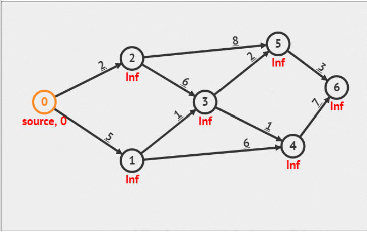

# 算法设计与分析 2025秋42系期末考试

## 一、填空

1. 基于比较的排序算法“最坏情况”的时间复杂度下界是__________。

2. 贪心算法具有__________性质。

3. P问题是指能在__________时间内解决的判定问题。

4. 根据主定理， $ T(n) = aT(n/b) + f(n) $，当 $ f(n) = O(n^{\log_b a - \epsilon}) $ 时， $ T(n) = $__________。

5. $ V = O(\sqrt{n}) , E = O(n) $ 时， Edmunds Karp 算法的复杂度为__________。

## 二、复杂度分析

1. $T(n) = T(n - 2) + n^2$

2. $T(n) = T(n / 2) + T(n / 4) + T(n / 8) + n$

3. $T(n) = 2T(n / 7) + n ^ 3$

4. $ T(n) = T(\sqrt{n}) +\log{n} $

5. $T(n) = 2T(n / 2) + n\log{n}$

## 三、简答题

1. 简述 $ BFS $ 的原理，并给出一个实际应用的例子。

2. 简述 $ 0-1 $ 背包和分数背包的区别，并说明贪心算法为何适用于分数背包问题但不适用于0-1背包问题。

3. 简述 $ P $ 、 $ NP $ 、 $ NPC $ 问题的定义，并给出证明一个问题是 $ NPC $ 问题的一般步骤。

## 四、流程题（非原题，仅供参考）

根据 $ dijkstra $ 算法的求解流程，填空下列表格：

| Steps | 0 | 1 | 2 | 3 | 4 | 5 | 6 | Selected Node |
| --- | --- | --- | --- | --- | --- | --- | --- | --- |
| 1 | 0 | $+\infty$ | $+\infty$ | $+\infty$ | $+\infty$ | $+\infty$ | $+\infty$ | 0 |
| 2 | | | | | | | | |
| 3 | | | | | | | | |
| 4 | | | | | | | | |
| 5 | | | | | | | | |
| 6 | | | | | | | | |
| 7 | | | | | | | | |

## 五、算法设计题

1. 给定一个包含 $ n $ 个整数的数组 $ r[1...n] $ ，为 $ n $ 个同学的得分，下面为每个同学分糖果的规则：

   1. 每个同学至少分得一个糖果。

   2. 相邻的同学中，得分高的同学必须比得分低的同学分得更多的糖果。

   请设计一个算法，计算出最少需要多少个糖果才能满足上述规则。请给出算法思路、伪代码和时间复杂度分析。

2. 给定一个矩阵 $ A_{n \times n} $ ，其中每一行从上到下和每一列从左到右都是递增排序的，即 $ A_{ij} < A_{i+1,j} $ 且 $ A_{ij} < A_{i,j+1} $ ，题目保证任意 $ A_{ij} $ 互不相等。题目确保矩阵中存在一个点 $ A_{ij} $ ，使得 $ A_{ij} = i + j $ ，请给出一个算法**快速**找到该点。请给出算法思路、伪代码和时间复杂度分析。

3. 给定一个 $ n $ 行 $ m $ 列的二维网格 $ M $ ，其中一部分单元格有障碍物，无法通行。每个单元格只能从上下左右四个方向进入。

   1. 给定起点 $ S(x_s, y_s) $ 和终点 $ T(x_t, y_t) $ ，请设计一个算法，计算从起点到终点的最短路径长度。如果无法到达终点，返回 -1 。请给出算法思路和时间复杂度分析。

   2. 给定 $ k $ 个点对，求是否有 $ k $ 条互不相交的路径连接对应点对，如果有则给出一种可行方案。请设计一个算法解决该问题，并给出算法思路和时间复杂度分析。
   经验证，该问题为NPC问题，故修改题干如下：给定 **$ k $ 个起点、 $ k $ 个终点** ，求是否有 $ k $ 条互不相交的路径连接**任意一对**起点和终点，且每个起点或终点被使用且仅被使用一次。

4. 给定一个背包容量为 $ W $ 的背包和 $ n $ 件物品，每件物品有重量 $ w_i $ 和价值 $ v_i $ 。

   1. 计算在不超过背包容量的前提下，能够获得的最大总价值。请给出算法思路和时间复杂度分析。

   2. 若相邻物品不能同时选择，计算在不超过背包容量的前提下，能够获得的最大总价值。请给出算法思路和时间复杂度分析。

*L.D.J 记忆版*，特别鸣谢：zzy、wxj、lqc、wzy、jyf、lmz。
