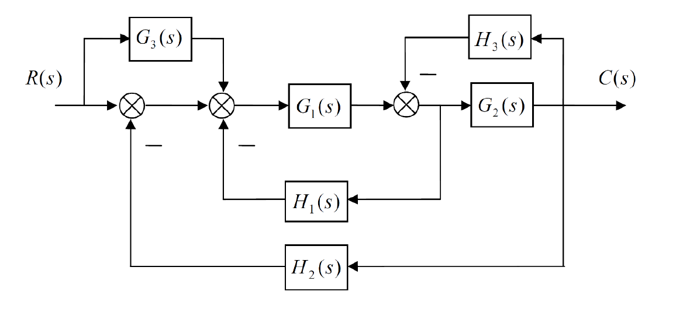
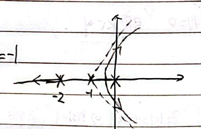
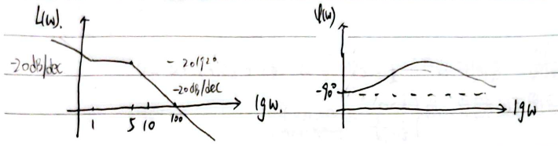

# 自动控制基础 2022–2023 学年第一学期期末试卷参考答案（手写版）

## 一、（本题 15 分）由系统结构图求传递函数

### 题目

已知系统的结构图如下图一所示，求传递函数 $C(s)/R(s)$。

### 答案

用梅森公式。前向通路：

$$
P_1=G_1G_2,\qquad P_2=G_1G_2G_3,
$$

回路：

$$
L_1=-G_1H_1,\qquad L_2=-G_2H_3,\qquad L_3=-G_1G_2H_2,
$$

三个回路两两相接触，故

$$
\Delta=1-(L_1+L_2+L_3)=1+G_1H_1+G_2H_3+G_1G_2H_2,
$$

$\Delta_1=\Delta_2=1$。于是

$$
G(s)=\frac{C(s)}{R(s)}=\frac{G_1G_2+G_1G_2G_3}{1+G_1H_1+G_2H_3+G_1G_2H_2}.
$$

## 二、（本题 15 分）单位负反馈系统的稳定性与稳态误差

### 题目

设单位负反馈系统的开环传递函数为

$$
G(s)=\frac{K}{s\left(\dfrac13 s+1\right)\left(\dfrac16 s+1\right)}
$$

1. 若要求闭环系统稳定，求 $K$ 的取值范围。
2. 若要求闭环特征方程所有根的实部小于 $-1$，求 $K$ 的取值范围。
3. 当 $K=3$ 时，计算在单位斜坡信号 $r(t)=t$ 作用下的稳态误差（误差定义为 $e(t)=r(t)-c(t)$）。

### 答案

#### 1. 若要求闭环系统稳定，求 $K$ 的取值范围

$C(s)/R(s)=G/(1+G)$，其闭环特征方程 $1+G(s)=0$：

$$
\tfrac{1}{18}s^3+\tfrac12 s^2+s+K=0 .
$$

由劳斯判据，要使 $G(s)$ 稳定，有

$$
\begin{cases}
K>0\\
\tfrac12>\dfrac{K}{18}
\end{cases}
\quad\Longrightarrow\quad 0<K<9 .
$$

#### 2. 若要求闭环特征方程所有根的实部小于 $-1$，求 $K$ 的取值范围

记 $\hat{s}=s+1$，有特征方程

$$
\tfrac{1}{18}\hat{s}^3+\tfrac13\hat{s}^2+\tfrac16\hat{s}+K-\tfrac59=0 .
$$

要令各根 $\operatorname{Re}(s)<-1$，即 $\operatorname{Re}(\hat{s})<0$，由劳斯判据有

$$
\begin{cases}
K-\tfrac59>0\\
\tfrac{1}{18}>\dfrac{1}{18}\left(K-\tfrac59\right)
\end{cases}
\quad\Longrightarrow\quad \frac59<K<\frac{14}{9}.
$$

#### 3. 当 $K=3$ 时在单位斜坡信号下的稳态误差

有

$$
\Phi(s)=\frac{C(s)}{R(s)}=\frac{3}{\tfrac{1}{18}s^3+\tfrac12 s^2+s+3},\qquad R(s)=\frac{1}{s^2},
$$

故

$$
C(s)=\Phi(s)R(s)=\frac{1}{s^2}\cdot\frac{3}{\tfrac{1}{18}s^3+\tfrac12 s^2+s+3},
$$

从而

$$
E(s)=R(s)-C(s)=\frac{1}{s^2}\cdot\frac{\tfrac{1}{18}s^3+\tfrac12 s^2+s}{\tfrac{1}{18}s^3+\tfrac12 s^2+s+3}=\frac{1}{s}\cdot\left(\frac{\tfrac{1}{18}s^2+\tfrac12 s+1}{\tfrac{1}{18}s^3+\tfrac12 s^2+s+3}\right).
$$

由拉氏终值定理，有

$$
e_{ss}=\lim_{s\to 0}sE(s)=\frac13 .
$$

## 三、（本题 15 分）根轨迹与调节时间

### 题目

设单位负反馈系统的开环传递函数为

$$
G(s)=\frac{K^*}{s(s+1)(s+2)}
$$

1. 按步骤绘制 $K^*$ 从 $0\to\infty$ 的闭环根轨迹。
2. 计算当系统的主导极点的阻尼比为 0.707 时，系统阶跃响应的调节时间（2% 误差带）。

### 答案

#### 1. 按步骤绘制 $K^*$ 从 $0\to\infty$ 的闭环根轨迹

开环极点 $p_1=0$， $p_2=-1$， $p_3=-2$。渐近线倾角

$$
\varphi_a=\frac{(2k+1)\pi}{3},\qquad k=0,1,2,
$$

即 $\pm 60^\circ$ 与 $180^\circ$；渐近线中心（重心）

$$
\sigma_a=\frac{0+(-1)+(-2)}{3}=-1 .
$$

根轨迹在实轴上位于 $(-\infty,-2]$ 与 $[-1,0]$。出射/会合点由 $\mathrm{d}K/\mathrm{d}s=0$ 确定：草图右侧页边给出 $\dfrac{1}{d}+\dfrac{1}{d+1}+\dfrac{1}{d+2}=0\Rightarrow d=-0.42$；按 $3d^{2}+6d+2=0$ 复算得 $d=-1\pm\dfrac{\sqrt3}{3}$，其中 $d\approx-0.42$ 落在 $[-1,0]$ 段上，与所取值一致，另一根 $d\approx-1.58$ 不在实轴根轨迹段上。

$$
1+G(s)=0\ \Longrightarrow\ s^3+3s^2+2s+K=0 .
$$

与虚轴交点：令 $s=j\omega$，得 $K=6$， $\omega^2=2$。

#### 2. 主导极点阻尼比为 0.707 时的调节时间

$\xi=\dfrac{1}{\sqrt2}\Rightarrow \cos\beta=\dfrac{1}{\sqrt2}\Rightarrow \beta=45^\circ$。设 $s=-x+jx$，代入特征方程有（注意 $K\ne 0$）

$$
\begin{cases}
2x^3-6x^2+2x=0\\
2x^3-2x+K=0
\end{cases}
\quad\Longrightarrow\quad
\begin{cases}
x\approx 0.38\\
K\approx 0.65
\end{cases}
$$

有 $\xi\omega_n=x\approx 0.382$，故按 2% 误差带常用近似

$$
t_s=\frac{4}{\xi\omega_n}\approx 10.5\ \mathrm{s}.
$$

## 四、（本题 15 分）Bode 图与相稳定裕度

### 题目

设单位负反馈系统的开环传递函数为

$$
G(s)=\frac{20(s+1)}{s(0.2s+1)}
$$

绘制其渐近对数幅频特性曲线和对数相频特性曲线，并计算相稳定裕度。

### 答案

分解

$$
G_1=20,\qquad G_2=s+1,\qquad G_3=\frac1s,\qquad G_4=\frac{1}{0.2s+1},
$$

$$
A(\omega)=\frac{20\sqrt{\omega^2+1}}{\omega\sqrt{0.2^2\omega^2+1}},
\qquad
\varphi(\omega)=\arctan\omega-\frac{\pi}{2}-\arctan(0.2\omega).
$$

转折频率： $\omega_2=1$， $\omega_4=5$。渐近对数幅频特性： $\omega<1$ 段斜率 $-20\ \mathrm{dB/dec}$，过 $\omega=1$ 后斜率变为 $0$，过 $\omega=5$ 后斜率变为 $-20\ \mathrm{dB/dec}$；对数相频特性由 $-\pi/2$ 起，先升后降，最终趋于 $-\pi$。

当 $L(\omega)=0$ 时 $\omega_c=100$，有

$$
\varphi(\omega_c)=-87.71^\circ,\qquad
\gamma=\varphi(\omega_c)+\pi=92.29^\circ .
$$

## 五、（本题 10 分）用 Nyquist 判据确定稳定范围

### 题目

设单位负反馈系统的开环传递函数为

$$
G(s)=\frac{K}{s(s^2+2s+4)}
$$

利用 Nyquist 判据确定参数 $K$（ $K>0$）的取值范围，使闭环系统稳定。

### 答案

$$
G(s)=\frac{1}{4s}\cdot\frac{4}{s^2+2s+4}\cdot K .
$$

$\varphi$：由 $-\dfrac{\pi}{2}$ 变化到 $-\dfrac{3\pi}{2}$，Nyquist 曲线与负实轴相交于右旋交点（即 $\varphi=-\pi$ 处）。

对于该交点，取 $\omega=2$，此时 $\varphi=-\pi$，有

$$
A(\omega)=\frac{K}{4}\cdot\frac{1}{j\omega}\cdot\frac{4}{8}=\frac{K}{8},\qquad A(\omega)<1 .
$$

由 $G(s)$ 无正实部极点 $\Rightarrow N=0$，即

$$
0<K<8 .
$$

## 六、（本题 20 分）状态空间系统的可控性、可观测性、稳定性与极点配置

### 题目

设单输入-单输出系统的状态方程和输出方程为

$$
\dot{x}=\begin{bmatrix}0&1&0\\0&0&1\\6&-1&-4\end{bmatrix}x+\begin{bmatrix}0\\0\\1\end{bmatrix}u,
\qquad
y=\begin{bmatrix}-1&1&0\end{bmatrix}x
$$

1. 判断系统的可控性和可观测性（要求说明理由）。
2. 判断系统是否渐近稳定（要求说明理由）。
3. 求传递函数 $Y(s)/U(s)$，并判断是否 BIBO 稳定。
4. 能否通过状态反馈将其闭环极点配置到 $\{-1,-2,-3\}$？如能，求出状态反馈矩阵 $k$。

### 答案

#### 1. 判断系统的可控性和可观测性

$$
S=\begin{bmatrix}b&Ab&A^2b\end{bmatrix}
=\begin{bmatrix}0&0&1\\0&1&-4\\1&-4&15\end{bmatrix},
\qquad |S|=-1\ne 0\ \Rightarrow\ \text{可控}.
$$

$$
V=\begin{bmatrix}c\\cA\\cA^2\end{bmatrix}
=\begin{bmatrix}-1&1&0\\0&-1&1\\6&-1&-5\end{bmatrix},
\qquad |V|=0\ \Rightarrow\ r(V)<3\ \Rightarrow\ \text{不可观}.
$$

#### 2. 判断系统是否渐近稳定

$$
|sI-A|=s^3+4s^2+s-6=0\ \Longrightarrow\ s_1=1,\ s_2=-2,\ s_3=-3 .
$$

可见 $\operatorname{Re}(s_1)>0$，故不渐近稳定。

#### 3. 求传递函数并判断是否 BIBO 稳定

由 $A=\begin{pmatrix}0&1&0\\0&0&1\\6&-1&-4\end{pmatrix}$、 $c=(-1,1,0)$、 $b=\begin{pmatrix}0\\0\\1\end{pmatrix}$，有

$$
G(s)=\frac{Y(s)}{U(s)}=c(sI-A)^{-1}b=\frac{s-1}{s^3+4s^2+s-6}=\frac{s-1}{(s-1)(s+2)(s+3)}=\frac{1}{(s+2)(s+3)} .
$$

极点 $s_1=-2$， $s_2=-3$，故 BIBO 稳定。

#### 4. 闭环极点配置到 $\{-1,-2,-3\}$

有 $k=[k_1,k_2,k_3]$，

$$
bk=\begin{bmatrix}0&0&0\\0&0&0\\k_1&k_2&k_3\end{bmatrix},
\qquad
A-bk=\begin{bmatrix}0&1&0\\0&0&1\\6-k_1&-1-k_2&-4-k_3\end{bmatrix}.
$$

$$
|sI-(A-bk)|=s^3+(4+k_3)s^2+(1+k_2)s+(k_1-6),
$$

$$
(s+1)(s+2)(s+3)=s^3+6s^2+11s+6
\quad\Longrightarrow\quad
\begin{cases}
k_1=12\\
k_2=10\\
k_3=2
\end{cases}
$$

有 $k=[12,\ 10,\ 2]$。

## 七、（本题 10 分）观测器加状态反馈构成的闭环系统不可控

### 题目

设单输入-单输出系统

$$
\begin{cases}
\dot{x}=Ax+bu\\
y=cx
\end{cases},
\qquad x\in\mathbb{R}^n
$$

是既可控又可观测的。现以观测器得到的估计值 $\hat{x}$ 来代替 $x$ 形成状态反馈，即 $u=v-k\hat{x}$。观测器的方程为： $\dot{\hat{x}}=(A-Hc)\hat{x}+bu+Hy$。试证明：由观测器、状态反馈构成的闭环系统是不可控的。

### 答案

已知有

$$
\begin{cases}
\dot{x}=Ax-bk\hat{x}+bv\\
y=cx
\end{cases},
\qquad
\dot{\hat{x}}=(A-Hc-bk)\hat{x}+bv+Hcx .
$$

以 $(x,\hat{x})$ 为状态，有

$$
\begin{pmatrix}\dot{x}\\\dot{\hat{x}}\end{pmatrix}
=\begin{pmatrix}A&-bk\\Hc&A-Hc-bk\end{pmatrix}
\begin{pmatrix}x\\\hat{x}\end{pmatrix}
+\begin{pmatrix}b\\b\end{pmatrix}v,
\qquad
y=\begin{pmatrix}c&0\end{pmatrix}\begin{pmatrix}x\\\hat{x}\end{pmatrix}.
$$

注意 $\hat{b}=\begin{pmatrix}b\\b\end{pmatrix}$，

$$
\hat{A}\hat{b}=\begin{pmatrix}(A-bk)b\\(A-bk)b\end{pmatrix},
\qquad
\hat{A}^2\hat{b}=\begin{pmatrix}(A-bk)^2b\\(A-bk)^2b\end{pmatrix},
$$

有 $\hat{S}=\begin{bmatrix}\hat{b}&\hat{A}\hat{b}&\hat{A}^2\hat{b}\end{bmatrix}$，其每一列的两个分块完全相同，显然 $r(\hat{S})<2n$，故不可控。
