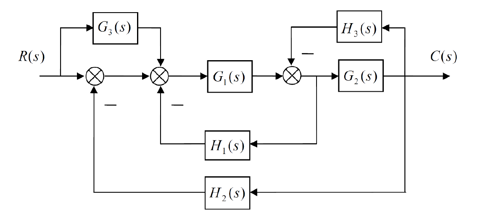

# 自动控制基础 2022–2023 学年第一学期期末试卷

## 一、（本题 15 分）由系统结构图求传递函数

已知系统的结构图如下图一所示，求传递函数 $C(s)/R(s)$。

## 二、（本题 15 分）单位负反馈系统的稳定性与稳态误差

设单位负反馈系统的开环传递函数为

$$
G(s)=\frac{K}{s\left(\dfrac13 s+1\right)\left(\dfrac16 s+1\right)}
$$

1. 若要求闭环系统稳定，求 $K$ 的取值范围。
2. 若要求闭环特征方程所有根的实部小于 $-1$，求 $K$ 的取值范围。
3. 当 $K=3$ 时，计算在单位斜坡信号 $r(t)=t$ 作用下的稳态误差（误差定义为 $e(t)=r(t)-c(t)$）。

## 三、（本题 15 分）根轨迹与调节时间

设单位负反馈系统的开环传递函数为

$$
G(s)=\frac{K^*}{s(s+1)(s+2)}
$$

1. 按步骤绘制 $K^*$ 从 $0\to\infty$ 的闭环根轨迹。
2. 计算当系统的主导极点的阻尼比为 0.707 时，系统阶跃响应的调节时间（2% 误差带）。

## 四、（本题 15 分）Bode 图与相稳定裕度

设单位负反馈系统的开环传递函数为

$$
G(s)=\frac{20(s+1)}{s(0.2s+1)}
$$

绘制其渐近对数幅频特性曲线和对数相频特性曲线，并计算相稳定裕度。

## 五、（本题 10 分）用 Nyquist 判据确定稳定范围

设单位负反馈系统的开环传递函数为

$$
G(s)=\frac{K}{s(s^2+2s+4)}
$$

利用 Nyquist 判据确定参数 $K$（ $K>0$）的取值范围，使闭环系统稳定。

## 六、（本题 20 分）状态空间系统的可控性、可观测性、稳定性与极点配置

设单输入-单输出系统的状态方程和输出方程为

$$
\dot{x}=\begin{bmatrix}0&1&0\\0&0&1\\6&-1&-4\end{bmatrix}x+\begin{bmatrix}0\\0\\1\end{bmatrix}u,
\qquad
y=\begin{bmatrix}-1&1&0\end{bmatrix}x
$$

1. 判断系统的可控性和可观测性（要求说明理由）。
2. 判断系统是否渐近稳定（要求说明理由）。
3. 求传递函数 $Y(s)/U(s)$，并判断是否 BIBO 稳定。
4. 能否通过状态反馈将其闭环极点配置到 $\{-1,-2,-3\}$？如能，求出状态反馈矩阵 $k$。

## 七、（本题 10 分）观测器加状态反馈构成的闭环系统不可控

设单输入-单输出系统

$$
\begin{cases}
\dot{x}=Ax+bu\\
y=cx
\end{cases},
\qquad x\in\mathbb{R}^n
$$

是既可控又可观测的。现以观测器得到的估计值 $\hat{x}$ 来代替 $x$ 形成状态反馈，即 $u=v-k\hat{x}$。观测器的方程为： $\dot{\hat{x}}=(A-Hc)\hat{x}+bu+Hy$。试证明：由观测器、状态反馈构成的闭环系统是不可控的。
