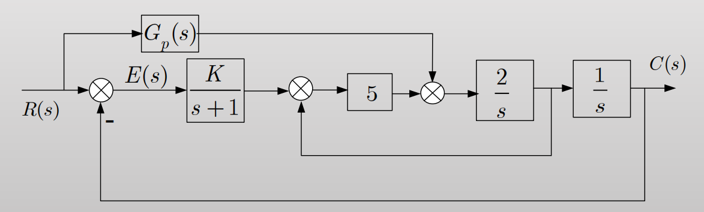
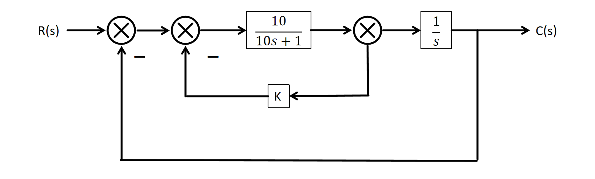
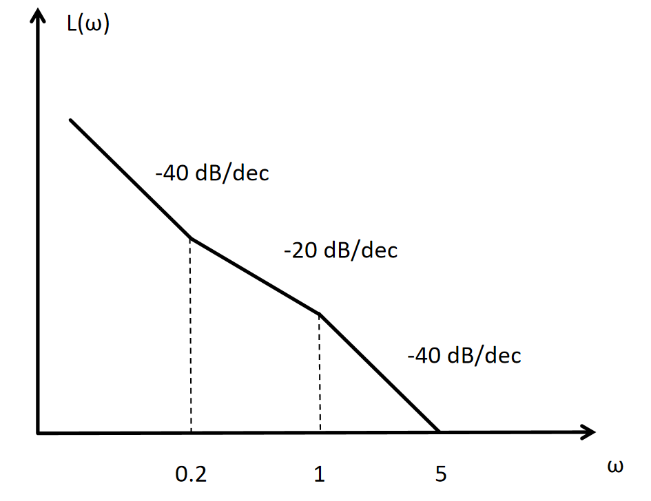

# 自动控制基础 2025 秋 42 系期末考试参考答案

## 一、简答题（15分，每题3分）

### 题目

#### 1. 自动控制的“灵魂”是什么？可以从哪些维度评价一个控制系统的性能？

#### 2. 对于一个二阶系统来说，最佳阻尼比是多少？为什么？

#### 3. 频率特性的定义是什么？为何要用正弦函数为输入信号？

#### 4. 在串联控制系统中，为什么采取滞后控制可以提高系统的相稳定裕度？

#### 5. 系统状态反馈能够将极点配置到任意位置处的充要条件是什么？如果给定极点，那么系统可将极点配置到这些位置的条件可以放宽到什么？

### 答案

#### 1. 自动控制的“灵魂”是什么？可以从哪些维度评价一个控制系统的性能？

自动控制的"灵魂"是**反馈**（工程上通常指**负反馈**）。正是把输出量（或其一部分）引回输入端与给定值比较、形成偏差并据此产生控制作用，系统才具备自动纠正偏差、抵抗扰动和参数变化的能力；没有反馈就谈不上自动控制。

评价控制系统性能的维度通常概括为"**稳、准、快**"三个方面：

| 维度 | 含义 | 主要指标 |
| --- | --- | --- |
| 稳（稳定性） | 系统受到扰动后能否恢复平衡、保持稳定工作 | 极点位置、相稳定裕度 $\gamma$、模稳定裕度 $h$ |
| 准（准确性） | 稳态输出与期望值的接近程度 | 稳态误差 $e_{ss}$、误差系数 $K_p$、 $K_v$、 $K_a$ |
| 快（快速性/动态性能） | 过渡过程的快慢与平稳程度 | 上升时间 $t_r$、调节时间 $t_s$、超调量 $\sigma\%$、振荡次数 |

三者是相互制约的：提高快速性往往降低稳定裕度、增大超调；提高精度（增大开环增益）又会削弱稳定性，因此实际设计要在三者之间折中。

#### 2. 对于一个二阶系统来说，最佳阻尼比是多少？为什么？

二阶系统的最佳阻尼比一般取 $\boxed{\zeta = 0.707 = \dfrac{\sqrt2}{2}}$。

**原因：**

- 从**时域**看， $\zeta = 0.707$ 时超调量约为 $\sigma\% = e^{-\pi\zeta/\sqrt{1-\zeta^2}}\times 100\% \approx 4.3\%$，超调很小、过渡过程平稳；同时在允许一定超调的条件下，调节时间 $t_s \approx \dfrac{3.5}{\zeta\omega_n}$ 较短，兼顾了平稳性与快速性。
- 从**频域**看， $\zeta = 0.707$ 时闭环幅频特性的谐振峰 $M_r = \dfrac{1}{2\zeta\sqrt{1-\zeta^2}} = 1$，即幅频特性在通频带内最平坦（无谐振峰），是工程上常说的"最佳"幅频特性；同时系统的带宽与上升时间的乘积接近最优，快速性好。
- $\zeta$ 过小（如 $0 < \zeta < 0.4$）则振荡剧烈、超调大、调节时间长； $\zeta$ 过大（接近或大于 1）则响应迟缓、上升时间长。 $\zeta=0.707$ 在这两者之间取得最佳折中，故被称为最佳阻尼比。

#### 3. 频率特性的定义是什么？为何要用正弦函数为输入信号？

**频率特性的定义：** 对于线性定常系统，当输入为正弦信号 $r(t) = A\sin(\omega t)$ 时，其稳态输出为同频率的正弦信号 $c(t) = B\sin(\omega t + \varphi)$。输出与输入的**幅值比** $A(\omega) = B/A$ 和**相位差** $\varphi(\omega)$ 随频率 $\omega$ 变化的规律，就称为系统的频率特性，记作

$$
G(j\omega) = A(\omega)e^{j\varphi(\omega)} = P(\omega) + jQ(\omega)
$$

即把系统传递函数 $G(s)$ 中的 $s$ 换成 $j\omega$ 所得到的复数函数。其中 $A(\omega)=|G(j\omega)|$ 称为幅频特性， $\varphi(\omega)=\angle G(j\omega)$ 称为相频特性。

**为何用正弦信号作为输入：**

1. **正弦信号形式简单、易于产生和测量**，实验上用信号发生器和示波器即可准确测出幅值比与相位差，便于用实验方法建立系统模型。
2. **线性定常系统对正弦输入的稳态响应仍是同频正弦信号**，只有幅值和相位发生变化，波形不畸变，因此可以用幅值比和相位差这两个量完整地刻画系统在该频率下的特性。
3. **由傅里叶分析，任何实际信号都可分解为不同频率正弦信号的叠加**。由于线性系统满足叠加原理，分别求出各频率分量作用下的响应再叠加，就能得到系统对任意输入信号的响应，因此频率特性可以推广到一般输入。
4. 频率法还可以方便地分析系统的稳定性与稳定裕度（奈氏判据、对数频率判据），并可用图形（Bode 图、Nyquist 图）直观表示，便于工程设计与校正。

#### 4. 在串联控制系统中，为什么采取滞后控制可以提高系统的相稳定裕度？

滞后校正装置的传递函数为

$$
G_c(s) = \frac{1 + Ts}{1 + \beta Ts},\qquad \beta > 1
$$

它本质上是一个低通滤波器：其对数幅频特性在 $\omega > \dfrac{1}{\beta T}$ 之后以 $-20$ dB/dec 衰减，在高频段总共衰减 $20\lg\beta$ dB，而相频特性在 $\left(\dfrac{1}{\beta T},\ \dfrac{1}{T}\right)$ 区间内为负的相位滞后。

**提高相稳定裕度的机理：**

1. 加入滞后校正后，系统开环对数幅频特性在高频段被压低 $20\lg\beta$ dB，幅值穿越频率 $\omega_c$ 因此**向低频方向移动**。
2. 对最小相位系统而言，开环相频特性 $\varphi(\omega)$ 一般随频率增大而变得更负（相位滞后加大）。因此在新的、更低的穿越频率 $\omega_c'$ 处，开环相角 $\varphi(\omega_c')$ 的负值比原来小。
3. 相稳定裕度 $\gamma = 180^\circ + \varphi(\omega_c)$，由于 $\varphi(\omega_c')$ 变得不那么负， $\gamma$ 随之**增大**，系统的相对稳定性提高。

同时，为保持低频段的开环增益不变（不降低稳态精度），通常把滞后校正装置的 $\beta$ 倍增益补在主通道上，即取 $G_c(s)=\dfrac{1+Ts}{1+\beta Ts}$ 并把系统增益提高 $\beta$ 倍，这样低频段增益提高、稳态误差减小，而高频段仍被衰减。

**代价：** 穿越频率降低使系统带宽变窄，响应速度变慢、调节时间变长。因此滞后校正适用于"稳态精度不足而动态性能已满足要求"的系统。

#### 5. 系统状态反馈能够将极点配置到任意位置处的充要条件是什么？如果给定极点，那么系统可将极点配置到这些位置的条件可以放宽到什么？

**充要条件：系统完全可控。** 即可控性矩阵满秩

$$
\text{rank}\left[b,\ Ab,\ A^2b,\ \ldots,\ A^{n-1}b\right] = n
$$

（多输入系统为 $\text{rank}\left[B,\ AB,\ \ldots,\ A^{n-1}B\right] = n$）。只要系统完全可控，就一定存在状态反馈 $u = v - kx$，使闭环系统矩阵 $A - bk$ 的特征值（极点）可任意配置；反之，若系统不完全可控，则不可控模态的极点无法被状态反馈改变，因而不可能任意配置。

**给定极点时条件可放宽为：系统可镇定（stabilizable）。** 即系统的**不可控部分本身是稳定的**（不可控模态对应的特征值全部位于左半 $s$ 平面）。此时虽然不能把不可控部分的极点移到别处，但它们本来就是稳定的，而可控部分的极点仍可任意配置，因此只要"给定的期望极点中，与不可控模态对应的那部分恰为原系统的稳定极点"，就能通过状态反馈把闭环极点配置到这些位置。

用特征值判据表述：设 $\lambda_i$ 是 $A$ 的特征值，则 $(A,b)$ 可镇定当且仅当

$$
\text{rank}\left[\lambda_i I - A,\ b\right] = n \quad \text{对所有 } \operatorname{Re}\lambda_i \ge 0 \text{ 成立}
$$

即所有不稳定模态都必须可控。

## 二、计算题（15分，每题5分）

### 题目

1. 设单位负反馈系统的开环传递函数为 $ G(s) = \frac { 4 } {s(s + 4)} $ ，求系统阶跃响应的自然频率 $ \omega_n $、阻尼比 $ \zeta $ 和超调量。

2. 设单位负反馈系统的开环传递函数为 $ G(s) = \frac { K(s+1) } {s(s+2)(s + 4)} $ ，若系统稳定，求K的取值范围。**（G(s)非原题，但类似）**

3. 设系统如图所示，确定 $ G_p(s) $ 的表达式，使得系统在单位斜坡信号 $ r(t) = t, t > 0 $ 下的稳态误差为零。（定义误差 $ e(t) = r(t) - c(t) $ ）

### 答案

#### 1. 求 $G(s)=\dfrac{4}{s(s+4)}$ 系统的 $\omega_n$、 $\zeta$ 和超调量

单位负反馈系统的闭环传递函数为

$$
\Phi(s) = \frac{G(s)}{1+G(s)} = \frac{\dfrac{4}{s(s+4)}}{1+\dfrac{4}{s(s+4)}} = \frac{4}{s(s+4)+4} = \frac{4}{s^2+4s+4} = \frac{4}{(s+2)^2}
$$

与二阶系统标准形式 $\Phi(s)=\dfrac{\omega_n^2}{s^2+2\zeta\omega_n s+\omega_n^2}$ 比较：

$$
\omega_n^2 = 4 \ \Rightarrow\ \boxed{\omega_n = 2\ \text{rad/s}}
$$

$$
2\zeta\omega_n = 4 \ \Rightarrow\ \zeta = \frac{4}{2\times 2} = \boxed{1}
$$

由于 $\zeta = 1$，系统处于**临界阻尼**状态，阶跃响应单调上升、无振荡、无超调，故

$$
\boxed{\sigma\% = 0\%}
$$

（两个闭环极点重合于 $s=-2$。）

#### 2. 求 $G(s)=\dfrac{K(s+1)}{s(s+2)(s+4)}$ 系统稳定时 $K$ 的取值范围

单位负反馈系统的特征方程为 $1 + G(s) = 0$，即

$$
s(s+2)(s+4) + K(s+1) = 0
$$

展开 $s(s+2)(s+4) = s(s^2+6s+8) = s^3+6s^2+8s$，得

$$
s^3 + 6s^2 + (8+K)s + K = 0
$$

列劳斯表：

| $s^3$ | $1$ | $8+K$ |
| --- | --- | --- |
| $s^2$ | $6$ | $K$ |
| $s^1$ | $\dfrac{6(8+K)-K}{6} = \dfrac{48+5K}{6}$ | $0$ |
| $s^0$ | $K$ | |

系统稳定要求劳斯表第一列全为正：

$$
1 > 0,\qquad 6 > 0,\qquad \frac{48+5K}{6} > 0,\qquad K > 0
$$

前两项恒成立， $48+5K>0$ 要求 $K>-9.6$，与 $K>0$ 综合得

$$
\boxed{K > 0}
$$

即只要 $K$ 为正，系统就稳定。

#### 3. 确定 $G_p(s)$ 使单位斜坡输入下稳态误差为零

按图， $R(s)$ 一路进入第一个比较点（与 $C(s)$ 负反馈相减）得 $E(s)=R(s)-C(s)$，经 $\dfrac{K}{s+1}$ 后进入第二个比较点（与 $\dfrac{2}{s}$ 的输出负反馈相减），再经增益 $5$ 进入第三个比较点； $R(s)$ 另一路经 $G_p(s)$ 前馈到第三个比较点；其后依次经 $\dfrac{2}{s}$ 和 $\dfrac{1}{s}$ 得到 $C(s)$。 $\dfrac{2}{s}$ 的输出还引回第二个比较点作负反馈。

记 $A=\dfrac{K}{s+1}E$， $D$ 为 $\dfrac{2}{s}$ 的输出， $B=A-D$，则

$$
D = \frac{2}{s}\left(5B + G_p(s)R\right) = \frac{10}{s}(A-D) + \frac{2}{s}G_p(s)R
$$

整理得

$$
D\cdot\frac{s+10}{s} = \frac{10A + 2G_p(s)R}{s}
\ \Longrightarrow\
D = \frac{10A + 2G_p(s)R}{s+10}
$$

又 $C = \dfrac{1}{s}D$， $A = \dfrac{K}{s+1}(R-C)$，代入并整理得

$$
\frac{C(s)}{R(s)} = \frac{10K + 2G_p(s)(s+1)}{s(s+10)(s+1)+10K}
$$

于是误差

$$
E(s) = R(s) - C(s) = R(s)\cdot\frac{(s+1)\left[s(s+10) - 2G_p(s)\right]}{s(s+10)(s+1)+10K}
$$

对单位斜坡输入 $r(t)=t$， $R(s)=\dfrac{1}{s^2}$，由终值定理

$$
e_{ss} = \lim_{s\to 0}sE(s) = \lim_{s\to 0}\frac{1}{s}\cdot\frac{(s+1)\left[s(s+10)-2G_p(s)\right]}{s(s+10)(s+1)+10K}
= \frac{1}{10K}\lim_{s\to 0}\frac{s^2+10s-2G_p(s)}{s}
$$

要使 $e_{ss}=0$，只需被求极限的分子是 $s$ 的高阶无穷小，即

$$
2G_p(s) = s^2 + 10s + O(s^2)\ \text{在 } s\to 0 \text{ 时}
$$

取最简单的一组解

$$
\boxed{G_p(s) = 5s}
$$

**验证：** 取 $G_p(s)=5s$，则 $s(s+10)-2G_p(s) = s^2+10s-10s = s^2$，于是

$$
E(s) = \frac{1}{s^2}\cdot\frac{(s+1)s^2}{s(s+10)(s+1)+10K} = \frac{s+1}{s(s+10)(s+1)+10K}
$$

$$
e_{ss} = \lim_{s\to0}sE(s) = \lim_{s\to0}\frac{s(s+1)}{s(s+10)(s+1)+10K} = 0
$$

满足要求。

## 三、解答题（15分）

### 题目

1. 某速度反馈系统如图所示，请按步骤画出 $ K $ 从 $ 0 $ 到正无穷变化时的根轨迹。（10分）

2. 当主导极点的阻尼比为 $ \zeta = 0.5 $ ，求 $ K $ 的大小。（5分）

### 答案

#### 1. 画出 $K$ 从 $0$ 到 $+\infty$ 变化时的根轨迹（10 分）

按图， $R(s)$ 经第一个比较点（ $C(s)$ 负反馈）后进入第二个比较点（ $K$ 支路负反馈），经 $\dfrac{10}{10s+1}$，再经 $\dfrac{1}{s}$ 输出 $C(s)$； $K$ 支路的输入取自 $\dfrac{10}{10s+1}$ 的输出。记 $X$ 为 $\dfrac{10}{10s+1}$ 的输出，则

$$
E_1 = R - C,\qquad E_2 = E_1 - KX,\qquad X = \frac{10}{10s+1}E_2,\qquad C = \frac{1}{s}X
$$

由 $X = \dfrac{10}{10s+1}(E_1 - KX)$ 解得 $X = \dfrac{10E_1}{10s+1+10K}$，于是

$$
C = \frac{10E_1}{s(10s+1+10K)}
$$

闭环特征方程（ $E_1 = -C$ 时）为

$$
s(10s+1+10K) + 10 = 0
\ \Longrightarrow\
10s^2 + (1+10K)s + 10 = 0
$$

整理成根轨迹标准形式

$$
1 + K\cdot\frac{10s}{10s^2+s+10} = 0
$$

即等效开环传递函数为

$$
G_0(s)H_0(s) = \frac{10s}{10s^2+s+10}
$$

**根轨迹绘制步骤：**

1. **开环极点与零点：** 极点为 $10s^2+s+10=0$ 的根

   $$
   s_{1,2} = \frac{-1\pm\sqrt{1-400}}{20} = -0.05 \pm j\,0.9987
   $$

   零点为 $z_1 = 0$（一个）。

2. **分支数：** $n=2$ 个极点、 $m=1$ 个零点，故有 2 条根轨迹分支，其中 1 条终止于零点 $s=0$，另 1 条趋于无穷远。

3. **实轴上的根轨迹：** 实轴上只有 1 个开环零点 $s=0$，其实极点为零，故实轴上 $(-∞,\ 0)$ 区间的右侧实极点与实零点个数之和为 1（奇数），**实轴上的根轨迹为 $(-∞,\ 0)$**。

4. **渐近线：** 只有 1 条，倾角 $\theta = \dfrac{(2k+1)\times180^\circ}{n-m} = 180^\circ$，即沿负实轴方向；中心点

   $$
   \sigma_a = \frac{\sum p_i - \sum z_i}{n-m} = \frac{(-0.1) - 0}{1} = -0.1
   $$

5. **分离点（会合点）：** 由 $K = -\dfrac{10s^2+s+10}{10s}$ 令 $\dfrac{dK}{ds}=0$：

   $$
   (20s+1)(10s) = 10(10s^2+s+10)\ \Longrightarrow\ 100s^2 = 100\ \Longrightarrow\ s = \pm 1
   $$

   落在实轴根轨迹 $(-∞,0)$ 上的只有 $s=-1$，对应

   $$
   K\big|_{s=-1} = -\frac{10-1+10}{-10} = 1.9
   $$

   即 $K=1.9$ 时两条分支在 $s=-1$ 处会合（此时特征方程为 $s^2+2s+1=(s+1)^2$，为重根）。

6. **轨迹形状：** 由特征方程 $s^2+(0.1+K)s+1=0$ 可知两根之积恒为 1、之和为 $-(0.1+K)$。当 $0\le K<1.9$ 时两根为共轭复数且 $|s|=1$，即**两支根轨迹沿单位圆**从 $-0.05\pm j0.9987$（ $K=0$）出发，向左移动到 $s=-1$（ $K=1.9$）；当 $K>1.9$ 时变为两个实根，一支沿实轴趋于零点 $s=0$，另一支沿实轴趋于 $-\infty$。

**根轨迹示意（文字描述）：** 起点在 $s$ 左半平面的单位圆上 $-0.05\pm j0.9987$ 处，两支沿单位圆弧向左靠拢，在 $s=-1$（ $K=1.9$）处会合于实轴，随后一支向右到达零点 $s=0$，另一支向左趋于 $-\infty$。整个根轨迹全部位于左半平面，故 $K>0$ 时系统始终稳定。

#### 2. 主导极点阻尼比 $\zeta = 0.5$ 时求 $K$（5 分）

由特征方程

$$
s^2 + (0.1+K)s + 1 = 0
$$

与二阶标准形式 $s^2+2\zeta\omega_n s + \omega_n^2 = 0$ 比较：

$$
\omega_n^2 = 1 \ \Rightarrow\ \omega_n = 1\ \text{rad/s}
$$

$$
2\zeta\omega_n = 0.1 + K \ \Rightarrow\ 2\times 0.5\times 1 = 0.1 + K
$$

$$
\boxed{K = 0.9}
$$

此时闭环极点为 $s = -0.5 \pm j\sqrt{1-0.25} = -0.5 \pm j0.866$，恰好位于单位圆上（与根轨迹分析一致），阻尼比 $\zeta=0.5$。

## 四、解答题（15分）

### 题目

如图所示为某单位负反馈系统的对数渐近幅频特性曲线，请回答下列问题：

1. 该系统的开环传递函数 $ G(s) $ 的表达式是什么？

2. 画出该系统的对数相频特性曲线，并利用对数相频判据判断系统的稳定性。

3. 计算系统的相稳定裕度和模稳定裕度。

### 答案

#### 1. 求开环传递函数 $G(s)$

由对数渐近幅频特性曲线读出：

| 频段 | 斜率 | 说明 |
| --- | --- | --- |
| $\omega < 0.2$ | $-40$ dB/dec | 两个积分环节 $\dfrac{1}{s^2}$ |
| $0.2 < \omega < 1$ | $-20$ dB/dec | 在 $\omega=0.2$ 处斜率 $+20$，有一个一阶零点 |
| $\omega > 1$ | $-40$ dB/dec | 在 $\omega=1$ 处斜率 $-20$，有一个一阶极点 |

且曲线在 $\omega = 5$ 处过 0 dB，即穿越频率 $\omega_c = 5$。

因此开环传递函数的形式为

$$
G(s) = \frac{K\left(1 + \dfrac{s}{0.2}\right)}{s^2\left(1 + \dfrac{s}{1}\right)} = \frac{K(1+5s)}{s^2(1+s)}
$$

由 $\omega_c=5$ 处 $L(\omega_c)=0$ dB 确定 $K$。在 $\omega>1$ 段的渐近表达式为

$$
L(\omega) = 20\lg K - 40\lg\omega + 20\lg\frac{\omega}{0.2} - 20\lg\omega
$$

令 $\omega = 5$、 $L(5)=0$：

$$
0 = 20\lg K - 40\lg 5 + 20\lg 25 - 20\lg 5 = 20\lg K - 20\lg 5
$$

得 $K = 5$。故

$$
\boxed{G(s) = \frac{5(1+5s)}{s^2(1+s)} = \frac{5(5s+1)}{s^2(s+1)}}
$$

#### 2. 画出对数相频特性曲线，并用对数相频判据判断稳定性

相频特性为

$$
\varphi(\omega) = -180^\circ + \arctan(5\omega) - \arctan(\omega)
$$

各特征频率处的相角：

| $\omega$ | $0^+$ | $0.2$ | $1$ | $5$ | $+\infty$ |
| --- | --- | --- | --- | --- | --- |
| $\varphi(\omega)$ | $-180^\circ$ | $-146.3^\circ$ | $-146.3^\circ$ | $-171.0^\circ$ | $-180^\circ$ |

计算示例： $\varphi(0.2) = -180^\circ + \arctan 1 - \arctan 0.2 = -180^\circ + 45^\circ - 11.3^\circ = -146.3^\circ$； $\varphi(5) = -180^\circ + \arctan 25 - \arctan 5 = -180^\circ + 87.7^\circ - 78.7^\circ = -171.0^\circ$。

**相频曲线形状：** 由于两个积分环节，相频特性从 $-180^\circ$ 起始；随频率增大，一阶零点（ $\omega=0.2$）的超前相角先起作用，相频曲线上升；在 $\omega=\dfrac{1}{\sqrt5}\approx 0.447$ 处达到最大值（ $\varphi_{\max}=-138.2^\circ$）；随后一阶极点（ $\omega=1$）的滞后相角起作用，曲线回落，最终趋于 $-180^\circ$。整条相频曲线**始终位于 $-180^\circ$ 线的上方**。

**稳定性判断（对数相频判据）：** 开环传递函数在 $s$ 右半平面没有极点（ $P=0$），在原点有两个极点（需作相应修正）。穿越频率 $\omega_c = 5$ 处的相角为 $\varphi(\omega_c) \approx -171^\circ > -180^\circ$，即相频曲线在 $\omega_c$ 处未穿越 $-180^\circ$ 线， $\gamma = 180^\circ + \varphi(\omega_c) > 0$。

由于 $\arctan(5\omega) > \arctan(\omega)$ 对一切 $\omega>0$ 成立， $\varphi(\omega) > -180^\circ$ 恒成立，相频曲线与 $-180^\circ$ 线的正负穿越次数均为 0。由对数频率稳定判据（ $P=0$，正负穿越次数之差为 0），**该闭环系统稳定**。

#### 3. 计算相稳定裕度和模稳定裕度

**相稳定裕度 $\gamma$：**

$$
\gamma = 180^\circ + \varphi(\omega_c) = 180^\circ + \left(-171.0^\circ\right) \approx \boxed{9^\circ}
$$

（用渐近线取 $\omega_c=5$；若用精确幅值条件求穿越频率，解 $\dfrac{5\sqrt{1+25\omega^2}}{\omega^2\sqrt{1+\omega^2}}=1$ 得 $\omega_c\approx 4.95$，对应 $\gamma\approx 9.10^\circ$，结论相同。）

**模稳定裕度 $h$（增益裕度）：** 模稳定裕度应在相角等于 $-180^\circ$ 的频率 $\omega_g$ 处求得。但由第 2 问可知

$$
\varphi(\omega) = -180^\circ + \arctan(5\omega) - \arctan(\omega) > -180^\circ,\qquad \forall\,\omega > 0
$$

即相频曲线只在 $\omega\to 0^+$ 和 $\omega\to+\infty$ 时**渐近**趋于 $-180^\circ$，不存在有限的 $\omega_g$。因此

$$
\boxed{h = +\infty\ \text{dB}\ (\text{模稳定裕度为无穷大})}
$$

**验证：** 闭环特征方程为 $s^2(s+1) + K(5s+1) = 0$，即 $s^3+s^2+5Ks+K=0$。列劳斯表：

| $s^3$ | $1$ | $5K$ |
| --- | --- | --- |
| $s^2$ | $1$ | $K$ |
| $s^1$ | $4K$ | |
| $s^0$ | $K$ | |

第一列全为正对一切 $K>0$ 成立，说明**开环增益 $K$ 取任意正值系统都稳定**，增益可以无限增大而不会失稳，与 $h=+\infty$ 的结论一致。

## 五、解答题（10分）

### 题目

设单位负反馈系统的开环传递函数为 $ G(s) = \frac { K } { s(s^2 + 6s + 9) } , K > 0 $ 。绘制Nyquist曲线，并计算系统稳定时 $ K $ 的取值范围。

### 答案

#### 1. 写出实部与虚部

$$
G(j\omega) = \frac{K}{j\omega\left(j\omega+3\right)^2},\qquad
\left(j\omega+3\right)^2 = \left(9-\omega^2\right) + j6\omega
$$

$$
j\omega\left(j\omega+3\right)^2 = j\omega\left(9-\omega^2\right) + j\omega\cdot j6\omega = -6\omega^2 + j\omega\left(9-\omega^2\right)
$$

记 $D = 36\omega^4 + \omega^2\left(9-\omega^2\right)^2$，则

$$
\text{Re}\left[G(j\omega)\right] = \frac{-6K\omega^2}{D},\qquad
\text{Im}\left[G(j\omega)\right] = \frac{-K\omega\left(9-\omega^2\right)}{D}
$$

#### 2. 关键点

- **起点（ $\omega\to 0^+$）：** $\text{Re}\to -\dfrac{2K}{27}$， $\text{Im}\to -\infty$。即曲线从 $\left(-\dfrac{2K}{27},\ -\infty\right)$ 出发，位于第三象限（实部为负、虚部为负）。
- **与实轴的交点：** 令 $\text{Im}=0$，得 $9-\omega^2=0$，即 $\omega = 3$。此时

  $$
  \text{Re}\left[G(j3)\right] = \frac{-6K\cdot 9}{36\times 81} = \frac{-54K}{2916} = -\frac{K}{54}
  $$

  即曲线在 $\omega=3$ 处穿过负实轴于点 $\left(-\dfrac{K}{54},\ 0\right)$。
- **终点（ $\omega\to+\infty$）：** $\text{Re}\to 0^-$， $\text{Im}\to 0^+$，曲线从第二象限趋于原点。

#### 3. Nyquist 曲线形状（文字描述）

当 $\omega$ 从 $0^+$ 增大到 $+\infty$ 时，曲线从第三象限的无穷远处（实部约为 $-2K/27$）出发，向右上方移动，在 $\omega=3$ 处穿过负实轴于 $-K/54$，随后进入第二象限（实部为负、虚部为正），最终趋于坐标原点。加上关于实轴的共轭对称部分（ $\omega<0$），即得完整的 Nyquist 曲线。

#### 4. 稳定性分析

开环传递函数在右半 $s$ 平面无极点（ $P=0$），在原点有一个极点（需用小半圆绕开）。由奈氏判据，闭环稳定的充要条件是 Nyquist 曲线不包围 $(-1,\ j0)$ 点。由于曲线在负实轴上的穿越点为 $-K/54$，要不包围 $-1$ 点，必须有

$$
-\frac{K}{54} > -1 \quad\Longleftrightarrow\quad K < 54
$$

**用劳斯判据验证：** 闭环特征方程为

$$
s(s+3)^2 + K = 0\ \Longrightarrow\ s^3+6s^2+9s+K = 0
$$

| $s^3$ | $1$ | $9$ |
| --- | --- | --- |
| $s^2$ | $6$ | $K$ |
| $s^1$ | $\dfrac{54-K}{6}$ | |
| $s^0$ | $K$ | |

第一列全为正要求 $K>0$ 且 $54-K>0$。

**结论：**

$$
\boxed{0 < K < 54}
$$

当 $K=54$ 时系统处于临界稳定状态（劳斯表 $s^1$ 行全为零，存在一对纯虚根 $\pm j3$）。

## 六、解答题（20分）

### 题目

已知单输入单输出系统的状态方程及输出方程如下：

$$
\dot{x}=\begin{bmatrix}-1 & 1\\
2 & 0
\end{bmatrix}x + \begin{bmatrix}0\\ 1\end{bmatrix}u, \quad y = \begin{bmatrix}? & ?\end{bmatrix}x
$$

1. 求状态转移矩阵 $ e^{At} $ ，并在 $x(0) = \begin{bmatrix}1\\ 2\end{bmatrix}$ 时，求解单位阶跃响应下的系统响应 $ x(t) $ 。

2. 判断系统是否渐近稳定（说明理由），判断系统是否BIBO稳定（说明理由）。

3. 判断系统是否可控，若可控，给出 $ \hat{x} = Px $ ，使得系统变为可控标准型，求出矩阵 $ P $ 并给出可控标准型。

4. 给定某极点，设置 $ k $ 进行状态反馈控制 $ u = v - kx $ ，判断是否可以将极点配置在 $ -2 \pm j2 $ 处。若可以，求 $ k $ 。**（极点并非原题，但类似）**

### 答案

#### 1. 求状态转移矩阵 $e^{At}$ 及单位阶跃响应下的 $x(t)$

##### （1）特征值

$$
\det(\lambda I - A) = \begin{vmatrix}\lambda+1 & -1\\ -2 & \lambda\end{vmatrix} = \lambda(\lambda+1) - 2 = \lambda^2+\lambda-2 = (\lambda-1)(\lambda+2)
$$

故 $\lambda_1 = 1$， $\lambda_2 = -2$。

##### （2）状态转移矩阵（用两点插值公式）

$$
e^{At} = \frac{1}{\lambda_1-\lambda_2}\left[(A-\lambda_2 I)e^{\lambda_1 t} - (A-\lambda_1 I)e^{\lambda_2 t}\right]
$$

其中 $\lambda_1-\lambda_2 = 3$， $A + 2I = \begin{bmatrix}1 & 1\\ 2 & 2\end{bmatrix}$， $A - I = \begin{bmatrix}-2 & 1\\ 2 & -1\end{bmatrix}$，故

$$
\boxed{
e^{At} = \frac{1}{3}\begin{bmatrix}
e^{t}+2e^{-2t} & e^{t}-e^{-2t}\\[4pt]
2e^{t}-2e^{-2t} & 2e^{t}+e^{-2t}
\end{bmatrix}}
$$

校验： $t=0$ 时 $\dfrac{1}{3}\begin{bmatrix}3&0\\0&3\end{bmatrix}=I$，正确。

##### （3）单位阶跃响应下的 $x(t)$（ $u(t)=1(t)$， $x(0)=\begin{bmatrix}1\\2\end{bmatrix}$）

$$
x(t) = e^{At}x(0) + \int_0^t e^{A(t-\tau)}b\,u(\tau)\,d\tau = e^{At}x(0) + A^{-1}\left(e^{At}-I\right)b
$$

先求 $A^{-1}$： $\det A = -2$，

$$
A^{-1} = \frac{1}{-2}\begin{bmatrix}0 & -1\\ -2 & -1\end{bmatrix} = \begin{bmatrix}0 & \tfrac12\\ 1 & \tfrac12\end{bmatrix},\qquad
A^{-1}b = \begin{bmatrix}\tfrac12\\ \tfrac12\end{bmatrix}
$$

第一项（注意 $\begin{bmatrix}1\\2\end{bmatrix}$ 恰为 $\lambda_1=1$ 的特征向量， $A\begin{bmatrix}1\\2\end{bmatrix}=\begin{bmatrix}1\\2\end{bmatrix}$）：

$$
e^{At}x(0) = \frac13\begin{bmatrix}e^t+2e^{-2t}+2e^t-2e^{-2t}\\ 2e^t-2e^{-2t}+4e^t+2e^{-2t}\end{bmatrix}
= \begin{bmatrix}e^{t}\\ 2e^{t}\end{bmatrix}
$$

第二项：

$$
e^{At}b = \frac13\begin{bmatrix}e^t-e^{-2t}\\ 2e^t+e^{-2t}\end{bmatrix},\qquad
A^{-1}e^{At}b = \frac13\begin{bmatrix}e^t+\tfrac12 e^{-2t}\\ 2e^t-\tfrac12 e^{-2t}\end{bmatrix}
$$

$$
A^{-1}\left(e^{At}-I\right)b = \begin{bmatrix}\tfrac13 e^t+\tfrac16 e^{-2t}-\tfrac12\\[4pt] \tfrac23 e^t-\tfrac16 e^{-2t}-\tfrac12\end{bmatrix}
$$

两项相加得

$$
\boxed{
x(t) = \begin{bmatrix}
\dfrac{4}{3}e^{t} + \dfrac{1}{6}e^{-2t} - \dfrac{1}{2}\\[8pt]
\dfrac{8}{3}e^{t} - \dfrac{1}{6}e^{-2t} - \dfrac{1}{2}
\end{bmatrix}}
$$

校验： $t=0$ 时 $x(0) = \left[\dfrac43+\dfrac16-\dfrac12,\ \dfrac83-\dfrac16-\dfrac12\right]^T = [1,\ 2]^T$，与初值一致。

#### 2. 判断系统是否渐近稳定、是否 BIBO 稳定

**渐近稳定性：** 系统渐近稳定的充要条件是 $A$ 的全部特征值实部为负。本题特征值为 $\lambda_1 = 1 > 0$、 $\lambda_2 = -2 < 0$，存在正实部特征值，故

$$
\boxed{\text{系统不是渐近稳定的（不稳定）}}
$$

（由第 1 问的 $x(t)$ 也可看出，响应中含有 $e^{t}$ 发散项。）

**BIBO 稳定性：** BIBO 稳定由输入—输出传递函数 $G(s)=c(sI-A)^{-1}b$ 的极点决定，即只有那些**既可控又可观测**的模态才出现在传递函数中。

由第 3 问可知系统完全可控，因此全部两个模态都可控；是否 BIBO 稳定就取决于可观测性：

- $\lambda_1=1$ 对应的特征向量为 $v_1=\begin{bmatrix}1\\2\end{bmatrix}$；
- 若输出矩阵 $c=\begin{bmatrix}c_1 & c_2\end{bmatrix}$ 满足 $cv_1 = c_1+2c_2 \ne 0$，则 $\lambda_1=1$ 的模态可观测，它出现在传递函数中并成为右半平面极点，此时**系统 BIBO 不稳定**；
- 若 $c_1 + 2c_2 = 0$（即 $\lambda_1=1$ 的模态不可观测），则传递函数的极点只剩下 $s=-2$，此时**系统 BIBO 稳定**（尽管系统内部仍不是渐近稳定的）。

由于回忆版试卷中输出方程的具体系数缺失（记为 $y=\begin{bmatrix}? & ?\end{bmatrix}x$），此处给出上述判别条件： $c_1+2c_2=0$ 时 BIBO 稳定，否则 BIBO 不稳定。

#### 3. 判断可控性；若可控，求 $P$ 使系统化为可控标准型

##### （1）可控性判断

$$
b = \begin{bmatrix}0\\1\end{bmatrix},\qquad
Ab = \begin{bmatrix}-1&1\\2&0\end{bmatrix}\begin{bmatrix}0\\1\end{bmatrix} = \begin{bmatrix}1\\0\end{bmatrix}
$$

$$
Q_c = \left[b,\ Ab\right] = \begin{bmatrix}0 & 1\\ 1 & 0\end{bmatrix},\qquad \det Q_c = -1 \ne 0
$$

$\text{rank}\,Q_c = 2 = n$，故 $\boxed{\text{系统完全可控}}$。

##### （2）化为可控标准型

$A$ 的特征多项式为 $\lambda^2 + a_1\lambda + a_0 = \lambda^2+\lambda-2$，即 $a_1 = 1$， $a_0 = -2$。可控标准型为

$$
A_c = \begin{bmatrix}0 & 1\\ -a_0 & -a_1\end{bmatrix} = \begin{bmatrix}0 & 1\\ 2 & -1\end{bmatrix},\qquad
b_c = \begin{bmatrix}0\\1\end{bmatrix}
$$

设 $\hat x = Px$，要求 $Pb = b_c$ 且 $PAP^{-1} = A_c$（等价于 $PA = A_cP$）。

由 $Pb=b_c$：设 $P=\begin{bmatrix}p_{11}&p_{12}\\p_{21}&p_{22}\end{bmatrix}$，则 $p_{12}=0$、 $p_{22}=1$，即 $P=\begin{bmatrix}p_{11}&0\\p_{21}&1\end{bmatrix}$。

由 $PA = A_cP$：

$$
PA = \begin{bmatrix}-p_{11} & p_{11}\\ 2-p_{21} & p_{21}\end{bmatrix},\qquad
A_cP = \begin{bmatrix}p_{21} & 1\\ 2p_{11}-p_{21} & -1\end{bmatrix}
$$

比较对应元素得 $p_{11}=1$， $p_{21}=-1$。故

$$
\boxed{P = \begin{bmatrix}1 & 0\\ -1 & 1\end{bmatrix}},\qquad
P^{-1} = \begin{bmatrix}1 & 0\\ 1 & 1\end{bmatrix}
$$

**验证：**

$$
PAP^{-1} = \begin{bmatrix}1&0\\-1&1\end{bmatrix}\begin{bmatrix}-1&1\\2&0\end{bmatrix}\begin{bmatrix}1&0\\1&1\end{bmatrix}
= \begin{bmatrix}-1&1\\3&-1\end{bmatrix}\begin{bmatrix}1&0\\1&1\end{bmatrix}
= \begin{bmatrix}0&1\\2&-1\end{bmatrix} = A_c
$$

$$
Pb = \begin{bmatrix}1&0\\-1&1\end{bmatrix}\begin{bmatrix}0\\1\end{bmatrix} = \begin{bmatrix}0\\1\end{bmatrix} = b_c
$$

**可控标准型：**

$$
\boxed{\dot{\hat x} = \begin{bmatrix}0 & 1\\ 2 & -1\end{bmatrix}\hat x + \begin{bmatrix}0\\1\end{bmatrix}u}
$$

#### 4. 判断能否将极点配置在 $-2\pm j2$ 处，若可以求 $k$

由第 3 问，系统完全可控，故**可以**通过状态反馈把极点配置到任意位置，包括 $-2\pm j2$。

设 $k = \begin{bmatrix}k_1 & k_2\end{bmatrix}$， $u = v - kx$，则闭环系统矩阵为

$$
A - bk = \begin{bmatrix}-1&1\\2&0\end{bmatrix} - \begin{bmatrix}0\\1\end{bmatrix}\begin{bmatrix}k_1&k_2\end{bmatrix}
= \begin{bmatrix}-1 & 1\\ 2-k_1 & -k_2\end{bmatrix}
$$

其特征多项式为

$$
\det\left[\lambda I - (A-bk)\right] = (\lambda+1)(\lambda+k_2) - (2-k_1) = \lambda^2 + (1+k_2)\lambda + \left(k_2 - 2 + k_1\right)
$$

期望极点 $-2\pm j2$ 对应的期望特征多项式为

$$
(\lambda+2-j2)(\lambda+2+j2) = (\lambda+2)^2 + 4 = \lambda^2+4\lambda+8
$$

比较系数：

$$
1 + k_2 = 4 \ \Rightarrow\ k_2 = 3
$$

$$
k_2 - 2 + k_1 = 8 \ \Rightarrow\ 3 - 2 + k_1 = 8 \ \Rightarrow\ k_1 = 7
$$

故

$$
\boxed{k = \begin{bmatrix}7 & 3\end{bmatrix}}
$$

**验证：** $A-bk = \begin{bmatrix}-1&1\\-5&-3\end{bmatrix}$，其迹为 $-4$、行列式为 $3+5=8$，特征多项式为 $\lambda^2+4\lambda+8$，根为 $-2\pm j2$，配置正确。

## 七、证明题（10分）

### 题目

1. 已知系统状态方程： $ \dot{x} = Ax + bu $ , $ y = cx $ 。证明：可逆变换不影响可观测性。

2. 已知状态观测器方程： $ \dot{\hat{x}} = (A - Hc)\hat{x} + bu + Hy $ 。证明：若系统可观测，则 $ A-Hc $ 可以将极点配置到任意位置处。

  *L.D.J 回忆版*
  *特别鸣谢：raregas、dzx*

### 答案

#### 1. 证明：可逆变换不影响可观测性

**已知：** $\dot x = Ax + bu$， $y = cx$。

**证明：** 设 $P$ 为 $n\times n$ 可逆矩阵，作可逆线性变换 $\hat x = Px$，则 $x = P^{-1}\hat x$，变换后的系统为

$$
\dot{\hat x} = P\dot x = PAx + Pbu = PAP^{-1}\hat x + Pbu
$$

$$
y = cx = cP^{-1}\hat x
$$

记 $\hat A = PAP^{-1}$， $\hat c = cP^{-1}$。原系统的可观测性矩阵为

$$
Q_o = \begin{bmatrix} c\\ cA\\ cA^2\\ \vdots\\ cA^{n-1}\end{bmatrix}
$$

新系统的可观测性矩阵为

$$
\hat Q_o = \begin{bmatrix} \hat c\\ \hat c\hat A\\ \hat c\hat A^2\\ \vdots\\ \hat c\hat A^{n-1}\end{bmatrix}
$$

注意到对任意正整数 $k$ 有

$$
\hat A^k = \left(PAP^{-1}\right)^k = PA^kP^{-1}
$$

（用数学归纳法易证： $k=1$ 显然；设 $\hat A^k = PA^kP^{-1}$，则 $\hat A^{k+1} = PA^kP^{-1}\cdot PAP^{-1} = PA^{k+1}P^{-1}$。）

因此

$$
\hat c\hat A^k = cP^{-1}\cdot PA^kP^{-1} = cA^kP^{-1},\qquad k = 0,1,\ldots,n-1
$$

于是

$$
\hat Q_o = \begin{bmatrix} cP^{-1}\\ cAP^{-1}\\ \vdots\\ cA^{n-1}P^{-1}\end{bmatrix} = Q_oP^{-1}
$$

由于 $P$ 可逆， $P^{-1}$ 也可逆，而矩阵右乘可逆矩阵不改变其秩，故

$$
\text{rank}\,\hat Q_o = \text{rank}\left(Q_oP^{-1}\right) = \text{rank}\,Q_o
$$

即变换前后可观测性矩阵的秩相同。由可观测性的秩判据，系统可观测当且仅当 $\text{rank}\,Q_o = n$，因此**可逆变换不影响系统的可观测性**。证毕。

#### 2. 证明：若系统可观测，则 $A-Hc$ 可以将极点配置到任意位置处

**已知：** 状态观测器方程 $\dot{\hat x} = (A-Hc)\hat x + bu + Hy$。

**证明：** 用**对偶原理**。

**第一步：构造对偶系统。** 对原系统 $(A, c)$，其对偶系统定义为

$$
\dot z = A^{T}z + c^{T}v,\qquad \eta = b^{T}z
$$

对偶系统的"输入矩阵"为 $c^T$。

**第二步：对偶原理。** 原系统 $(A,c)$ 完全可观测 $\iff$ 对偶系统 $(A^T, c^T)$ 完全可控。

事实上，原系统的可观测性矩阵为 $Q_o = \begin{bmatrix}c\\cA\\\vdots\\cA^{n-1}\end{bmatrix}$，对偶系统的可控性矩阵为

$$
Q_c^{dual} = \left[c^T,\ A^Tc^T,\ \ldots,\ (A^T)^{n-1}c^T\right] = \begin{bmatrix}c\\cA\\\vdots\\cA^{n-1}\end{bmatrix}^{T} = Q_o^{T}
$$

显然 $\text{rank}\,Q_c^{dual} = \text{rank}\,Q_o$，故二者同时满秩或同时不满秩。

**第三步：对可控系统用极点配置定理。** 由于对偶系统 $(A^T,c^T)$ 完全可控，根据状态反馈极点配置定理，存在行向量 $\bar k$（即 $v = w - \bar k z$），使闭环矩阵

$$
A^T - c^T\bar k
$$

的特征值可以任意配置。

**第四步：取转置回到原系统。** 令 $H = \bar k^{T}$，即 $\bar k = H^{T}$，则

$$
A - Hc = A - \bar k^{T}c = \left(A^{T} - c^{T}\bar k\right)^{T}
$$

由于一个矩阵与其转置矩阵具有相同的特征值（特征多项式相同： $\det(\lambda I - M^T) = \det\left[(\lambda I - M)^T\right] = \det(\lambda I - M)$）， $A - Hc$ 的特征值与 $A^T-c^T\bar k$ 的特征值完全相同，因而也可以任意配置。

**结论：** 若系统 $(A,c)$ 可观测，则一定存在 $H$，使观测器误差系统矩阵 $A-Hc$ 的极点（观测器极点）可以配置到任意期望位置。证毕。

**补充说明：** 观测器的误差方程为 $\dot e = \dot x - \dot{\hat x} = (A-Hc)e$，其中 $e = x - \hat x$。因此 $A-Hc$ 的极点决定了误差的收敛速度；上述结论说明，只要系统可观测，就可以任意加快观测器的收敛速度。
