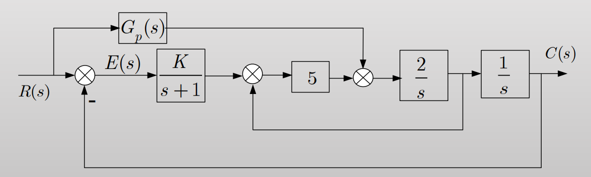
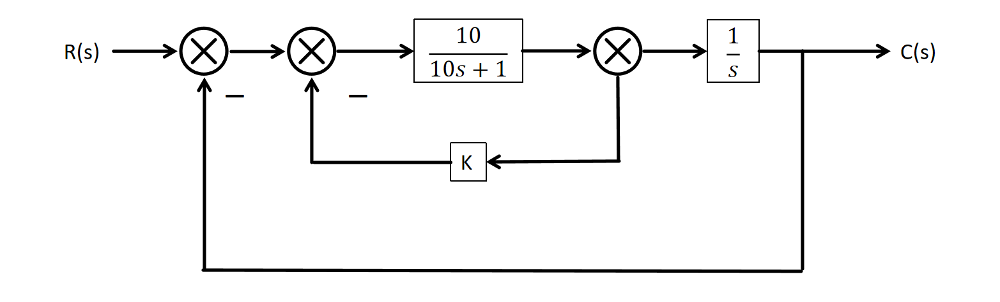
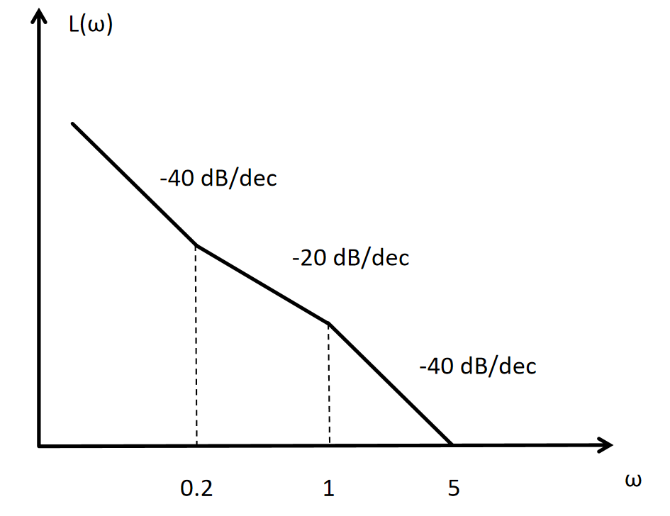

# 自动控制基础 2025秋42系期末考试

## 一、简答题（15分，每题3分）

1. 自动控制的“灵魂”是什么？可以从哪些维度评价一个控制系统的性能？

2. 对于一个二阶系统来说，最佳阻尼比是多少？为什么？

3. 频率特性的定义是什么？为何要用正弦函数为输入信号？

4. 在串联控制系统中，为什么采取滞后控制可以提高系统的相稳定裕度？

5. 系统状态反馈能够将极点配置到任意位置处的充要条件是什么？如果给定极点，那么系统可将极点配置到这些位置的条件可以放宽到什么？

## 二、计算题（15分，每题5分）

1. 设单位负反馈系统的开环传递函数为 $ G(s) = \frac { 4 } {s(s + 4)} $ ，求系统阶跃响应的自然频率 $ \omega_n $、阻尼比 $ \zeta $ 和超调量。

2. 设单位负反馈系统的开环传递函数为 $ G(s) = \frac { K(s+1) } {s(s+2)(s + 4)} $ ，若系统稳定，求K的取值范围。**（G(s)非原题，但类似）**

3. 设系统如图所示，确定 $ G_p(s) $ 的表达式，使得系统在单位斜坡信号 $ r(t) = t, t > 0 $ 下的稳态误差为零。（定义误差 $ e(t) = r(t) - c(t) $ ）

## 三、解答题（15分）

1. 某速度反馈系统如图所示，请按步骤画出 $ K $ 从 $ 0 $ 到正无穷变化时的根轨迹。（10分）

2. 当主导极点的阻尼比为 $ \zeta = 0.5 $ ，求 $ K $ 的大小。（5分）

## 四、解答题（15分）

如图所示为某单位负反馈系统的对数渐近幅频特性曲线，请回答下列问题：

1. 该系统的开环传递函数 $ G(s) $ 的表达式是什么？

2. 画出该系统的对数相频特性曲线，并利用对数相频判据判断系统的稳定性。

3. 计算系统的相稳定裕度和模稳定裕度。

## 五、解答题（10分）

设单位负反馈系统的开环传递函数为 $ G(s) = \frac { K } { s(s^2 + 6s + 9) } , K > 0 $ 。绘制Nyquist曲线，并计算系统稳定时 $ K $ 的取值范围。

## 六、解答题（20分）

已知单输入单输出系统的状态方程及输出方程如下：

$$
\dot{x}=\begin{bmatrix}-1 & 1\\
2 & 0
\end{bmatrix}x + \begin{bmatrix}0\\ 1\end{bmatrix}u, \quad y = \begin{bmatrix}? & ?\end{bmatrix}x
$$

1. 求状态转移矩阵 $ e^{At} $ ，并在 $x(0) = \begin{bmatrix}1\\ 2\end{bmatrix}$ 时，求解单位阶跃响应下的系统响应 $ x(t) $ 。

2. 判断系统是否渐近稳定（说明理由），判断系统是否BIBO稳定（说明理由）。

3. 判断系统是否可控，若可控，给出 $ \hat{x} = Px $ ，使得系统变为可控标准型，求出矩阵 $ P $ 并给出可控标准型。

4. 给定某极点，设置 $ k $ 进行状态反馈控制 $ u = v - kx $ ，判断是否可以将极点配置在 $ -2 \pm j2 $ 处。若可以，求 $ k $ 。**（极点并非原题，但类似）**

## 七、证明题（10分）

1. 已知系统状态方程： $ \dot{x} = Ax + bu $ , $ y = cx $ 。证明：可逆变换不影响可观测性。

2. 已知状态观测器方程： $ \dot{\hat{x}} = (A - Hc)\hat{x} + bu + Hy $ 。证明：若系统可观测，则 $ A-Hc $ 可以将极点配置到任意位置处。

  
  *L.D.J 回忆版*
  *特别鸣谢：raregas、dzx*

