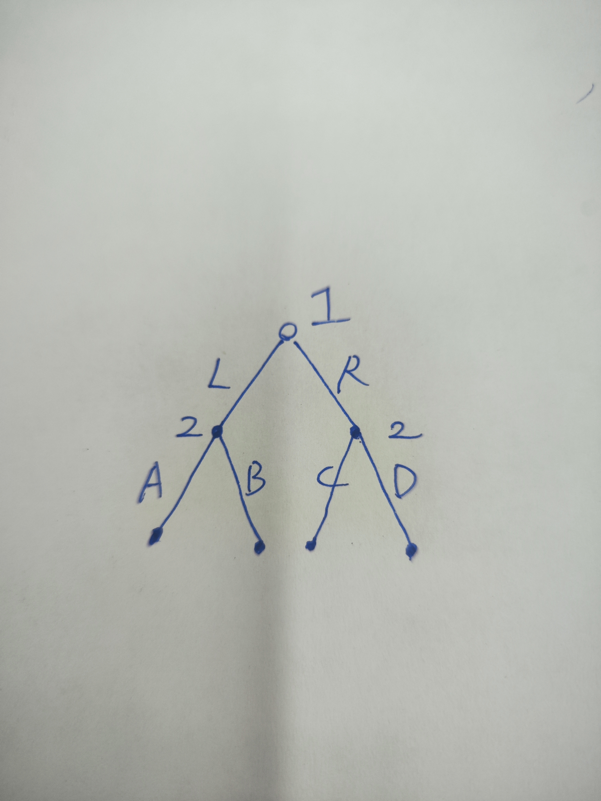

# 作业1：已知 $[L,(A,C)]$ 是纳什均衡，问 $[L,(A,D)]$ 是否一定也是

## 作业1

### 题目

#### 1

考虑下图给出的博弈树：玩家 1 在根节点先选 $L$ 或 $R$；选 $L$ 后由玩家 2 在左边的节点选 $A$ 或 $B$；选 $R$ 后由玩家 2 在右边的节点选 $C$ 或 $D$。四个终点的收益记为 $(u_1,u_2)$，题目未给出具体数值。

已知 $[L,(A,C)]$ 是纳什均衡，问 $[L,(A,D)]$ 是否一定也是纳什均衡？

### 答案

#### 一、博弈结构

图 1：题目给出的博弈树

玩家 1 在根节点先选 $L$ 或 $R$。选 $L$ 后由玩家 2 在左边的节点选 $A$ 或 $B$；选 $R$ 后由玩家 2 在右边的节点选 $C$ 或 $D$。玩家 2 在两个不同的节点各行动一次，所以玩家 2 的一个纯策略是一对动作：

$$s_2=(\text{L 节点选什么},\ \text{R 节点选什么})\in\{A,B\}\times\{C,D\}.$$

因此 $(A,C)$ 和 $(A,D)$ 都是玩家 2 的完整策略，二者只在 R 节点的选择上不一样。

把四个终点的收益记成 $(u_1,u_2)$，前一个是玩家 1 的、后一个是玩家 2 的：

| 路径 | 玩家 1 | 玩家 2 |
| --- | --- | --- |
| $L\to A$ | $a_1$ | $a_2$ |
| $L\to B$ | $b_1$ | $b_2$ |
| $R\to C$ | $c_1$ | $c_2$ |
| $R\to D$ | $d_1$ | $d_2$ |

题目没给具体数字，用一般符号就能把结论证清楚。

#### 二、先看清一点：R 节点在均衡里走不到

纳什均衡的要求是：给定别人的策略，没有人能靠单方面改自己的策略严格变好。

本题的关键在于，只要玩家 1 选了 $L$，博弈就沿 $L\to A$ 走，玩家 2 右边那个节点（ $R$ 之后）根本不会被用到。纳什均衡并不要求玩家 2 在这个走不到的节点上选得最优（这正是它和子博弈精炼均衡的区别），只要求每个人的整体策略是对别人策略的最优反应。所以当 $L$ 被选中时， $(A,C)$ 和 $(A,D)$ 给出的收益是完全一样的。

#### 三、 $[L,(A,C)]$ 是纳什均衡的条件

在 $[L,(A,C)]$ 下，实际走的是 $L\to A$，收益 $(a_1,a_2)$。

玩家 1 不偏离：留在 $L$ 得 $a_1$；如果改选 $R$，玩家 2 会在 R 节点按策略选 $C$，玩家 1 得 $c_1$。所以要

$$a_1\ge c_1.$$

玩家 2 不偏离：当前策略 $(A,C)$ 的收益是 $a_2$；把 L 节点从 $A$ 改成 $B$ 得 $b_2$；把 R 节点 $C$ 改成 $D$ 不改变收益（R 走不到）。所以要

$$a_2\ge b_2.$$

合起来， $[L,(A,C)]$ 是纳什均衡，当且仅当 $a_1\ge c_1$ 且 $a_2\ge b_2$。

#### 四、 $[L,(A,D)]$ 是纳什均衡的条件

$(A,D)$ 与 $(A,C)$ 只差在 R 节点。仍然是玩家 1 选 $L$、走 $L\to A$、收益 $(a_1,a_2)$。

玩家 2 不偏离：和上一节一模一样，R 节点 $C$、 $D$ 的差别走不到，对玩家 2 的收益没有影响，仍然只需 $a_2\ge b_2$。这条由题设已经成立。

玩家 1 不偏离：留 $L$ 得 $a_1$；如果改选 $R$，这时玩家 2 在 R 节点选的是 $D$，玩家 1 得 $d_1$。所以要

$$a_1\ge d_1.$$

合起来， $[L,(A,D)]$ 是纳什均衡，当且仅当 $a_2\ge b_2$ 且 $a_1\ge d_1$。

#### 五、结论：不一定

已知 $[L,(A,C)]$ 是纳什均衡，即 $a_1\ge c_1$ 且 $a_2\ge b_2$。要判断 $[L,(A,D)]$，其中 $a_2\ge b_2$ 已经有了，只剩 $a_1\ge d_1$ 这一条还定不下来。

$c_1$ 是 $R\to C$ 处玩家 1 的收益， $d_1$ 是 $R\to D$ 处玩家 1 的收益，它们是两个不同终点上的数，已知的 $a_1\ge c_1$ 对 $a_1$ 和 $d_1$ 谁大谁小没有任何约束。于是：

- 如果 $a_1\ge d_1$，那么 $[L,(A,D)]$ 仍然是纳什均衡；
- 如果 $a_1<d_1$，玩家 1 改选 $R$ 就能得到 $d_1>a_1$， $[L,(A,D)]$ 就不是纳什均衡。

所以光凭“ $[L,(A,C)]$ 是纳什均衡”这一条，推不出“ $[L,(A,D)]$ 也是纳什均衡”。答案是不一定。

#### 六、举两个例子

不是纳什均衡的例子。取

$$a=(2,2),\quad b=(0,1),\quad c=(1,0),\quad d=(3,0).$$

- 看 $[L,(A,C)]$： $a_1=2\ge c_1=1$， $a_2=2\ge b_2=1$，是纳什均衡。
- 看 $[L,(A,D)]$： $a_2=2\ge b_2=1$ 成立，但 $a_1=2<d_1=3$，玩家 1 偏离到 $R$ 能得 $3>2$，不是纳什均衡。

是纳什均衡的例子。把上面的 $d_1$ 改成 $0$，即 $d=(0,0)$，其余不变：

- $[L,(A,C)]$ 同上，仍是纳什均衡；
- $[L,(A,D)]$： $a_2\ge b_2$，且 $a_1=2\ge d_1=0$，是纳什均衡。

一正一反两个例子都存在，说明确实“不一定”。

#### 七、补充：如果进一步要求子博弈精炼

如果要求的是子博弈精炼纳什均衡（SPNE），那么玩家 2 在 R 节点就必须选对自己最好的那个（ $c_2\ge d_2$ 时选 $C$，否则选 $D$）， $(A,C)$ 和 $(A,D)$ 里最多只有一个能在 R 节点站得住。本题之所以会出现“ $(A,C)$ 是纳什均衡、 $(A,D)$ 却不一定”的情况，根子就在于纳什均衡不去管那条走不到的路上怎么选，这也是它相比子博弈精炼均衡可能留下不可信威胁、不够“干净”的地方。
