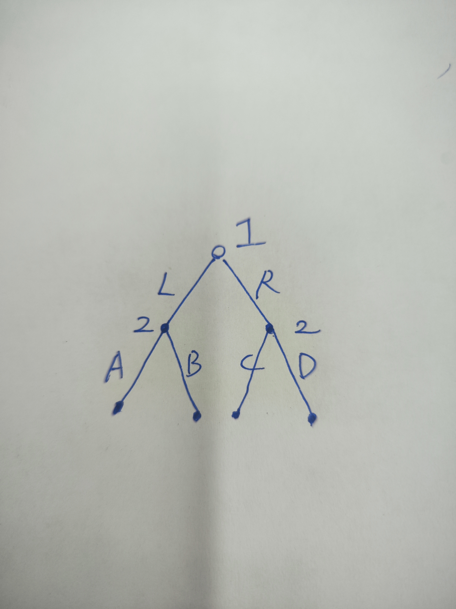

# 博弈论 第1次作业题目（2026春）

> 完整题面与解答见同目录的答案文件。

## 作业1

### 1

考虑下图给出的博弈树：玩家 1 在根节点先选 $L$ 或 $R$；选 $L$ 后由玩家 2 在左边的节点选 $A$ 或 $B$；选 $R$ 后由玩家 2 在右边的节点选 $C$ 或 $D$。四个终点的收益记为 $(u_1,u_2)$，题目未给出具体数值。

已知 $[L,(A,C)]$ 是纳什均衡，问 $[L,(A,D)]$ 是否一定也是纳什均衡？
