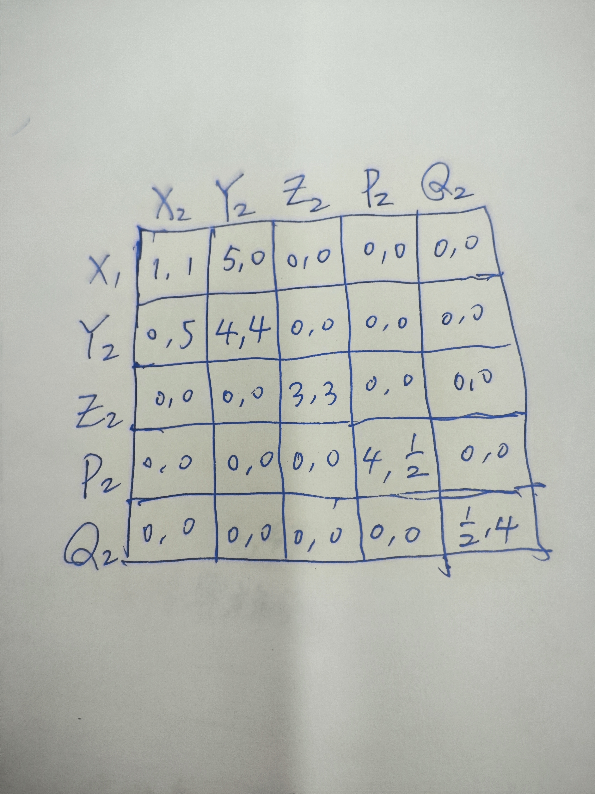

# 作业2：用两轮重复博弈支撑合作的子博弈精炼纳什均衡

## 作业2

### 题目

#### 1

阶段博弈是一个 $5\times5$ 的双矩阵：行是玩家 1 的动作 $X_1,Y_1,Z_1,P_1,Q_1$，列是玩家 2 的动作 $X_2,Y_2,Z_2,P_2,Q_2$，每个格子写 $(u_1,u_2)$。收益矩阵如下：

考虑由该阶段博弈进行 2 次重复得到的重复博弈，第二轮开始前双方观测到第一轮结果，两轮收益直接相加，不贴现（ $\delta=1$）。记 $a^t=(a_1^t,a_2^t)$ 为第 $t$ 轮的动作组合。证明下述策略组合是该两轮重复博弈的子博弈精炼纳什均衡：

- 第一轮：双方都出 $Y$；
- 第二轮：按第一轮的结果决定，

$$
a^2=\begin{cases}
(Z_1,Z_2), & a^1=(Y_1,Y_2)\\[2pt]
(P_1,P_2), & a_1^1=Y_1,\ a_2^1\ne Y_2\\[2pt]
(Q_1,Q_2), & a_1^1\ne Y_1,\ a_2^1=Y_2\\[2pt]
(X_1,X_2), & a_1^1\ne Y_1,\ a_2^1\ne Y_2
\end{cases}
$$

### 答案

#### 一、阶段博弈

阶段博弈是一个 $5\times5$ 的双矩阵：行是玩家 1 的动作 $X_1,Y_1,Z_1,P_1,Q_1$，列是玩家 2 的动作 $X_2,Y_2,Z_2,P_2,Q_2$，每个格子写 $(u_1,u_2)$。题目给出的收益矩阵如下：

图 1：题目给出的阶段博弈收益矩阵

（原图左侧的行标签写成了 $X_1,Y_2,Z_2,P_2,Q_2$，其中第二到第五行应当是玩家 1 的策略 $Y_1,Z_1,P_1,Q_1$，下面按“行索引是玩家 1 的动作”来理解。）

##### 阶段博弈的纯策略纳什均衡

逐格检验双方是否都在最优反应，可以得到对角线上除 $Y$ 以外的四个纯策略纳什均衡：

$$(X_1,X_2)=(1,1),\quad (Z_1,Z_2)=(3,3),\quad (P_1,P_2)=\left(4,\tfrac12\right),\quad (Q_1,Q_2)=\left(\tfrac12,4\right).$$

要注意 $(Y_1,Y_2)=(4,4)$ 不是阶段纳什均衡：给定对手出 $Y$，任何一方改出 $X$ 都能把自己的收益从 $4$ 提到 $5$，

$$u_1(X_1,Y_2)=5>4=u_1(Y_1,Y_2),\qquad u_2(Y_1,X_2)=5>4.$$

$(4,4)$ 对双方都比那几个纳什均衡更好，可它本身撑不住，正是我们想用重复博弈保住的合作结果。剩下三个纳什均衡各有用处： $Z=(3,3)$ 对双方都还不错，可以当守约后的奖励； $P=(4,\tfrac12)$ 对玩家 1 好、对玩家 2 差，可以拿来惩罚玩家 2； $Q=(\tfrac12,4)$ 反过来，用来惩罚玩家 1。

#### 二、要证明的策略

记 $a^t=(a_1^t,a_2^t)$ 为第 $t$ 轮的动作组合，两轮收益直接相加，不贴现（ $\delta=1$）。

- 第一轮：双方都出 $Y$。
- 第二轮：按第一轮的结果决定，

$$
a^2=\begin{cases}
(Z_1,Z_2), & a^1=(Y_1,Y_2)\\[2pt]
(P_1,P_2), & a_1^1=Y_1,\ a_2^1\ne Y_2\\[2pt]
(Q_1,Q_2), & a_1^1\ne Y_1,\ a_2^1=Y_2\\[2pt]
(X_1,X_2), & a_1^1\ne Y_1,\ a_2^1\ne Y_2
\end{cases}
$$

意思就是：第一轮先合作出 $Y$ 去争 $(4,4)$；第二轮如果双方都守约就给奖励 $Z$，谁单方面背叛，就在第二轮切到那个惩罚背叛者、不亏待守约者的纳什均衡。

#### 三、证明思路：逆向归纳（一次单边偏离原则）

在有限重复博弈里，一个策略组合是子博弈精炼纳什均衡，当且仅当在每个子博弈里都没有人能靠一次单边偏离获利。两轮博弈的子博弈分两类：从第二轮开始的子博弈，以及整个博弈（从第一轮开始）。

##### 第二轮的子博弈

第二轮是最后一轮，相当于一次性博弈，当期收益就是全部的后续收益。本策略在四类历史下规定的第二轮组合， $Z$、 $P$、 $Q$、 $X$ 都是阶段纳什均衡（见第一节）。而阶段纳什均衡本来就是“双方互为最优反应”，所以在每一个第二轮子博弈里，任何一方单边偏离都不会增加自己的当期（也就是全部）收益。第二轮的序贯理性成立。

这一步是关键：正因为四个续局 $Z,P,Q,X$ 个个都是阶段纳什均衡，第二轮的奖惩才是可信的，没有人有动机不照着做。

##### 第一轮（整个博弈）

给定上面的第二轮续局，比较第一轮“守约”和“偏离”的两轮总收益。

双方都守约（出 $Y$）：第一轮 $(Y_1,Y_2)=(4,4)$，触发第二轮 $Z=(3,3)$，

$$V_1^{\text{守}}=4+3=7,\qquad V_2^{\text{守}}=4+3=7.$$

玩家 1 单边偏离（玩家 2 仍出 $Y_2$）：第一轮对着 $Y_2$ 这一列，玩家 1 最好的偏离是 $X_1$，得 $u_1(X_1,Y_2)=5$（ $Z_1,P_1,Q_1$ 对 $Y_2$ 都只有 $0$，更差）；这属于“其他, $Y$”，触发第二轮 $Q$，玩家 1 第二轮只得 $\tfrac12$，

$$V_1^{\text{偏}}=5+\tfrac12=5.5<7=V_1^{\text{守}}.$$

玩家 2 单边偏离完全对称：最好的偏离 $X_2$ 第一轮得 $u_2(Y_1,X_2)=5$，属于“ $Y$, 其他”，触发第二轮 $P$，玩家 2 第二轮得 $\tfrac12$，

$$V_2^{\text{偏}}=5+\tfrac12=5.5<7=V_2^{\text{守}}.$$

两个人都没有划算的偏离。

##### 结论

两类子博弈里都不存在有利的单边偏离，由一次单边偏离原则，这个策略是该两轮重复博弈的子博弈精炼纳什均衡。

#### 四、关于一般的贴现因子

如果第二轮收益按 $\delta\in(0,1]$ 贴现，守约不偏离的条件是

$$4+3\delta\ge 5+\tfrac12\delta\iff \tfrac52\delta\ge1\iff \delta\ge0.4.$$

也就是说，只要玩家足够有耐心（ $\delta\ge0.4$），就能用第二轮的纳什均衡当奖惩，在第一轮把本来撑不住的合作结果 $(Y_1,Y_2)=(4,4)$ 撑起来。题目取 $\delta=1$，显然满足。

本题能成立靠两点：一是续局 $Z,P,Q,X$ 都是阶段纳什均衡，第二轮的奖惩才可信，这保证了子博弈精炼；二是背叛的人会被切到对自己最差的那个纳什均衡（玩家 1 被切到 $Q$ 只得 $\tfrac12$，玩家 2 被切到 $P$ 只得 $\tfrac12$），使得“第一轮多拿的 $5-4=1$”抵不过“第二轮少拿的 $3-\tfrac12=2.5$”，所以第一轮谁都不偏离。
