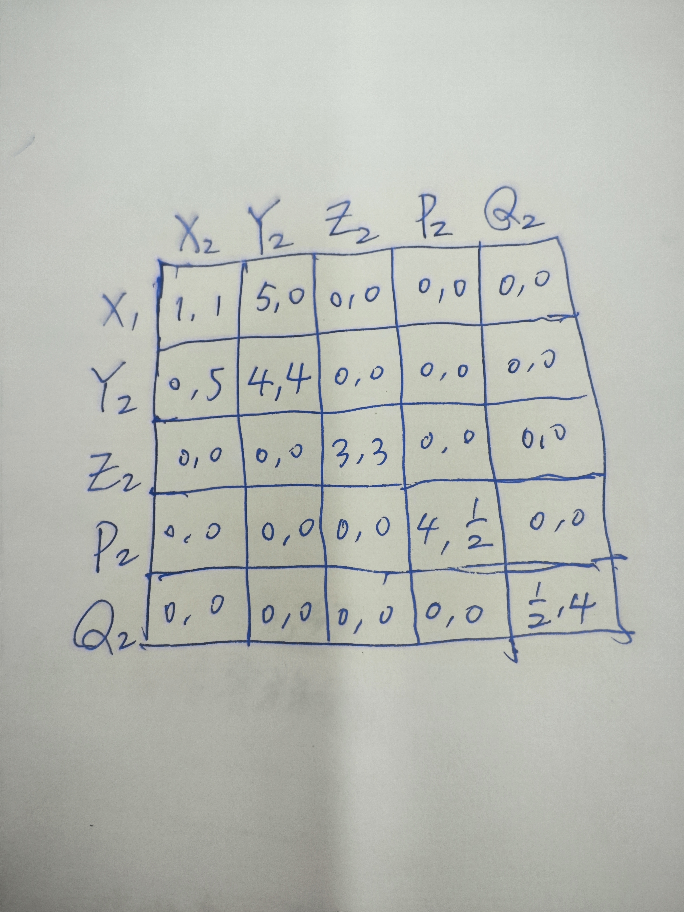

# 博弈论 第2次作业题目（2026春）

> 完整题面与解答见同目录的答案文件。

## 作业2

### 1

阶段博弈是一个 $5\times5$ 的双矩阵：行是玩家 1 的动作 $X_1,Y_1,Z_1,P_1,Q_1$，列是玩家 2 的动作 $X_2,Y_2,Z_2,P_2,Q_2$，每个格子写 $(u_1,u_2)$。收益矩阵如下：

考虑由该阶段博弈进行 2 次重复得到的重复博弈，第二轮开始前双方观测到第一轮结果，两轮收益直接相加，不贴现（ $\delta=1$）。记 $a^t=(a_1^t,a_2^t)$ 为第 $t$ 轮的动作组合。证明下述策略组合是该两轮重复博弈的子博弈精炼纳什均衡：

- 第一轮：双方都出 $Y$；
- 第二轮：按第一轮的结果决定，

$$
a^2=\begin{cases}
(Z_1,Z_2), & a^1=(Y_1,Y_2)\\[2pt]
(P_1,P_2), & a_1^1=Y_1,\ a_2^1\ne Y_2\\[2pt]
(Q_1,Q_2), & a_1^1\ne Y_1,\ a_2^1=Y_2\\[2pt]
(X_1,X_2), & a_1^1\ne Y_1,\ a_2^1\ne Y_2
\end{cases}
$$
