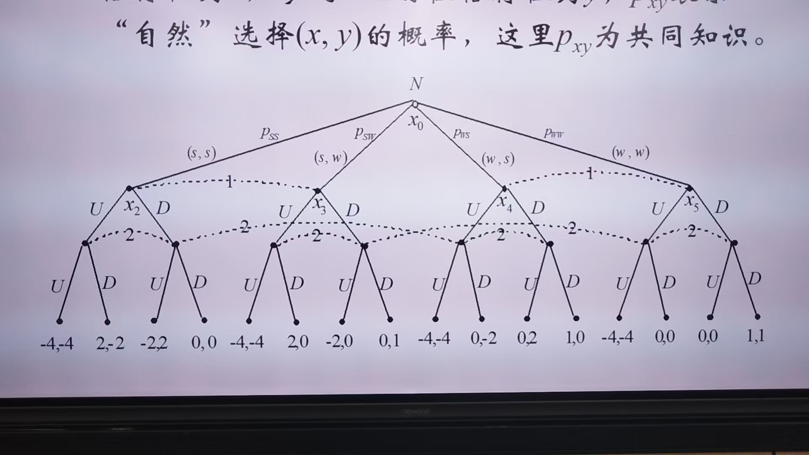

# 作业3：不完全信息静态博弈的收益矩阵与纯策略贝叶斯纳什均衡

## 作业3

### 题目

#### 1

考虑下图给出的不完全信息静态博弈：「自然」 $N$ 先选一个类型组合 $(x,y)$，其中 $x$ 是玩家 1 的类型、 $y$ 是玩家 2 的类型，每人的类型都属于 $\{s\ (\text{强}),\ w\ (\text{弱})\}$。联合概率 $p_{xy}$ 是共同知识，按图中从左到右是

$$
p_{ss}=0.3,\quad p_{sw}=0.3,\quad p_{ws}=0.2,\quad p_{ww}=0.2.
$$

每个玩家先看到自己的类型，再同时从 $\{U,D\}$ 中选动作。每个类型节点下面的四个终点按 $(a_1,a_2)=(U,U),(U,D),(D,U),(D,D)$ 排列。

求此博弈的纯策略贝叶斯纳什均衡。

### 答案

#### 一、博弈描述

图 1：题目给出的博弈树

“自然” $N$ 先选一个类型组合 $(x,y)$，其中 $x$ 是玩家 1 的类型、 $y$ 是玩家 2 的类型，每人的类型都属于 $\{s\,(\text{强}),\ w\,(\text{弱})\}$。联合概率 $p_{xy}$ 是共同知识，按图中从左到右是

$$p_{ss}=0.3,\quad p_{sw}=0.3,\quad p_{ws}=0.2,\quad p_{ww}=0.2\quad(\textstyle\sum=1).$$

每个玩家先看到自己的类型，再同时从 $\{U,D\}$ 中选动作。玩家 1 只知道自己是强还是弱，分不清具体落在哪个类型组合上；玩家 2 既不知道对方的类型，也看不到对方选了 $U$ 还是 $D$。每个类型节点下面的四个终点按 $(a_1,a_2)=(U,U),(U,D),(D,U),(D,D)$ 排列，从树上读出来的收益是：

| 类型 $(x,y)$ | 概率 | $(U,U)$ | $(U,D)$ | $(D,U)$ | $(D,D)$ |
| --- | --- | --- | --- | --- | --- |
| $(s,s)$ | $0.3$ | $-4,-4$ | $2,-2$ | $-2,2$ | $0,0$ |
| $(s,w)$ | $0.3$ | $-4,-4$ | $2,0$ | $-2,0$ | $0,1$ |
| $(w,s)$ | $0.2$ | $-4,-4$ | $0,-2$ | $0,2$ | $1,0$ |
| $(w,w)$ | $0.2$ | $-4,-4$ | $0,0$ | $0,0$ | $1,1$ |

（在每个 $(x,y)$ 子树里，第一个分量按玩家 1 的动作、第二个分量按玩家 2 的动作。比如 $(s,s)$ 里的 $(D,U)$ 是玩家 1 选 $D$、玩家 2 选 $U$，收益 $(-2,2)$。）

#### 二、按类型整理收益（方便计算）

把同一个玩家在“自己强 / 自己弱”两种情况下的单期收益分别列出来。设自己的动作为 $a$、对手的动作为 $a'$。

玩家 1（记 $f_t(a,a')$， $t$ 是玩家 1 自己的类型）：

| 玩家1强 $f_s$ | 对手 $U$ | 对手 $D$ | — | 玩家1弱 $f_w$ | 对手 $U$ | 对手 $D$ |
| --- | --- | --- | --- | --- | --- | --- |
| 自选 $U$ | $-4$ | $2$ | — | 自选 $U$ | $-4$ | $0$ |
| 自选 $D$ | $-2$ | $0$ | — | 自选 $D$ | $0$ | $1$ |

玩家 2（记 $g_t(a,a')$， $t$ 是玩家 2 自己的类型， $a'$ 是玩家 1 的动作）的收益结构和玩家 1 对称：

- 玩家 2 强（出现在 $(s,s)$ 和 $(w,s)$）： $g_s(U,U)=-4,\ g_s(U,D)=2,\ g_s(D,U)=-2,\ g_s(D,D)=0$；
- 玩家 2 弱（出现在 $(s,w)$ 和 $(w,w)$）： $g_w(U,U)=-4,\ g_w(U,D)=0,\ g_w(D,U)=0,\ g_w(D,D)=1$。

直观上，强类型把 $U$ 当进攻，在对手退让（出 $D$）时占便宜得 $2$，但双方对攻 $(U,U)$ 时两边都得 $-4$；弱类型进攻得不到好处，更愿意出 $D$，双方都出 $D$ 时各得 $1$。

#### 三、纯策略集合

每个玩家的纯策略是一个“类型 → 动作”的映射，各有 $2^2=4$ 个，写成（强时的动作，弱时的动作）：

$$\{UU,\ UD,\ DU,\ DD\},\qquad \text{例如 }UD\text{ 表示“强时出 }U\text{、弱时出 }D\text{”}.$$

#### 四、事前期望收益矩阵

玩家 1 选 $s_1=(a_1^s,a_1^w)$、玩家 2 选 $s_2=(a_2^s,a_2^w)$ 时，事前期望收益为

$$
U_1=\sum_{(x,y)} p_{xy}\,f_x\big(a_1^x,\,a_2^y\big),\qquad
U_2=\sum_{(x,y)} p_{xy}\,g_y\big(a_2^y,\,a_1^x\big).
$$

代入 $p_{ss}=0.3,\ p_{sw}=0.3,\ p_{ws}=0.2,\ p_{ww}=0.2$，得到 $4\times4$ 的收益矩阵（行是玩家 1，列是玩家 2，每格 $=(U_1,U_2)$）：

| $U_1,U_2$ | $U U$ | $U D$ | $D U$ | $D D$ |
| --- | --- | --- | --- | --- |
| $UU$ | $-4.0,\,-4.0$ | $-1.4,\,-2.0$ | $-1.4,\,-3.0$ | $1.2,\,-1.0$ |
| $UD$ | $-2.4,\,-2.0$ | $-0.4,\,-0.6$ | $-0.4,\,-1.8$ | $1.6,\,-0.4$ |
| $DU$ | $-2.8,\,-1.0$ | $-1.4,\,0.1$ | $-1.4,\,-1.2$ | $0.0,\,-0.1$ |
| $DD$ | $-1.2,\,1.0$ | $-0.4,\,1.5$ | $-0.4,\,0.0$ | $0.4,\,0.5$ |

#### 五、一个详细的计算（以格子 $(s_1,s_2)=(UD,\ DD)$ 为例）

取玩家 1 用 $UD$（强出 $U$、弱出 $D$），玩家 2 用 $DD$（强弱都出 $D$）。逐个类型组合代进去：

| 类型 | 概率 | 玩家1动作 | 玩家2动作 | $(u_1,u_2)$ |
| --- | --- | --- | --- | --- |
| $(s,s)$ | $0.3$ | $U$（1强） | $D$（2强） | $f_s(U,D)=2,\ g_s(D,U)=-2$ |
| $(s,w)$ | $0.3$ | $U$（1强） | $D$（2弱） | $f_s(U,D)=2,\ g_w(D,U)=0$ |
| $(w,s)$ | $0.2$ | $D$（1弱） | $D$（2强） | $f_w(D,D)=1,\ g_s(D,D)=0$ |
| $(w,w)$ | $0.2$ | $D$（1弱） | $D$（2弱） | $f_w(D,D)=1,\ g_w(D,D)=1$ |

玩家 1 的期望收益：

$$U_1=0.3\cdot2+0.3\cdot2+0.2\cdot1+0.2\cdot1=0.6+0.6+0.2+0.2=1.6.$$

玩家 2 的期望收益：

$$U_2=0.3\cdot(-2)+0.3\cdot0+0.2\cdot0+0.2\cdot1=-0.6+0.2=-0.4.$$

所以这一格是 $(1.6,\,-0.4)$，和矩阵里一致。

#### 六、求纯策略贝叶斯纳什均衡

纯策略贝叶斯纳什均衡，就是上面这个 $4\times4$ 完全信息博弈的纯策略纳什均衡：每个玩家的策略在对手策略给定时，要让自己的事前期望收益最大（因为各个类型可以独立取最优，这等价于每个类型都在做最优反应）。

在矩阵里逐列找玩家 1 的最优反应、逐行找玩家 2 的最优反应：

- 玩家 1 的最优反应（每列最大的 $U_1$）： $UU$ 列选 $DD(-1.2)$； $UD$ 列选 $UD$ 或 $DD(-0.4)$； $DU$ 列选 $UU$ 或 $UD(-1.4)$； $DD$ 列选 $UD(1.6)$。
- 玩家 2 的最优反应（每行最大的 $U_2$）： $UD$ 行选 $DD(-0.4)$； $DD$ 行选 $UD(1.5)$，等等。

双向最优反应重合的格子就是纯策略贝叶斯纳什均衡，一共有两个：

$$(s_1^*,s_2^*)=(UD,\ DD),\quad\text{收益 }(1.6,\,-0.4);$$
$$(s_1^*,s_2^*)=(DD,\ UD),\quad\text{收益 }(-0.4,\,1.5).$$

验证 $(UD,DD)$：固定玩家 2 = $DD$（看 $DD$ 列），玩家 1 的 $U_1$ 取值是 $1.2,\,1.6,\,0.0,\,0.4$，最大的是 $UD$ 的 $1.6$，所以玩家 1 不偏离；固定玩家 1 = $UD$（看 $UD$ 行），玩家 2 的 $U_2$ 取值是 $-2.0,\,-0.6,\,-1.8,\,-0.4$，最大的是 $DD$ 的 $-0.4$，所以玩家 2 不偏离。另一个均衡 $(DD,UD)$ 由对称性同理成立。

#### 七、直观解释

两个贝叶斯纳什均衡是非对称的。 $(UD,\ DD)$ 是玩家 1“强时进攻 $U$、弱时退让 $D$”，玩家 2“一律退让 $D$”：玩家 1 靠强类型的进攻优势拿到正收益 $1.6$，玩家 2 全程退让，把损失压到 $-0.4$（一旦改成进攻，就会撞上玩家 1 强类型的 $U$ 而吃 $-4$，更糟）。 $(DD,\ UD)$ 则是角色对调，玩家 2 占据进攻方。两个均衡都体现了“只有强类型才敢进攻、弱类型选择退让”的逻辑，至于谁来当进攻方，则取决于均衡选择，是一个协调上的多重均衡问题。
