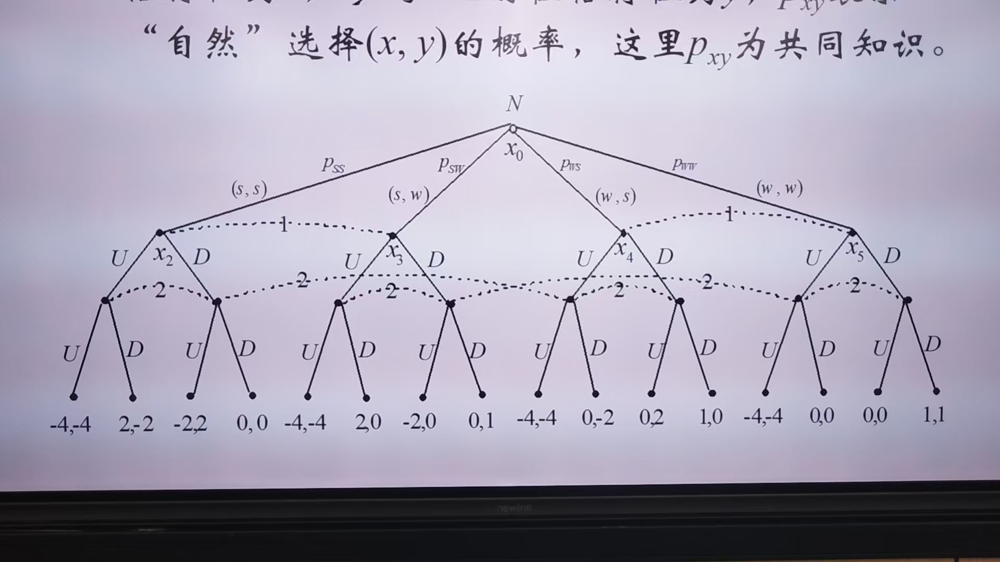

# 博弈论 第3次作业题目（2026春）

> 完整题面与解答见同目录的答案文件。

## 作业3

### 1

考虑下图给出的不完全信息静态博弈：「自然」 $N$ 先选一个类型组合 $(x,y)$，其中 $x$ 是玩家 1 的类型、 $y$ 是玩家 2 的类型，每人的类型都属于 $\{s\ (\text{强}),\ w\ (\text{弱})\}$。联合概率 $p_{xy}$ 是共同知识，按图中从左到右是

$$
p_{ss}=0.3,\quad p_{sw}=0.3,\quad p_{ws}=0.2,\quad p_{ww}=0.2.
$$

每个玩家先看到自己的类型，再同时从 $\{U,D\}$ 中选动作。每个类型节点下面的四个终点按 $(a_1,a_2)=(U,U),(U,D),(D,U),(D,D)$ 排列。

求此博弈的纯策略贝叶斯纳什均衡。
