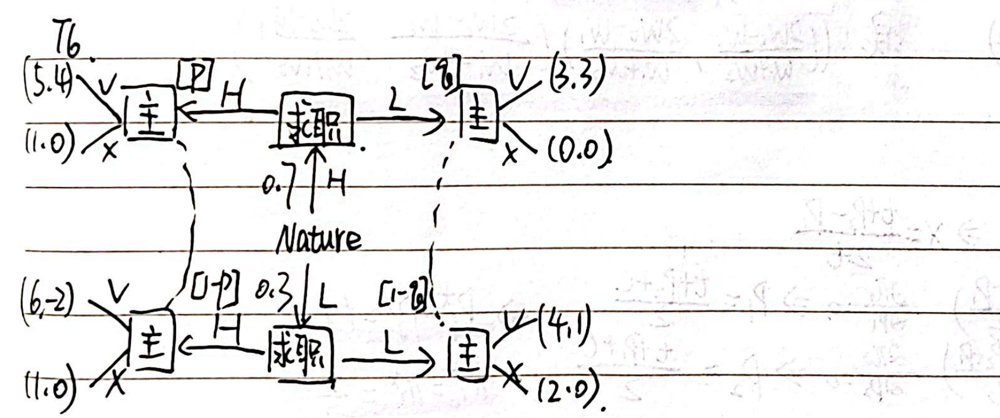

# 博弈论 往年习题1 答案（年份未知）

## 一、习题

### 题目

#### 1

考虑如下的双变量博弈表，回答如下问题。

| 参与人 1 \ 参与人 2 | $B_1$ | $B_2$ | $B_3$ |
| --- | --- | --- | --- |
| $A_1$ | $(0,8)$ | $(8,0)$ | $(10,6)$ |
| $A_2$ | $(8,8)$ | $(0,4)$ | $(10,6)$ |
| $A_3$ | $(6,10)$ | $(6,8)$ | $(12,12)$ |

(a) 这一博弈是否存在严格劣战略？若存在，请指出依照累次剔除严格劣策略的方法，所需要剔除的所有严格劣策略。

(b) 这一博弈是否存在纯策略 Nash 均衡？若存在，请利用划线法求出纯策略 Nash 均衡。

(c) 这一博弈是否存在混合策略 Nash 均衡？若存在，请求出混合策略 Nash 均衡。

#### 2

考虑 2 个企业在长度为 1 的线性城市 $[0,1]$ 上竞争的 Hotelling 价格竞争模型，企业 1 位于 0，企业 2 位于 1。消费者均匀分布在城市上，每个消费者购买 1 单位产品，每跨越 1 单位距离的交通成本为 1。企业 1 选择价格 $p_1$，企业 2 选择价格 $p_2$。任意消费者选择总成本（价格 + 交通成本）最小的企业购买 1 单位产品。企业单位商品的生产成本为 1。求解此博弈的纳什均衡。

#### 3

考虑如下阶段博弈（行玩家：参与人 1；列玩家：参与人 2），该博弈进行 2 次重复，第二阶段开始前双方观测到第一阶段结果，不考虑贴现。在纯策略子博弈精炼纳什均衡（SPNE）中，是否能在第一阶段实现 $(A_3,B_3)$ 的策略组合（收益 $(4,5)$）？

| 参与人 1 \ 参与人 2 | $B_1$ | $B_2$ | $B_3$ |
| --- | --- | --- | --- |
| $A_1$ | $(3,3)$ | $(0,0)$ | $(0,0)$ |
| $A_2$ | $(0,0)$ | $(2,2)$ | $(6,1)$ |
| $A_3$ | $(0,0)$ | $(0,0)$ | $(4,5)$ |

（答：不可以。）

#### 4

考虑同类产品的 Bertrand 模型，企业 1 和 2 同时给产品定价为 $p_1,p_2$，对企业 $i$ 产品的需求：如果 $p_i<p_j$，需求为 $a-p_i$；如果 $p_i>p_j$，需求为 0；如果 $p_i=p_j$，需求为 $\dfrac{a-p_i}{2}$。边际成本为 $c<a$。

双方若选择合作，则双方定价均采取垄断价格；若有一方背离，当期背离方获得背离收益，之后的所有阶段双方均采用惩罚定价 $p_i=p_j=c$，此时收益均为 0。

考虑基于以上阶段博弈的无限重复博弈，求在子博弈精炼 Nash 均衡中，企业可以采取上述触发策略以维持垄断条件下的价格水平的贴现值 $\delta$ 的取值范围。

（答：大于等于 1/2）

#### 5

考虑一个双寡头市场，企业 1 和企业 2 同时决定产量 $q_1,q_2\geqslant 0$。市场需求函数为 $P(Q)=a-Q$，其中 $Q=q_1+q_2$ 为总产量。企业 1 的生产成本是共同知识： $C_1(q_1)=Cq_1$。企业 2 的生产成本是私有信息。

企业 2 以概率 $p$ 为高成本类型（H）： $C_2^H(q_2)=Hq_2$，以概率 $1-p$ 为低成本类型： $C_2^L(q_2)=Lq_2$， $L<H$。企业 1 在决策时不知道企业 2 的真实类型，但知道类型的概率分布。求此博弈的贝叶斯纳什均衡。

#### 6

考虑一个求职信号博弈，参与者包括求职者（发送者）和雇主（接收者）。发送者有两种类型：高能力（H）和低能力（L），先验概率中，强类型的概率为 0.7，弱类型的概率为 0.3。求职者观察自己的类型后，向雇主发送信号 $m\in\{\text{High},\text{Low}\}$。雇主观察到信号（但不知类型），选择行动 $a\in\{\text{Hire},\text{Reject}\}$。收益函数如下：

| 求职者类型 | 教育信号 | 雇主行动 | 求职者收益 | 雇主收益 |
| --- | --- | --- | --- | --- |
| H | High | Hire | 5 | 4 |
| H | High | Not Hire | 1 | 0 |
| H | Low | Hire | 3 | 3 |
| H | Low | Not Hire | 0 | 0 |
| L | High | Hire | 6 | -2 |
| L | High | Not Hire | 1 | 0 |
| L | Low | Hire | 4 | 1 |
| L | Low | Not Hire | 2 | 0 |

是否存在混同精炼贝叶斯均衡，两种类型求职者均选择高能力（High）信号，且雇主观察到 High 信号时选择雇用（Hire）？

（答：存在。）

### 答案

#### 1

见「某年习题2」第 1 题的解答（两份习题的第 1 题完全相同）。

#### 2

设在 $x$ 处满足

$$
p_1+x\cdot 1=p_2+(1-x)\cdot 1\quad\Longrightarrow\quad x=\frac{p_2-p_1+1}{2}.
$$

企业 1 的利润

$$
\pi_1=x(p_1-1)=\frac{p_2-p_1+1}{2}(p_1-1),
$$

由 $\dfrac{\partial\pi_1}{\partial p_1}=0$ 得

$$
p_1^*=\frac{p_2}{2}+1.
$$

企业 2 的利润

$$
\pi_2=(1-x)(p_2-1)=\frac{1-p_2+p_1}{2}(p_2-1),
$$

由 $\dfrac{\partial\pi_2}{\partial p_2}=0$ 得

$$
p_2^*=1+\frac{p_1}{2}.
$$

联立得

$$
p_1^*=p_2^*=2,
$$

此时

$$
\pi_1^*=\pi_2^*=\frac12.
$$

#### 3

单轮 Nash 均衡为 $(A_1,B_1)$、 $(A_2,B_2)$，故 Stage 2 必为二者之一。

设 Stage 1 为 $(A_3,B_3)$，Stage 2 为 $(A_1,B_1)$：

- 参与人 1 先选 $A_3$，若结果为 $(A_3,B_3)$，则 Stage 2 选 $A_1$，否则选 $A_2$；
- 参与人 2 先选 $B_3$，若结果为 $(A_3,B_3)$，则 Stage 2 选 $B_1$，否则选 $B_2$。

但此时两阶段总收益矩阵为

| 参与人 1 \ 参与人 2 | $B_1$ | $B_2$ | $B_3$ |
| --- | --- | --- | --- |
| $A_1$ | $(5,5)$ | $(2,2)$ | $(2,2)$ |
| $A_2$ | $(2,2)$ | $(4,4)$ | $(8,3)$ |
| $A_3$ | $(2,2)$ | $(2,2)$ | $(7,8)$ |

显然 $(A_3,B_3)$ 不为 Nash 均衡（参与人 1 改选 $A_2$ 可得 $8>7$）。

同理可分析 Stage 1 为 $(A_2,B_2)$、Stage 2 为 $(A_2,B_2)$ 的情形，其它构造方式更不可能为子博弈精炼 Nash（因为上述分析是最有可能成为子博弈精炼 Nash 的）。故不可能。

#### 4

垄断时，价格为 $p$ 时总需求 $\dfrac{a-p}{2}\times 2=a-p$，故总利润

$$
\pi=(p-c)(a-p),
$$

故垄断价格满足 $\dfrac{\partial\pi}{\partial p}=0$，得

$$
p=\frac{a+c}{2},
$$

此时总利润

$$
\left(\frac{a+c}{2}-c\right)\left(a-\frac{a+c}{2}\right)=\frac{(a-c)^2}{4}.
$$

理想条件下，一方背离时的背离收益即 $\dfrac{(a-c)^2}{4}$。

（剩下步骤见「某年习题2」第 4 题解答。）计算有 $\delta\geqslant\dfrac12$。

#### 5

企业 2：

$$
\pi_2=(a-Q-c_2)q_2=(a-q_1-q_2-c_2)q_2,
$$

由 $\dfrac{\partial\pi_2}{\partial q_2}=0$ 得

$$
q_2=\frac{a-q_1-c_2}{2}.
$$

故对高成本企业 2，有 $q_2^H=\dfrac{a-q_1-H}{2}$；对低成本企业 2，有 $q_2^L=\dfrac{a-q_1-L}{2}$。

企业 1：

$$
E[\pi_1]=p\,(a-q_1-q_2^H-c)\,q_1+(1-p)\,(a-q_1-q_2^L-c)\,q_1,
$$

令 $\dfrac{\partial E[\pi_1]}{\partial q_1}=0$，有

$$
q_1=\frac12\left[a-c-p\,q_2^H-(1-p)\,q_2^L\right].
$$

联立 3 个方程，有

$$
\begin{cases}
q_1^*=\dfrac{a}{3}-\dfrac{2}{3}c+\dfrac{p}{3}H+\dfrac{1-p}{3}L\\[6pt]
q_2^{L*}=\dfrac{a}{3}+\dfrac{c}{3}-\dfrac{p}{6}H-\dfrac{4-p}{6}L\\[6pt]
q_2^{H*}=\dfrac{a}{3}+\dfrac{c}{3}-\dfrac{3+p}{6}H-\dfrac{1-p}{6}L
\end{cases}
$$

贝叶斯 Nash 均衡为 $\left(q_1^*,\ (q_2^{L*},q_2^{H*})\right)$。

#### 6

信号博弈树如下（ $p$ 为收到 High 信号后认为类型为 H 的信念， $q$ 为收到 Low 信号后的对应信念）：

求职者策略为 $(H,H)$ 时，由贝叶斯公式知 $p=0.7$。对雇主而言：

$$
U(\text{Hire})=4\times 0.7+(-2)\times 0.3=2.2,\qquad U(\text{Not Hire})=0+0=0,
$$

故选 Hire。

而此时无论雇主收到 Low 信号时有何策略，求职者都没动机改变信号（易见 Not Hire 为其劣策略）。

故此混同精炼贝叶斯 Nash 均衡一定存在：

$$
\big((H,H),\ (\text{Hire},\text{Hire}),\ p=0.7,\ q\big).
$$
