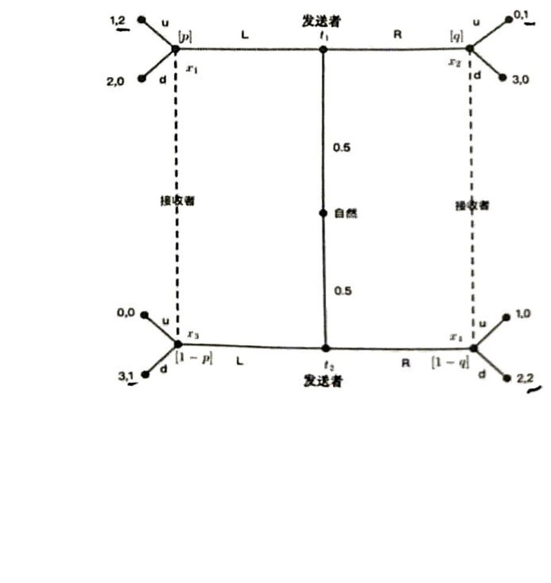

# 博弈论 往年习题2 答案（年份未知）

## 一、习题

### 题目

#### 1

考虑如下的双变量博弈表，回答如下问题。

| 参与人 1 \ 参与人 2 | $B_1$ | $B_2$ | $B_3$ |
| --- | --- | --- | --- |
| $A_1$ | $(0,8)$ | $(8,0)$ | $(10,6)$ |
| $A_2$ | $(8,8)$ | $(0,4)$ | $(10,6)$ |
| $A_3$ | $(6,10)$ | $(6,8)$ | $(12,12)$ |

(a) 这一博弈是否存在严格劣战略？若存在，请指出依照累次剔除严格劣策略的方法，所需要剔除的所有严格劣策略。

(b) 这一博弈是否存在纯策略 Nash 均衡？若存在，请利用划线法求出纯策略 Nash 均衡。

(c) 这一博弈是否存在混合策略 Nash 均衡？若存在，请求出混合策略 Nash 均衡。

#### 2

考虑有 $n$ 个企业参与博弈的 Cournot 模型：设企业 $i$ 的产量为 $q_i$，市场总产量为 $Q=\sum_{i=1}^{n}q_i$，价格与需求的关系为 $p(Q)=a-Q$，成本函数 $c_i(q_i)=cq_i$，边际成本为 $c<a$。企业根据产量进行决策。请求出这一博弈的 Nash 均衡，并考虑当参与博弈的企业数量 $n\to\infty$ 时，会出现什么情况？

#### 3

考虑进行 2 次的有限重复博弈，其中阶段博弈如下表所示。第二阶段开始前双方均可观测到第一阶段的结果，不考虑贴现因素。在一个纯战略子博弈精炼 Nash 均衡中，是否能在第一阶段得到 $(4,4)$ 的 Nash 均衡？如果可以，请给出相应的战略；如果不能，请给出理由。

| 参与人 1 \ 参与人 2 | $B_1$ | $B_2$ | $B_3$ |
| --- | --- | --- | --- |
| $A_1$ | $(3,1)$ | $(0,0)$ | $(5,0)$ |
| $A_2$ | $(2,1)$ | $(1,2)$ | $(3,1)$ |
| $A_3$ | $(1,2)$ | $(0,1)$ | $(4,4)$ |

#### 4

考虑同类产品的 Bertrand 模型，企业 1 和 2 同时给产品定价为 $p_1,p_2$，对企业 $i$ 产品的需求：如果 $p_i<p_j$，需求为 $a-p_i$；如果 $p_i>p_j$，需求为 0；如果 $p_i=p_j$，需求为 $\dfrac{a-p_i}{2}$。边际成本为 $c<a$。

双方若选择合作，则双方定价均采取垄断价格 $\dfrac{a+c}{2}$；若有一方背离，理想情况下，假定背离一方当期的收益为 $\dfrac{(a-c)^2}{4}$，但之后的所有阶段双方均采用惩罚定价 $p_i=p_j=c$，此时收益均为 0。

考虑基于以上阶段博弈的无限重复博弈，求在子博弈精炼 Nash 均衡中，企业可以采取上述触发策略以维持垄断条件下的价格水平的贴现值 $\delta$ 的取值范围。

#### 5

对于如下图猜硬币博弈（完全信息静态博弈），我们已经得知：其不存在纯策略 Nash 均衡，但存在一个混合策略 Nash 均衡，即双方都以 1/2 的概率猜正面，1/2 的概率猜背面。

| 玩家 1 \ 玩家 2 | 正面 | 背面 |
| --- | --- | --- |
| 正面 | $(1,-1)$ | $(-1,1)$ |
| 背面 | $(-1,1)$ | $(1,-1)$ |

对于此完全信息静态博弈对应的非完全信息静态博弈（有私人信息，如下所示， $t_1,t_2$ 是 $[0,x]$ 上均匀分布，其为自然节点赋予的类型推断），请给出一个纯战略贝叶斯 Nash 均衡，使得私人信息趋于消失时，玩家在贝叶斯 Nash 均衡下的行为达到其在完全信息静态博弈下混合策略 Nash 均衡的行为。

| 玩家 1 \ 玩家 2 | 正面 | 背面 |
| --- | --- | --- |
| 正面 | $(1+t_1,-1)$ | $(-1,1+t_2)$ |
| 背面 | $(-1,1)$ | $(1,-1)$ |

#### 6

写出下面信号博弈的一个混同精炼贝叶斯均衡，其中两种类型的发送者都选择信号 $R$。

### 答案

#### 1

(a) 存在。参与人 2 的 $B_2$ 被 $B_1$ 严格劣（ $B_2\to B_1$）。

(b) 剔除 $B_2$ 后，用划线法在剩余的 $2\times2$ 博弈上求解（ $A_1$ 在余下两列上被 $A_2$ 弱劣，表中只列 $A_2$、 $A_3$ 两行）

| 参与人 1 \ 参与人 2 | $B_1$ | $B_3$ |
| --- | --- | --- |
| $A_2$ | $(8,8)$ | $(10,6)$ |
| $A_3$ | $(6,10)$ | $(12,12)$ |

存在纯策略 Nash 均衡 $(A_2,B_1)$ 与 $(A_3,B_3)$。

(c) 设参与人 1 选 $A_2$ 的概率为 $p$，参与人 2 选 $B_1$ 的概率为 $q$。易见除去退化为纯策略的情形， $p,q\in(0,1)$。

由 $U_1(A_2,\sigma_2)=U_1(A_3,\sigma_2)$，即

$$
8q+10(1-q)=6q+12(1-q)\quad\Longrightarrow\quad q=\frac12;
$$

由 $U_2(\sigma_1,B_1)=U_2(\sigma_1,B_3)$，即

$$
8p+10(1-p)=6p+12(1-p)\quad\Longrightarrow\quad p=\frac12.
$$

故混合策略 Nash 均衡为

$$
\left(\left(\tfrac12,\tfrac12\right),\left(\tfrac12,\tfrac12\right)\right).
$$

#### 2

有

$$
\pi_i=q_i(a-Q-c)=q_i\left[a-(q_1+\cdots+q_n)-c\right],
$$

企业 $i$ 选 $q_i$ 使 $\pi_i$ 最大。由

$$
\frac{\partial\pi_i}{\partial q_i}=0\quad\Longrightarrow\quad
q_i=\frac12\left[a-c-(q_1+\cdots+q_{i-1}+q_{i+1}+\cdots+q_n)\right],
$$

对 $\forall i\in\{1,\cdots,n\}$ 成立。联立求解，有

$$
q_i^*=\frac{a-c}{n+1},\qquad Q^*=\frac{n}{n+1}(a-c).
$$

当 $n\to+\infty$ 时， $q_i^*\to 0$， $Q^*\to a-c$，有 $\pi_i^*\to 0$，即产量为 0、收益也为 0，价格趋近边际成本 $P(Q)\to c$。

#### 3

对单阶段而言，存在 $(A_1,B_1)$、 $(A_2,B_2)$ 两个 Nash 均衡。现在 Stage 1 双方试探有无合作意愿：

- 参与人 1 在 Stage 1 选 $A_3$，若结果为 $(A_3,B_3)$，则下阶段选 $A_1$，否则选 $A_2$；
- 参与人 2 在 Stage 1 选 $B_3$，若结果为 $(A_3,B_3)$，则下阶段选 $B_1$，否则选 $B_2$。

此时两阶段总收益（每格写成「第一阶段 + 第二阶段」）为

| 参与人 1 \ 参与人 2 | $B_1$ | $B_2$ | $B_3$ |
| --- | --- | --- | --- |
| $A_1$ | $3+1,\ 1+2$ | $0+1,\ 0+2$ | $5+1,\ 0+2$ |
| $A_2$ | $2+1,\ 1+2$ | $1+1,\ 2+2$ | $3+1,\ 1+2$ |
| $A_3$ | $1+1,\ 2+2$ | $0+1,\ 1+2$ | $4+3,\ 4+1$ |

易见此策略为一个 Nash 均衡，且为子博弈精炼 Nash，即题设成立，策略构造如上。

#### 4

若双方合作，需求为

$$
\frac{a-\frac{a+c}{2}}{2}=\frac{a-c}{4},
$$

则利润为

$$
\frac{a-c}{4}\left(\frac{a+c}{2}-c\right)=\frac{(a-c)^2}{8}.
$$

在贴现值为 $\delta$ 时，其收益（一直合作）为

$$
\frac{(a-c)^2}{8}+\frac{(a-c)^2}{8}\delta+\frac{(a-c)^2}{8}\delta^2+\cdots=\frac{1}{1-\delta}\cdot\frac{(a-c)^2}{8}.
$$

若 $i$ 背离则收入

$$
\frac{(a-c)^2}{4}+0\cdot\delta+0\cdot\delta^2=\frac{(a-c)^2}{4}.
$$

要使合作成为均衡，应满足

$$
\frac{1}{1-\delta}\cdot\frac{(a-c)^2}{8}\geqslant\frac{(a-c)^2}{4}
\quad\Longrightarrow\quad \delta\geqslant\frac12.
$$

#### 5

现考虑 $t_1>C_1$ 时玩家 1 选正面，否则选背面； $t_2>C_2$ 时玩家 2 选背面，否则选正面。

于是玩家 1 在 $\dfrac{C_1}{x}$ 的概率选背、 $\dfrac{x-C_1}{x}$ 的概率选正；玩家 2 在 $\dfrac{C_2}{x}$ 的概率选正、 $\dfrac{x-C_2}{x}$ 的概率选背。

玩家 1 选正时收益：

$$
\frac{C_2}{x}(1+t_1)-\frac{x-C_2}{x}=\frac{C_2}{x}t_1-1+\frac{2C_2}{x};
$$

选背时收益：

$$
-\frac{C_2}{x}+\frac{x-C_2}{x}=1-\frac{2C_2}{x}.
$$

当 $\dfrac{C_2}{x}t_1-1+\dfrac{2C_2}{x}>1-\dfrac{2C_2}{x}$ 时，即 $t_1>\dfrac{2x}{C_2}-4=C_1$ 时，其会选正面。

玩家 2 选正时收益：

$$
-\frac{x-C_1}{x}+\frac{C_1}{x}=-1+\frac{2C_1}{x};
$$

选背时收益：

$$
\frac{x-C_1}{x}(1+t_2)-\frac{C_1}{x}=1-\frac{2C_1}{x}+\frac{x-C_1}{x}t_2.
$$

当 $1-\dfrac{2C_1}{x}+\dfrac{x-C_1}{x}t_2>-1+\dfrac{2C_1}{x}$，即 $t_2>\dfrac{-2x+4C_1}{x-C_1}=C_2$ 时，其会选背面。

联立，有

$$
C_1=\frac{-4+\sqrt{16+8x+2x^2}}{2},\qquad
C_2=\frac{4x}{4+\sqrt{16+8x+2x^2}}.
$$

故纯贝叶斯 Nash 均衡为： $t_1>C_1$ 时玩家 1 选正，否则选背； $t_2>C_2$ 时玩家 2 选背，否则选正。

注意 $x\to 0$ 时，

$$
\text{玩家 1 选背：}\quad \lim_{x\to 0}\frac{C_1}{x}=\lim_{x\to 0}\frac{8+4x}{4\sqrt{16+8x+2x^2}}=\frac{8}{16}=\frac12,
$$

故玩家 1 选正的概率为 $\dfrac12$；

$$
\text{玩家 2 选正：}\quad \lim_{x\to 0}\frac{C_2}{x}=\lim_{x\to 0}\frac{4}{4+\sqrt{16+8x+2x^2}}=\frac{4}{4+4}=\frac12,
$$

故玩家 2 选背的概率为 $\dfrac12$。

可见私人信息消失时，玩家贝叶斯 Nash 均衡的行为趋于完全信息下的混合策略 Nash 均衡。

#### 6

$$
P(t_1\mid R)=\frac{P(R\mid t_1)\cdot P(t_1)}{P(R\mid t_1)P(t_1)+P(R\mid t_2)P(t_2)}=\frac12,\qquad
P(t_2\mid R)=\frac12,
$$

故 $q_0=\dfrac12$。

此时

$$
U_2(u)=\frac12+0=\frac12,\qquad U_2(d)=0+\frac12\cdot 2=1,
$$

故接收者选 $d$。

要求 $(R,R)$ 为混同贝叶斯均衡，则接收者收到 $L$ 时只可选 $u$，即接收者策略为 $(u,d)$。

信号为 $L$ 时，

$$
U_2(u)=2p+0=2p,\qquad U_2(d)=0+(1-p)\cdot 1=1-p,
$$

有 $2p\geqslant 1-p$，即 $p\geqslant\dfrac13$。

综上，混同精炼贝叶斯均衡为

$$
\big((R,R),\ (u,d),\ p\geqslant\tfrac13,\ q=\tfrac12\big).
$$
