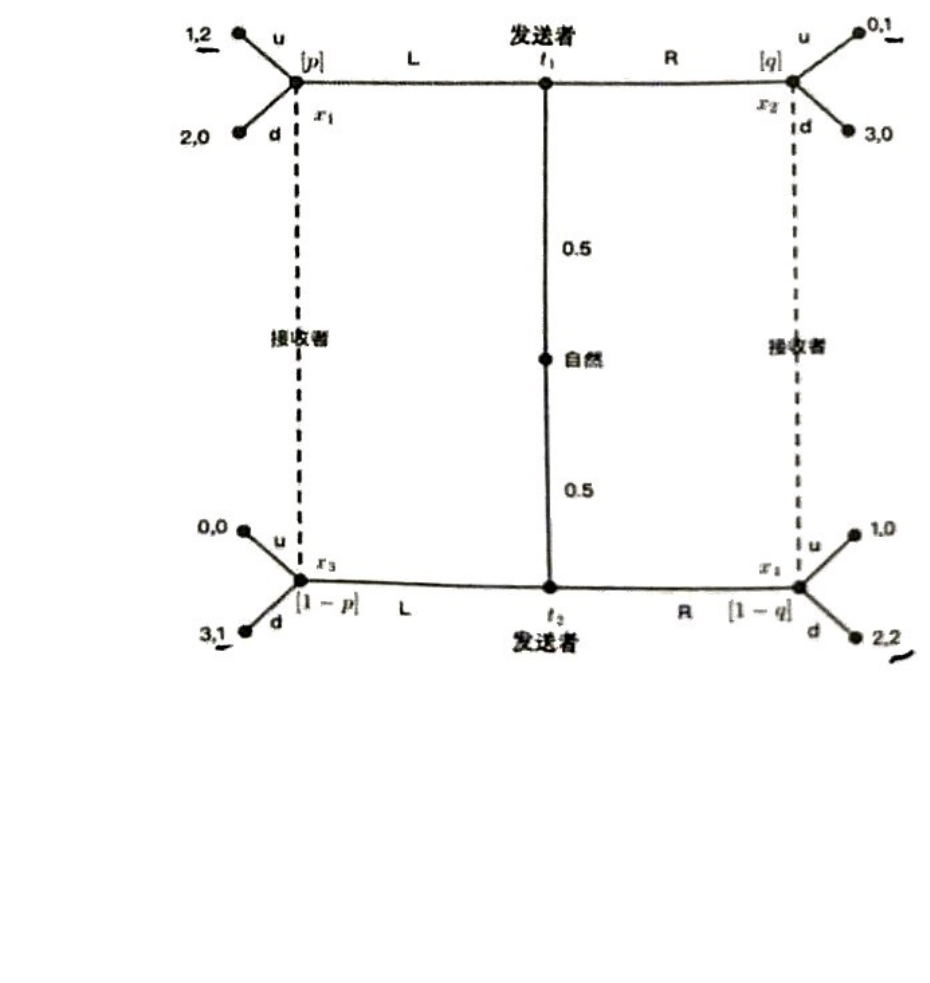

# 博弈论 往年习题2 题目（年份未知）

## 一、习题

### 1

考虑如下的双变量博弈表，回答如下问题。

| 参与人 1 \ 参与人 2 | $B_1$ | $B_2$ | $B_3$ |
| --- | --- | --- | --- |
| $A_1$ | $(0,8)$ | $(8,0)$ | $(10,6)$ |
| $A_2$ | $(8,8)$ | $(0,4)$ | $(10,6)$ |
| $A_3$ | $(6,10)$ | $(6,8)$ | $(12,12)$ |

(a) 这一博弈是否存在严格劣战略？若存在，请指出依照累次剔除严格劣策略的方法，所需要剔除的所有严格劣策略。

(b) 这一博弈是否存在纯策略 Nash 均衡？若存在，请利用划线法求出纯策略 Nash 均衡。

(c) 这一博弈是否存在混合策略 Nash 均衡？若存在，请求出混合策略 Nash 均衡。

### 2

考虑有 $n$ 个企业参与博弈的 Cournot 模型：设企业 $i$ 的产量为 $q_i$，市场总产量为 $Q=\sum_{i=1}^{n}q_i$，价格与需求的关系为 $p(Q)=a-Q$，成本函数 $c_i(q_i)=cq_i$，边际成本为 $c<a$。企业根据产量进行决策。请求出这一博弈的 Nash 均衡，并考虑当参与博弈的企业数量 $n\to\infty$ 时，会出现什么情况？

### 3

考虑进行 2 次的有限重复博弈，其中阶段博弈如下表所示。第二阶段开始前双方均可观测到第一阶段的结果，不考虑贴现因素。在一个纯战略子博弈精炼 Nash 均衡中，是否能在第一阶段得到 $(4,4)$ 的 Nash 均衡？如果可以，请给出相应的战略；如果不能，请给出理由。

| 参与人 1 \ 参与人 2 | $B_1$ | $B_2$ | $B_3$ |
| --- | --- | --- | --- |
| $A_1$ | $(3,1)$ | $(0,0)$ | $(5,0)$ |
| $A_2$ | $(2,1)$ | $(1,2)$ | $(3,1)$ |
| $A_3$ | $(1,2)$ | $(0,1)$ | $(4,4)$ |

### 4

考虑同类产品的 Bertrand 模型，企业 1 和 2 同时给产品定价为 $p_1,p_2$，对企业 $i$ 产品的需求：如果 $p_i<p_j$，需求为 $a-p_i$；如果 $p_i>p_j$，需求为 0；如果 $p_i=p_j$，需求为 $\dfrac{a-p_i}{2}$。边际成本为 $c<a$。

双方若选择合作，则双方定价均采取垄断价格 $\dfrac{a+c}{2}$；若有一方背离，理想情况下，假定背离一方当期的收益为 $\dfrac{(a-c)^2}{4}$，但之后的所有阶段双方均采用惩罚定价 $p_i=p_j=c$，此时收益均为 0。

考虑基于以上阶段博弈的无限重复博弈，求在子博弈精炼 Nash 均衡中，企业可以采取上述触发策略以维持垄断条件下的价格水平的贴现值 $\delta$ 的取值范围。

### 5

对于如下图猜硬币博弈（完全信息静态博弈），我们已经得知：其不存在纯策略 Nash 均衡，但存在一个混合策略 Nash 均衡，即双方都以 1/2 的概率猜正面，1/2 的概率猜背面。

| 玩家 1 \ 玩家 2 | 正面 | 背面 |
| --- | --- | --- |
| 正面 | $(1,-1)$ | $(-1,1)$ |
| 背面 | $(-1,1)$ | $(1,-1)$ |

对于此完全信息静态博弈对应的非完全信息静态博弈（有私人信息，如下所示， $t_1,t_2$ 是 $[0,x]$ 上均匀分布，其为自然节点赋予的类型推断），请给出一个纯战略贝叶斯 Nash 均衡，使得私人信息趋于消失时，玩家在贝叶斯 Nash 均衡下的行为达到其在完全信息静态博弈下混合策略 Nash 均衡的行为。

| 玩家 1 \ 玩家 2 | 正面 | 背面 |
| --- | --- | --- |
| 正面 | $(1+t_1,-1)$ | $(-1,1+t_2)$ |
| 背面 | $(-1,1)$ | $(1,-1)$ |

### 6

写出下面信号博弈的一个混同精炼贝叶斯均衡，其中两种类型的发送者都选择信号 $R$。

