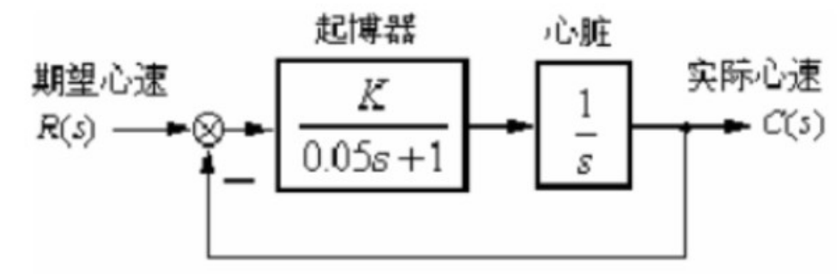

# 智能控制与机器人 第9讲课后作业（2022春）

## 1

设单位负反馈系统的开环传递函数

$$G(s)=\frac{K}{s(0.1s+1)}$$

试分别计算当 $K=10\ \mathrm{s^{-1}}$ 和 $K=20\ \mathrm{s^{-1}}$ 时系统的阻尼比 $\zeta$，无阻尼自然频率 $\omega_{n}$，单位阶跃响应的超调量 $\sigma\%$，峰值时间 $t_{p}$，过渡时间 $t_{s}$。并讨论 $K$ 的大小对系统性能指标的影响。

## 2

设单位负反馈系统的开环传递函数

$$G(s)=\frac{4}{s(s+5)}$$

求单位阶跃响应 $h(t)$ 和调节时间 $t_{s}$。

## 3

电子心脏起搏器心率控制系统结构图如下所示，其中模仿心脏的传递函数相当于一纯积分环节。

(1) 若 $\zeta=0.5$ 对应最佳响应，问起搏器增益 $K$ 应取多大？

(2) 若期望心率为 60 次/分，并突然接通起搏器，试求 $1\ \mathrm{s}$ 后实际心率为多少，瞬时最大心率为多少？

## 4

系统的特征方程如下，试判别系统的稳定性，若不稳定，确定系统正式根的个数：

(1) $s^{3}+20s^{2}+9s+100=0$

(2) $3s^{4}+10s^{3}+5s^{2}+s+2=0$

(3) $s^{4}+3s^{3}+s^{2}+3s+1=0$

(4) $s^{3}+10s^{2}+16s+160=0$

## 5

设单位负反馈系统的开环传递函数为

$$G(s)=\frac{K}{s\left(\dfrac{1}{3}s+1\right)\left(\dfrac{1}{6}s+1\right)}$$

若要求闭环特征方程根的实部分别小于 $0,\ -1,\ -2$，试求 $K$ 值的取值范围。

## 6

已知单位负反馈系统的开环传递函数为

(1) $G(s)=\dfrac{10}{(0.1s+1)(0.5s+1)}$

(2) $G(s)=\dfrac{7(s+1)}{s(s+4)(s^{2}+2s+2)}$

(3) $G(s)=\dfrac{8(0.5s+1)}{s^{2}(0.1s+1)}$

分别求出当 $r(t)=1(t),\ r(t)=t,\ r(t)=t^{2}$ 时，系统的稳态误差 $e=r-c$。
