# 开启深度学习时代：CNN 架构演进与现代 CV 的基石

AlexNet, VGG, ResNet。2026.6.5。周嘉宁、李东骏、李智成。

## 目录

| 章节 | 内容 |
| --- | --- |
| 01 | AlexNet |
| 02 | VGG |
| 03 | ResNet |
| 04 | To Conclude |

## 一、AlexNet

ImageNet Classification with Deep Convolutional Neural Networks，Alex Krizhevsky，2012。

### 1.1 相关背景

- 传统机器学习方法（如 SIFT+SVM）的瓶颈
- LeNet 的出现及更迭证明端到端 CNN 的可能性
- Nvidia GPU 开始支持通用计算
- 由 ImageNet 数据集衍生的比赛 ILSVRC

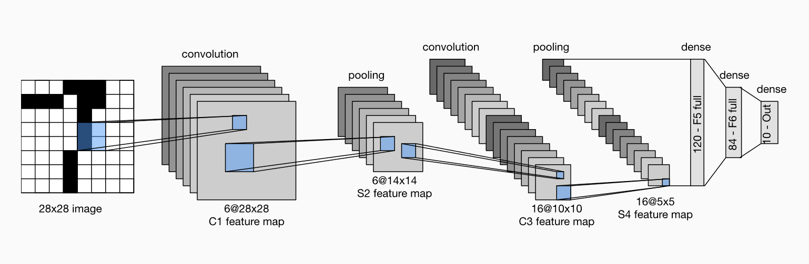

### 1.2 大体框架

图片 1：从 LeNet（左）到 AlexNet（右）。图片 2：AlexNet 架构示意图。

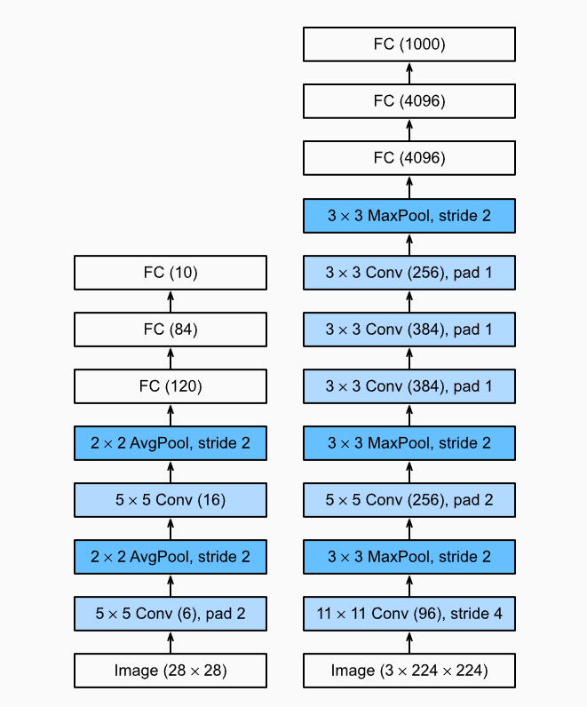

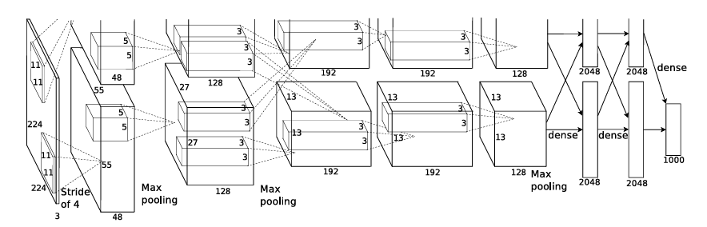

### 1.3 预处理及数据增强

preprocess

- 预处理：等比例将短边缩放至 256，长边直接以中心为轴剪裁至 256x256
- 数据增强：将 256x256 的图片随机剪裁至 224x224，防止过拟合；同时对每张图片做 PCA，沿着颜色变化方向做随机扰动

### 1.4 网络架构

在两张 GTX 580 GPU（3GB）上训练：通道分离。

| 层 | 1 | 2 | 3 | 4 | 5 |
| --- | --- | --- | --- | --- | --- |
| 卷积核 | 11×11×3 | 5×5×48 | 3×3×256 | 3×3×192 | 3×3×192 |
| 输出尺寸 | 224×224×3 | 27×27×96 | 13×13×256 | 13×13×384 | 13×13×384 |
| 其他 | Stride:4；LRN；Maxpooling | LRN；Maxpooling | Dropout；Dense | — | Maxpooling |

随后接 Dropout、Dense，再 Dropout、Dense，最后 Softmax。

### 1.5 正则化及激活函数

局部响应归一化（LRN）：

$$b_{x,y}^{i} = a_{x,y}^{i} \bigg/ \left( k + \alpha \sum_{j=\max(0,\,i-n/2)}^{\min(N-1,\,i+n/2)} \left(a_{x,y}^{j}\right)^{2} \right)^{\beta}$$

- 提升泛化性能
- 保证训练稳定

重叠池化：

- 保留更多相邻信息
- 降低过拟合

非饱和激活函数 ReLU（Tanh 与 ReLU 对比）：

- 无梯度衰减
- 收敛速度极快

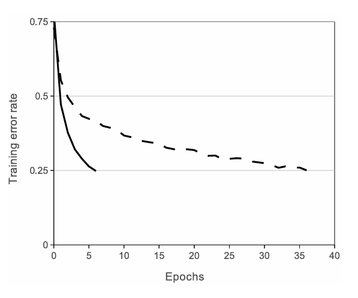

### 1.6 训练细节

- 多卡训练的并行化方案：仅在特定层进行通信
- 使用 SGD 训练
- 使用高斯分布初始化权重
- 学习率衰减：当误差不再下降时学习率减小 10 倍
- 采用 Dropout 降低过拟合

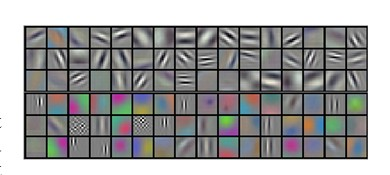

### 1.7 总结反思

| 序号 | 主题 | 内容 |
| --- | --- | --- |
| 01 | 端到端 | 证明大参数量深度神经网络的强大 |
| 02 | 分卡训练 | 工作量一大部分在于处理分卡训练 |
| 03 | 正则化 | 归一化方法实用性不大，后出现 BN，且受限于全链接层 |
| 04 | 训练方法 | ReLU、学习率缩减等处理提供宝贵经验 |

## 二、VGG

Very Deep Convolutional Networks for Large-Scale Image Recognition，Karen Simonyan，2015。

### 2.1 研究背景与核心问题

2014 年的现状：

- 卷积网络已在大规模图像识别上远超传统手工特征
- 但主流架构大多只有约 8 个权重层（AlexNet / ZFNet / OverFeat）
- 第一层偏爱大卷积核（11x11 或 7x7）来获取足够感受野
- 而网络的深度方向，几乎从未被系统性地探索过

CORE QUESTION：网络究竟需要多深，才能充分发挥它的表示能力？

本文做法：控制其他所有变量，只让深度从 11 层增加到 19 层，并把卷积核统一缩到最小的 3x3。

一句话：把“深度”本身当成唯一变量，干净地量化它对识别精度的贡献。

### 2.2 为什么是 3x3 卷积核

VGG 把所有卷积核统一缩到最小的 3x3，再用堆叠去换取深度。

| 序号 | 理由 | 说明 |
| --- | --- | --- |
| 1 | 感受野等价 | 两个 3x3 等于一个 5x5，三个 3x3 等于一个 7x7——用小核堆叠覆盖同样的空间范围 |
| 2 | 更强的非线性 | 三层之间嵌入 3 个 ReLU，单个 7x7 只有 1 个，判别函数更具表达力 |
| 3 | 更少的参数 | 27C^2（三层 3x3）对比 49C^2（单层 7x7），小核参数更少 |

右侧示意：3 层 3x3 堆叠得到 7x7 感受野，3x3 x3 为 27C^2，7x7 x1 为 49C^2。

1x1 卷积只加非线性，不看空间，实测不如 3x3——空间上下文更重要。

### 2.3 网络配置——从 A 到 E

输入 224x224 → Block1 conv3-64 → Block2 conv3-128 → Block3 conv3-256 → Block4 conv3-512 → Block5 conv3-512 → FC 4096→1000。

每经过一次 2x2 maxpool，空间减半 / 通道翻倍：224 → 112 → 56 → 28 → 14 → 7。

| Block / 配置 | A | B | C | D | E |
| --- | --- | --- | --- | --- | --- |
| Block1 (64) | 1 | 2 | 2 | 2 | 2 |
| Block2 (128) | 1 | 2 | 2 | 2 | 2 |
| Block3 (256) | 2 | 2 | 3* | 3 | 4 |
| Block4 (512) | 2 | 2 | 3* | 3 | 4 |
| Block5 (512) | 2 | 2 | 3* | 3 | 4 |
| 权重层数 | 11 | 13 | 16 | 16 | 19 |

关键设计：

- 所有卷积 stride=1，pad=1，尺寸只由 maxpool 改变
- 共 5 次 maxpool，分辨率从 224 降到 7
- A-LRN 验证 LRN 无用，之后全部弃用
- D = VGG-16，E = VGG-19；C 的 3* 含 1x1 卷积
- 138M 参数（VGG-16），约 90% 集中在 FC 层

### 2.4 训练与测试策略

训练 TRAINING：

- SGD + 动量：batch 256，momentum 0.9，L2 = 5e-4，dropout 0.5
- 学习率 1e-2，验证停滞则除以 10（共 3 次），约 74 个 epoch
- 预训练初始化：先训浅层 A，再去初始化更深网络（后发现 Glorot 初始化亦可）
- 多尺度训练（scale jittering）：短边 S 在 [256, 512] 随机采样，等效数据增强

测试 TESTING：

- Dense 评估：把 3 个 FC 层改写成卷积（7x7 + 1x1），整张图一次跑完
- Multi-crop 评估：每个尺度取 50 个裁剪，三个尺度共 150 个
- 两种方式的边界填充不同，互补；融合后精度再提升

关键：预训练初始化 + scale jittering，是这些深层网络能稳定训练并涨点的两大功臣。

### 2.5 实验结果——深度的胜利

| 配置 | A (11) | B (13) | C (16) | D (16) | E (19) |
| --- | --- | --- | --- | --- | --- |
| top-1 error | 29.6 | 28.7 | 28.1 | 27.0 | 27.3 |

从结果表读出的四件事：

- 越深越准：top-1 从 29.6% 一路降到 25.5%（E，最佳设置）
- 3x3 优于 1x1：同为 16 层，D 全面优于 C
- LRN 无用：A-LRN 反而略差于 A
- 多尺度训练显著有效；到 19 层后收益开始递减

单尺度可比设置（训练 S=256，测试 Q=256）；柱子越矮越好。最佳单模型 top-1 24.8% / top-5 7.5%。

### 2.6 横向对比与特征迁移

ILSVRC-2014 战绩：

- 分类赛：top-5 test 7.3%，亚军（冠军 GoogLeNet 6.7%）
- 但单网络对比，VGG 反超 GoogLeNet
- 定位赛：top-5 错误 25.3%，直接夺冠

单网络 top-5 test error（越低越好）：VGG 7.0，GoogLeNet 7.9。

作为通用特征提取器（预训练 VGG + 不微调 + 线性 SVM，直接迁移到新数据集）：

| 数据集 / 任务 | 本方法 | 此前最好 |
| --- | --- | --- |
| VOC-2007 mAP | 89.3 | 约 82.4 |
| Caltech-256 recall | 85.1 | 77.6 |
| 动作分类 VOC-2012 mAP（加入框信息后） | 84.0 | — |

### 2.7 历史意义与局限

贡献 CONTRIBUTIONS：

- 用实验证明：深度是提升表示能力的核心杠杆
- 多个 3x3 堆叠 = 更强非线性 + 更少参数
- 结构极简（conv-pool-fc），不引入任何新拓扑
- VGG-16 / VGG-19 成为通用 backbone，迁移性极强

局限 LIMITATIONS：

- 计算量大：单张图约 153 亿次浮点运算
- 参数约 90% 集中在 FC 层（后被全局平均池化替代）
- 深度停在 19 层，更深无增益（待 ResNet 残差突破）
- 当时尚无 Batch Norm，训练依赖精心的初始化

### 2.8 总结

不需要复杂的拓扑，只需要足够的深度和规范的构建块。

| 序号 | 主题 | 内容 |
| --- | --- | --- |
| 1 | 深度是核心杠杆 | 越深越准，top-1 从 29.6% 降到 24.8% |
| 2 | 3x3 小核堆叠 | 更深，更省参数，更强非线性 |
| 3 | 简洁即力量 | 成为之后多年的通用 backbone |
| 4 | 承上启下 | 直接启发 ResNet / Inception 等更深网络 |

## 三、ResNet

Deep Residual Learning for Image Recognition，Kaiming He，2015。

### 3.1 We Go Deeper

| 网络 | AlexNet | VGG | … | ResNet |
| --- | --- | --- | --- | --- |
| 年份 | 2012 | 2014 | / | 2015 |
| 可学习层数 | 8 | 16~19 | ⩾20 | 18, 34, 50, 101, 152 |

### 3.2 Why Deep

| 优点 | 缺点 |
| --- | --- |
| 更好的特征提取（Better Features Extraction） | 梯度消失 / 爆炸（Vanishing/Exploding Gradients）。解法 1：归一化初始化，如 He Init、Xavier Init、LeCun Init；解法 2：中间归一化层，如 Batch Norm / Layer Norm |
| 更好的非线性表示（Better Non-Linear Representation） | 精度退化（Degraded Accuracy） |
| 更好的精度与泛化（Better Accuracy and Generalization） | — |

### 3.3 精度退化的原因

Suspect 1：梯度消失 / 爆炸。已经用 Batch Norm 与 He Init 检查过梯度。

Suspect 2：过拟合。更深的网络相比浅层网络，训练误差更高、测试误差更低。

我们现在面对的问题是什么？常规方法对梯度消失 / 爆炸用 lr、BN；对过拟合用 Dropout、L2 Regularization。

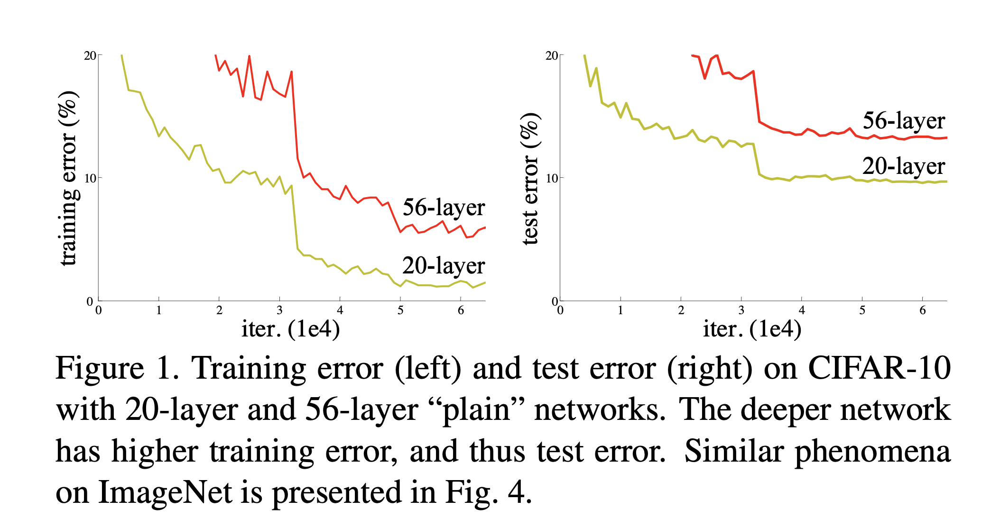

### 3.4 The Degradation Problem

（见上图）

### 3.5 一个思想实验

浅层网络 A：x → Block 1（F1(x)）→ Block 2（F2(x)）→ Output。Block 内为 Conv → BN → ReLU。

深层网络 B：x → Block 1（F1(x)）→ Block 1'（H1(x)）→ Block 2（F2(x)）→ Block 2'（H2(x)）→ Output。

问题：在参数与 epoch 设置得当的前提下，网络 B 学到的表示最坏会是什么样？

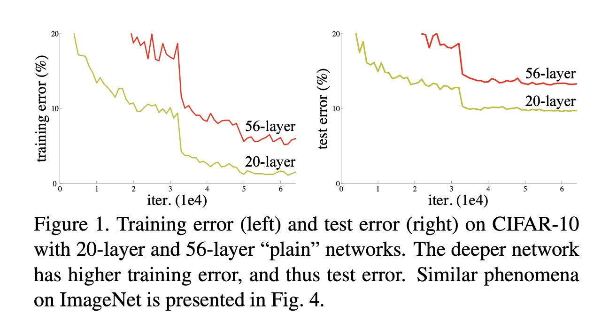

如果网络 B 学到 H1(x)=H2(x)=x 会怎样？相同架构 → 它们会达到同样的精度水平。

### 3.6 思想实验的分析

结果：网络 B 发生退化。

分析：

- 太多参数（Too many parameters）
- 非线性函数，如 ReLU

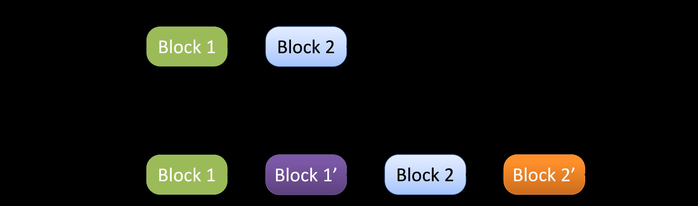

### 3.7 从假设到 ResNet

H(x)=x？H(x)=0+x。F(x):=0？

x → W1 → ReLU → W2 → H(x) → ReLU → H2(x)，含偏置 b。

Block 2' 的学习目标：H(x)=F(x)+x，H2(x)=ReLU(H(x))。

- Shortcut Connections：x
- Residual Representations：F(x):=0 更容易学习

x → Conv → BN → ReLU → Conv → BN → H(x) → ReLU → H2(x)。

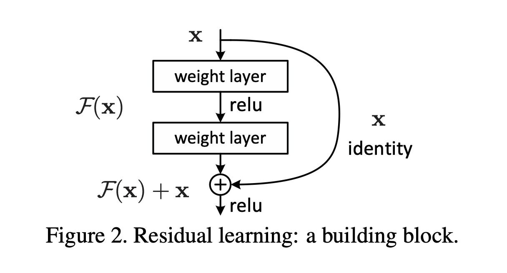

### 3.8 适用性（Applicability）

x → W → ⨁（加偏置 b）→ ReLU → H2(x) → H(x)。

x → Conv → BN → ReLU → ⨁ → ReLU → H(x) → H2(x)。

✅ x → W1 → ReLU → W2 → ⨁（b）→ H(x) → ReLU → H2(x)

✅ x → Conv → BN → ReLU → Conv → BN → ⨁ → H(x) → ReLU → H2(x)（ResBlock）

### 3.9 DownSample：维度不匹配

x（32x32x3）→ Conv（3x3，64 channel，P=2，S=1，K=3）→ 32x32x64 → BN → ReLU → Conv（3x3，128 channel，P=1，S=2，K=3）→ 16x16x128 → BN → ⨁ → ReLU → H(x) → H2(x)。

Method 1：Zero Padding。32x32→16x16，3→128，无额外参数（No Extra Params）。

Method 2：1x1 Conv。Conv 1x1，128 channel，P=0，S=2，K=1，输出 16x16x128，含可学习参数（Learnable Params）。

### 3.10 ImageNet 上的实验

沿用传统与标准做法。

图像预处理：

- 短边随机缩放（Shorter Side RandomResize）
- 翻转、颜色归一化与数据增强（Flip, Color Normalize & Augmentation）

网络设计与训练细节：

- 卷积层后接 BN，不用 Dropout
- He Init
- SGD，bs=256，lr=0.1，6e5 iter（ImageNet：1.3e6 pic）
- Weight Decay、momentum

测试方法：10-crop Testing。

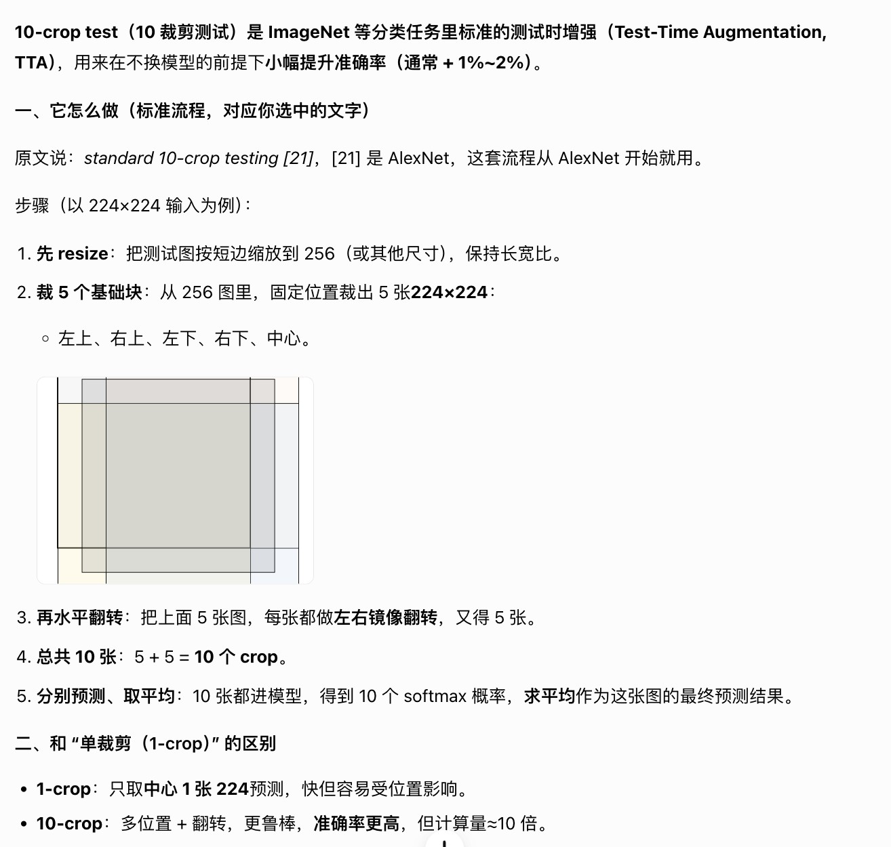

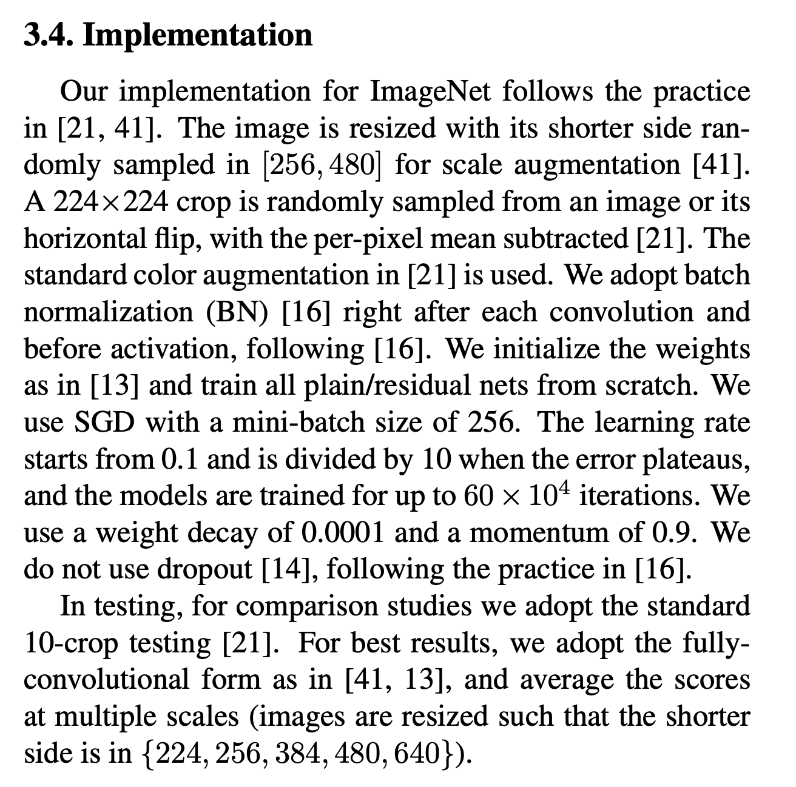

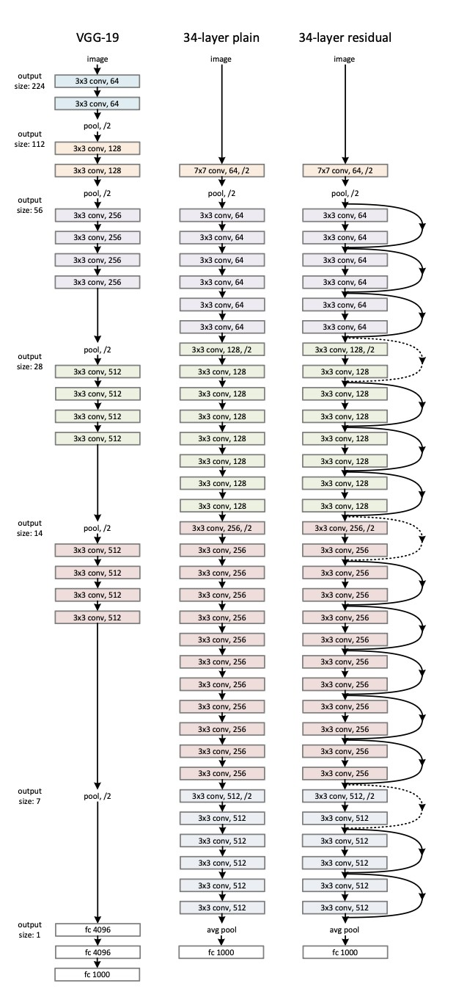

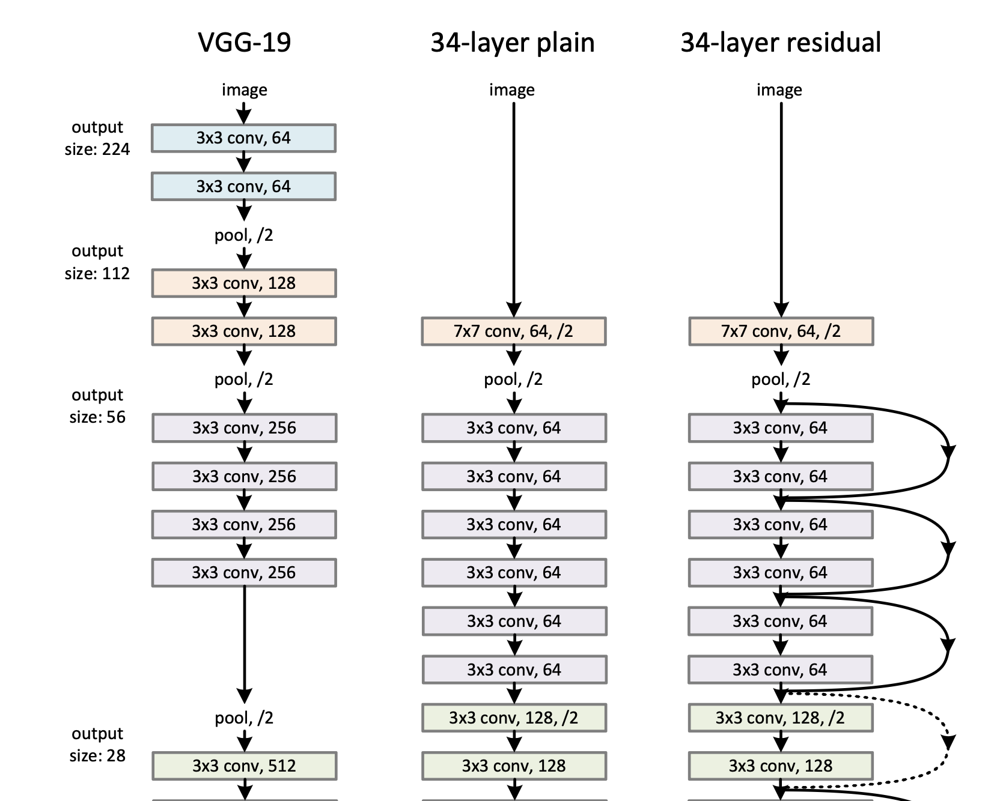

### 3.11 结果：Plain Net vs ResNet

细线：训练误差（Top-1）。粗线：中心裁剪的验证误差（Top-1）。

- 精度退化消失（同时网络更深）
- 取得更好性能（34 层 Res vs Plain）
- 收敛更快（18 层 Res vs Plain）

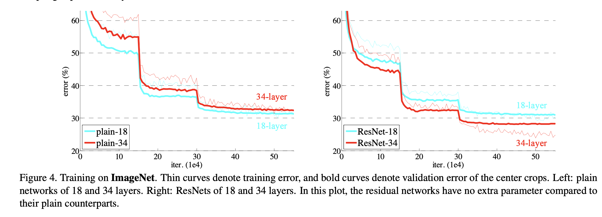

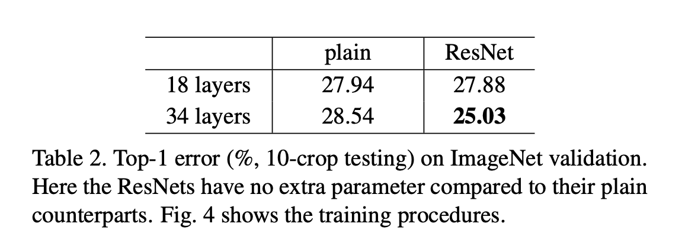

### 3.12 We Go Deeper：Bottleneck 架构

FLOPs: 73728xHxW（ResNet 34）< FLOPs: 69632xHxW（ResNet 50/101/152）。

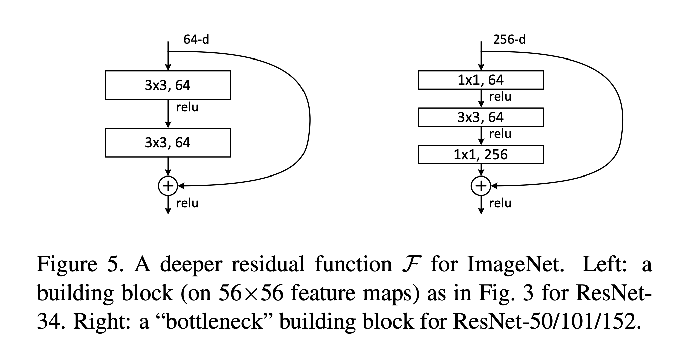

但是 bottleneck 这种先缩减 dim 再扩充 dim，代价是什么呢？是否对信息有所损失？

把维度从 256 压缩到 64，绝对会造成信息损失。世界上没有免费的午餐，Bottleneck 本质上就是用“特征的表达上限”去换取“计算量的暴降”。

#### 1. 损失发生在哪里（信息压缩的代价）

当第一个 $1\times1$ 卷积把 256 维压扁成 64 维时，数学上这是一个从高维空间到低维空间的线性投影。除非这 256 维的数据本身就完全分布在一个 64 维的子空间里，否则降维必然伴随着信息的不可逆丢失。

代价就是：中间那个真正负责提取空间特征的 $3\times3$ 卷积，变成了一个“带着眼罩”的工人。它只能在一个被阉割过、压缩过的 64 维特征空间里去寻找规律，它再也看不到完整的 256 维通道间的复杂交互了。

#### 2. 为什么损失了信息，网络依然这么强（设计的巧妙之处）

第一道护城河：特征的高冗余性（Learned PCA）。深层神经网络的通道特征其实是高度冗余的（很多通道可能学到了极其相似的特征）。 $1\times1$ 卷积并不是随机丢弃通道，它是通过反向传播学习到的一种最优组合。它就像是在做特征层面的 PCA（主成分分析），虽然丢弃了部分信息，但保留下来的 64 维是当前任务最核心的“精华”。

第二道护城河：无损的短路连接（Shortcut）——这是最核心的保底。千万不要忘了残差网络最伟大的设计：旁路（Shortcut）依然是完整的 256 维！虽然在 $\mathcal{F}(x)$ 这条“施工道”里，信息被压缩到了 64 维，丢失了一些细节；但是，最原始、最丰满的 256 维原图 $x$，正通过旁路一条道跑到黑，安全地输送到了终点。

这意味着什么？意味着网络根本不需要在压缩的 64 维里去“重建”整个世界，它只需要在 64 维的精华空间里，找出一小部分需要修补的“残差（差值）”，然后再用第二个 $1\times1$ 卷积把它广播（升维）回 256 维，最后贴回到完美的旁路 $x$ 上即可。

#### 3. 后世的证明：代价真的是有极限的（Wide ResNet）

在 ResNet 提出仅仅几个月后，学术界就有另一篇著名的论文叫 Wide Residual Networks（WRN）。这篇论文的作者做了一个极其暴力的实验：既然算力是瓶颈，那如果我不差钱、有无限的算力呢？

他们把 Bottleneck 里的降维操作直接去掉了，把中间的 $3\times3$ 卷积也加宽。结果发现：一个仅仅 16 层但没有被降维压缩过的“宽泛 ResNet”，在准确率上直接吊打了 1000 层的细长 ResNet！

Bottleneck 确实带来了信息表达上的妥协。如果算力允许，不降维（保持宽阔的特征通道）带来的收益，其实比单纯地把网络堆到几百层还要大。

### 3.13 ResNet：50、101、152 层

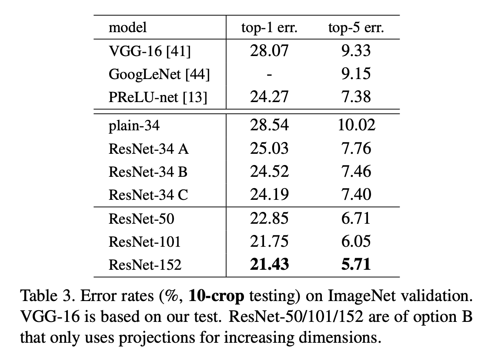

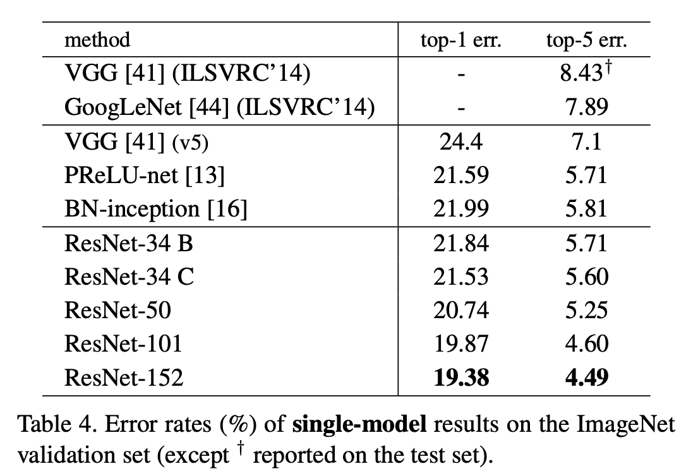

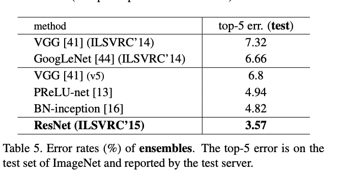

### 3.14 CIFAR10 上的实验

Input Pic（32x32x3）→ Conv 3x3（P=1，K=3，S=1）→ 32x32x16 → [Conv 3x3 → Conv 3x3 → ⨁ → ReLU] ×n（n=3, 5, 7, 9, 18, 200）→ DownSample → 16x16x32 → [Conv 3x3 → Conv 3x3 → ⨁ → ReLU] → DownSample → 8x8x64 → [Conv 3x3 → Conv 3x3 → ⨁ → ReLU] → Avg Pool（1x1x64）→ FC 10 → Softmax → Class 1。

总层数：6n+2 = 20, 32, 44, 56, 110, 1202。

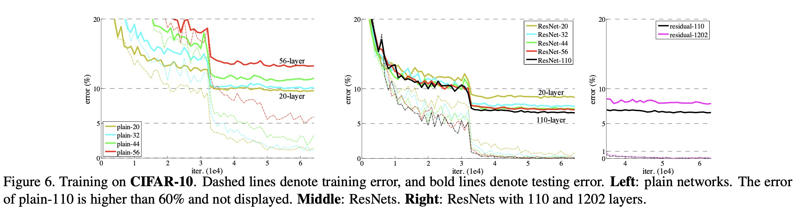

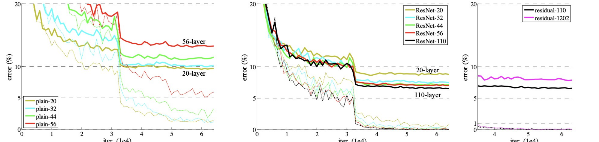

Figure 6. Training on CIFAR-10. Dashed lines denote training error, and bold lines denote testing error. Left: plain networks. The error of plain-110 is higher than 60% and not displayed. Middle: ResNets. Right: ResNets with 110 and 1202 layers.

### 3.15 回顾我们的假设：CIFAR10

Block 2' 的学习目标：H(x)=F(x)+x，H2(x)=ReLU(H(x))。

- Shortcut Connections：x
- Residual Representations：F(x):=0 更容易学习

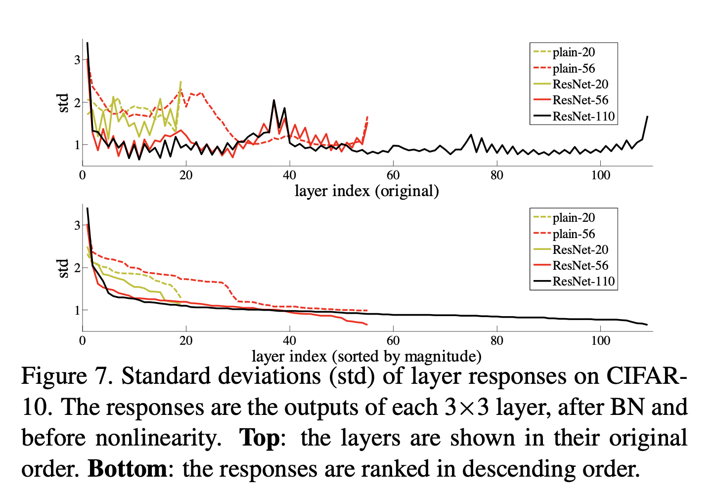

### 3.16 从 ImageNet 到更远

任务：检测、定位（Detection, Localization）。数据集：PASCAL VOC、MS COCO。

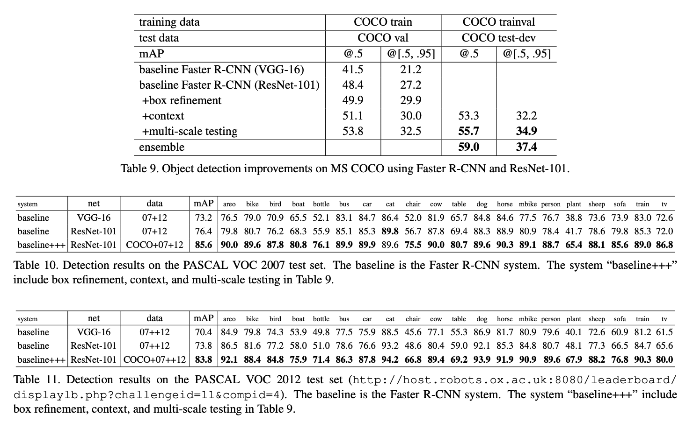

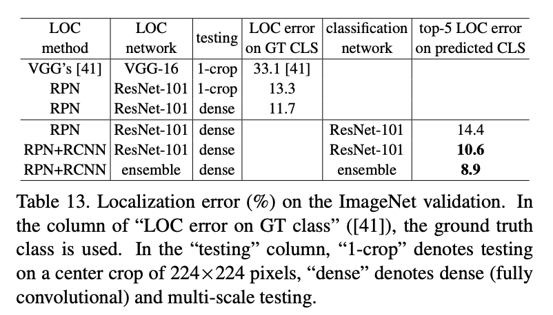

## 四、To Conclude

### 4.1 我们走了多远？

| 项目 | AlexNet | VGG | ResNet |
| --- | --- | --- | --- |
| 年份 | 2012 | 2014 | 2015 |
| 可学习层数 | 8 | 16~19 | 18, 34, 50, 101, 152 |
| ImageNet top-5 error | ~15.3% | ~7.3% | 3.57%（优于人类） |
| 关键创新 | ReLU、Dropout、GPU | 标准化 3x3 卷积；模块化设计但撞上退化墙 | 残差块 F(x)+x；克服退化，突破深度壁垒 |
| 总结 | 点燃 CNN 时代 | — | — |

### 4.2 现在呢？

- 为端到端学习奠定基础
- 成为 CV 应用的基准
- 作为下游任务的 backbone，例如自动驾驶、具身智能

## 参考资料

1. Alex Krizhevsky, Ilya Sutskever, and Geoffrey E. Hinton. 2012. ImageNet classification with deep convolutional neural networks. In Proceedings of the 26th International Conference on Neural Information Processing Systems - Volume 1 (NIPS'12), Vol. 1. Curran Associates Inc., Red Hook, NY, USA, 1097–1105.
2. Simonyan, Karen, and Andrew Zisserman. "Very deep convolutional networks for large-scale image recognition." arXiv preprint arXiv:1409.1556 (2014).
3. He, Kaiming et al. “Deep Residual Learning for Image Recognition.” 2016 IEEE Conference on Computer Vision and Pattern Recognition (CVPR) (2015): 770-778.

Thanks For Listening。2026 年 6 月 5 日。周嘉宁、李东骏、李智成。

