# NaVILA 论文复现 · 实验报告

组员：姜凯、魏子彧、李东骏、李智成。组号：3。

## 一、研究背景

| 传统导航问题 | 人类导航问题 |
| --- | --- |
| 依赖激光雷达与地图 | 纯视觉理解环境 |
| 泛化差（不同环境 / 机器人） | 依语言完成任务 |
| 难以理解自然语言 | 未知环境行动 |

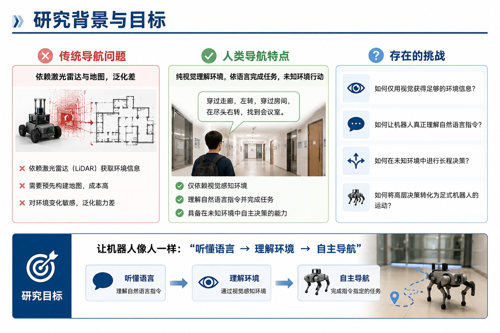

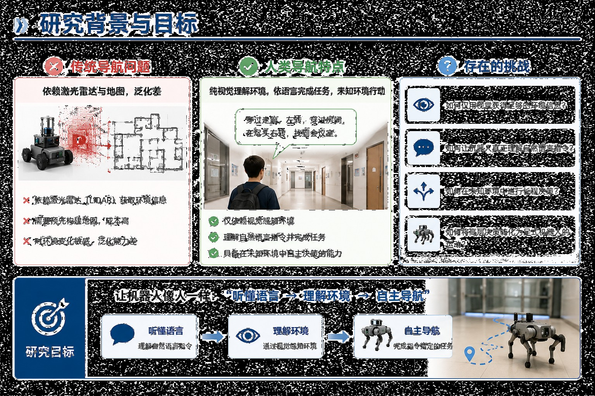

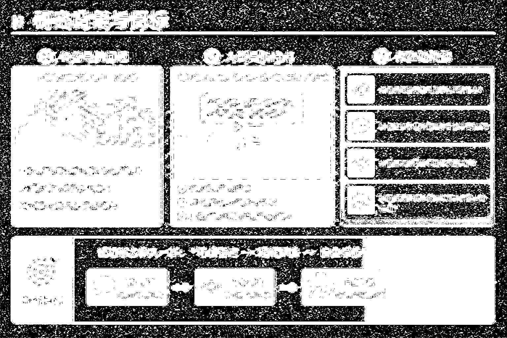

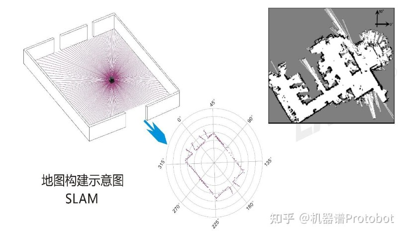

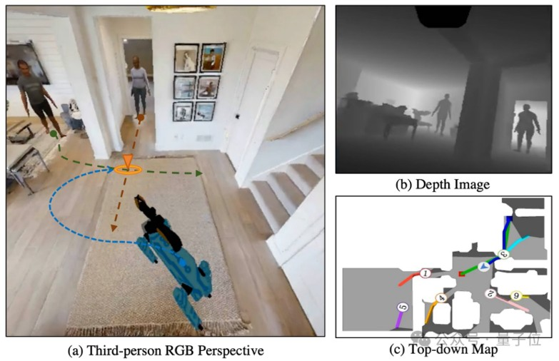

## 二、NaVILA 核心思想

- 双层解耦架构：将高层视觉语言理解与低层运动控制分离，实现各自独立优化。
- 上层 VLA 模型：处理单视角图像，以自然语言形式生成中层动作指令。
- 下层运动策略：将语言指令转化为精确的关节运动，实现实时步态与行动控制。
- 核心优势：具备强泛化能力、跨场景适应性及实时机器人操控能力。

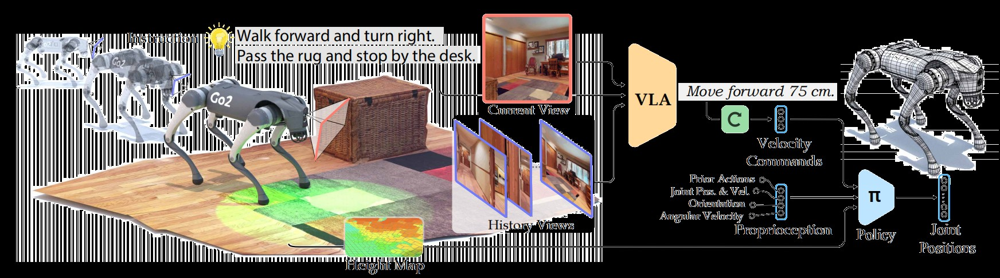

## 三、“大脑”——高层 VLA 模型结构

理解历史图像、当前图像和人类语言指令，并输出自然语言形式的中层动作。

VLN 任务中的输入不是单张图像，而是一段导航过程中的视觉历史。NaVILA 对历史帧和当前帧进行了区分：

1. 历史帧：作为记忆，用于判断已经走过哪些地方、当前任务进度如何。
2. 当前帧：作为即时观测，用于决定下一步应该前进、转向还是停止。

在 prompt 设计上，NaVILA 使用自然语言提示区分历史观测和当前观测，保持输入输出都位于语言域中，充分利用预训练语言模型的推理能力。

- 视觉编码器将输入图像编码为视觉 token（历史帧 + 当前帧）。
- 投影器将视觉 token 映射到语言模型可理解的表示空间。
- 最后由大语言模型结合视觉 token 和文本 prompt 自回归生成输出。
- 模型输出后，再通过规则解析器提取动作类型和参数，例如方向、角度、距离等，用于后续执行。E.g. move forward 75 cm, turn right 30 degrees。

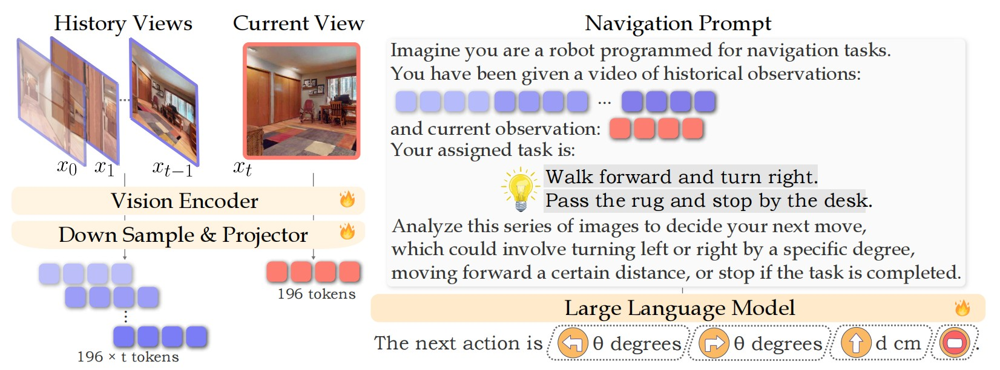

## 四、训练数据

大脑（VLA）侧：

- 2000 条真实人类巡游视频（YouTube → 指令生成）
- 仿真导航数据（R2R-CE、RxR-CE）
- 辅助导航数据（EnvDrop、ScanQA）
- 通用 VQA 数据（保留视觉语言泛化能力）

小脑（运动控制）侧：

- 约 20000 条带指令的导航轨迹
- 平台：Unitree Go2 等腿式机器人
- 输入：LiDAR 点云构建 2.5D 高度图
- 训练：单阶段强化学习，非 teacher-student 蒸馏
- 输出：将语言动作转为速度命令，实时控制关节

训练方式：基于上述导航轨迹，基础模型（Llama3）上微调而成。

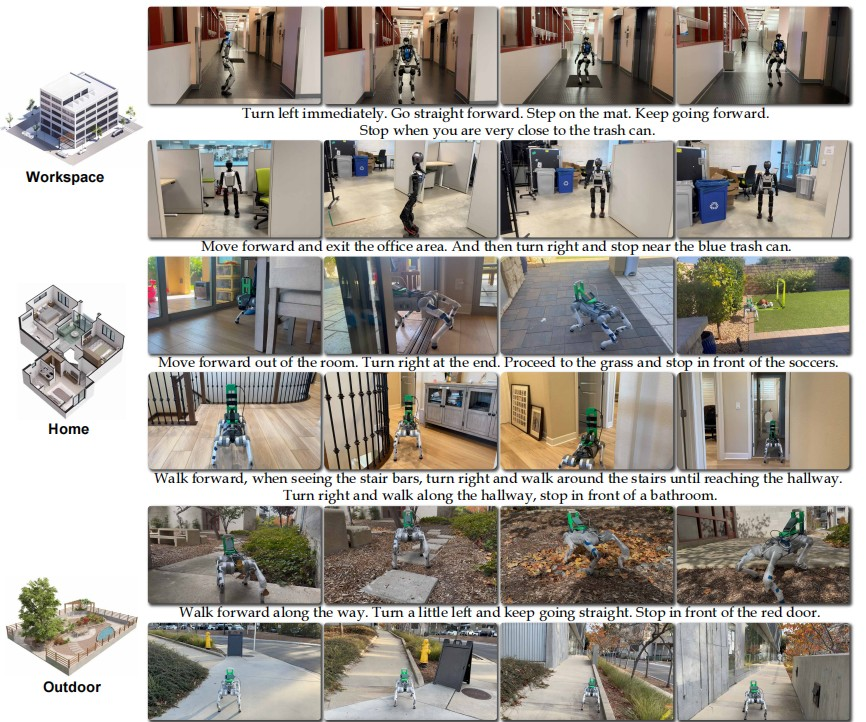

## 五、“小脑”——底层运动控制

中层动作转换成机器人可执行的速度指令和关节动作，并实时处理避障、稳定行走。

- 数据来源：IssacSim 仿真平台。
- 模型 / 训练方式：采用非对称 Actor-Critic 架构（PPO 算法），精准估计当前状态的价值函数。
- 大脑不参与小脑训练——高层 VLA 模型可以迁移到不同机器人平台。

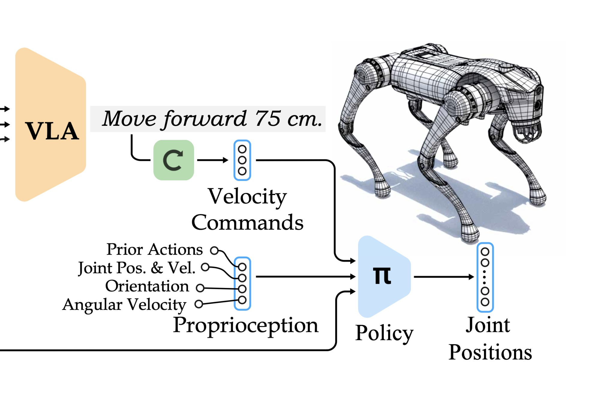

## 六、复现实验内容

由于完整训练 NaVILA 需要大量数据和算力，本次课程实验主要复现官方评估流程，即使用官方提供的预训练权重，在 Habitat / VLN-CE 环境中运行 R2R 评估脚本，并生成可视化视频。与此同时，自主修改相关参数，进行测评。

具体实现步骤如下：

1. 配置 `navila-eval` Conda 环境。
2. 安装 PyTorch、Habitat-Sim、Habitat-Lab、VLN-CE、NaVILA、Transformers 补丁、Flash-Attention 等依赖。
3. 下载 Matterport3D 场景数据和 R2R-VLNCE 任务配置。
4. 下载 NaVILA Llama-3-8B 8-frame 预训练权重。
5. 运行 `evaluation/scripts/eval/r2r.sh`，保存运行日志和最终视频。
6. 自主测评：分别修改原始实验中的开环控制为闭环控制，16bit 模型为 4bit 量化模型，进行测评。

## 七、复现过程中的分工

| 成员 | 主要分工 | 具体工作 |
| --- | --- | --- |
| 姜凯、魏子彧、李东骏、李智成 | 论文阅读与项目复现方案制定 | 了解论文相关内容，集体讨论并制定复现计划 |
| 姜凯、魏子彧、李东骏、李智成 | 环境配置与依赖排查、数据与权重准备 | 租服务器；配置 NaVILA 环境依赖；解决版本兼容问题；下载场景数据、模型权重 |
| 姜凯 | 实验运行与结果记录 | 运行评估脚本，对原始结果及变更参数后的结果进行测评，保存日志 / 视频 |
| 魏子彧、李智成、李东骏 | 最终展示 | 制作 PPT-魏子彧；撰写报告-李智成；录制讲解视频-李东骏 |

## 八、遇到的问题与解决方法

由于 NaVILA 评估依赖旧版 VLN-CE，而 VLN-CE 又依赖较老版本的 Habitat-Sim 和 Habitat-Lab，导致不同版本之间 API 差异较大，会导致一系列模块缺失、配置字段不匹配和传感器接口不兼容问题。

### 问题 1：Habitat-Sim 与 Habitat-Lab 版本不匹配

报错：`ModuleNotFoundError: No module named 'habitat_sim.robots'`

报错原因：该问题说明当前 Habitat-Lab 代码调用了 `habitat_sim.robots`，但安装的 Habitat-Sim 版本中没有对应模块。尝试安装 `habitat-sim=0.2.2` 后仍无法完全解决。进一步排查后发现，NaVILA 官方 README 中评估部分说明其基于 VLN-CE，而 VLN-CE 依赖较旧版本的 Habitat-Lab / Habitat-Sim。

解决：将 Habitat-Lab 调整为 `v0.1.7`，并重新安装：

```bash
git clone --branch v0.1.7 https://github.com/facebookresearch/habitat-lab.git habitat-lab-v0.1.7
cd habitat-lab-v0.1.7
pip install -e .
pip install -e habitat_baselines
```

同时，Habitat-Sim 也需要按 VLN-CE 对应版本从源码构建，而不是直接使用最新 Conda 包。NaVILA 官方 README 还提供了一个 Habitat-Sim 兼容性热修复脚本，用于替换 `habitat_sim/utils/common.py` 中与新版 NumPy 不兼容的部分：

```bash
python evaluation/scripts/habitat_sim_autofix.py
```

### 问题 2：Python 依赖版本冲突

在安装和运行过程中，又出现了 NumPy、Hugging Face、VLN-CE 周边依赖不兼容问题。实际修复包括：

```bash
pip uninstall numpy -y
pip install "numpy==1.26.4"
pip install typing-extensions "huggingface_hub<1.0"
pip install lmdb
pip install msgpack_numpy
pip install dtw
pip install fastdtw
```

其中 `lmdb`、`msgpack_numpy`、`dtw`、`fastdtw` 是运行过程中逐步暴露出的缺失依赖。由于 VLN-CE 代码年代较早，依赖约束并不总是能由 `requirements.txt` 一次性安装完整，因此需要根据报错逐项补齐。

### 问题 3：`habitat_baselines.common.environments` 缺失

报错：

```text
ModuleNotFoundError: No module named 'habitat_baselines.common.environments'
```

解决方法：该问题不是普通 pip 包缺失，而是 Habitat-Lab 版本不对或 `habitat_baselines` 没有以 editable 方式安装导致的。解决方式是使用 `v0.1.7` 版本 Habitat-Lab，并执行：

```bash
pip install -e habitat_baselines
```

### 问题 4：模型权重下载损坏

报错：加载模型权重时曾出现：

```text
safetensors_rust.SafetensorError: Error while deserializing header: invalid JSON in header: EOF while parsing a value
```

解决方法：该错误通常说明本地权重文件没有完整下载，或传输过程中损坏。我们删除损坏文件，并在服务器上直接重新下载官方权重，以避免本地下载后再上传造成文件不完整。

### 问题 5：Transformers 加载模型时的 meta tensor 问题

报错：模型加载阶段出现：

```text
NotImplementedError: Cannot copy out of meta tensor; no data!
```

报错原因：该问题与 Transformers 加载大模型时的 `low_cpu_mem_usage`、`device_map` 等参数有关。我们尝试在 NaVILA 的 `llava/model/builder.py` 中关闭 `low_cpu_mem_usage`，但随后又触发：

```text
ValueError: Passing along a device_map requires low_cpu_mem_usage=True
```

解决方法：因此需要同时处理 `device_map` 参数，避免模型以 meta tensor 空壳形式加载后再 `.cuda()`。该问题说明 NaVILA 代码、Transformers 版本和显存加载策略之间存在较强耦合，必须严格对齐官方推荐版本，并根据单卡 / 多卡情况调整加载参数。

## 九、实验复现指标

- SR（Success Rate，成功率）：机器狗最终有没有走到目标点。要求机器狗不仅要走到终点附近（通常是距离目标 3 米以内），还必须主动输出 stop 指令停下来，才算成功。
- SPL（Success weighted by Path Length）：衡量规划的最优性——大模型找的路，距离理论上的最短路径有多近。这是体现大模型“智商”的终极指标。如果机器狗在屋子里绕了一大圈才误打误撞走到终点，SR 是 100%，但 SPL 会非常低。
- OS（Oracle Success Rate，神谕成功率）：不同于 SR，OS 则是机器狗在乱逛的过程中，有任何一瞬间踏入了终点 3 米范围内，OS 就记为成功（哪怕它后来又瞎溜达走远了）。
- NE（Navigation Error，导航误差）：机器狗最终停下来的位置，距离真正目标点的直线物理距离，越低越好。
- nDTW（normalized Dynamic Time Warping，归一化动态时间规整）：衡量机器狗走到终点中经过的路线是不是人类指令里要求的那条。假设指令是“穿过厨房，经过沙发，停在卧室门前”。机器狗如果直接从走廊抄近道去了卧室，它的 SR 可能是 100%，NE 也很低，但是 nDTW 会非常低。因为它的轨迹和标准的参考轨迹完全不匹配。
- 平均步数（Average Steps）：机器狗的“大脑”总共下达了多少次中层指令。在保证成功率的前提下，步数越少越好，说明决策更果断，没有在原地反复横跳或者走弯路。

## 十、实验复现中涉及的指标解读

| 指标名 | 全称 / 翻译 | 解释 |
| --- | --- | --- |
| SR | Success Rate，成功率 | 机器狗最终有没有走到目标点。要求机器狗不仅要走到终点附近（通常是距离目标 3 米以内），还必须主动输出 stop 指令停下来，才算成功。 |
| SPL | Success weighted by Path Length | 衡量规划的最优性 / 大模型的智商：大模型找的路，距离理论上的最短路径有多近。如果机器狗在屋子里绕了一大圈才误打误撞走到终点，SR 是 100%，但 SPL 会非常低。 |
| OS | Oracle Success Rate，神谕成功率 | 不同于 SR，OS 则是机器狗在乱逛的过程中，有任何一瞬间踏入了终点 3 米范围内，OS 就记为成功（哪怕它后来又瞎溜达走远了）。 |
| NE | Navigation Error，导航误差 | 机器狗最终停下来的位置，距离真正目标点的直线物理距离，越低越好。 |
| nDTW | normalized Dynamic Time Warping，归一化动态时间规整 | 衡量机器狗走到终点中经过的路线是不是人类指令里要求的那条。假设指令是“穿过厨房，经过沙发，停在卧室门前”。机器狗如果直接从走廊抄近道去了卧室，它的 SR 可能是 100%，NE 也很低，但是 nDTW 会非常低。因为它的轨迹和标准的参考轨迹完全不匹配。 |
| AS | Average Steps，平均步数 | 机器狗的“大脑”总共下达了多少次中层指令。在保证成功率的前提下，步数越少越好，说明决策更果断，没有在原地反复横跳或者走弯路。 |

## 十一、实验结果一览

| 编号 | 名称 | 精度 | 控制模式 | Episode 数 | Shuffle | 视频 | 耗时 |
| --- | --- | --- | --- | --- | --- | --- | --- |
| Exp-1 | 全量 FP16 开环（论文复现） | FP16 | 开环 | 1839（全量） | 否 | 是 | ~28.5 h |
| Exp-2 | FP16 闭环消融 | FP16 | 闭环 | 300 | 是 | 是 | ~8.6 h |
| Exp-3 | 4-bit 开环量化 | 4-bit (BnB) | 开环 | 300 | 是 | 是 | ~4.4 h |

| 实验 | N | SR ↑ | SPL ↑ | NE (m) ↓ | OS ↑ | nDTW ↑ | 平均步数 | 平均路径长 |
| --- | --- | --- | --- | --- | --- | --- | --- | --- |
| Exp-1 FP16 开环（全量） | 1839 | 54.21% | 49.55% | 5.22 | 61.66% | 63.83% | 123.4 | 10.28 m |
| Exp-2 FP16 闭环（shuffle 300） | 300 | 52.67% | 50.85% | 4.28 | 59.00% | 69.20% | 118.4 | 7.85 m |
| Exp-3 4-bit 开环（shuffle 300） | 300 | 55.33% | 52.01% | 4.08 | 63.00% | 69.82% | 94.0 | 8.51 m |
| NaVILA 论文 Table I | 1839 | 54.0% | 49.0% | 5.22 | 62.5% | — | — | — |

## 十二、Exp-1：原始参数下效果测评

Exp-1 成功复现论文主结果，四项核心指标与 Table I 高度一致。

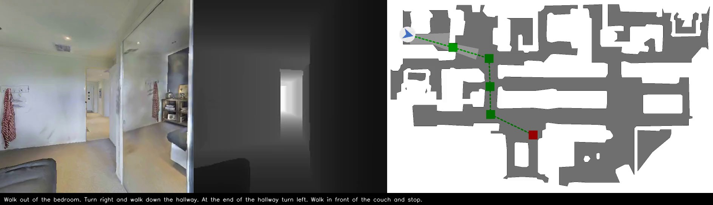

## 十三、Exp-2：闭环控制效果测评

开环：原始论文中，模型解析距离 / 角度后，将多步动作放入 queue 依次执行。例如“move forward 75 cm”→ 连续 3 步 MOVE_FORWARD，期间不再调用模型。这种推理方式在中途不引入新的观测，也不使用反馈，类似控制论中所谓的“开环控制”，因此我们称原始论文 / Exp-1 中使用的为开环（Open-loop）控制。论文 Table I 采用的是开环设置，与原始 NaVILA 代码行为一致。

闭环：当我们修改 EVAL.CLOSED_LOOP 参数为 False 时，每次模型调用只执行 1 个 Habitat 步（25 cm 或 15°），忽略输出中的距离 / 角度数值，下一步必须重新 inference。这就相当于强迫模型在每一步推理之间重新引入观察，进行反馈控制，因此称 Exp-2 中为闭环（Closed-loop）控制。

实验目的：对比闭环单步控制与开环 queue 多步控制的导航表现与推理开销。（为节省实验时间，我从 1839 条测试中，随机选取了 300 条测评）

整体效果：Exp-2 相比 Exp-1：

- SR 略低（−1.6 pp）：成功率比开环稍差，但在 300 条 shuffle 子集的抽样误差内，不能算明显退化。
- SPL 略高（+1.3 pp）：成功者路径更短（平均 path 7.85 vs 10.28 m），说明闭环“每步重规划”在成功 case 上更高效。
- NE 更低：失败时离目标更近一些。

### 测评案例 1

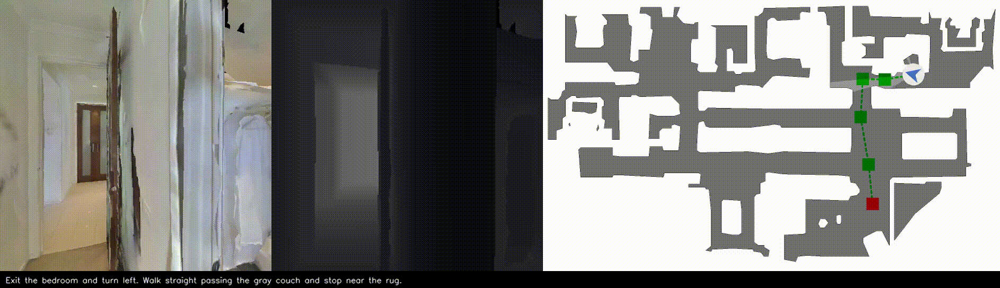

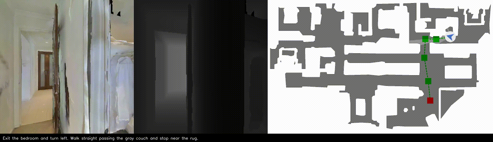

左图为 Exp-1 中，开环控制的结果，机器狗在初始位置附近兜兜转转，最终走到了终点；右图为 Exp-2 中，在闭环控制下，机器狗虽然几乎没有经过迂回曲折，在闭环控制的及时反馈下，最终径直成功走到了终点。且最终 Exp-2 中的每次推理平均路径明显短于 Exp-1（8.00 vs 16.50）。

### 测评案例 2

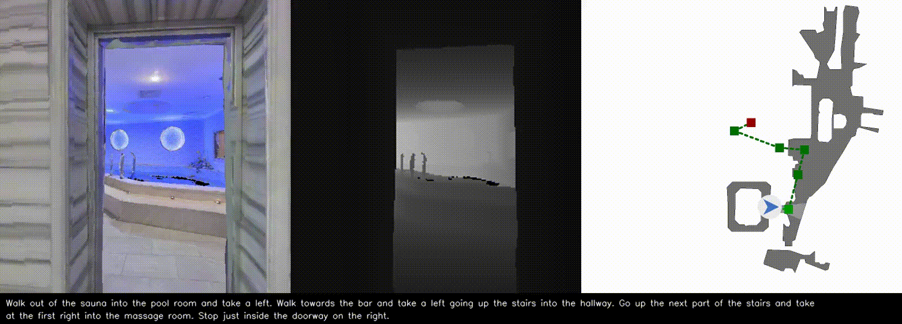


Exp-2 中走到终点的路径更接近人类预设路径（绿色虚线），且最终 Exp-2 中的每次推理平均移动距离短于 Exp-1（9.97 vs 11.41）。

### 测评案例 3

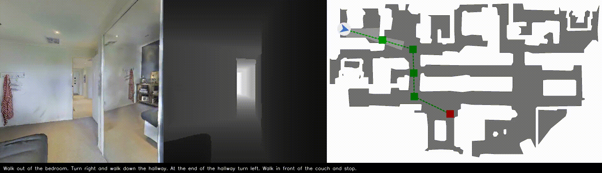


左图为 Exp-1 中，开环控制的结果，机器狗在导航过程的中间兜兜转转，最终没有走到终点；右图为 Exp-2 中，在闭环控制下，机器狗虽然也经过了一定程度的迂回曲折，但在闭环控制的及时反馈下，最终成功走到了终点。虽然最终 Exp-2 中的每次推理平均移动距离更长（22.74 vs 12.25），但这恰恰证明了闭环控制牺牲了部分局部效率，换取了在复杂环境下导航至终点任务的全局鲁棒性。

### 结论

闭环模式更接近“真实机器人逐步感知–决策”场景，但 Habitat 评测中开环 queue 是论文标准设置，且指标更稳定。闭环模式中引入动态实时的反馈，从而让机器人及时调整自身位置状态等信息，少走冤枉路（SPL 值高于开环，平均路径长度短于开环），最终停留在更靠近终点的位置（NE 值低于开环），更好的遵从人类预设路线（nDTW 值高于开环）。但由于相比之下有更多次的模型调用，推理速度也相对慢。

## 十四、Exp-3：模型量化效果测评

论文中原始“大脑”模型为 Llama-3-8B。但即使是半精度（FP16），也需要近 16GB 的显存。在真机部署场景下，机器狗背着一块沉重且耗电的显卡显然不现实。因此，论文使用了 AWQ（Activation-aware Weight Quantization）技术，把模型压缩到了 W4A16（4-bit 权重），不仅显存占用减半，推理速度还提升了 40%。在本次测评中，我们使用 bitsandbytes（BnB）NF4 4-bit 运行时量化（非论文 AWQ 离线量化权重），且只对 LLM 部分进行量化（SigLIP 视觉编码器与 mm_projector 仍为 FP16）。

实验目的：评估 bitsandbytes 4-bit 运行时量化对 LLM 精度的影响。因此，除了单个参数所占空间这一变量之外，Exp-3 参数设置与论文 / Exp-1 保持一致。

结果分析：Exp-3 中，SR 55.33%、SPL 52.01%，与 Exp-1 中 FP16 全量（54.21% / 49.55%）同量级，量化几乎无损。但运行时间大幅降低（300 条仅 4.4 h）。且在随机抽取的 300 条测评样本中，有 246 条测评场景中，4bit 量化的模型和 16bit 模型取得了一样的结果（都成功 / 都失败）；甚至还有 16 条测评场景中，出现了 16bit 模型未成功导航至终点。

### 测评案例 1

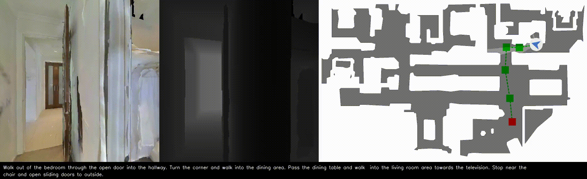

左图为 Exp-1 中模型参数为 16bit 量化的结果，机器狗最终顺利走到终点；右图为 Exp-3 中，模型参数为 4bit 量化的结果下，机器狗也最终成功走到了终点，且效果和 Exp-1 中差不太多（到终点最终距离分别为：0.75 vs 0.57，且路径高度相似）。

### 测评案例 2

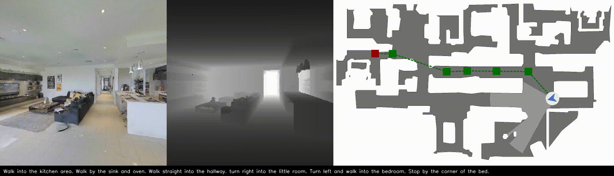


左图为 Exp-1 中模型参数为 16bit 量化的结果，机器狗最终没有走到终点；右图为 Exp-3 中，模型参数为 4bit 量化的结果下，机器狗也最终成功走到终点。我们认为，4-bit 量化本质上是对模型权重加入了一种数值截断噪声（Quantization Noise）。在极少数边缘 Case 中，16-bit 模型可能会陷入某种局部死循环（比如在墙角反复横跳），而 4-bit 模型带来的微小数值扰动，恰好起到了类似“随机探索”的作用，帮它偶然打破了死循环从而走到终点。但这属于概率偶发事件，宏观上二者的智力水平依然是完全对等的。

### 结论

4-bit 量化具有可行性。Exp-3 使用 bitsandbytes NF4 进行了运行时权重加载。与原论文的 AWQ 离线量化不同，BnB 技术主要以牺牲极少量的计算开销（反量化）为代价来换取显存的大幅下降。实验证明，在 300 条子集上，4-bit 模型 SR 保持在 55.33%，与 Exp-1: 16bit 几乎无损，甚至还有小幅度增加，且单步推理时间与全精度相当（300 条耗时 4.4h vs 理论 4.65h）。这验证了在极低显存（~7GB）下无损部署该模型的可行性。

## 十五、总结

通过本次复现，我们对视觉语言导航任务和机器人仿真环境有了更直观的认识。NaVILA 的方法并不是简单地让大模型直接控制机器人，而是将大模型放在更适合它的位置：理解视觉历史、语言指令和空间关系，并输出可解释的中层导航动作。真正高频、实时、与机器人动力学强相关的部分，则交给专门训练的底层运动策略完成。

从工程角度看，复现 embodied AI 论文时，环境依赖往往比普通深度学习项目复杂得多。NaVILA 同时涉及大模型推理、CUDA 算子、Habitat 仿真、Matterport3D 场景、VLN-CE 数据格式和机器人控制策略。任何一个组件版本不匹配，都可能导致运行失败。因此，复现工作需要细致记录每一步环境变更，并尽量固定关键依赖版本。

本次实验也体现了课程中“智能控制与机器人”的综合性：上层智能决策依赖视觉语言模型，下层执行依赖控制策略和仿真环境，而真正可落地的机器人系统必须把两者稳定连接起来。

本次复现中还对不同参数组合情况下的实验效果进行了探究。在原始参数之外，考虑到实际模型部署，可以从开闭环控制、模型量化等角度出发，对模型进行合理调整，从而更加符合实际部署环境，带来更好的效果。

## 参考资料

1. An-Chieh Cheng, Yandong Ji, Zhaojing Yang, Zaitian Gongye, Xueyan Zou, Jan Kautz, Erdem Biyik, Hongxu Yin, Sifei Liu, Xiaolong Wang. *NaVILA: Legged Robot Vision-Language-Action Model for Navigation*. RSS 2025.
2. AnjieCheng/NaVILA GitHub Repository: <https://github.com/AnjieCheng/NaVILA>
