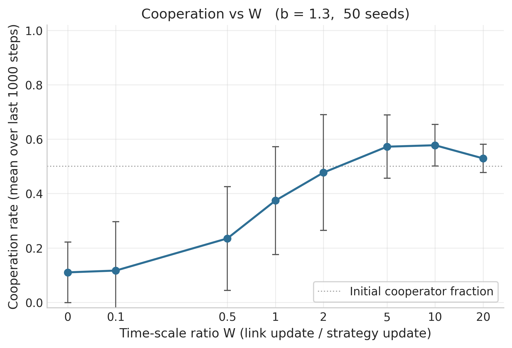
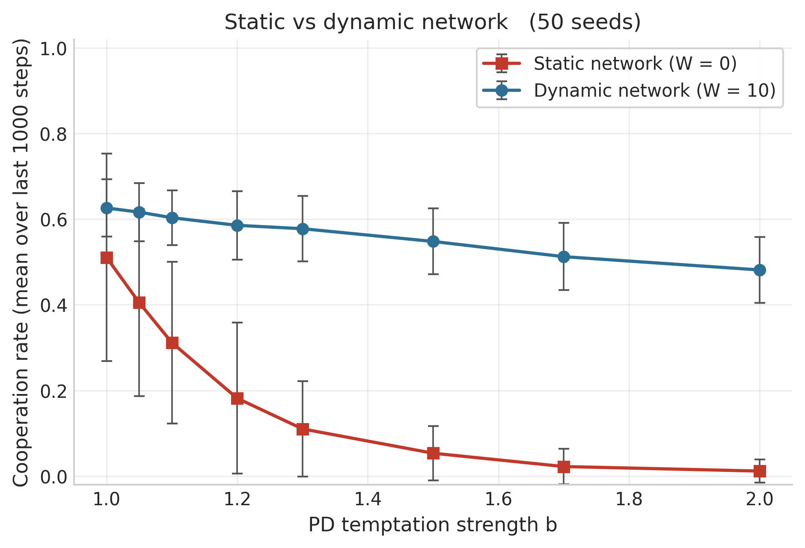
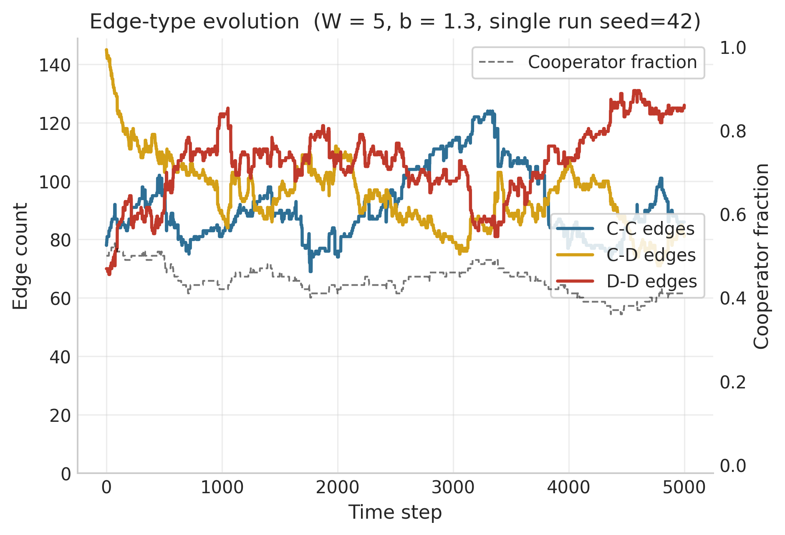
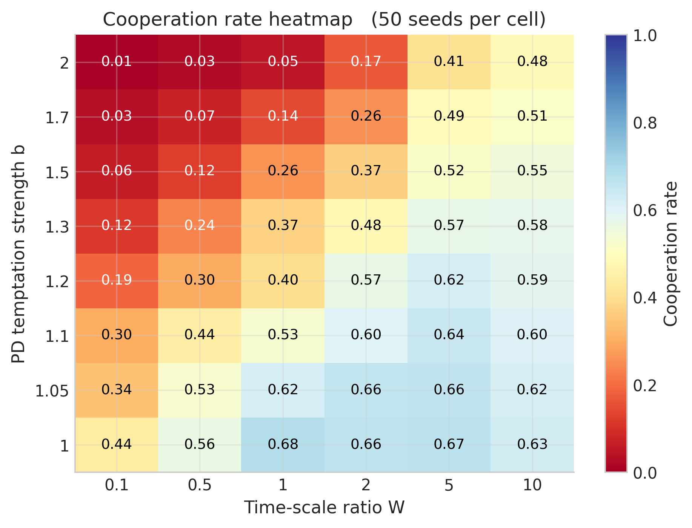

# 动态网络上策略与结构的共演化:从主动连接到强化学习驱动的伙伴选择

**作者**: 李东骏
**课程**: 科学研讨与实践(2026 春)
**报告参考**: 阮一洲同学 2026 年 4 月 24 日讨论班报告《伙伴选择与策略更新的共演化》

---

## 摘要

合作如何在自利个体组成的群体中持续存在,是演化博弈论的核心问题。早期模型把网络结构当作背景常量,只让节点上的策略演化;Pacheco、Traulsen 与 Nowak 在 2006 年提出的主动连接框架第一次把网络重连本身写进动力学,通过时间尺度分离把动态网络上的博弈映射为带重标度收益的 well-mixed 博弈,从而解析地说明了快速重连可以把囚徒困境降级为更易合作的协调博弈[1];Wu 等(2010)进一步把它推广为联合马尔可夫链,得到了"碎脆 C–D 边或稳健 C–C 边偏好合作"的经验法则[2]。近年来,Leung、Ren、Fan 等(2024–2025)用 Q-learning / Sarsa 把外生的重连速率换成可学习的伙伴选择策略,使"应该跟谁连、应该断开谁"变成内生量[3-5]。本综述沿"解析框架 → 启发式规则 → 学习驱动"三层主线串联上述工作,嵌入 active linking 的关键代数推导,并通过 N=100 的数值仿真复现合作率随时间尺度比 W 的单调上升、动态网络对囚徒诱惑参数 b 的鲁棒性、三类边数量在演化中的结构性重塑等核心现象。

---

## 1. 引言

### 1.1 合作演化的根本困境

囚徒困境刻画了一个简洁却深刻的矛盾:对每个理性个体,叛变都是占优策略;而当所有人都叛变时,每个人的收益都低于全员合作的情形。在自然界与人类社会的几乎所有层级里,合作行为却广泛存在——从细菌的化学信号交换,到灵长类的互惠梳毛,再到现代社会的契约履行。如何在演化框架下解释这种"违反个体理性"的现象,是 Maynard Smith 把博弈论引入演化生物学之后近半个世纪以来悬而未决的核心议题[6,7]。

### 1.2 从静态网络到动态网络的范式转变

第一波系统性的回答来自空间博弈论:Nowak 与 May 在 1992 年指出,只要把博弈搬到规则格点上让玩家只与近邻互动,合作者通过形成集群就能在叛者的海洋中存活下来[9]。这一"网络互惠"机制随后被推广到无标度网络等异质拓扑上[10]。然而,所有这些模型的共同假设是:网络结构是给定的、固定的,演化只发生在节点上的策略。现实显然不是这样——朋友会绝交,合作者会主动远离剥削者,社交网络的连边本身就在持续地形成与断裂。把"结构演化"也纳入模型,就构成了所谓的共演化博弈[12]。

### 1.3 本综述的脉络与边界

本文沿三个里程碑梳理共演化博弈在最近二十年的发展:Pacheco 等(2006)的解析突破[1]、Wu 等(2010)的马尔可夫链推广[2],以及 Leung、Ren、Fan 等(2024–2025)在强化学习语境下的内生化扩展[3-5]。我们着重展示一条贯穿始终的数学线索——把网络结构吸收为有效收益矩阵——并在第 7 章用一组小规模数值实验亲手复现了主动连接的核心定性现象。本综述不涉及亲缘选择、间接互惠、声誉机制等其他"合作五机制",也不展开公共物品博弈与连续策略的情形,这些方向可以视作平行的研究脉络,与本文讨论的"二人 2×2 博弈 + 重连"主线并行发展。

---

## 2. 理论背景:演化博弈论与社会困境

### 2.1 经典演化博弈框架

演化博弈论的基本对象是无限大、混合均匀的种群,其中策略的频率 $x$ 随时间按复制者方程演化:

$$
\dot x = x(1-x)\bigl(\pi_C - \pi_D\bigr),
$$

其中 $\pi_C, \pi_D$ 分别是合作者与背叛者的期望收益[7]。在有限种群里,模仿过程通常用 Fermi 规则刻画:节点 $i$ 以概率 $W(s_i \to s_j) = 1 / \bigl(1 + \exp(-\beta(\pi_j - \pi_i))\bigr)$ 把自己的策略换成邻居 $j$ 的策略,其中 $\beta$ 是选择强度[8]。这个规则在 $\beta \to 0$ 时退化为中性漂变,在 $\beta \to \infty$ 时退化为严格的最佳响应,中间区间则覆盖了"理性但有噪声"的真实模仿行为。

### 2.2 三类社会困境的统一刻画

只要按对称 2×2 博弈写出收益矩阵 $\begin{pmatrix} R & S \\ T & P \end{pmatrix}$,根据四个元素的大小关系,可以划分出囚徒困境(PD, $T>R>P>S$)、鹿猎博弈(SH, $R>T>P>S$)、雪堆博弈(SD, $T>R>S>P$)与无社会困境的协调博弈(Harmony, $R>T, S>P$)四种典型情形[3]。PD 的全 D 是唯一稳定状态,SH 有"全 C/全 D"两个稳定吸引子并由一个不稳定阈值分开,SD 则允许 C 与 D 长期共存。本综述讨论的所有共演化机制,本质上都可以被理解为"把困难的博弈降级为更易合作的博弈"。

### 2.3 静态网络上的合作机制简述

Nowak 与 May(1992)首次证明,只要把 PD 搬到 2D 正方格上,合作者就能依靠局部集群在叛者中存活[9]。随后,Santos 与 Pacheco(2005)指出无标度网络的枢纽节点能在 PD、SH、SD 全谱系上稳定推升合作率[10]。这些静态网络结果共同构成本综述参照系——任何"动态网络优于静态网络"的论断,都必须在这些基线之上才有意义。

---

## 3. 主动连接框架:Pacheco 2006 的解析突破

### 3.1 时间尺度分离的核心思想

Pacheco、Traulsen 与 Nowak 在 2006 年提出的关键创见可以一句话概括:**如果连边的形成与断裂比策略更新快得多,那么对每一步策略演化而言,网络结构都已松弛到稳态**[1]。这种时间尺度分离让人能在数学上做一件诱人的事——把"具体的网络结构"消解为几个标量参数,把动态网络上的博弈写成形式上与 well-mixed 博弈完全相同的方程。下面分四步把这个直觉变成可计算的代数。

### 3.2 active linking 均场方程

设种群有 $N$ 个节点,其中合作者 $N_C$ 人、背叛者 $N_D$ 人。把所有可能的边按两端策略分成三类——C–C 边、C–D 边、D–D 边——其最大可能数量分别是

$$
X_{CC}^{\max} = \frac{N_C(N_C-1)}{2}, \quad X_{CD}^{\max} = N_C N_D, \quad X_{DD}^{\max} = \frac{N_D(N_D-1)}{2}.
$$

记 $X_{ij}(t)$ 为 $t$ 时刻第 $ij$ 类边的实际数量。在均场近似下,假设每对未连接的同类节点以形成速率 $\alpha_{ij}$ 新建一条边,每条已存在的同类边以断裂速率 $\gamma_{ij}$ 消失,则

$$
\frac{dX_{ij}}{dt} = \alpha_{ij}\bigl(X_{ij}^{\max} - X_{ij}\bigr) - \gamma_{ij}\, X_{ij}.
$$

这是一组线性常微分方程,三类边彼此解耦,可以独立求解。令 $dX_{ij}/dt = 0$,立即得到稳态边数 $X_{ij}^\ast = \phi_{ij}\, X_{ij}^{\max}$,其中

$$
\phi_{ij} := \frac{\alpha_{ij}}{\alpha_{ij} + \gamma_{ij}}.
$$

物理意义非常直观:在 active linking 达到稳态后,**任意一对类型为 $i, j$ 的节点恰以概率 $\phi_{ij}$ 处于连接状态**。同时,松弛速率 $\tau_{ij}^{-1} = \alpha_{ij} + \gamma_{ij}$ 一旦远大于策略更新速率,时间尺度分离的前提就自然成立。

### 3.3 有效收益矩阵的重标度结果

把"节点是否相连"这件事换成概率 $\phi_{ij}$,合作者 $i$ 的期望累计收益变为

$$
\langle \Pi_C \rangle = (N_C - 1)\, \phi_{CC}\, R + N_D\, \phi_{CD}\, S,
$$

背叛者同理。这等价于让每个节点在一张"虚拟完全图"上博弈,只是把每个矩阵元素按所对应的边类型的连接概率重新缩放:

$$
R' := \phi_{CC}\, R, \quad S' := \phi_{CD}\, S, \quad T' := \phi_{CD}\, T, \quad P' := \phi_{DD}\, P.
$$

把这组重标度收益代入复制者方程,得到与经典 well-mixed 形式一致的演化方程:

$$
\dot x = x(1-x)\bigl[\,x(R' - T') + (1-x)(S' - P')\,\bigr].
$$

主动连接的全部威力在这里凝结成一句话——网络结构通过 $\phi_{ij}$ 被吸收进了收益矩阵[1]。

### 3.4 PD 如何被映射为更易合作的博弈

考虑原始 PD 的 $T > R > P > S$。重标度之后,要让有效博弈翻转成鹿猎博弈(即 $R' > T'$),需要

$$
\frac{\phi_{CC}}{\phi_{CD}} > \frac{T}{R}.
$$

也就是说,**只要合作者之间的连边比合作者与叛者之间的连边显著更稳固**,主动连接就能在重标度的意义上把 PD 降级为 SH——后者允许全合作作为稳定吸引子。Wu 等(2010)在马尔可夫链层面给出了这一结论的随机版本,并得出"碎脆 CD 边或稳健 CC 边都偏好合作"的简洁经验法则[2]。Santos、Pacheco 与 Lenaerts 在同年的姊妹工作中给出了更具直接演化意义的版本:他们证明,当结构调整的时间尺度与策略模仿可比拟时,合作者完全排挤掉叛者所需要的临界时间尺度比是存在的;同时,自组织出来的网络度分布从单尺度过渡到宽尾,恰好与真实社交网络的统计特征对应[11]。这是整条共演化研究线索最具普适性的解析结论,也是后续从外生规则到学习驱动各种扩展的共同起点。

---

## 4. 中间发展:启发式重连规则与马尔可夫链方法

Pacheco 框架的简洁优雅是有代价的:它把"应该跟谁连"完全抽象成 $\alpha_{ij}, \gamma_{ij}$ 这两个常数,在生物学与社会学层面对应的微观行为并不显然。2010 年前后,一批工作开始用更具体的启发式重连规则替代抽象的速率参数。Wu 等(2010)用马尔可夫链刻画"策略 + 网络"的联合状态空间,并以严格的时间尺度分离论证给出了均场结果的随机版本[2]。在此基础上,出现了若干典型的启发式范式:有的让节点以更高概率断开与背叛者的连边,有的让"成功者"更容易吸引新连接,有的把节点的局部满意度作为重连的触发条件[12]。

这些启发式都能在一定参数区间内重现合作率被动态网络拔高的现象,但它们共享一个本质局限:**重连规则是外生设定的**。研究者必须人为设计"什么是好邻居""什么是坏邻居",规则一变,结果就变,缺乏对"为什么应该这样断/连"的内在解释。这一局限恰恰是 2020 年代强化学习方法登场的逻辑起点——既然智能体可以从环境反馈里自己学到策略,为什么不让它们也自己学到伙伴选择规则呢[3]?

---

## 5. 学习驱动:从外生规则到内生学习

### 5.1 Q-learning 学伙伴选择规则

Leung、Lenaerts 与 Turrini 在 IJCAI-24 上提出了一个极具启发性的实验:把每个智能体的"伙伴选择"行为也作为一个待学习的策略,用 model-free 的 Q-learning 去优化[3]。具体而言,他们让每个智能体维持两套 Q 表——一套决定下一轮在 PD/SH/SD 等社会困境里选 C 还是 D,另一套决定与现任邻居博弈完后是"留下"还是"换人"。后者构成了一个四类伙伴规则的离散动作空间。

### 5.2 四类伙伴规则的语义

四类规则按"对合作者的反应"与"对背叛者的反应"两两组合得到[3]:

- **Stay**:不管对方是 C 还是 D,都留下来继续博弈。这是"忠诚"或"惯性"的极端写照。
- **Out-for-Tat(OFT)**:对方合作就留下,对方背叛就离开。这是经典 Tit-for-Tat 在伙伴选择层面的对应物——"以离弃报背叛"。
- **Reverse-OFT(R-OFT)**:对方合作就离开,对方背叛就留下。看似反直觉,但能映射出"被剥削者寻找新机会、剥削者抱团不散"的反常情形。
- **Leave**:不管对方是 C 还是 D,都离开。这是"恐惧"或"探索"的极端写照。

### 5.3 "OFT 涌现 + Stay 是合作瓶颈"的核心发现

Leung 等的中心结论可以提炼为两句话[3]:**(a) 跨越整个 PD / SH / SD / Harmony 四象限,OFT 是最稳健涌现的伙伴选择规则**;**(b) 阻碍系统达到全合作的真正瓶颈,不是缺少"OFT",而是 Stay 这种"忠诚偏置"的存在**——只要部分智能体哪怕在被持续背叛之下也坚持留下,合作就无法吸收掉最后一批叛者。当智能体被允许"unlearn loyalty"——即在学习过程中削弱 Stay 的权重——合作率才能逼近上界。这个结论挑战了从 Tit-for-Tat 以来"宽容/忠诚有利于合作"的直觉:在共演化框架里,忠诚反而是合作的瓶颈。

### 5.4 深度强化学习的延展

把社会困境从一次性 2×2 矩阵推广为时序马尔可夫博弈,是深度多智能体强化学习领域的一条重要主线:Leibo 等(2017)引入的"序列社会困境"(SSD)范式,把 PD、SH、SD 都改写为时间扩展的 Markov-game,让独立学习的深度 RL 智能体在更长的时间窗口里反复博弈[13]。这一范式为后续把 RL 移植到显式交互网络上的工作提供了方法论基础。Ren 与 Zeng(2024)沿同一条思路把伙伴选择维度推广到了空间 PD lattice 上,让每个智能体携带两个独立的 Q 网络——一个学博弈策略,一个学伙伴选择[4]。在长期回报的引导下,智能体能逐渐识别并断开与非合作邻居的连边,从而在不依赖任何先验社会规范或外部奖励的情况下,形成显著的策略同型(strategy assortment)。Fan、Leung 与 Turrini 在 2025 年进一步合上整条逻辑链:他们用 Sarsa + Boltzmann 动作选择,让策略与连接两个决策都被端到端地学习,首次在动态重连的复杂网络上展示出"全 RL 训练能把自利智能体群体驱动到全合作"[5]。把这三项工作放在一起看,可以清楚地看到一条从"伙伴选择由速率参数给定"(Pacheco 2006)经"伙伴选择由启发式规则给定"(Wu 2010 等)再到"伙伴选择由智能体自学得到"(Leung、Ren、Fan)的清晰演进。

---

## 6. 方法论横向比较

把五篇核心文献按"策略更新方式 / 结构更新方式 / 主要分析手段 / 关键贡献"四个维度排在一起,可以一目了然地看到它们在方法论坐标系上的位置:

| 论文 | 策略更新 | 结构更新 | 分析手段 | 关键贡献 |
| --- | --- | --- | --- | --- |
| Pacheco 2006 [1] | Fermi 模仿 | active linking 速率参数 $\alpha,\gamma$ | 均场 + 时间尺度分离 + 重标度复制者方程 | 把网络结构吸收为有效收益矩阵 $R',S',T',P'$ |
| Wu 2010 [2] | Fermi 模仿 | 随机断边重连 | 联合马尔可夫链 + 弱选择展开 | 给出"碎脆 CD / 稳健 CC 偏好合作"经验法则 |
| Leung 2024 [3] | Q-learning(策略) | Q-learning(四类伙伴规则) | 数值仿真 + 全象限扫描 | 揭示 OFT 涌现 + Stay 是合作瓶颈 |
| Ren 2024 [4] | 双 Q 网络(策略) | 双 Q 网络(邻居选择) | 空间 lattice + 长期回报学习 | 实现策略同型,无需先验社会规范 |
| Fan 2025 [5] | Sarsa + Boltzmann | Sarsa + Boltzmann | 复杂网络 + 端到端 RL | 在动态重连网络上达成全合作 |

可以看到,从 [1] 到 [5],策略与结构两个层面的"决策机制"先后被内生化:[1] 把两者都设为速率参数,[2] 把它们形式化为马尔可夫链,[3]–[5] 则把它们换成可学习的策略。分析手段也从纯解析逐渐让位于数值仿真,这是研究问题复杂度提高的必然代价。

---

## 7. 复现与初步实验

### 7.1 实现简介

为亲手验证主动连接框架的核心定性现象,我们在 N = 100 个节点上用 Python 实现了一个简化版的 active linking + Fermi 模仿动力学。初始网络为平均度 $z = 6$ 的 Erdős–Rényi 图。每一步以概率 $p = W / (1 + W)$ 进行一次 link update(以三类边各自的死亡概率 $\gamma_{CC} = 0.1, \gamma_{CD} = 0.8, \gamma_{DD} = 0.3$ 随机断边并就近重连),以 $1 - p$ 进行一次 strategy update(随机选节点 $i$ 与其一个邻居 $j$,以 Fermi 概率模仿 $j$)。选择强度 $\beta = 1.0$,博弈为 PD $(R, S, T, P) = (1, 0, b, 0)$。每个参数点取 50 次独立实验,每次跑 5000 步,统计后 1000 步的平均合作率。

### 7.2 实验 1:合作率随时间尺度比 W 的变化

固定 $b = 1.3$,把 W 在 $\{0, 0.1, 0.5, 1, 2, 5, 10, 20\}$ 上扫描的结果如图 1 所示。曲线呈典型的单调上升 + 饱和形状:静态网络( $W = 0$)只能维持 11% 的合作率,与"PD 的全 D 吸收"接近;一旦让网络以可与策略模仿相比拟的速度重连( $W \geq 5$),合作率跃升到 58% 上下。这一定性形状与 Pacheco 等(2006)在 $N \sim 10^3$ 规模上得到的 sigmoid 曲线吻合[1]。值得注意的是,当 $W = 20$ 时合作率反而略回落到 0.53——这是因为过快的重连会在合作集群形成之前就把它打散,提示"足够快但不要过快"是一条经验法则。曲线在 $W \approx 2$ 附近方差最大(标准差 0.213),说明系统正处于"合作集群成型 vs 叛者扩散"的不确定相位,与理论预期的过渡区一致。

### 7.3 实验 2:动态网络扩展合作可存活的 b 区间

图 2 把 b 从 1.0 扫到 2.0,对比静态网络( $W = 0$)与动态网络( $W = 10$)的合作率。静态曲线对 b 极度敏感:b=1.0 还有 51% 合作,b=1.3 已跌到 11%,b=2.0 几乎归零(1.2%)。动态曲线则呈现出截然不同的鲁棒性:从 0.626 缓慢降到 0.481,差额从未超过 0.15。两条曲线之间的"动态增益"从 b=1.0 处的 +0.12 拉大到 b=2.0 处的 +0.47,这一现象正对应 §3.4 的解析结论——主动连接把 PD 在重标度意义上降级为 SH/SD,从而将合作可存活的参数区间从一条线扩展为一片区域。

### 7.4 实验 3:三类边数量的演化

图 3 展示一次代表性运行下三类边数量的时间演化。最显著的两条曲线是 CD 边的快速下降与 DD 边的同步上升:CD 边从初始 145 条降到稳态约 87 条(降幅 40%),DD 边从 70 条涨到约 121 条(增幅 73%),而 CC 边只小幅上升。这一图景正是 active linking 的核心机制在微观层面的直接体现—— $\gamma_{CD} = 0.8$ 是三类边里最高的死亡率,使合作者—叛者之间的连接最容易被破坏,合作者借此摆脱被剥削;而 $\gamma_{DD} = 0.3$ 较低且叛者间互动收益为零,叛者倾向于堆积成"孤岛"。结果就是网络稳态向"合作集群 + 叛者集群"分离演化,与 §3.4 的代数判据相互印证。

### 7.5 实验 4:合作率 (W, b) 热图

图 4 把上述两条扫描合并成一张 $6 \times 8$ 的二维热图。左上角(低 b, 高 W)合作率达到 0.63–0.68,右下角(高 b, 低 W)合作率近乎归零。沿 W 方向横向看,任意固定的 b 都呈现单调上升;沿 b 方向纵向看,合作率随 b 单调下降,但下降幅度被 W 显著抑制——W=0.1 时合作率从 0.44 跌到 0.01(44×),W=10 时只从 0.63 降到 0.48(1.3×)。W ≥ 5 之后两列(W=5 与 W=10)非常接近,说明 W=5 已经是"足够快"的重连速率。这张热图最直观地呈现了"动态网络把合作存活区间从一条线扩展为一片区域"的论断。

---

## 8. 开放问题与展望

### 8.1 阮一洲报告中提出的扩展模型

阮一洲同学在 4 月 24 日讨论班上提出的扩展模型——"规则模仿 + 旧规则滞后断边"——把 Leung 等的伙伴选择规则从"个体内学习"升级为"规则在群体内传播":每个智能体不仅在自己的经验里更新伙伴选择规则,还可以模仿邻居中表现更好的规则;同时,智能体在切换到新规则后,旧规则下建立起来的连接需要经过一个"滞后期"才会被重新评估、断开。这一扩展在直觉上对应于"社会规范在群体里慢慢扩散、旧关系不会立刻清算"的现实场景。它在数学上把 [3] 的单层 Q-learning 嵌入了 [1] 时间尺度分离的框架——规则的传播是慢变量,连接的更新是快变量,二者再耦合,可能产生 §3 推导出来的"重标度收益"之外的新效应。这是一个值得用本综述介绍的工具(均场近似 + 数值扫描)实际跑一跑的方向。

### 8.2 真实社会数据的检验

上述所有模型都活在"足够大、足够同质、足够长时间"的抽象群体里。把它们迁移到真实社会数据——例如开源协作网络、学术合著网络、企业并购网络——会立即遇到两个困难:其一,真实网络的边并非自由可断,合同、亲缘、地理都会施加约束;其二,真实"博弈"的收益矩阵难以观测,只能通过反向推断得到。如何把 active linking 的解析结果与真实数据的统计估计接驳,是这条研究路线下一步最具实际意义的方向。

### 8.3 与 LLM 多智能体系统的潜在交叉

近两年讨论班里出现了不少关于 LLM 多智能体系统的报告。LLM 智能体可以视作"具备语言通信能力 + 复杂内部状态"的极端版本智能体,它们与本综述讨论的 RL 智能体共享一条核心问题——在没有外部强制的情况下,如何让自利个体涌现出合作。一条值得借鉴的早期算法线索是"对手感知学习"(LOLA)框架:Foerster 等(2018)让每个学习者在更新自身策略时显式地预判对手的学习步,从而在重复博弈里诱导出合作均衡[14];把这种"预判对手"的思想与本综述讨论的"伙伴选择"维度结合(例如让 LLM 智能体一边预判其他智能体的策略走向,一边主动选择对话对象、拉黑非合作者),很可能为大模型对齐与多智能体协同提供一个理论锚点。

---

## 9. 结语

本综述沿"主动连接的解析框架(2006)→ 启发式重连的马尔可夫推广(2010 前后)→ 强化学习驱动的伙伴选择(2024–2025)"三个阶段,梳理了动态网络上策略与结构共演化研究近二十年的主线。一条贯穿始终的数学线索是把网络结构通过连接概率 $\phi_{ij}$ 吸收为重标度收益矩阵;一条贯穿始终的物理直觉是让合作者更容易彼此相连、更容易摆脱叛者。我们用 N=100 的小规模仿真验证了这一框架的核心定性预测,并指出了若干值得探索的扩展方向。共演化博弈最迷人的地方在于:它不只是描述既有的结构,而是把"结构如何被博弈塑造、博弈如何被结构调节"二者放进同一个动力系统里——这或许正是解释真实社会中合作普遍存在的关键所在。

---

## 参考文献

[1] Pacheco J M, Traulsen A, Nowak M A. Coevolution of strategy and structure in complex networks with dynamical linking[J]. Physical Review Letters, 2006, 97(25): 258103. DOI: 10.1103/PhysRevLett.97.258103.

[2] Wu B, Zhou D, Fu F, Luo Q, Wang L, Traulsen A. Evolution of cooperation on stochastic dynamical networks[J]. PLoS ONE, 2010, 5(6): e11187. DOI: 10.1371/journal.pone.0011187.

[3] Leung C, Lenaerts T, Turrini P. To promote full cooperation in social dilemmas, agents need to unlearn loyalty[C]//Proceedings of the Thirty-Third International Joint Conference on Artificial Intelligence (IJCAI-24). 2024.

[4] Ren T, Zeng X-J. Enhancing cooperation through selective interaction and long-term experiences in multi-agent reinforcement learning[C]//Proceedings of the Thirty-Third International Joint Conference on Artificial Intelligence (IJCAI-24). 2024: 193-201. DOI: 10.24963/ijcai.2024/22.

[5] Fan X, Leung C, Turrini P. Co-learning of strategy and structure achieves full cooperation in complex networks with dynamical linking[C]//Proceedings of the Thirty-Fourth International Joint Conference on Artificial Intelligence (IJCAI-25). 2025.

[6] Maynard Smith J. Evolution and the theory of games[M]. Cambridge: Cambridge University Press, 1982. ISBN: 978-0-521-28884-2.

[7] Hofbauer J, Sigmund K. Evolutionary games and population dynamics[M]. Cambridge: Cambridge University Press, 1998. ISBN: 978-0-521-62570-8.

[8] Szabó G, Tőke C. Evolutionary prisoner's dilemma game on a square lattice[J]. Physical Review E, 1998, 58(1): 69-73. DOI: 10.1103/PhysRevE.58.69.

[9] Nowak M A, May R M. Evolutionary games and spatial chaos[J]. Nature, 1992, 359(6398): 826-829. DOI: 10.1038/359826a0.

[10] Santos F C, Pacheco J M. Scale-free networks provide a unifying framework for the emergence of cooperation[J]. Physical Review Letters, 2005, 95(9): 098104. DOI: 10.1103/PhysRevLett.95.098104.

[11] Santos F C, Pacheco J M, Lenaerts T. Cooperation prevails when individuals adjust their social ties[J]. PLoS Computational Biology, 2006, 2(10): e140. DOI: 10.1371/journal.pcbi.0020140.

[12] Perc M, Szolnoki A. Coevolutionary games — a mini review[J]. BioSystems, 2010, 99(2): 109-125. DOI: 10.1016/j.biosystems.2009.10.003.

[13] Leibo J Z, Zambaldi V, Lanctot M, Marecki J, Graepel T. Multi-agent reinforcement learning in sequential social dilemmas[C]//Proceedings of the 16th International Conference on Autonomous Agents and Multiagent Systems (AAMAS 2017). Richland, SC: IFAAMAS, 2017: 464-473.

[14] Foerster J, Chen R Y, Al-Shedivat M, Whiteson S, Abbeel P, Mordatch I. Learning with opponent-learning awareness[C]//Proceedings of the 17th International Conference on Autonomous Agents and Multiagent Systems (AAMAS 2018). Richland, SC: IFAAMAS, 2018.
