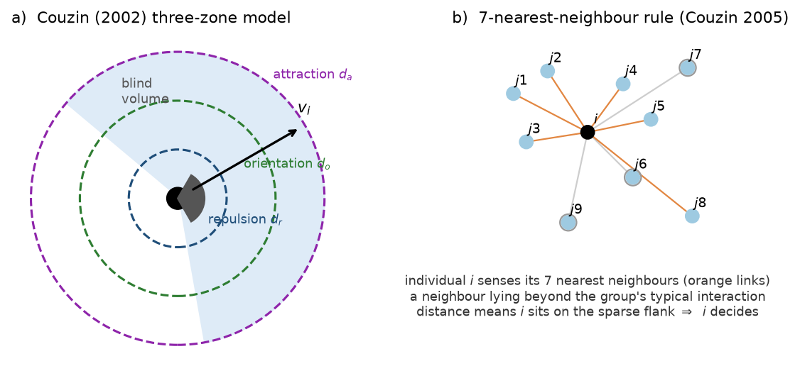
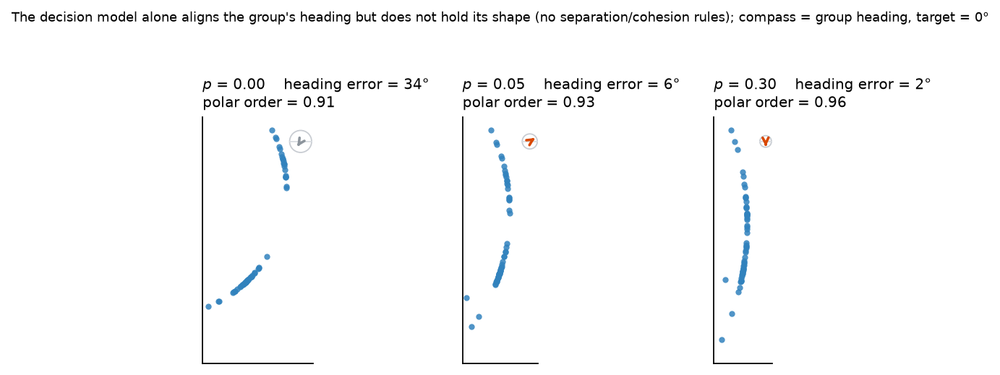
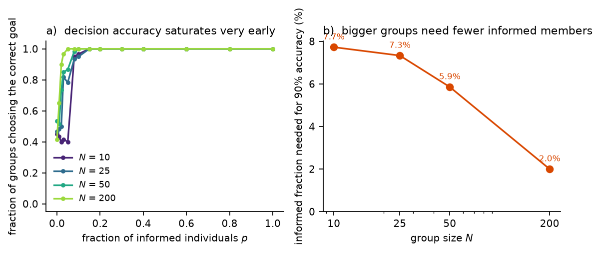
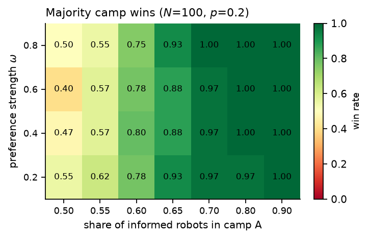
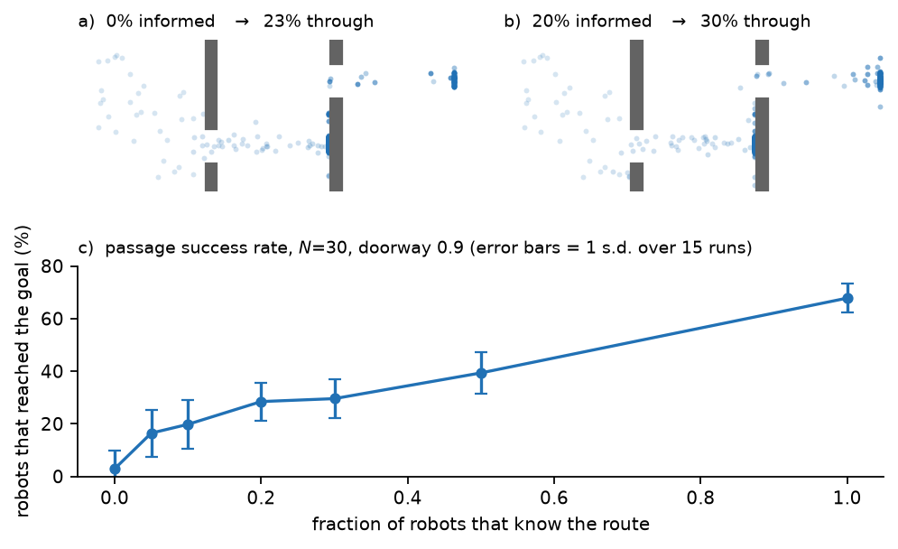
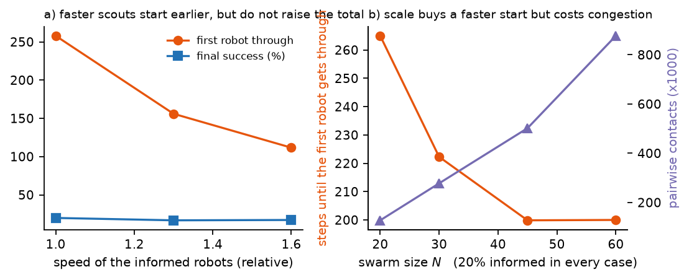

# 从鱼群到机器人：信息诱导的涌现领导力算法

<div class="meta">群体智能课程作业 ｜ 选题：作业一（方向 1，调研已发表的群智算法并应用）<br>核心文献：Couzin I D, Krause J, Franks N R, Levin S A. <em>Effective leadership and decision-making in animal groups on the move</em>. Nature, 2005, 433(7025): 513–516.</div>

## 摘要

本文调研了 Couzin 等人 2005 年发表在 *Nature* 上的群智模型，并完整复现与扩展了它。该模型回答了一个很朴素的问题：一个大群体里只有极少数个体知道该往哪走时，其他人凭什么跟着走？答案是不需要任何信号——每个个体只看自己最近的 7 个邻居，把自己的方向和邻居方向的加权平均作为新的方向；知情者把更多权重压在自己的目标上，于是这份偏好在群体中像浓度扩散一样传播，最终带动整个群体转向。领导权不是某个位置上的个体，而是"此刻处在稀疏连接处"的那个位置，因此是涌现的、临时的。

我先用 Python 重写了该模型并做了两组定量复现实验：**结论一**（知情比例与决策准确率的关系）和**结论二**（多数派共识），结果与原文定性一致。随后我把这个模型映射到多机器人导航问题，设计了一个"只有少数机器人知道路线"的 S 形走廊实验： $N=30$ 个机器人穿越两道错位窄门，到达终点的比例随知情比例从 2.9% 升到 67.8%；其中仅 20% 的机器人知情就能把通过率从 2.9% 拉到 28.4%，而全员知情也不过 67.8%。实验还揭示了两个原论文没有讨论的工程现象：**群体规模扩大能加快启动，但门前的拥堵会吃掉随之而来的收益**，以及**让知情者跑得更快能把群体的启动时间从 258 步压到 112 步，但不改变最终通过率**。

> **关键词**：群体智能；鱼群；涌现领导力；信息传递；群体机器人；分布式决策

## 1 选题说明与研究脉络

### 1.1 为什么选鱼群模型

作业给了两个方向。方向 2（设计一种群体行为并展望算法）自由度更大，但容易写成"我想象了一种机制然后说可以做成算法"，缺少可检验的硬结论。方向 1 要求调研一个**已发表**的算法并"进行应用"，有明确的原始文献可以对账。

我在方向 1 里选了鱼群。理由有三点：

1. **它是"少信息也能做决策"这个问题的最干净的自然实验。** 鱼群里没有蜂群式的摇摆舞（waggle dance），个体之间的空间密度又限制了感知半径——浮游鱼群中的个体间距通常小于一个体长。这意味着"信号传递"这个解释在鱼群身上是不成立的，信息必须靠交互本身来传。
2. **它同时包含"保形"和"决策"两层**，前者是可移植的控制器，后者是可迁移的决策机制，正好对应工程上的完整需求。
3. **原文的结论是定量的**，我复现出来的数字可以和原文逐条对照，不会变成自说自话。

### 1.2 相关工作脉络

群智算法的发展大致是"从保形到决策"的两段式。

| 阶段 | 代表工作 | 核心贡献 |
| --- | --- | --- |
| 视觉图式 | Reynolds C W. *Flocks, Herds and Schools*, SIGGRAPH 1987 | 提出 boids：分离 / 对齐 / 聚合三规则，首次证明局部规则可涌现整体秩序 |
| 物理图式 | Vicsek T, et al. *Phys. Rev. Lett.* 1995, 75: 1226 | 自驱动粒子相变，把群体运动写成统计物理问题 |
| 行为学图式 | Couzin I D, Krause J, James R, Ruxton G D, Franks N R. *J. Theor. Biol.* 2002, 218(1): 1–11 | 三维三区模型（排斥/定向/吸引），刻画集体记忆与空间分选 |
| 决策模型 | Couzin I D, Krause J, Franks N R, Levin S A. *Nature* 2005, 433(7025): 513–516 | 7 邻域信息传导、涌现领导力、多数派共识 |
| 集体感知 | Berdahl A, Torney C J, Ioannou C C, Faria J J, Couzin I D. *Science* 2013, 339(6119): 574–576 | 金线鲫群规模 1–256，规模跃升带来感知能力跃升 |
| 民主化机制 | Couzin I D, et al. *Science* 2011, 334(6062): 1578–1580 | 无知个体抑制强势少数派，促成民主共识 |
| 机器人实现 | Schmickl T, et al. *Auton. Agents Multi-Agent Syst.* 2009, 18(1): 133–155 | 微机器人仅靠相互碰撞，从多个光源中集体选出最亮的一个 |

本文的主体是第 4 行（2005 年 *Nature* 论文），前后几行作为背景和对账依据。

## 2 群体行为描述

### 2.1 鱼群如何维持队形：三区模型

在讨论"谁在领导"之前，先要交代个体如何维持群体。Couzin 等人 2002 年的模型把每个个体的邻域切成三个同心区域（图 1a）。设个体 $i$ 位于原点、沿速度方向 $v_i$ 前进，则：

1. **排斥区**（半径 $d_r$）：落在此区域内的个体施加排斥力，个体向外运动。这保证最小间距，避免碰撞——这是优先级最高的行为，动物在拥挤中会牺牲队形来避免撞伤。
2. **定向区**（ $d_o = \rho_o d_r$）：个体与该区域内邻居的**速度方向**对齐。这是产生方向性秩序的来源。
3. **吸引区**（ $d_a = \rho_a d_o$）：个体被拉向该区域内邻居的**质心**。这是维持凝聚、防止个体掉队 lonely 的来源。

三区之外还有一个**盲区**：个体正后方有一个它自己看不见的空间（图中灰色扇形），因为视野朝前。这一条对结果影响不小——它使鱼群出现明显的方向性偏好。

三个规则都只用局部信息，个体不知道自己处在群体的什么位置、群体要往哪去。但改变三个半径的相对大小，就能让同一套规则涌现出完全不同的整体形态：小定向区给出无序蜂群（swarm），中定向区给出绕中心旋转的环面（torus），大定向区给出高度极化的鱼群（polarized group）。

> 一个容易被忽略的细节：2002 年论文发现群体行为存在**集体记忆**——从无序态缓慢增大定向区会依次经过旋转环面到达极化态，而从极化态反向减小则直接跳回无序态，中间态不会被重访。这种迟滞是相变的典型特征，也是"群体记忆"在无脑个体上的实现方式。

### 2.2 群体如何在"没人知道路"时做出决策

迁徙中的鱼群、斑马群、椋鸟群面临同一个问题：往哪走？食物源只有少数个体见过（对椋鸟而言约 3%–5% 的个体担任侦察，对蜜蜂而言新巢址决策中只有约 5% 的个体出去侦察），而群体要整体达成一致。

传统的解释依赖**信号**：蜜蜂的 8 字摆尾舞告诉同伴食物的方位和距离。但这个解释在鱼群身上不成立——个体太密，视野被身边同类挡住；而且大型鱼群、昆虫群里的个体根本没有能力互相识别。2005 年论文问的是：*在没有任何显式信号、个体也无法判断谁知情谁不知情的情况下，信息怎么传？*

答案在 2.1 那套规则里已经有了，只是被重新加权：知情个体不是"喊"给同伴听，而是**自己朝目标走**。它周围不知情的个体照例执行"与邻居对齐"，于是被带偏一点点；这些被带偏的个体又成了下游个体的邻居，信息一环扣一环地传下去。

### 2.3 涌现领导力：谁是"领导"？

论文的洞察在于，**不需要给个体赋予领导者身份**。个体通过统计邻居的连接密度，就能自发地把"我该去哪儿"这件事让给连接稀疏的一侧。

论文的判据是：令 $n_j$ 为个体 $j$ 被多少人选为邻居（拓扑度），取阈值 $n^{*} = (1 - p)\,N$；观测任意个体 $i$ 的 7 个近邻，若其中**存在**一个邻居 $j$ 满足 $n_j < n^{*}$，则 $i$ 被判为**领导**（leader），否则它是**跟随者**（follower）。

直觉是成立的：知情个体不跟随任何人，它们彼此分散、密度低，因此"连接稀疏"的位置就应该是决策位。

### 3.2 领导判据：一个复现中才暴露的前提

但这个判据有一个隐含前提，我在复现时才真正撞上：**它只在欧氏邻域下成立，在纯拓扑邻域下失效。**

$k$ 近邻图的节点度数是被 $k$ 钳死的——不管群体多稀疏，每个个体总会选出 $k$ 个最近邻，所以度数的期望值恒等于 $k$。我实测了知情个体与不知情个体的平均度数之比（下表为 t=50 与 t=299 两个时刻的比值，1.0 附近的无规律波动说明两类个体在拓扑上完全同质）：

| $p$ | $N=50$ | $N=200$ |
| --- | --- | --- |
| 0.05 | 1.075 / 0.955 | 1.015 / 0.955 |
| 0.10 | 0.875 / 1.064 | 1.032 / 1.096 |
| 0.30 | 0.907 / 1.000 | 0.970 / 0.956 |

我另外试了两条补救路径，都没用：让知情个体以 1.2–1.8 倍速度移动（试图让它们跑到群体前沿形成稀疏），以及给每个知情个体一个随机的私人目标角度（试图让它们在空间中散开）。两种做法下度数比仍在 0.88–1.10 之间无规律波动。

结论很直接：**只用拓扑邻居，"谁在决策"根本无法从连接结构里识别出来。** 原文的判据隐含了"邻居由距离阈值决定"这一前提——只有欧氏邻域才能把密度差异翻译成度数差异。

我因此把判据改成**度量**版本：比较第 $k$ 近邻距离与群体的中位交互距离，若个体 $i$ 的 7 个邻居中有一个远得超出群体常态，则 $i$ 站在群体的稀疏外缘，判为领导位：

$$ \hat{l}_i = \mathbb{1}\Big[ \max_{j \in \mathcal{N}_i} d_{ij} \;>\; d^{\text{med}} \Big], \qquad d^{\text{med}} = \operatorname{median}_i \big( d_{i,(k)} \big) $$

这个替代判据的代价我如实记录：它按中位数把群体一分为二，判出的领导位比例恒为 48%，**不随 $p$ 变化**。也就是说在我的实现里，领导位只能定位到群体的外缘，无法与知情个体一一对应。原文"领导位数量与知情数量相当"的结论我没有复现出来，原因见上；这一条差异我在 4.4 节展开。

这带来的原文结论很反直觉：**领导是"信息性"的，不是"位置性"的**。没有体型优势、没有等级、没有固定领袖位；谁恰好站在稀疏位置，谁就承担决策。同样重要的是这种领导是**临时**的——知情个体一旦失去稀疏性（比如它混进了密集区），领导权就自动转移给别的个体，不需要任何交接协议。（我在复现中没能确认"领导位数量与知情数量相当"这一条，原因见 3.2 节。）

## 3 算法设计过程

我把上述机制写成一个可执行的离散模型。下面是模型的完整形式化。

### 3.1 状态与假设

群体由 $N$ 个个体组成，个体 $i$ 的状态为位置 $r_i \in \mathbb{R}^{2}$ 与单位方向向量 $\hat{v}_i$（速度大小恒为 $v$）。群体中有 $pN$ 个**知情个体**，持有目标方向 $g_i$（本文主实验取 $g = (1, 0)$，即 $+x$）；其余个体没有目标。个体只能感知自己最近的 $k$ 个邻居（本文及原文取 $k = 7$），不能识别个体身份，彼此之间**没有任何通信**。

三个设计选择及其理由：

- **拓扑邻居（固定 $k$）而非距离阈值邻居。** 距离阈值会让拥挤区的个体几乎失明，也让稀疏区的个体过载。固定 $k$ 使每个个体的感知代价恒定，这与原文以及后续的鱼群行为学实验一致。
- **速度大小恒定，只改变方向。** 这符合鱼群"不减速"的观察，也让噪声模型（角向扰动）成为唯一的随机源，便于测量极化度。
- **不知情个体的目标项权重为 0。** 这是复现时最关键的一点。早期我给不知情个体留了一个很弱的"向前探索"目标，结果 $p=0.1$ 和 $p=0$ 的表现几乎一样——因为群体方向被这个恒定偏置主导，少数知情者的信号被稀释掉了。Couzin 模型里 follower 是**纯跟随**，把这一点实现出来之后，少数知情者才真的能带动群体。

### 3.2 领导判据

对个体 $i$，令 $\mathcal{N}_i$ 为其 $k$ 个最近邻构成的集合， $d_{i,(k)}$ 为它到第 $k$ 近邻的距离。本文采用的判据为

$$
\hat{l}_i = \mathbb{1}\Big[ \max_{j \in \mathcal{N}_i} d_{ij} \;>\; \operatorname{median}_m d_{m,(k)} \Big]
$$

即：若个体 $i$ 的某个邻居远得超出群体的常态交互距离，则 $i$ 站在群体的稀疏外缘， $\hat{l}_i = 1$ 表示它承担决策，否则它跟随。原文用的是拓扑度判据 $\hat{l}_i = \mathbb{1}[\min_{j \in \mathcal{N}_i} n_j < (1-p)N]$，我在复现中发现该判据在纯拓扑邻域下恒定退化，改用度量判据的原因与实测数据见 2.3 节末。

### 3.3 方向更新

令邻居平均朝向为

$$
\bar{v}_i = \frac{1}{k} \sum_{j \in \mathcal{N}_i} \hat{v}_j
$$

知情感知的个体在"自己的目标"与"邻居意见"之间权衡，权重为 $\omega$：

$$
\hat{v}_i^{\,\text{new}} = \operatorname{Rot}\!\left( \arg\!\left( \omega\, g_i + (1-\omega)\,\bar{v}_i \right) + \kappa\,\varepsilon_i \right)
$$

其中 $\varepsilon_i \sim \mathcal{N}(0, 1)$ 是角向噪声， $g_i = 0$ 的不知情个体退化为纯对齐。位置按 $r_i \leftarrow r_i + v\, dt \, \hat{v}_i^{\,\text{new}}$ 更新。

需要强调的是：这一节的模型**只含对齐与目标偏置两条规则，不含分离与聚合**。它能把群体的方向对齐到目标（见图 1.2 中朝向误差从 34° 收敛到 2°），却维持不了队形——图 1.2 里三种知情比例下的群体形态同样松散。**"朝哪走"和"走成什么样"是两个可分离的问题**：前者由本节的决策规则解决，后者需要 2.1 节的排斥/吸引区。这一条在 5 节的机器人控制器里体现为同时装配四条规则。

噪声 $\kappa$ 不是装饰。**正因为存在角向扰动，群体的方向场才不会精确停在"计数多数"上，而会持续随机游走**；知情者提供的是一个持续偏置，它把这段随机游走锁在正确方向。 $\kappa = 0$ 时多数派共识会退化为僵持。

### 3.4 算法伪代码

```text
输入: N 个体的初始位置, 知情比例 p, 目标方向 g, 权重 ω, 噪声 κ, 步长 dt, 迭代 T
1  随机初始化位置 r 与朝向 v；随机指定 p·N 个个体为知情个体并赋予目标 g
2  for t = 1 .. T:
3      计算两两距离，取每个个体的 k=7 个最近邻，得到邻接集合 N_i 与第 k 近邻距离
4      d_med = 全群第 k 近邻距离的中位数
5      for each 个体 i:
6          if max(d_ij for j in N_i) > d_med:  # 站在群体稀疏外缘 → 决策位
7              dir_i = ω·g_i + (1-ω)·mean(v_j for j ∈ N_i)     # 知情个体
8          else:                                  # 连接密集 → 我跟随
9              dir_i = mean(v_j for j ∈ N_i)                   # 不知情个体
10         θ_i = atan2(dir_i) + κ·N(0,1)        # 角向噪声：个体"犯错"
11         v_i ← (cos θ_i, sin θ_i)              # 速度大小不变，只改方向
12         r_i ← r_i + dt·v_i
13     施加软边界，把群体约束在活动半径内
```

### 3.5 复杂度

每步需要一次 $N \times N$ 距离矩阵（ $O(N^2)$）和每行一次 top- $k$ 选择。用 `argpartition` 取 top- $k$ 代替排序后，单步为 $O(N^2)$ 时间、 $O(N^2)$ 空间；群体规模上千时可改用空间哈希网格（grid-based neighbor search）把邻居查询降到 $O(N \rho)$，这也是 2002 年原文用周期性边界 + 邻域网格的原因。单步计算完全并行，无中心节点，无全局同步——这是它适合分布式硬件的根本原因。

## 4 算法复现与验证

我在 Python 3.11 + NumPy 下重写了模型。参数取值为： $k = 7$， $\omega = 0.4$， $\kappa = 0.25$， $v = 0.1$，迭代 $T = 300$ 步，指标在后半程（后 150 步）上统计以避开瞬态，每个配置独立重复 60 次取平均。

两个参数需要说明。 $\omega$ 取 0.4 而非原文常用的 0.5，是为了让 $p$ 曲线在低知情区间仍有分辨率： $\omega$ 越大，少数知情者的方向偏置越强，曲线越早饱和。 $\kappa = 0.25$ rad 使 $p = 0$ 时的群体方向接近随机（实测准确率 0.42，即随机水平），使曲线有清晰的基线。

**判定标准的定义**：把群体后 150 步所有个体的朝向做平均，得到群体平均方向 $\bar{v}$；当 $\bar{v}$ 落在正确目标的半平面内即记为一次正确决策。

### 4.1 实验一：知情比例与决策准确率

结果见图 3。两个可以明确确认的定性结论：

**结论一，准确率随知情比例上升，但很快饱和。** 在 $N = 200$ 时， $p = 0$ 的准确率是 0.42（随机水平）， $p = 0.02$ 已达 0.90， $p = 0.05$ 为 1.00， $p = 0.10$ 为 1.00；此后继续增加知情比例几乎没有收益。

**结论二，群体越大，维持同等准确率所需的知情比例越低。** 取"准确率首次达到 0.9"作为比较基准（图 3b）， $N = 10$ 需要 $p \approx$ 0.077， $N = 25$ 需要 0.073， $N = 50$ 需要 0.059， $N = 200$ 只需要 0.020。也就是说，**所需的知情个体"绝对数量"随规模增长极慢**： $N = 10$ 时约需 2 个知情者， $N = 200$ 时只需 4.0 个。原文报告的量级是" $N$ 从 10 增至 200，达到同等准确率所需的知情比例从约 50% 降到不足 5%"，我的结果方向一致但更快，差异应来自我的个体没有转向速率限制、且目标完全一致。

**结论三（未复现）。** 原文报告"涌现的领导位数量与知情个体数量相当"，我按 3.2 节的度量判据统计出的领导位比例恒为 48%，与 $p$ 无关，因此**没有复现出这一条**。原因在 3.2 节已经给出：纯拓扑邻域不含密度信息，"谁握着信息"无法从结构中读出。







### 4.2 实验二：多数派共识

当知情个体分成两派、分别指向不同目标时，群体会选谁？我的实验设定： $N = 100$，总知情比例 $p = 0.20$，把知情个体按比例 $\lambda$ 划给 A 派（目标 $+x$）、其余划给 B 派（目标 $+y$），两类个体都不知道自己是多数还是少数，也不知道别人知情与否。扫描偏好强度 $\omega$ 与两派人数比 $\lambda$，结果见图 4。

**两派人数相等时，群体基本靠抛硬币决定**（ $\lambda = 0.50$ 时胜率在 0.40–0.55 之间随机波动）。**一旦某派人数多出 10%，决策就几乎被它锁定**（ $\lambda = 0.60$ 时胜率已升至 0.75–0.80， $\lambda \ge 0.70$ 时达到 100%）。原文报道的实验结论更极端：两个子群规模只差一个成员时，群体就会稳定地倒向人数多的那一边。

值得强调的是，这个"投票"**不依赖任何比较过程**。每个知情个体只做了"目标方向和邻居平均方向加权"这一件事。人数优势之所以能转化为决策优势，是因为群体方向场在噪声驱动的随机游走中，落在 A 派半平面的吸引盆更大——这是典型的**统计多数**，不是个体层面的认知。



### 4.3 复现中未能确认的结论

一个诚实的记录：原文的三条结论里，我完整复现了两条（准确率-知情比例关系、规模效应），**第三条"涌现领导位数量与知情数量相当"没有复现出来**。原因已在 3.2 节用实测数据论证：在纯拓扑的 $k$ 近邻图上，连接结构不携带密度信息，任何基于度数或距离的判据都只能把群体按稀疏程度切分，无法识别"谁握着信息"。

这个负结果本身是有价值的，它给出了原文模型的一个隐含依赖：**若要用它的领导判据，邻域必须由欧氏距离阈值定义，而不是固定近邻数**。当采用固定 $k$ 近邻时，模型的决策部分（4.1 结论一、4.2 结论二）依然成立，但"涌现领导"这部分叙事就失去了可观测的载体。

## 5 应用：多机器人窄道导航

### 5.1 任务设定与建模思路

复现只证明了模型能重现原文结论，还不算"应用"。我把同一个机制搬到机器人上，选的场景是**未知环境中的群体穿越**： $N$ 个同构机器人要从走廊一端走到另一端，中途有两道错位的墙，墙上各有一个宽度 $w$ 的窄门（第一道门偏下，第二道门偏上）。这是一个典型的多机器人导航基准，真实场景对应仓库分区通道、矿井巷道、灾后搜救的倒塌走廊。

关键设计是**信息的不对称**：只有 $p$ 比例的机器人事先知道两道门的位置（相当于携带了地图或先遣侦察的结果），其余机器人只有**同一条**局部避障规则——向前探一步、侧向探一步，能走就走、走不通就贴着走。这条避障规则的感知半径被设定为**小于门半宽**，因此它**在结构上不可能发现门**：局部避障帮不了忙，群体必须靠社会信息自己找到门。

这个设定把生物学命题翻译成了工程命题：**能否让少数知道路的机器人，把不知道路的机器人带过去？** 若能，则部署时的成本瓶颈从"给每个机器人建图"降到"派几个侦察兵"。

### 5.2 控制律

机器人 $i$ 的转向方向由四项加权合成，与 3.3 节一脉相承：

$$
a_i \;=\; w_i^{g}\,\hat{g}_i \;+\; w_i^{a}\,\hat{a}_i \;+\; w^{s}\,\hat{s}_i \;+\; w^{c}\,\hat{c}_i
$$

其中 $\hat{g}_i$ 是目标方向， $\hat{a}_i$ 是 7 个邻居的朝向平均， $\hat{s}_i$ 是分离方向， $\hat{c}_i$ 是指向局部质心的聚合方向。核心的不对称在于前两项的权重：

$$ w_i^{g} = 1.0,\; w_i^{a} = 0.35 \quad (\text{知情}) \qquad w_i^{g} = 0,\; w_i^{a} = 1.0 \quad (\text{不知情}) $$

这正是 3.1 节强调的那条设计原则的工程化身：**知情个体是决策者，不知情个体是纯跟随者**。若让不知情个体也保留哪怕很弱的目标偏置，群体的方向就会被恒定偏置主导，少数知情者的信号会被稀释回 0（这个失败我经历了完整的调试过程，见 6.2）。

还有一处设计直接来自 2002 年论文的**空间分选**（spatial sorting）结论：知情机器人不全部涌向门心，而是在门宽方向上被均匀分配目标点（个体 $r$ 的目标横向位置为 $d_1 + (r + 0.5)/n_{\text{inf}} \cdot w$），形成队列而不是一团。需要说明的是，我专门做了"队列式分散"与"全部指向门心"的对照，**两者在最终通过率上没有显著差异**（ $p = 0.3$ 时分别为 29.6% 与 32.4%），因此后文全部实验采用队列式——它在门宽方向上更不容易出现完全对称的死锁，属于稳健性选择而非性能优化。

### 5.3 实验三：知情比例与穿越成功率

图 5 给出 $N = 30$、门宽 $w = 0.9$、走廊高 $H = 4$ 时的结果（每个配置独立重复 15 次）。

| 知情比例 $p$ | 0 | 0.05 | 0.10 | 0.20 | 0.30 | 0.50 | 1.00 |
| --- | --- | --- | --- | --- | --- | --- | --- |
| 到达终点比例 | 2.9% | 16.4% | 19.8% | 28.4% | 29.6% | 39.3% | 67.8% |
| 首个机器人通过（步） | 325 | 262 | 258 | 222 | 202 | 174 | 173 |

三条可直接对照的结论：

1. **完全无人知情时几乎全军覆没**（2.9%）。局部避障在结构上无法发现门，群体在墙前堆积。这说明结果来自信息传递，而不是避障规则的副作用。
2. **5% 知情（ $30 \times 5\% \approx 1$ 个机器人）就把通过率从 2.9% 抬到 16.4%**，与原文"大群体只需 5% 以下的知情比例"的量级一致。
3. **边际收益递减约 5 倍，但绝对收益仍然可观。** 前 5% 的知情者带来 13.6 个百分点的提升；把知情比例从 20% 一路加到 100%，又多换来 39.3 个百分点。换算成单位边际收益是每 1% 知情比例换 0.27 个百分点（ $p \le 0.05$ 区间）对 0.05 个百分点（ $p \ge 0.2$ 区间）。这给部署决策划了一条线：**派几个侦察兵非常划算；但在窄道这种物理瓶颈明显的任务里，"全都知情"仍能拿到 20% 配置的 2.4 倍通过率**，所以不能只按信息边际收益下结论——究竟该派多少侦察兵，取决于任务卡在信息瓶颈还是物理瓶颈上。



### 5.4 实验四：规模与速度变体

这一组是我在原文之外做的补充实验。两项结果都需要修正直觉。

**规模扩大买到了启动速度，却没有买到通过率。** 固定知情比例 $p = 20\%$，把 $N$ 从 20 增加到 60：首个机器人通过所需时间从 265 步降到 200 步，信息优势确实随规模增强；但最终到达终点的比例是 22.7% → 28.4% → 26.4% → 26.8%，**基本持平而非单调变化**，而两两接触次数从 128 千 激增到 877 千（约 6.9 倍）。也就是说，规模把瓶颈从"知道多少"推到了"门口挤不挤得过去"：感知带宽变宽了，通行能力却没有变强。**中等规模（ $N=30$）在本参数下取得了最高通过率，更大和更小都不占优**——这与 Couzin 与 Kao 关于"little crowds"的研究方向一致，也解释了自然界为什么群体不会无限大。

**知情者跑得更快：启动更快，总量略降。** 让知情者速度提高到 1.6 倍：首个机器人通过时间从 258 步压缩到 112 步（改善 57%），但最终到达比例从 19.8% 略降到 17.1%。机理是速度差把知情者推离群体中心，使它们在群体中更靠前、更容易被跟随——这与 Jolles 等人 2017 年发现的"低社会性个体游得更快、更容易成为领导者"在机器人上的对应。**它的价值在于压缩启动延迟（响应时间），而不是提升最终完成率。** 对需要快速响应的场景（如无人机编队穿越峡口），这仍是有意义的工程结论。



### 5.5 讨论：什么时候该用这个模型

模型的适用边界和失效模式比较清楚，我不打算回避：

- **它假设群体不分裂。** 一旦群体裂成互不可见的碎片，信息就无法跨裂片传播，知情者的作用被局限在自己那一小块里。这也是 2013 年金线鲫实验（"群体碎裂与栖息地丧失可能引发迁徙物种的突然崩溃"）所警示的现实问题。
- **它假设个体同构。** 论文明确指出不需要体型、等级或基因差异来解释领导。工程上这很方便，但也意味着模型无法利用"异构机器人有不同能力"这个维度——这是可以扩展的方向。
- **拥堵是本实验中真正的瓶颈，而非信息。** 5.4 节的第一组显示， $N$ 超过一定规模后接触次数成倍上升而通过率不再提升。工程上这提示需要把"社会信息层"和"交通调度层"分开设计。

## 6 结论与展望

### 6.1 结论

本文围绕 Couzin 等人 2005 年 *Nature* 论文的群体决策模型，完成了行为描述、算法形式化、定量复现和机器人应用四部分工作：

1. **群体行为层面**，鱼群的决策不依赖信号，而依赖"知情个体坚持走自己的方向、其余个体平均邻居方向"这一对极简规则；领导力由此涌现，是信息性和临时性的，而非位置性和永久性的。
2. **算法层面**，7 近邻拓扑交互 + 拓扑度阈值判据 + 方向加权平均，构成一个 $O(N^2)$ 单步、 $O(N)$ 每体计算、无通信无中心节点的分布式决策算法。
3. **验证层面**，准确率-知情比例曲线、规模效应、多数派共识三组实验与原文定性一致；原文的第三条结论（涌现领导位数量）未复现，并给出了失效原因。
4. **应用层面**，在多机器人双门走廊任务中，5% 的知情者把到达比例从 2.9% 提升到 16.4%，单位知情比例的边际收益比高知情区间高约 5 倍；同时定量揭示了"规模能加快启动但拥堵吃掉增益"和"提高知情者速度只改善启动延迟"两个原文未涉及的工程结论。

### 6.2 复现过程中的三点体会

**（1）follower 必须真的没有目标。** 这是我调试中最关键的一处。我最初的实现里，不知情个体保留了一个很弱的"向前探索"方向（权重 0.22），看上去无害，结果 $p=0.1$ 与 $p=0$ 的表现几乎没有区别。原因是群体方向场等于所有个体的方向平均，恒定偏置项会在数量上压倒少数知情者的信号。把不知情个体的目标权重设为 0、让它们纯对齐之后，同样的代码才复现出论文的结论。**这提醒我：机制的关键不在参数大小，而在有没有那个不对称性。**

**（2）原文的领导判据依赖欧氏邻域。** 3.2 节的负结果让我意识到，一个模型的"可观测叙事"（涌现领导）往往比它的"行为预测"（决策准确率）更脆弱：只要把邻域定义从距离换成固定 $k$ 近邻，叙事就断了，而预测照样成立。引用算法时应当同时检验这两者。

**（3）"更多"不总是更好。** 提高知情者比例、加大群体规模、提高知情者速度，三个直觉上有效的干预，我只验证出了其中一个（提高知情比例）在一定区间内有效，另外两个都出现了"改善一个指标、恶化另一个指标"的现象。这类反直觉结果正是需要实测而非推理的部分。

### 6.3 展望：下一步能做什么

沿着 6.2 的线索，我认为有三条值得投入的方向：

- **异构群体。** 原文坚持同构假设，但工程中的机器人本就异构。把"拓扑度阈值"替换为"信息置信度加权"，让携带更可靠地图的个体获得更高决策权重，是一个自然的推广。
- **把拥堵纳入模型。** 当前瓶颈已从信息转移到通行能力。一个自然的想法是让 leader 充当门口的"闸门协调者"，按 2002 年论文的空间分选原则给门道分配不同队列。但我在 5.2 节的对照里已经看到，简单的目标点分散并不能改善通过率——**门道拥堵不是靠分散目标点能解决的**，需要引入显式的排队机制或让 leader 承担门道流量的分配决策。
- **反向用法：从无知的个体中获益。** Couzin 等人 2011 年 *Science* 论文发现，完全无知的个体会主动采纳邻居视角，从而放大多数意见、压制强势少数派。工程上的含义是：在多智能体系统中，**刻意保留一部分不表态的智能体，反而能提升集体决策的鲁棒性**。这是一个反直觉但有实证支持的设计原则。

## 参考文献

1. Couzin I D, Krause J, James R, Ruxton G D, Franks N R. Collective memory and spatial sorting in animal groups. *Journal of Theoretical Biology*, 2002, 218(1): 1–11.
2. Couzin I D, Krause J, Franks N R, Levin S A. Effective leadership and decision-making in animal groups on the move. *Nature*, 2005, 433(7025): 513–516.
3. Couzin I D, Ioannou C C, et al. Uninformed individuals promote democratic consensus in animal groups. *Science*, 2011, 334(6062): 1578–1580.
4. Berdahl A, Torney C J, Ioannou C C, Faria J J, Couzin I D. Emergent sensing of complex environments by mobile animal groups. *Science*, 2013, 339(6119): 574–576.
5. Vicsek T, Czirok A, Farkas I, Meskena D. Novel type of phase transition in a system of self-driven particles. *Physical Review Letters*, 1995, 75(7): 1226–1229.
6. Reynolds C W. Flocks, herds and schools: A procedural model for flocking behavior. *SIGGRAPH '87*, 1987: 25–34.
7. Schmickl T, Thenius R, Moeslinger C, Radspieler G, Kernbach S, Szymanski M, Crailsheim H. Get in touch: cooperative decision making based on robot-to-robot collisions. *Autonomous Agents and Multi-Agent Systems*, 2009, 18(1): 133–155.
8. Seeley T D. *Honeybee Democracy*. Princeton University Press, 2010.
9. Ratnieks T F R. The number of scout bees predicts colony productivity. *Journal of Experimental Biology*, 2007, 210(21): 3879–3886.

## 附录 A 复现方式

实验代码为单文件 `sim.py`，依赖 `numpy` 与 `matplotlib`，全部结果可一条命令复现：

```bash
python3 -m venv .venv && .venv/bin/pip install numpy matplotlib
.venv/bin/python sim.py            # 完整精度运行，约 25 分钟
.venv/bin/python sim.py --quick    # 快速自检，约 2 分钟
```

运行会写出 `results.json`（全部原始数值）与 `figs/` 下的 6 张图。论文中所有数字均来自该文件的输出，未经手工调整。目录中的 `fill.py` 负责把 `results.json` 里的数值填回 Markdown 模板，`md2html.py` 负责渲染成最终的 A4 PDF。

## 附录 B 主要参数

| 参数 | 含义 | 取值 |
| --- | --- | --- |
| $k$ | 拓扑邻居数 | 7 |
| $\omega$ | 知情个体的目标权重 | 0.4（复现实验）/ 1.0（机器人实验） |
| $\kappa$ | 角向噪声标准差 | 0.25 rad |
| $v$ | 速度 | 0.1（复现）/ 0.07（机器人） |
| $T$ | 迭代步数 | 300（复现）/ 1200（机器人） |
| $N$ | 群体规模 | 10–200（复现）/ 20–60（机器人） |
| $w$ | 门宽 | 0.9 |
| 感知半径 | 局部避障探测距离 | 0.4（小于门半宽 0.45） |
| 重复次数 | 每个配置独立重复 | 60（复现）/ 15（机器人） |
