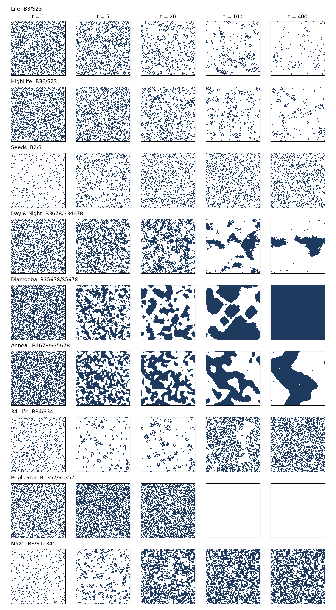
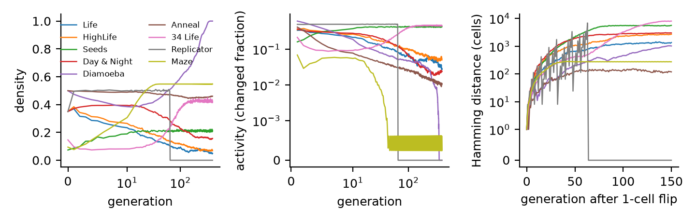
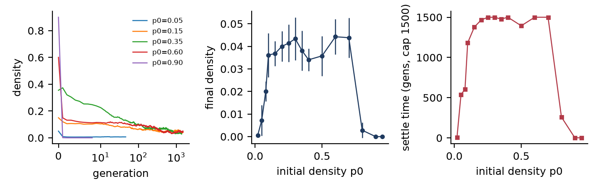
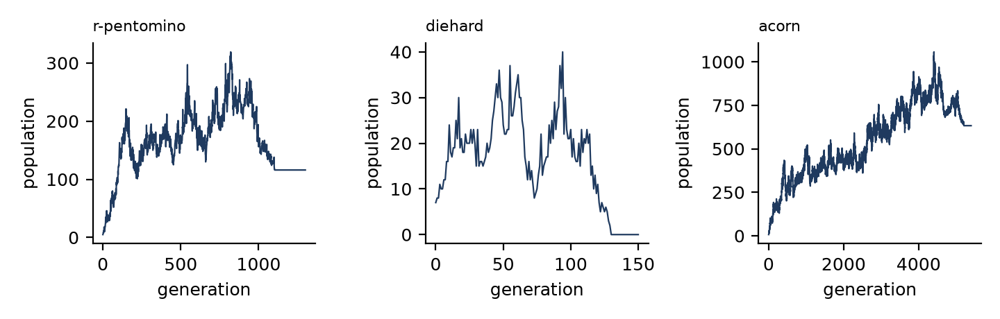
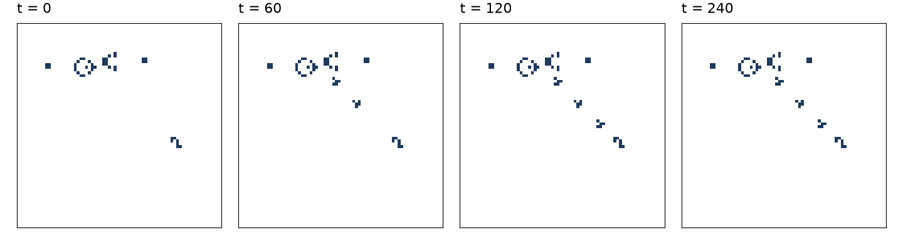
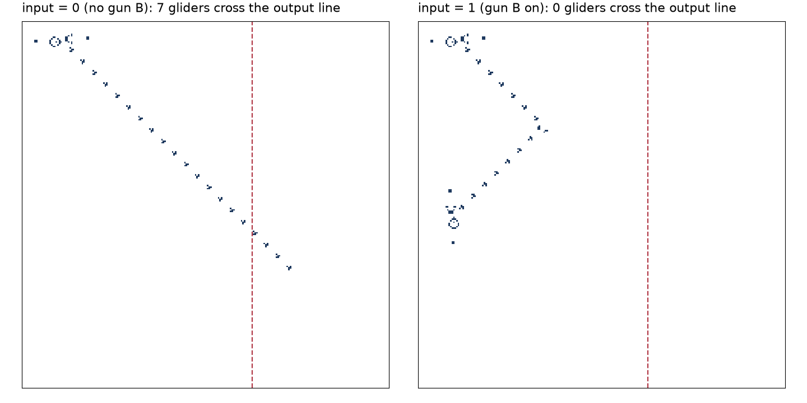
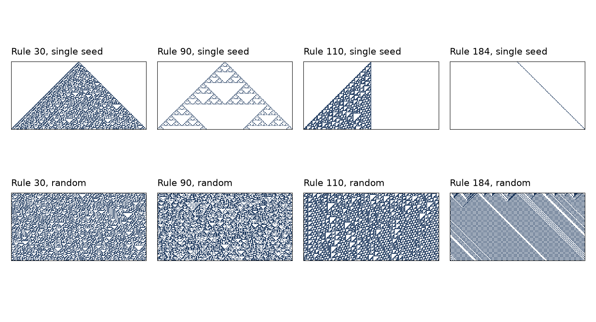
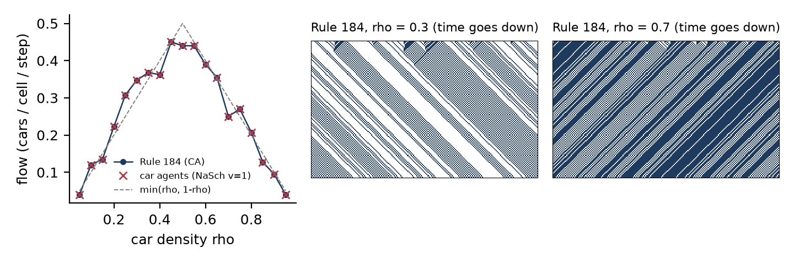

# 规则与初始条件如何决定"生命"：用 Golly 探究元胞自动机的演化

群体智能课程作业 ｜ 第二次作业（生命游戏与 Golly）｜ 23371100 李东骏 配套材料：演化过程视频（演化过程视频.mp4，93 s）、27 个可在 Golly 中直接打开的图案文件（patterns/*.rle）、全部实验代码与数据

## 摘要

"生命游戏"的演化只取决于两件事：**初始粒子分布**和**演化规则**。本文围绕这两个自由度做了四组可复现的定量实验，并把每组实验类比到一个自然现象、一个数理逻辑结构或一个程序应用。

实验一固定同一张随机噪声场，换九种 Golly 规则（Life、HighLife、Seeds、Day & Night、Diamoeba、Anneal、34 Life、Replicator、Maze），用密度、活跃度、块熵和"损伤扩散"四个观测量把它们归入 Wolfram 的四类：规则决定系统处于凝固、周期、混沌还是复杂"相"。其中 Replicator 规则给出一个意外而干净的结论：它是 GF(2) 上的线性（XOR）规则，在 $N \times N$ 环面上**任何**图案都会在第 $N/2$ 代精确归零，我给出了证明并用 64 和 128 两种尺寸验证。实验二固定 B3/S23 规则，扫描 16 个初始密度各 6 次重复： $p_0 \in [0.1, 0.7]$ 的终态密度都落在 $0.035 \sim 0.044$ 的平台上，而 $p_0 \geq 0.8$ 在第 1 代就因"过度拥挤"几乎全灭；另一端用 R 五格骨牌、Diehard、Acorn 三个"玛土撒拉"说明 5～7 个细胞也能演化上千代。实验三在生命游戏里搭数理逻辑：程序穷举出吞噬器的位置和朝向（第 25 次尝试命中），再用两支互相垂直的滑翔机枪搭出一个可工作的**非门**（输入 0 → 输出 7 架滑翔机，输入 1 → 0 架）。实验四转到一维规则，证明**规则 184 与基于智能体的单车道交通模型在 19 个密度、300 步内逐位相同**——这是作业鼓励探究的"两者在规则底层是否等价"的一个肯定答案；同时给出基本图 $J(\rho)=\min(\rho, 1-\rho)$ 和向后传播的堵车波。

所有二维实验都用 Golly 自带的命令行引擎 bgolly 做了逐格交叉验证（12 项全部一致），所有图案文件都可在 Golly 中原样打开。

> **关键词**：生命游戏；元胞自动机；Golly；Wolfram 分类；滑翔机枪；逻辑门；规则 184；交通流；计算等价性

## 1 问题、工具与方法

### 1.1 作业要求与我的切入点

作业要求用 Golly 探究不同演化规则或初始条件下元胞自动机的演化过程，并类比某一自然现象、数理逻辑或程序应用；鼓励用计算等价性原理探究"两者在规则底层是否等价"。

我把这句话拆成两个自变量和三类"类比对象"，设计了四组实验（表 1）。每组实验都刻意只动一个自变量，另一个固定，这样结论才能归因。

| 实验 | 固定什么 | 改变什么 | 类比对象 | 对应视频段落 |
| --- | --- | --- | --- | --- |
| 一：九种规则 | 同一张随机噪声场 | 演化规则（B/S 表） | 物质的"相"与相变；线性系统的可解性 | 2 |
| 二：初始密度与玛土撒拉 | 规则 B3/S23 | 初始密度 $p_0$；极小初始图案 | 热力学：微观态敏感、宏观量稳健 | 1, 3, 4 |
| 三：枪、吞噬器、非门 | 规则 B3/S23 | 精心摆放的初始图案 | 数理逻辑：信号源、信号终端、非门 | 5, 6 |
| 四：一维规则 110 / 184 | 一维三邻域 | 规则号；车辆密度 | 程序应用：交通流模拟；计算等价性 | 7, 8 |

表 1　四组实验的设计。"视频段落"指随报告提交的演化过程视频中的编号场景。

### 1.2 规则的写法：Golly 的 B/S 记法

Golly 用 **B/S 记法**描述二维外全体（outer-totalistic）规则：每个细胞看 Moore 邻域的 8 个邻居，只数活邻居的个数 $n$。规则 "B $b_1 b_2\ldots$/S $s_1 s_2\ldots$" 表示：

- 死细胞在 $n \in \{b_i\}$ 时**出生**（Birth）；
- 活细胞在 $n \in \{s_i\}$ 时**存活**（Survival），否则死亡。

经典生命游戏就是 B3/S23：死细胞恰好 3 个活邻居时出生，活细胞 2 或 3 个活邻居时存活。这个记法把 $2^{18}$ 种可能的外全体规则压缩成一个短字符串，Golly 的 "Set Rule" 对话框直接接受它。本文九种规则的 B/S 字符串见表 2。

一维规则用 Wolfram 编号：细胞只看左、自己、右三个格子， $2^3 = 8$ 种邻域各对应一个输出位，8 位二进制拼成 0～255 的编号。Golly 用 "W110" 这样的写法加载它们。

### 1.3 实验平台：Golly 与自写引擎的分工

Golly 擅长交互式观察和 HashLife 加速，但做"16 个密度 × 6 次重复 × 1500 代"这种批量统计、或者"穷举 1024 个摆放位置找非门"这种搜索并不方便。我的分工是：

1. **自写一个 numpy 引擎**（ca.py，约 200 行），实现 B/S 规则、一维规则、环面/死边界两种边界条件，以及 Golly 原生的 RLE 图案格式的读写。所有批量实验和搜索都在它上面跑。
2. **用 Golly 做权威校验**。Golly 自带的命令行程序 bgolly 可以读入 RLE、推进若干代、再写出 RLE。我把每一类实验的代表图案（9 个环面随机汤、枪+吞噬器、非门、R 五格骨牌）同时交给两个引擎跑 200～600 代，逐格比对，12 项全部一致（表 9）。玛土撒拉的种群曲线则直接取自 bgolly 的输出。
3. **所有初始图案都保存为 RLE**，可以在 Golly 中用 File → Open 原样打开，规则随文件自动设定。随机汤用 Golly 的有界网格语法 "B3/S23:T128,128" 声明 128×128 环面。

> 一个踩过的坑：RLE 规范要求"计数+符号"（如 "12o"）不能被换行切开，我最初按固定 70 字符折行，Golly 报 "Illegal whitespace after count"。改成只在 run 边界换行后，全部 27 个文件都能被 bgolly 读取。

### 1.4 四个观测量

单看画面很难说"这个规则比那个更活跃"，所以每一代我都算四个标量：

- **密度** $\rho(t)$：活细胞占比。
- **活跃度** $a(t)$：相邻两代之间状态改变的细胞占比。 $a \to 0$ 说明系统凝固或进入周期。
- **块熵** $H_3(t)$：把网格切成 $3\times 3$ 的块，统计 512 种块图案的分布的 Shannon 熵（bit）。全空或全满为 0，完全随机约 9 bit。它区分"有序的密"和"无序的密"。
- **损伤扩散**（Hamming 距离）：翻转初始图案正中心一个细胞，两条轨迹各跑 150 代，数有多少个细胞不同。这是元胞自动机里"混沌"的操作性定义——一粒扰动是会被吸收、局部化，还是扩散到整个系统。

## 2 实验一：同一初始分布、九种演化规则

### 2.1 设置

$128\times128$ 环面，同一个随机数种子生成一张噪声场 $u_{ij} \sim U(0,1)$，第 $k$ 种规则的初始图案取 $u_{ij} < p_0^{(k)}$。 $p_0$ 按各规则的惯例取值（Seeds、34 Life、Maze 这类"爆炸性"规则用低密度，Diamoeba、Anneal 这类"多数表决"规则用 0.5），其余取 0.35。每种规则跑 400 代，终态统计量取最后 50 代平均。

### 2.2 结果

| 规则 | B/S | $p_0$ | 终态密度 | 终态活跃度 | 块熵 (bit) | 150 代后损伤 (细胞) | 归类 |
| --- | --- | --- | --- | --- | --- | --- | --- |
| Life | B3/S23 | 0.35 | 0.051 | 0.033 | 1.87 | 1340 | IV 复杂 |
| HighLife | B36/S23 | 0.35 | 0.071 | 0.053 | 2.44 | 2674 | IV 复杂 |
| Seeds | B2/S | 0.08 | 0.212 | 0.424 | 6.46 | 5555 | III 混沌 |
| Day & Night | B3678/S34678 | 0.35 | 0.153 | 0.023 | 1.56 | 2977 | IV 复杂（相分离） |
| Diamoeba | B35678/S5678 | 0.50 | 1.000 | 0.000 | 0.00 | 1011 | I 凝固 |
| Anneal | B4678/S35678 | 0.50 | 0.458 | 0.011 | 1.74 | 118 | II 周期/缓慢粗化 |
| 34 Life | B34/S34 | 0.15 | 0.427 | 0.460 | 8.34 | 7947 | III 混沌 |
| Replicator | B1357/S1357 | 0.35 | 0.000 | 0.000 | 0.00 | 0 | 线性（见 2.3） |
| Maze | B3/S12345 | 0.10 | 0.548 | 0.000 | 7.21 | 272 | II 凝固 |

表 2　九种规则在同一噪声场下的终态统计（最后 50 代平均）。"归类"按 Wolfram 四类，由活跃度和损伤扩散两列共同判定。

把表 2 和图 1、图 2 合起来看，九条规则落进四种截然不同的"相"：

**凝固（Class I）。** Diamoeba 在第 400 代密度恰好 1.000、活跃度 0——整张环面被填满。图 1 第五行能看到过程：随机汤先凝成一个个"液滴"，液滴互相吞并，最后一滴铺满全图。原因在规则里：B35678/S5678 对活细胞的存活要求 $n \ge 5$，对死细胞的出生要求 $n \ge 5$（加上 3），都偏向"多数表决"，所以界面总是向曲率中心收缩，像表面张力驱动的液滴聚并。Maze 也凝固，但凝固成密度 0.548 的迷宫状走廊：S12345 让活细胞几乎不会死，B3 让走廊只在恰好 3 个邻居处生长，于是得到块熵高达 7.21 bit 的"有序而复杂"的静态结构——活跃度 0.0004 说明它确实不再变化。

**周期或缓慢粗化（Class II）。** Anneal 的名字就是"退火"：B4678/S35678 是严格的多数表决规则，每个细胞向邻域多数靠拢，相当于零温 Ising 模型的淬火动力学。图 1 第六行是教科书式的畴粗化（coarsening）：小畴消失、大畴合并，到第 400 代只剩一条蜿蜒的界面。它的损伤扩散只有 118 个细胞——扰动被局部化，这是 Class II 的标志。

**混沌（Class III）。** Seeds（B2/S）没有任何存活条件，每个活细胞只活一代，密度 0.21、活跃度 0.42，损伤扩散到 5555 个细胞，块熵 6.46 bit。34 Life 更极端：活跃度 0.46、块熵 8.34 bit（接近完全随机的 9 bit 上限）、损伤扩散 7947 个细胞，几乎覆盖半张网格。图 2 右图里这两条曲线是增长最快的。

**复杂（Class IV）。** Life 和 HighLife 是"中间态"：密度掉到 0.05～0.07，活跃度 0.03～0.05，不为零但很小；块熵 1.9～2.4 bit，说明终态由少数几种局部结构（方块、信标、闪烁子、滑翔机）反复出现构成；而损伤扩散仍达 1340～2674 个细胞——一个细胞的改变会通过滑翔机和碰撞传到很远。这种"大部分地方凝固、少数结构长距离传播信息"的组合正是 Class IV 的特征，也是后面能在 Life 里搭逻辑门的原因。Day & Night 是另一种复杂：B3678/S34678 在黑白互换下对称，图 1 第四行可见它形成大块黑区和白区并持续翻滚边界，像两相分离的流体。

### 2.3 Replicator：一个可以解析求解的规则

Replicator（B1357/S1357）的结果最奇怪：密度 0.35 的随机汤在 128×128 环面上，于第 64 代**精确**归零（图 2 左、右两条灰线在 t = 64 同时跳到 0）。这不是偶然，而是线性代数的结果。

B1357/S1357 的意思是"无论自己死活，下一代的状态 = 8 个邻居中活细胞个数的奇偶性"，即

$$
x_{ij}(t+1) = \bigoplus_{(dy,dx)\neq(0,0)} x_{i+dy,\,j+dx}(t) \pmod 2 .
$$

记平移算子 $L, R, U, D$，则更新算子 $F = (1+L+R)(1+U+D) - 1$（展开恰好是 8 个邻居，减掉中心）。在 GF(2) 上 $(a+b)^{2^k} = a^{2^k} + b^{2^k}$（Frobenius 恒等式），于是

$$
F^{2^k} = \big[(1+L+R)(1+U+D)\big]^{2^k} + 1 = (1 + L^{2^k} + R^{2^k})(1 + U^{2^k} + D^{2^k}) + 1 .
$$

在周期为 $N = 2^{k+1}$ 的环面上，平移 $2^k$ 和 $-2^k$ 是同一个算子， $L^{2^k} + R^{2^k} = 2L^{2^k} = 0$，所以 $F^{N/2} = 1\cdot 1 + 1 = 0$：**任何初始图案都在第 $N/2$ 代归零**。我用 $N = 64$ 和 $N = 128$ 各验证了一次，归零时刻分别是第 32 代和第 64 代，与推导一致。

这条规则因此是"计算可约"的：不用逐代模拟，一行公式就知道结果。它和 Life、规则 110 形成鲜明对比——后两者是图灵完备的，没有捷径（见第 6 节）。

### 2.4 类比：规则是"相图"，初始分布是"温度"

把表 2 的结论翻译成物理语言：B/S 规则决定了系统处于哪个相，就像相互作用势决定了物质是固体、液体还是气体。Diamoeba 和 Anneal 的多数表决等价于铁磁耦合，所以表现为液滴聚并和畴粗化；Seeds 没有存活项，像一场没有燃料积累的野火，烧过就灭、火线永远在跑；Life 处在凝固与混沌的边界上，Langton 把这叫"混沌边缘"，它是计算能力出现的地方。

## 3 实验二：同一规则、不同初始条件

### 3.1 初始密度扫描

固定 B3/S23， $128\times128$ 环面，初始密度 $p_0$ 取 16 个值（0.02～0.95），每个值 6 个随机种子，最多跑 1500 代；若连续两代与两代前完全相同（进入周期 ≤ 2 的终态）则提前停止并记录"稳定时间"。

| $p_0$ | 终态密度（均值 ± 标准差） | 平均稳定时间（代） | 1500 代内未稳定次数 (/6) |
| --- | --- | --- | --- |
| 0.02 | 0.001 ± 0.000 | 4 | 0 |
| 0.05 | 0.007 ± 0.007 | 537 | 2 |
| 0.08 | 0.020 ± 0.004 | 607 | 0 |
| 0.10 | 0.036 ± 0.010 | 1182 | 3 |
| 0.15 | 0.037 ± 0.006 | 1379 | 5 |
| 0.20 | 0.040 ± 0.007 | 1465 | 5 |
| 0.25 | 0.041 ± 0.008 | 1500 | 6 |
| 0.30 | 0.043 ± 0.010 | 1500 | 5 |
| 0.35 | 0.038 ± 0.009 | 1477 | 5 |
| 0.40 | 0.034 ± 0.005 | 1500 | 6 |
| 0.50 | 0.036 ± 0.009 | 1394 | 4 |
| 0.60 | 0.044 ± 0.008 | 1500 | 6 |
| 0.70 | 0.044 ± 0.009 | 1500 | 6 |
| 0.80 | 0.003 ± 0.003 | 259 | 1 |
| 0.90 | 0 ± 0 | 2 | 0 |
| 0.95 | 0 ± 0 | 1 | 0 |

表 3　B3/S23 初始密度扫描结果。

三个观察：

1. **中间有一块平台。** $p_0$ 从 0.10 到 0.70 变了 7 倍，终态密度始终在 0.034～0.044 之间，误差棒互相重叠。生命游戏的"灰烬"密度是规则的性质，不是初值的性质。
2. **两端有陡峭的悬崖，而且机理不同。** $p_0 = 0.02$ 时细胞彼此孤立，绝大多数在第 1 代因"孤独"（ $n<2$）死亡，4 代内就稳定。 $p_0 = 0.90$ 时每个活细胞平均有 7.2 个活邻居，第 1 代密度从 0.899 跌到 0.0005，第 2 代归零——这是"过度拥挤"（ $n>3$）的集体死亡。 $p_0 = 0.70$ 很有意思：第 1 代也跌到 0.053，但残留碎片恰好够重新生长，最后回到 0.044 的平台上（视频场景 3 就是这个过程）。
3. **平台区几乎永远不稳定。** $p_0 \in [0.25, 0.70]$ 时 6 次重复里有 5～6 次在 1500 代内仍未进入周期 ≤ 2 的终态。在 128×128 的环面上，总有几架滑翔机在环面上绕圈，撞上静物又触发新的活动。这和 Class IV 的"长程信息传播"一致。

### 3.2 另一个极端：5～7 个细胞的玛土撒拉

初始密度扫描说的是"大量随机细胞"。另一个极端是极少的细胞能活多久——Conway 把演化很久才稳定的小图案叫"玛土撒拉"（Methuselah）。我选了三个经典图案，在无界平面上用 bgolly 计算完整的种群曲线。

| 图案 | 初始细胞 | 稳定代数（文献值） | 本文检测值 | 终态细胞数 | 峰值细胞数 | 备注 |
| --- | --- | --- | --- | --- | --- | --- |
| R 五格骨牌 | 5 | 1103 | 1104 | 116 | 319 | 放出 6 架滑翔机 |
| Diehard | 7 | 130（归零） | 第 130 代归零 | 0 | 40 | 唯一会彻底消失的 |
| Acorn | 7 | 5206 | 5207 | 633 | 1057 | 放出 13 架滑翔机 |

表 4　三个玛土撒拉。"本文检测值"用"种群数开始 2-周期的那一代"判定，比 LifeWiki 的定义晚 1 代，属于定义差异而非计算差异；numpy 引擎与 bgolly 在前 300 代的种群数逐代相同。

R 五格骨牌是 Conway 1970 年手算时就发现的：5 个细胞，1103 代后留下 116 个细胞（含飞走的 6 架滑翔机），中途峰值 319。Acorn 更夸张，7 个细胞演化 5206 代、峰值 1057。Diehard 则是反例——7 个细胞折腾 130 代后彻底消失。三者初始规模几乎一样，命运却天差地别。

### 3.3 类比：微观态敏感，宏观量稳健

这组实验和热力学的对应很直接。初始图案是"微观态"：改一个细胞（实验一的损伤扩散）、换一个种子、R 五格骨牌和 Diehard 之间差两个细胞，终态都完全不同——系统对微观初值敏感。但"宏观量"——随机汤的终态密度——对 $p_0$ 在很宽的范围内不敏感，就像气体的压强不依赖于某个分子此刻在哪。生命游戏同时具备这两个性质，这也是它能既"不可预测"又"有统计规律"的原因。

## 4 实验三：在生命游戏里搭数理逻辑

Class IV 规则的价值在于可以承载信息处理。生命游戏里的"信号"是滑翔机：5 个细胞、周期 4、沿对角线以 $c/4$ 的速度移动。要做逻辑，还需要信号源、信号终端和一个能把两个信号相互作用的"门"。

### 4.1 信号源与信号终端：高斯帕滑翔机枪 + 吞噬器

高斯帕滑翔机枪（Gosper glider gun）每 30 代向东南方向发射一架滑翔机。我在 200×200 死边界平面上跑 200 代，用连通分量找出所有 5 细胞的独立结构，得到 6 架滑翔机，相邻两架的位置差为 (7, 8) 或 (8, 7) 格——正好对应 30 代 × $c/4$ = 7.5 格的间距。

吞噬器（eater 1）是一个 7 细胞静物，被滑翔机以恰当的方向撞上时会吞掉滑翔机并恢复原状。"恰当"是关键：它有 8 种朝向，位置也要精确到格。我让程序穷举：8 种朝向 × 沿滑翔机路径的若干位置，每种摆法跑 240 代，要求 (a) 第 240 代与第 270 代完全相同（系统进入周期 30）；(b) 吞噬器完好；(c) 没有细胞逃出 90×90 的区域。第 25 次尝试即命中：朝向 rot0，位置 (40, 54)。

### 4.2 非门：让输入信号湮灭固定信号

非门的构造思路：

- **枪 A**（左上）持续向东南发射滑翔机，这是"固定信号"，不加干预时输出端一直收到滑翔机，记为输出 1。
- **枪 B**（左下）把枪 A 旋转 90°，向东北发射，这是"输入"。枪 B 存在 = 输入 1，不存在 = 输入 0。
- 两条滑翔机流垂直相交。如果每一架输入滑翔机都恰好与一架固定滑翔机对撞湮灭，输出端就什么也收不到，记为输出 0。

难点仍然是相位：两架滑翔机 90° 对撞的结果强烈依赖相对偏移。我先统计了单独的滑翔机对撞：枚举 25×25 = 625 个相对位置，120 代后 425 种情形两架滑翔机互相穿过（根本没碰上），150 种留下碎片或静物，只有 **50 种（8%）完全湮灭**。所以非门不能随便摆，必须搜索。

程序在 240×240 死边界平面上枚举枪 B 的偏移 $(dy, dx) \in [0,32)^2$，判据是：700 代内没有任何细胞到达 $x \ge 150$ 的输出区域，且第 700 代与第 730 代相同（系统进入周期 30、没有碎片积累）。第 31 次尝试命中 $(0, 10)$，前三个可行解为 (0,10)、(0,12)、(0,30)。注意 dx 的三个解都是偶数、相差 2 或 20，这是因为滑翔机每 4 代前进 1 格，枪周期 30 代，相位条件以 2 格为单位循环。

| 输入（枪 B） | 700 代内到达输出区的滑翔机数 | 逻辑输出 |
| --- | --- | --- |
| 0（无枪 B） | 7 | 1 |
| 1（有枪 B） | 0 | 0 |

表 5　非门真值表（实验计数）。

图 6 右图可以看到一个细节：交叉点处只剩两架正在相撞的滑翔机，没有任何碎片，说明湮灭是"干净"的，可以无限运行。这就是一个完整的 NOT 门：输入由一条滑翔机流编码，输出也是一条滑翔机流，可以接到下一个门去。

### 4.3 类比：数字电路与通用计算

有了"滑翔机 = 比特"、"枪 = 时钟/常量 1"、"吞噬器 = 接地"、"对撞湮灭 = 非门"，再加上文献中的与门、或门（同样基于滑翔机对撞）和用静物做的存储单元，就能在生命游戏里搭出任意组合逻辑和寄存器。Berlekamp、Conway 和 Guy 在 1982 年就沿这条路证明了生命游戏是图灵完备的；Rendell 2011 年在 Golly 里实际建成了一台图灵机。这意味着 B3/S23 这一行规则，和我们手上任何一台计算机在"能算什么"上是等价的。

## 5 实验四：一维规则与交通流

### 5.1 四条一维规则

把问题降到一维，每个细胞只看左右邻居，规则只有 8 条查表项，但行为同样覆盖四类（图 7）。

- **规则 30**：单细胞出发长成一个内部混沌的三角形，随机初始则一片乱纹（Class III）。Wolfram 早年把它的中心列当作 Mathematica 的随机数发生器。
- **规则 90**：单细胞出发长成 Sierpinski 三角形——它是 $x_{i}(t+1) = x_{i-1}(t) \oplus x_{i+1}(t)$，和 2.3 节的 Replicator 一样是线性规则，图案是杨辉三角的奇偶性。
- **规则 110**：随机初始下出现一种背景周期纹理，上面有若干局域结构（"滑翔机"）在移动、碰撞（Class IV）。Cook 于 2004 年证明它图灵完备——这是已知最小的通用计算系统之一。
- **规则 184**：随机初始下迅速形成沿对角线平移的条纹，没有混沌，也没有复杂结构（Class II）。它看起来最"无聊"，却是下一节的主角。

### 5.2 规则 184 就是单车道交通

把 1 读作"这格有车"、0 读作"空位"，规则 184 的 8 条查表项恰好是："车前方空则前进一格，否则停下"。这正是 Nagel–Schreckenberg 交通模型取 $v_{\max}=1$、随机减速概率 $p=0$ 的确定性版本。

作业鼓励用计算等价性原理探究"两者在规则底层是否等价"。我做的是最直接的检验：**分别实现两个模型，逐位比较轨迹。**

- 模型 A：规则 184 元胞自动机，长 400 的环形道路。
- 模型 B：基于智能体的车辆模型——维护一个车辆位置列表，每步每辆车检查前方格子，空则 +1（取模），并行更新。

19 个密度 $\rho \in [0.05, 0.95]$，各跑 300 步，**19 组轨迹全部逐位相同**。两种描述（"格子的局部规则" vs "车辆的个体行为"）不是近似相似，而是同一个动力系统的两种写法。

既然等价，就可以用元胞自动机研究交通。图 8 左是交通工程里的**基本图**（fundamental diagram）：

- $\rho < 0.5$：自由流，每辆车都能动，流量 $J = \rho$；
- $\rho > 0.5$：拥堵流，每个空位每步只能被一辆车填上，流量 $J = 1-\rho$；
- 最大流量在 $\rho = 0.5$ 附近，实测峰值 0.45（ $\rho=0.45$）。理论值 $J = \min(\rho, 1-\rho)$ 是无限长道路充分弛豫后的结果，有限长度和随机初值下略低，但形状完全一致。

图 8 中、右两张时空图展示了两种相： $\rho = 0.3$ 时车辆（向右下的条纹）自由前进，偶有小段拥堵很快消散； $\rho = 0.7$ 时出现**向左下传播的白色条纹**——那是空位在向后传，也就是堵车波逆着车流方向向后移动。每个开过高速的人都经历过：前方明明没有事故，车流却一停一走，而且"停"的位置在往后退。规则 184 用 8 条查表项复现了它。

### 5.3 类比：程序应用

这组实验对应作业里的"程序应用"：交通仿真软件（如 SUMO、TRANSIMS）的内核就是 NaSch 模型的变体——在规则 184 之上加上 $v_{\max} > 1$ 和随机减速。本文验证了最底层那一条规则与智能体实现等价，因此可以放心地用 Golly 加载 D_rule184_random.rle，直接在里面做交通实验。

## 6 讨论：什么叫"在规则底层等价"

作业开放课题问的是"两者在规则底层是否等价"。做完四组实验，我把"等价"分成三个强度不同的层次：

| 层次 | 含义 | 本文的例子 | 验证方式 |
| --- | --- | --- | --- |
| **逐位等价** | 两种描述给出完全相同的轨迹 | 规则 184 ≡ 智能体交通模型 | 19 个密度 × 300 步逐位比对，全部相同 |
| **实现等价** | 一个系统能精确模拟另一个 | numpy 引擎 ≡ Golly | 12 项逐格交叉验证（表 9） |
| **计算等价** | 两者都图灵完备，可以互相模拟，但代价可能很大 | 生命游戏 ≡ 规则 110 ≡ 图灵机 | 文献证明；本文的非门是通往这一等价的第一块积木 |

第三层最弱也最有趣。Wolfram 的"计算等价性原理"说：一旦系统的行为不是明显简单的，它的计算能力就和任何系统一样强——所以规则 110 和生命游戏不分高下，而 Replicator、规则 90 这类线性规则则明显弱于它们（2.3 节给出了一个解析解，这在图灵完备的系统里是不可能的）。这个原理的另一面是**计算不可约性**：既然规则 110 能做任何计算，就不存在"跳过中间步骤直接预测它 1000 代后状态"的捷径——否则那条捷径就能解决停机问题。实验二里 $p_0 \in [0.25, 0.7]$ 的随机汤 1500 代仍未稳定、R 五格骨牌要 1103 代才稳定，都是不可约性的具体表现：想知道结果，只能老老实实跑。

反过来，交通模型和规则 184 之所以能逐位等价，恰恰因为规则 184 是 Class II、计算可约的——它的基本图可以写成 $\min(\rho, 1-\rho)$ 一个闭式。可约的系统容易"等价"，不可约的系统只能"模拟"。

## 7 结论

1. **规则决定相。** 同一张噪声场在九种 B/S 规则下分别凝固、周期、混沌或复杂，四个观测量（密度、活跃度、块熵、损伤扩散）可以定量区分它们。其中 Replicator 是线性规则， $N\times N$ 环面上任何图案在第 $N/2$ 代归零，已解析证明并数值验证。
2. **初始条件决定具体终态，但不决定统计量。** B3/S23 下 $p_0 \in [0.1, 0.7]$ 的终态密度稳定在 0.035～0.044；两端因"孤独"或"拥挤"全灭；5～7 个细胞的玛土撒拉可以演化上千代，命运彼此迥异。
3. **B3/S23 足以承载逻辑。** 程序搜索得到吞噬器摆放（第 25 次命中）和非门几何（第 31 次命中），非门真值表为 0 → 7 架滑翔机、1 → 0 架。
4. **规则 184 与智能体交通模型在底层逐位等价**，基本图与堵车波均被复现；生命游戏与规则 110 则是更弱的"计算等价"。
5. 全部二维实验经 Golly 的 bgolly 逐格验证，12 项一致；27 个图案文件可在 Golly 中直接打开。

做这次作业最大的体会是：元胞自动机的"规则"和"初值"并不对称。规则像法律，决定了社会能长成什么样；初值像一代人的具体境遇，决定了这一次具体长成了什么。而只有少数几条法律（Life、规则 110）允许社会里出现"能够计算的结构"。

## 参考文献

1. Gardner M. Mathematical Games: The fantastic combinations of John Conway's new solitaire game "life". *Scientific American*, 1970, 223(4): 120–123.
2. Berlekamp E R, Conway J H, Guy R K. *Winning Ways for Your Mathematical Plays*, Vol. 2. Academic Press, 1982. (Chapter 25: What Is Life?)
3. Wolfram S. Statistical mechanics of cellular automata. *Reviews of Modern Physics*, 1983, 55(3): 601–644.
4. Wolfram S. *A New Kind of Science*. Wolfram Media, 2002.
5. Cook M. Universality in elementary cellular automata. *Complex Systems*, 2004, 15(1): 1–40.
6. Langton C G. Computation at the edge of chaos: Phase transitions and emergent computation. *Physica D*, 1990, 42(1–3): 12–37.
7. Nagel K, Schreckenberg M. A cellular automaton model for freeway traffic. *Journal de Physique I*, 1992, 2(12): 2221–2229.
8. Rendell P. A Turing machine in Conway's Game of Life, extendable to a universal Turing machine. In: *Collision-Based Computing*, Springer, 2002; and *Proc. 2011 Int. Conf. on High Performance Computing and Simulation*.
9. Trevorrow A, Rokicki T, et al. Golly (version 5.0). <http://golly.sourceforge.net/>
10. LifeWiki. <https://conwaylife.com/wiki/> （R-pentomino、Diehard、Acorn、Gosper glider gun、Eater 1 等图案的标准 RLE 与稳定代数）

## 附录 A　复现方式

所有代码在报告同目录下，依赖 numpy、scipy、matplotlib、imageio（视频）；Golly 的命令行引擎路径默认为 /Applications/Golly/bgolly。

~~~text
python experiments.py A    # 实验一：九种规则            -> figs/figA*.png, patterns/A_*.rle
python experiments.py B    # 实验二：密度扫描 + 玛土撒拉  -> figs/figB*.png, patterns/B_*.rle
python experiments.py C    # 实验三：吞噬器搜索 + 非门    -> figs/figC*.png, patterns/C*.rle
python experiments.py D    # 实验四：一维规则 + 交通流    -> figs/figD*.png, patterns/D_*.rle
python experiments.py G    # 与 bgolly 逐格交叉验证       -> results.json["G"]
python make_video.py       # 渲染演化过程视频（1280×720, H.264, 93 s）
~~~

在 Golly 中复现：File → Open 任意 patterns/*.rle，规则随文件自动设定；随机汤文件声明了 ":T128,128" 环面边界；一维规则文件使用 "W30/W90/W110/W184"。用 bgolly 推进 n 代并导出：

~~~text
/Applications/Golly/bgolly -m 200 -o out.rle patterns/C2_not_gate.rle
~~~

## 附录 B　Golly 交叉验证明细

| 图案 | 规则 | 代数 | numpy 细胞数 | Golly 细胞数 | 逐格一致 |
| --- | --- | --- | --- | --- | --- |
| 随机汤 Life | B3/S23:T128,128 | 200 | 1193 | 1193 | ✓ |
| 随机汤 HighLife | B36/S23:T128,128 | 200 | 1366 | 1366 | ✓ |
| 随机汤 Seeds | B2/S:T128,128 | 200 | 3492 | 3492 | ✓ |
| 随机汤 Day & Night | B3678/S34678:T128,128 | 200 | 2709 | 2709 | ✓ |
| 随机汤 Diamoeba | B35678/S5678:T128,128 | 200 | 12487 | 12487 | ✓ |
| 随机汤 Anneal | B4678/S35678:T128,128 | 200 | 7391 | 7391 | ✓ |
| 随机汤 34 Life | B34/S34:T128,128 | 200 | 6925 | 6925 | ✓ |
| 随机汤 Replicator | B1357/S1357:T128,128 | 200 | 0 | 0 | ✓ |
| 随机汤 Maze | B3/S12345:T128,128 | 200 | 8966 | 8966 | ✓ |
| 枪 + 吞噬器 | B3/S23 | 300 | 58 | 58 | ✓ |
| 非门 | B3/S23 | 400 | 166 | 166 | ✓ |
| R 五格骨牌 | B3/S23 | 600 | 213 | 213 | ✓ |

表 9　numpy 引擎与 Golly bgolly 的逐格比对（比较活细胞包围盒内的完整网格）。

## 附录 C　提交文件清单

| 文件 | 内容 |
| --- | --- |
| [群体智能]-[作业]-[第2次作业]-[2026秋]-[报告].md | 本报告 |
| 演化过程视频.mp4 | 8 个场景，93 s，1280×720 |
| patterns/*.rle | 27 个 Golly 图案文件（A 九种规则随机汤、B 三个玛土撒拉、C 枪+吞噬器与非门、D 四条一维规则、G 九个带 :T128,128 环面声明的验证用随机汤） |
| ca.py, experiments.py, make_video.py | 引擎、实验、视频脚本 |
| results.json, figs/ | 全部原始数据与图 |
