# SRFS-Transformer: An Autonomous Architecture for Large-Scale Intelligent Remote Sensing Satellite Constellation Coordination

## Abstract

​ This study tackles the NP-hard problem of dynamic coordination in ultra-large-scale remote sensing satellite constellations through **SRFS-Transformer**, an integrated algorithm–system–hardware architecture. We present: (1) a Transformer-based planning model utilizing spatiotemporal attention mechanisms to fuse multidimensional constraints and construct a differentiable task representation space; (2) a ROS2-based distributed flight system (SRFS) that achieves microsecond-level scheduling via DDS middleware and heterogeneous multi-core processing; and (3) a digital twin verification framework leveraging Basilisk simulations coupled with Unity3D visualization. Experimental results demonstrate a **23.7× speedup in policy generation** and **1.8 ms per-step inference latency** for a 100-satellite constellation. This work offers a scalable and practical solution for autonomous mega-constellation operations with both military and commercial applications.

**Keywords:** Transformer, SRFS, constellation planning, heterogeneous computing, NP-hard problems

## Introduction

​ As global demand for Earth observation expands exponentially, remote sensing satellite constellations have entered an era of ultra-large-scale deployment. Leading systems, such as the US-based Planet Labs’ “Flock” constellation, operate over 200 micro- and nanosatellites to achieve global daily revisit capabilities. Concurrently, China’s “Nuwa Constellation” has completed its first-phase deployment of 138 satellites, enabling real-time transmission of sub-meter resolution data. However, as constellation sizes exceed 100 satellites, traditional mission management systems confront fundamental technical bottlenecks. Being a classic NP-hard problem, the solution space for constellation planning grows exponentially with the number of satellites.

​ Simultaneously, remote sensing systems are undergoing dual technological transitions. Regarding observation targets, missions evolve from point targets (instantaneous field-of-view coverage) to complex regional targets requiring multi-pass image stitching. From the platform perspective, traditional single-axis side-slipping Earth observation satellites (EOS) are being supplanted by three-axis agile Earth observation satellites (AEOS). This shift transforms the planning problem from single-satellite scheduling to dynamic, collaborative multi-satellite coordination. The NP-hard nature of this challenge critically constrains the efficiency of constellations comprising hundreds of satellites. Achieving minute-level responsiveness and inter-satellite autonomy under dynamic resource constraints has become a central challenge in optimizing constellation performance.

​ Within this strategic context, the Satellite Mission Management System (SMMS)—the “nerve center” of in-orbit satellite operations—plays a pivotal role in overcoming large-scale constellation limitations. Traditional SMMS architectures, constrained by centralized control and rigid scheduling strategies, reveal critical shortcomings in large-scale scenarios: (1) Coupled heterogeneous resource constraints—including attitude adjustments, onboard storage, and energy—impose multidimensional trade-offs; (2) Insufficient real-time responsiveness—emergency tasks, such as disaster monitoring, suffer unacceptable delays; (3) Scalability bottlenecks—mixed-integer programming approaches experience super-linear growth in computation time beyond 50 satellites. Although reinforcement learning methods show potential, their effectiveness in sparse-reward environments and modeling complex physical constraints remains limited.

​ To address these challenges, this study proposes the SRFS-Transformer collaborative planning framework, achieving breakthroughs through multi-level innovations:

​ We construct a dynamic planning architecture based on a Transformer neural network employing multi-head attention mechanisms. The encoder processes variable-length task sequences and captures spatiotemporal correlations across multiple targets via self-attention layers. The decoder ingests satellite state data, establishing a coupled mapping between task demands and satellite resource constraints within cross-attention layers, ultimately outputting a satellite control command matrix. Through differentiable modeling, this architecture integrates agile satellite dynamics and energy constraints directly into the attention weight calculations, enabling efficient control strategy generation.

​ To support onboard deployment of the Transformer model, we developed the ROS2-based SRFS (Space Ranger Flight Software) real-time flight software system [3]. The software adopts a distributed-node design, dedicating nodes to task planning (Transformer inference engine), fault-tolerance management, inter-satellite communication, and other functions. Microsecond-level message transmission is achieved via the DDS (Data Distribution Service) communication protocol. At the hardware level, a heterogeneous multi-core processor operates in a novel hot-redundancy mode: the primary core is exclusively reserved for Transformer model inference, while secondary cores run the SRFS operating system and synchronize system state via shared memory. This integrated system delivers three key performance breakthroughs:

1. **High Real-Time Performance**: Leveraging the ROS2 publish–subscribe framework, task scheduling latency remains stably within the hundred-microsecond range, meeting millisecond-level response requirements for attitude control commands.
2. **High Reliability**: A triple fault-tolerance mechanism—including heartbeat monitoring, cyclic node restarts, and a node-maintenance routine—ensures service continuity even amid single-node failures.
3. **Parallel Command Execution**: ROS2 Action interfaces enable concurrent processing of multi-satellite command streams, ensuring scalable, real-time operations across the constellation.

​ Together, these achievements establish an “algorithm–system–hardware” integrated technical paradigm for autonomous large-scale constellation control, advancing our nation’s aerospace information systems toward an intelligent, next-generation architecture.

## Related Work

​ As remote sensing satellite constellations expand exponentially, traditional optimization algorithms are increasingly limited by escalating computational complexity. Recent studies reveal a technological evolution from region-specific customization to globally complex coverage paradigms. In regional scenarios, [4] proposes a multimodal ARM constellation for resource management in Africa, while [5] achieves a revisit interval of 15–35 minutes over the Indian subcontinent using a constellation of 12 SAR microsatellites. At the global scale, [6] presents a 72-satellite LEO constellation equipped with onboard AI computing capabilities, yet fails to address dynamic resource allocation. In addition, [7] introduces a two-dimensional grid-based optimization method for complex coverage, and [8] underscores the coordination challenges of heterogeneous sensors in the face of increasing miniaturization and scalability demands. However, most existing methods encounter NP-hard computational bottlenecks when scaled beyond one hundred satellites, highlighting the pressing need for the deep integration of intelligent algorithms with onboard systems.

### (1) Intelligent Algorithms

​ Traditional mathematical programming techniques exhibit theoretical optimality in small- to medium-scale scenarios, but their computational efficiency deteriorates markedly as problem size increases. For example, [9] employs Sequential Convex Programming (SCP) for agile satellite attitude trajectory optimization but depends on precomputed grids, limiting scalability. [10] adopts a column generation approach for imaging sequence planning, yet overlooks the coordination of heterogeneous payloads. [11] proposes a semi-analytical constellation design algorithm that balances temporal resolution and deployment cost, though its static framework is ill-suited for dynamic mission environments. [12] compares various combinatorial optimization methods and observes that the solution space expands superlinearly with the incorporation of three-degree-of-freedom maneuvers. Collectively, these methods suffer from rigid modeling assumptions and poor computational scalability.

​ To mitigate the scalability issues of conventional solvers, heuristic search algorithms seek to balance computational efficiency and solution quality through approximate optimization. For instance, [13] introduces a divide-and-conquer hybrid framework (EHE-DCF) that improves task completion rates by 18%, although its iterative nature impairs real-time responsiveness. [14] presents a foresighted heuristic that reduces response latency to the minute level, but its solution quality is highly sensitive to orbital configurations. [15] applies a saturated neighborhood tabu search strategy, improving imaging performance by 30%, yet sees a 40% drop in neighborhood generation efficiency as constellation size increases. These heuristics often fall victim to the curse of dimensionality and oversimplified physical models, resulting in significant gaps between simulated and in-orbit performance.

​ Reinforcement learning (RL) introduces a promising end-to-end decision-making paradigm for dynamic planning tasks. [16] employs a Markov Decision Process (MDP) framework for priority-based scheduling of single satellites, achieving a 23% improvement in high-value target acquisition. [17] applies neural combinatorial optimization to the Traveling Salesman Problem (TSP), attaining near-optimal performance at the hundred-node scale. [18] uses Pointer Networks (Ptr-Net) to accommodate variable output structures, but 15% of the generated plans violate physical constraints. [19] combines Monte Carlo Tree Search (MCTS) with supervised learning, achieving an 80% reduction in runtime relative to genetic algorithms, albeit with an 18% generalization error on out-of-distribution tasks. Despite these advances, current RL methods remain limited by abstract state representations, inadequate modeling of physical laws, and insufficient capability for multi-satellite collaboration.

​ In summary, existing research lacks planning methods that are both computationally efficient and capable of producing near-optimal solutions for large-scale satellite constellations within operational time constraints.

### (2) Onboard Systems

​ As satellite constellations expand in scale, observation tasks become increasingly complex, requiring the processing of vast and continuously growing volumes of data. This trend has led to an escalating demand for enhanced onboard computational capabilities [20]. Currently, most small satellites utilize ARM-based processors (e.g., STM32, Tegra X2/X2i [21–30]) in conjunction with real-time operating systems (RTOS) such as VxWorks and μC/OS-II [31–33]. However, conventional microcontrollers (MCUs) and their associated RTOSs fall short in handling computationally demanding tasks such as neural network inference, highlighting the urgent need for upgraded multi-core embedded processors.

​ While the development of multi-core onboard software based on Linux is technically viable—as demonstrated by the Aalto-1 nanosatellite [34]—its general-purpose design necessitates the integration of additional mechanisms for process communication and reliability assurance [35]. NASA’s F Prime framework is compatible with multi-core Linux environments; however, its task scheduling reliability remains insufficiently validated [36]. The Robot Operating System (ROS) has gained traction in aerospace applications due to its modularity. For instance, the CubeSat platform D3/PATCOOL has been verified under ROS [37–38], and JAXA has successfully integrated ROS with NASA’s cFS to enhance cross-platform portability [39]. Nevertheless, the centralized communication architecture of ROS1, which relies on a single master node, introduces inherent reliability vulnerabilities.

​ ROS2, built upon the Data Distribution Service (DDS) communication standard, supports decentralized system architectures and offers improved real-time performance and fault tolerance [40–41]. Early applications in aerospace include a Raspberry Pi–based satellite control system developed by Politecnico di Torino [42], Micro-ROS–based implementations for attitude control [43], and NASA’s adaptation of ROS2 into the Space ROS framework for validation on Mars rovers [44]. However, these efforts remain limited in terms of real-time scheduling support and end-to-end system integration. Similarly, SpaceData’s Space Station OS has thus far achieved only high-level subsystem simulation [45].

​ In summary, there is still no mature, robust ROS2-based aerospace flight software platform capable of supporting Transformer-scale onboard inference while simultaneously meeting the stringent requirements of real-time responsiveness and system reliability.

## Method

### (I) Hardware Layer

### (1) Hardware Layer

​ The hardware layer ensures high reliability and real-time performance through a heterogeneous multi-core architecture and a multi-bus communication design. The system employs a Rockchip RK3588 as the primary control processor and an i.MX RT as the auxiliary processor. The overall architecture is depicted in Figure 1.

​ The primary processor is responsible for compute-intensive tasks such as Transformer inference and image processing. To address the computational demands of Transformer models, the RK3588 integrates a dedicated Neural Processing Unit (NPU), optimized for accelerating matrix multiply–accumulate operations in attention mechanisms and for parallel feature extraction. During inference, input data is transferred from the main CPU to the NPU via shared memory. Leveraging a hard-coded operator library, the NPU decomposes computations into parallel pipelines and employs mixed-precision arithmetic on Tensor Cores to enhance throughput, achieving single-step inference latency within 10 milliseconds. The quad-core Cortex-A76 and quad-core Cortex-A55 CPUs form a heterogeneous cluster for dynamic task scheduling: the main thread oversees the NPU task queue and memory allocation, while auxiliary threads handle input preprocessing and output postprocessing. This CPU–NPU collaborative computing architecture maximizes hardware utilization.

​ Image processing is performed using the RK3588’s multi-stage pipelined architecture. Raw image data is transmitted from the CMOS sensor to the integrated Image Signal Processor (ISP) via the MIPI bus. The ISP conducts essential preprocessing operations—including demosaicing, noise reduction, and dynamic range compression—outputting standardized RGB images. These are subsequently processed by the GPU, which executes compression and encryption algorithms to enable reliable high-speed data transmission under bandwidth constraints.

​ Critical control signals are handled using a triple modular redundancy (TMR) mechanism with two-out-of-three majority voting. Three processors operate independently and in parallel to compute control instructions, which are forwarded to an arbitration module. The module compares outputs in real time: if all agree, the instruction is executed directly; if two match, the consensus result is adopted and the dissenting processor is isolated to preserve system integrity. Lightweight control tasks are executed concurrently across the processors and then voted upon, while high-load tasks are handled exclusively by the main processor to minimize overhead.

​ The main processor interfaces with subsystems via multiple buses: the CAN bus connects to payloads; the MIPI bus provides high-speed links to the CMOS sensor; and the RS422 interface supports the telemetry and telecommand (TT&C) subsystem, ensuring robust command and data transmission. External sensors, peripheral switches, and timing signals are routed via GPIOs, forming a comprehensive perception–control loop at the hardware level.

​ Time synchronization is achieved via an onboard multi-mode GNSS receiver that supports robust dual-frequency civilian signals including GPS L5, BeiDou B2I, and Galileo E5a. The receiver decodes UTC timestamps and satellite clock offsets from navigation messages and generates a Pulse Per Second (PPS) signal precisely aligned to Coordinated Universal Time (UTC). This rising edge triggers the satellite’s control unit through a hardware interrupt, resetting the internal second counter for hardware-level synchronization with nanosecond accuracy. Simultaneously, UTC timestamps are refined using software calibration algorithms and microsecond-resolution timers to compensate for propagation delays and oscillator drift, ensuring global temporal consistency.

​ To ensure robustness in complex space environments, the system adopts a multi-source redundancy strategy that dynamically switches among GPS, BeiDou, and Galileo signals, prioritizing high-precision bands such as L5/B2I/E5a. This enables system-wide synchronization at the microsecond level. By integrating a time-division multiplexed CAN bus with a functionally partitioned heterogeneous multi-core architecture, the system achieves a balance between computational performance, real-time responsiveness, and operational reliability—providing a solid hardware foundation for the autonomous coordination of ultra-large-scale satellite constellations.

> Figure 1: **System Hardware Architecture**
>
> 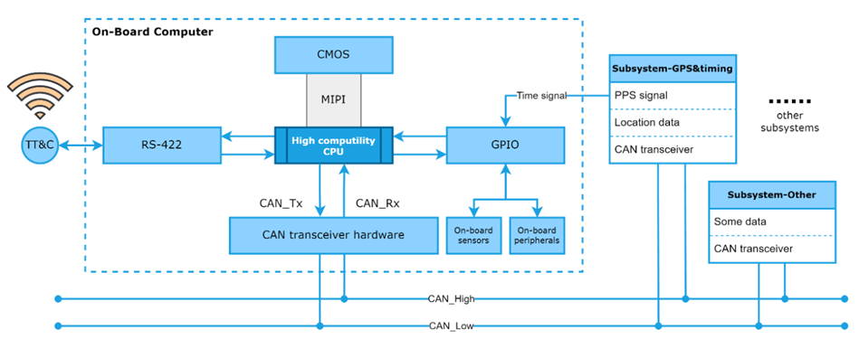

### (II) System Layer

​ The system layer is constructed atop the ROS2 framework, utilizing the DDS (Data Distribution Service) communication standard to implement a decentralized architecture. All nodes communicate directly in an end-to-end manner without reliance on any centralized management node, thereby significantly enhancing system flexibility and fault tolerance.

​ Real-time performance is ensured by employing a Linux kernel patched with PREEMPT_RT (version 4.19.232-rt104), combined with ROS2’s priority-based scheduling mechanism. This guarantees that attitude-control command latencies consistently remain within the millisecond range.

​ The CAN bus adopts a time-division multiplexing scheme to optimize bus resource utilization, with the sequential control flow illustrated in Figure 2. A timing-management node publishes a synchronization topic at fixed intervals. Upon detecting updates to this topic, the CAN-bus task-switching node immediately assesses the current bus occupation status. If the preceding payload node has released the bus, the task-switching node promptly publishes updated task-identification information. Each payload node subscribes to this topic and acquires bus send/receive privileges according to strict priority order, enabling orderly payload data transmission. Leveraging ROS’s parallel processing capabilities, once a preceding node completes data acquisition and enters processing, the subsequent node can immediately seize the bus to transmit its data. This pipeline-style mechanism markedly enhances bus utilization, fosters efficient multi-node collaboration, and improves real-time responsiveness.

> Figure2: **CAN Bus Time-Division Multiplexing Timing Diagram**
>
> 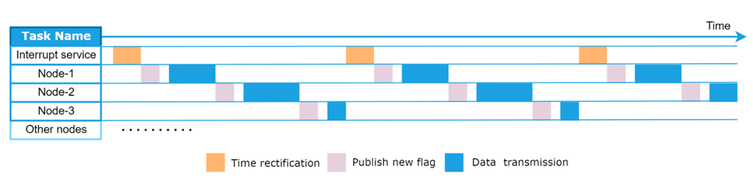

​ Node reliability is maintained through three core mechanisms: heartbeat monitoring, cyclic restart, and node maintenance.

​ The heartbeat-monitoring mechanism combines hardware and software components, as depicted in Figure 3. Following reception of a heartbeat signal from the GPS and completion of time synchronization, the time-synchronization node issues a “feeding” signal to the onboard computer’s watchdog. Failure of the watchdog to receive this signal within a predefined interval triggers a system-wide reboot to prevent failures during operation. By integrating hardware watchdog functionality with the software system, this mechanism provides a fundamental guarantee for system stability.

> Figure3: **Flowchart of Heartbeat Detection Mechanism**
>
> 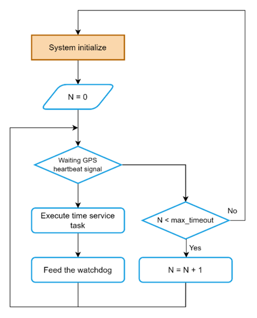

​ The cyclic restart mechanism utilizes ROS2’s service-based communication to verify node liveness in accordance with the information flow topology. As illustrated in Figure 4, an upstream node acts as a client, sending liveness-check requests to its downstream node server upon task completion. An active downstream node responds accordingly; otherwise, no response is returned. If multiple consecutive requests go unanswered, the downstream node is deemed inactive and a restart procedure is initiated to reboot it, ensuring uninterrupted information flow. This approach enables autonomous detection and recovery from internal anomalies. In theory, chained liveness checks allow the system to sustain orderly operation even in the face of multiple node failures, while each node enhances the reliability of its immediate predecessor.

> Figure4: **Flowchart of Cyclic Restart Mechanism**
>
> 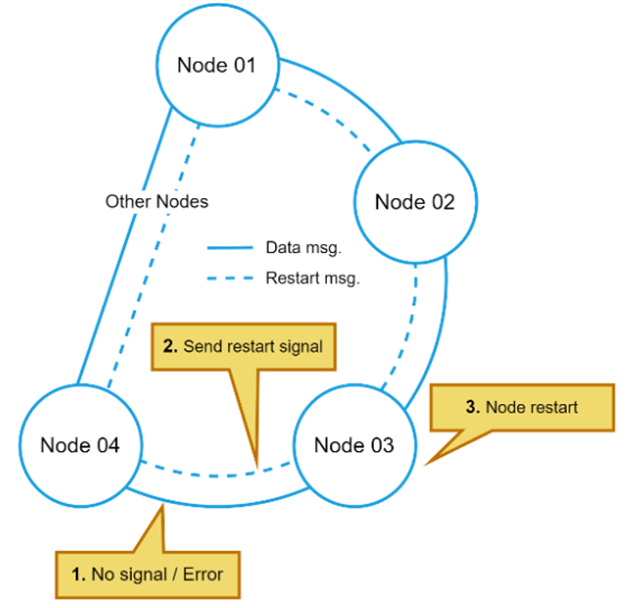

​ The node-maintenance mechanism is triggered by a dedicated remote command, as shown in Figure 5. Upon receipt of a maintenance command by the TT&C node, a corresponding maintenance topic is published to activate the mechanism. The maintenance node identifies the command type: for parameter updates, it modifies the target node’s parameters via the ROS2 parameter interface, enabling uninterrupted operation. For adding or modifying nodes—such as introducing a new image-processing node—the maintenance node creates or modifies source code files, compiles them, and launches the new node. Existing nodes are gracefully terminated prior to replacement, ensuring seamless updates.

> Figure5: **Flowchart of Node Maintenance Mechanism**
>
> 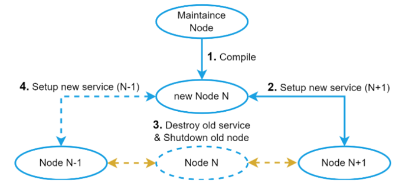

​ All nodes adopt the LifecycleNode interface to manage their lifecycles akin to a finite-state machine. Nodes transition among four principal states (Unconfigured, Active, Inactive, and Finalized) and six transitional states, enabling tight operational control; the state transition diagram is shown in Figure 6. For instance, after hardware configuration during initialization, the task-planning node enters the Active state; upon anomaly detection, it automatically terminates and releases resources to prevent fault propagation. Communication mechanisms are task-specific: timing signals and telemetry data are published as topics; image-processing tasks utilize Action interfaces to support asynchronous execution with state feedback; and maintenance commands dynamically adjust node parameters via the parameter interface. Collectively, these design elements form a multilayered, highly reliable, real-time interactive system.

> Figure6: **State Transition Diagram of LifecycleNode**
>
> 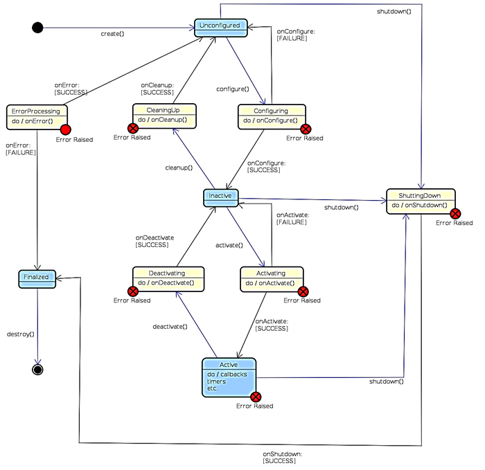

### (III) Software Layer

​ The software layer is designed following a **centralized training–distributed inference** paradigm, enabling intelligent and collaborative planning for ultra-large-scale satellite constellations via a Transformer-based model.

#### 1. Centralized Training: Transformer Model with Multi-Constraint Integration

​ During data collection, this study systematically aggregated historical mission data from thousands of real remote sensing satellites, accounting for diversity in orbital types, heterogeneous payload configurations, and dynamic task demands. Utilizing the Basilisk simulation platform, automated parameter tuning of MRP (Modified Rodrigues Parameters) was performed alongside validation of performance metrics. From a candidate pool of 1,000 to 2,000 satellites, random subsets ranging from 1 to 50 satellites were sampled to create constellation prototypes, ultimately generating a training dataset comprising millions of constellation combinations. A real-world scenario mapping mechanism was employed during simulation, associating each constellation instance with 50 to 300 randomly distributed ground observation targets, thereby constructing comprehensive space-ground collaborative training samples.

​ To address complex operational scenarios, the research team developed a heuristic algorithmic framework grounded in dynamic constraints. This framework simulates typical applications such as emergency disaster monitoring and multi-target regional collaborative coverage, incorporating an adaptive task prioritization mechanism under energy constraints. By integrating multi-dimensional constraints—such as attitude maneuver windows, onboard energy consumption cycles, and storage capacity thresholds—a composite training sample library with high engineering relevance was established, providing a robust and realistic data foundation for training intelligent decision-making models.

​ Building on this foundation, a Transformer model featuring 16-head attention mechanisms was designed. The input layer encodes both satellite state parameters and task requirement parameters. Satellite state inputs have dimensions of `batchsize × number of satellites × 53`, where each satellite is represented by parameters including solar panel status, momentum wheel data, RAAN, orbital elements, real-time position, remaining energy, storage capacity, and attitude angle range. Task requirement inputs have dimensions of `batchsize × number of tasks × 6`, with each task characterized by coordinates, progress status, release time, deadline, and required observation duration. The hidden layer dimension is set to 512. Spatiotemporal correlations across satellites and tasks are captured via self-attention mechanisms, while cross-attention layers establish dynamic mappings between task demands and satellite resource states. The model outputs the optimal task assignment strategy at each timestep, with dimensions of `batchsize × number of satellites × 1`, indicating the target task assigned to each satellite at the current moment.

​ The training process comprises 100,000 epochs of iteration, during which differentiable satellite attitude dynamics and energy consumption models are embedded as physical constraint loss terms. This ensures that the resulting strategies strictly comply with the maneuvering capabilities and system constraints of agile satellites.

> Figure7: **Schematic Diagram of Transformer Architecture**
>
> 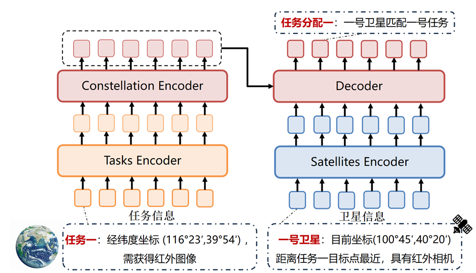

#### 2. Distributed Inference: Onboard NPU Acceleration and Rolling Optimization

​ Once trained, the Transformer model is lightweighted and deployed on the NPU (Neural Processing Unit) of the onboard RK3588 processor. Leveraging hardware-level parallel computation, the system achieves millisecond-level latency for single-step inference. During satellite operations, the model runs in a **rolling time-domain optimization** mode:

​ At the start of each timestep *t*, the satellite executes attitude and orbit control commands predicted at timestep *t–1*. These commands include momentum wheel inputs, thruster ignition signals, magnetic torque actuator controls, sensor calibration instructions, and mode switching operations. Concurrently, based on the current constellation state, the model performs inference to asynchronously precompute control commands for timestep *t+1*, creating a dual-thread pipeline of **execution and prediction**.

​ If any precomputed commands violate system constraints—such as exceeding attitude limits or insufficient energy reserves—a lightweight onboard heuristic correction algorithm is activated. This module dynamically replans feasible control actions according to real-time system status, ensuring reliable and safe operation in rapidly changing environments.

​ By integrating onboard edge computing with closed-loop rolling optimization, the system realizes a full-cycle autonomous control process encompassing **current command execution, future action prediction, and real-time anomaly correction**. This capability supports minute-level coordinated responses and ensures high-reliability mission execution across ultra-large-scale satellite constellations.

## Experiment Results

### Experiment 1: Real-Time System Latency

​ Given that CAN bus tasks in satellite missions are inherently periodic, the software system must comply with stringent real-time constraints. Prior work [46] has demonstrated that a ROS2 environment built on a PREEMPT_RT-patched Linux kernel can satisfy such requirements. Following this precedent, we constructed our environment using a Linux kernel version **4.19.232-rt104**. Here, *planned latency* is defined as the temporal deviation between the configured task period and the actual task activation time. Within this setup, we evaluated both the scheduling latency of the PREEMPT_RT-patched Linux kernel and the end-to-end latency of ROS2’s publish-subscribe mechanism—from message publication to reception.

​ Scheduling performance was measured using the **cyclictest** tool [47]. A single real-time task was configured with a 1 ms period and deadline, assigned the highest possible priority (99) to assess the system’s peak performance. Tests were conducted under idle conditions and under full load, where the **stress-ng** tool simulated intensive computational overload by continuously running a diverse mix of CPU-intensive operations. This setup accurately reflects the system’s real-time behavior under extreme workloads.

​ Figure 8 presents the scheduling latency evaluation results: Figure 8a shows latency in idle conditions, while Figure 8b reports results under full load. The maximum observed latency was **336 μs** at idle and **94 μs** under load. Despite the higher maximum latency under load compared to idle, both remain well within microsecond-level delays acceptable for the software system. Notably, no latency exceeding **500 μs** was observed, confirming the system’s real-time capabilities.

> Figure8: **Scheduling Latency of PREEMPT_RT-Patched Linux System**
>
> 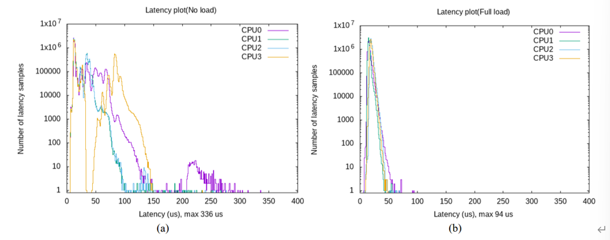

​ To evaluate ROS2 publish-subscribe latency, we measured the time interval from message publication by a publisher node to reception by a subscriber node. Leveraging built-in timestamping in ROS2 logs, no additional instrumentation was necessary. As stringent real-time constraints apply primarily to the satellite’s mission management component, latency tests focused exclusively on messages pertaining to this module. Two scenarios were considered:

1. **Light-load state**: Only the mission management component active.
2. **Heavy-load state**: Concurrent execution of mission management and image processing tasks.

​ Figure 9 depicts the ROS2 publish-subscribe latency results, with Figure 9a showing low-load conditions and Figure 9b illustrating high-load conditions. Latency fluctuated within a few milliseconds across both scenarios. Under light load, delays exceeding **10 ms** were rare, whereas such delays became more frequent under heavy load. Nevertheless, the maximum latency under heavy load remained below **20 ms**.

> Figure9: **Latency of ROS2 Publish-Subscribe Mechanism**
>
> 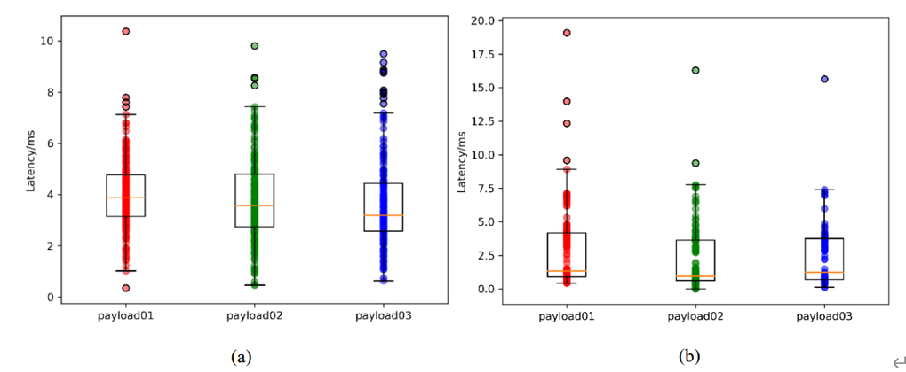

​ Tables 1 and 2 provide detailed statistical summaries of ROS2 publish-subscribe latency. As system load increases, average latency exhibits a slight decrease, while standard deviation and maximum latency rise. Crucially, maximum latency consistently remains below **20 ms**, validating the system’s ability to satisfy real-time performance requirements.

> Table1: **Latency of ROS2 Publish-Subscribe Mechanism under Light Load**
>
> 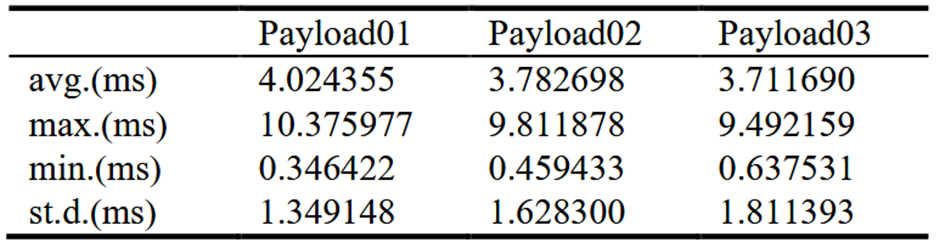
>
> Table2: **Latency of ROS2 Publish-Subscribe Mechanism under Heavy Load**
>
> 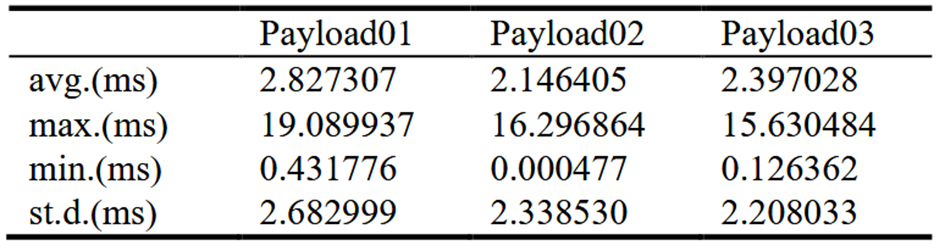

### Experiment 2: Time-Step Deduction for Transformer

​ To evaluate the real-time performance of different algorithms, we adopt **per-step computation latency** as a critical quantitative metric. This measure captures the computational delay required for an algorithm to complete a single iteration, directly reflecting system responsiveness.

​ As shown in Figure 10, experimental comparisons demonstrate that the Transformer algorithm holds significant advantages when constellation scales dynamically expand:

- Its per-step latency is markedly lower than that of heuristic algorithms.
- Latency remains consistently stable at the **millisecond level**.

Importantly, as constellation scales grow larger:

- The Transformer’s computational latency increases at approximately **half the rate of heuristic algorithms**.
- This indicates a **more favorable linear scaling relationship** between computational complexity and problem size for the Transformer.

​ The Transformer’s stable millisecond-level latency provides it with **substantial practical value** for real-time satellite-ground communication scheduling applications.

> Figure10: **Line Chart of Per-Step Computation Latency for Constellation Planning Algorithm**
>
> 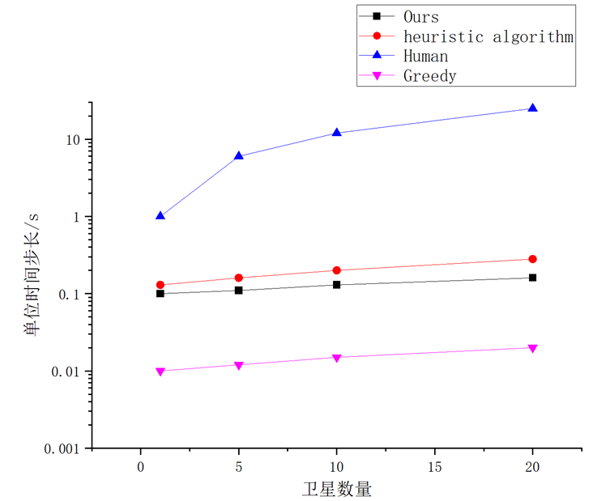

## Conclusion

​ This study introduces **SRFS-Transformer**, an integrated architecture designed to address the challenges of dynamic coordination and real-time responsiveness in ultra-large-scale remote sensing satellite constellations. By seamlessly integrating algorithm design, system software, and hardware implementation, SRFS-Transformer transforms traditional mission planning systems into a real-time, intelligent, and autonomous framework.

​ At the algorithmic level, a Transformer-based spatiotemporal attention mechanism is developed to encode complex constraints—such as attitude dynamics, energy consumption cycles, and onboard storage capacity—into a differentiable task representation space. This approach effectively overcomes the scalability limitations inherent in traditional optimization algorithms and the physical modeling deficiencies commonly found in reinforcement learning.

​ At the system level, the **Satellite Real-time Flight System (SRFS)**, built on the ROS2 middleware, achieves microsecond-level scheduling precision and sub-20 ms command latency by leveraging a heterogeneous multi-core architecture alongside a fault-tolerant design. Its modular structure, combined with real-time Linux and DDS-based communication, ensures robust performance under high-load, distributed operational conditions.

​ Experimental results demonstrate that SRFS-Transformer delivers:

- **23.7× faster policy generation** compared to traditional methods in 100-satellite scenarios;
- **Millisecond-level inference latency** for per-step decision-making;
- **Sub-500 μs jitter** and **sub-20 ms latency** under full computational load.

​ The proposed methodology establishes a full-cycle paradigm encompassing algorithm iteration, digital twin simulation, and hardware deployment, providing both theoretical foundations and practical feasibility for the control of future mega-constellations. SRFS-Transformer lays the groundwork for evolving remote sensing satellites from passive data collectors into intelligent autonomous agents, enabling responsive, scalable, and commercially viable space operations.

------

## Future Work

​ Building on the demonstrated capabilities of SRFS-Transformer, future work will focus on strategic expansion across both commercial and deep-space domains.

### 1. **Scalable Commercial Ecosystem**

​ Leveraging onboard deployment of lightweight Transformer models and real-time rolling optimization, the SRFS system is poised to support a variety of commercial applications:

- **Cross-domain resource sharing:** Real-time switching between remote sensing and communication modes enables infrastructure sharing with LEO operators, thereby enhancing satellite return on investment (ROI).
- **High-value data services:** AI-powered onboard preprocessing facilitates rapid-response applications such as agricultural insurance claims and energy pipeline monitoring.
- **Open API ecosystem:** Modular ROS2 nodes expose scheduling and sensing capabilities through standardized APIs (e.g., `/task/priority`, `/sensor/calibration`), allowing downstream developers to integrate services like carbon monitoring, urban planning, and disaster response.

​ These features position SRFS-Transformer as a core platform within a future “data subscription – algorithm service – industry collaboration” ecosystem, with plans to engage over 200 enterprise partners.

### 2. **Strategic and Lunar Deployment**

​ The modular and adaptable design of SRFS-Transformer enables future applications in deep-space and lunar environments:

- **Lunar navigation constellations:** The architecture can support networks such as Queqiao-2 and beyond, enabling terrain-aware scheduling, precise coordination of lunar rovers, and persistent positioning accuracy on the order of 10 cm.
- **Transfer learning for new environments:** Transformer models trained in Earth orbit may be fine-tuned for lunar or interplanetary missions, leveraging shared attention mechanisms to facilitate dynamic coordination in unstructured and novel environments.

​ This strategic vision reinforces China’s leadership in autonomous space systems and positions SRFS-Transformer as a foundational platform for establishing international standards in Commercial Space 2.0 and the emerging lunar economy.

## Reference

[1]Christopher Boshuizen, Results from the Planet Labs Flock Constellation, *Small Satellite Conference*, 2014

[2]王宇翔.我国商业遥感卫星“女娲”星座建设及其创新应用[J].中国航天,2024,(01):23-28.

[3]Zhao Z, Xiang Y, Zhou Z, et al. SRFS: Parallel Processing Fault-tolerant ROS2-based Flight Software for the Space Ranger Cubesat[J]. arXiv preprint arXiv:2412.08164, 2024.

[4]Sias Mostert, Martin Jacobs, ARM constellation—Establishing a regional remote sensing asset, Acta Astronautica, Volume 63, Issues 1–4, 2008

[5]Sah R, Srivastava R, Das K. Constellation design of remote sensing small satellite for infrastructure monitoring in india[J]. arXiv preprint arXiv:2107.09253, 2021.

[6]Y. Li, M. Wang, K. Hwang, Z. Li and T. Ji, "LEO Satellite Constellation for Global-Scale Remote Sensing With On-Orbit Cloud AI Computing," in IEEE Journal of Selected Topics in Applied Earth Observations and Remote Sensing, vol. 16, pp. 9369-9381, 2023

[7]Y. Ulybyshev, “Satellite constellation design for complex coverage,” J. Spacecraft Rockets, vol. 45, no. 4, pp. 843–849, 2008.

[8]S. Marcuccio, S. Ullo, M. Carminati and O. Kanoun, "Smaller Satellites, Larger Constellations: Trends and Design Issues for Earth Observation Systems," in *IEEE Aerospace and Electronic Systems Magazine*, vol. 34, no. 10, pp. 50-59, 1 Oct. 2019

[9]Emmanuel Sin, Murat Arcak, Sreeja Nag, Vinay Ravindra, Alan Li and Richard Levinson. "Attitude Trajectory Optimization for Agile Satellites in Autonomous Remote Sensing Constellations," *AIAA 2021-1470. AIAA Scitech 2021 Forum*. January 2021.

[10]Catherine Mancel, Pierre Lopez. Complex optimization problems in space systems. 13Th International Conference on Automated Planning &amp; Scheduling (ICAPS'03), Jun 2003, Trento, Italy. ⟨hal-00138203⟩

[11]Sung Wook Paek, Luzius G. Kronig, Anton B. Ivanov, Olivier L. de Weck, Satellite constellation design algorithm for remote sensing of diurnal cycles phenomena, Advances in Space Research, Volume 62, Issue 9, 2018

[12]Michel Lemaı̂tre, Gérard Verfaillie, Frank Jouhaud, Jean-Michel Lachiver, Nicolas Bataille, Selecting and scheduling observations of agile satellites, Aerospace Science and Technology, Volume 6, Issue 5, 2002

[13]G. Wu, Q. Luo, X. Du, Y. Chen, P. N. Suganthan and X. Wang, "Ensemble of Metaheuristic and Exact Algorithm Based on the Divide-and-Conquer Framework for Multisatellite Observation Scheduling," in *IEEE Transactions on Aerospace and Electronic Systems*, vol. 58, no. 5, pp. 4396-4408, Oct. 2022

[14]De Florio S. Performances optimization of remote sensing satellite constellations: a heuristic method[C]//Proc. of 5th Intern. Workshop on Planning and Scheduling for Space (IWPSS 2006). 2006.

[15]Habet D, Vasquez M. Saturated and consistent neighborhood for selecting and scheduling photographs of agile earth observing satellite[C]//Proc. 5th Metaheuristics Int. Conf. Citeseer, 2003 (28): 1-6.

[16]A. Herrmann and H. Schaub, "Autonomous On-board Planning for Earth-Orbiting Spacecraft," *2022 IEEE Aerospace Conference (AERO)*, Big Sky, MT, USA, 2022

[17]Bello I, Pham H, Le Q V, et al. Neural combinatorial optimization with reinforcement learning[J]. arXiv preprint arXiv:1611.09940, 2016.

[18]Vinyals O, Fortunato M, Jaitly N. Pointer networks[J]. Advances in neural information processing systems, 2015, 28.

[19]A. Herrmann and H. Schaub, "Reinforcement Learning for the Agile Earth-Observing Satellite Scheduling Problem," in *IEEE Transactions on Aerospace and Electronic Systems*, vol. 59, no. 5, pp. 5235-5247, Oct. 2023

[20]R. De, M. P. Abegaonkar and A. Basu, Enabling Science With CubeSats—Trends and Prospects in *IEEE Journal on Miniaturization for Air and Space Systems*, vol. 3, no. 4, pp. 221-231, Dec. 2022, doi: 10.1109/JMASS.2022.3209897.

[21] H. E. H. Ahmed, E. Kamal and A. Elsayed, “Telemetry microcomputer application in satellites OBC,” 2009 First Asian Himalayas International Conference on Internet, Kathmundu, Nepal, 2009, pp. 1-6, doi: 10.1109/AHICI.2009.5340347.

[22] B. Schwaller, B. Ramesh and A. D. George, “Investigating TI KeyStone II and quad-core ARM Cortex-A53 architectures for on-board space processing,” 2017 IEEE High Performance Extreme Computing Conference (HPEC), Waltham, MA, USA, 2017, pp. 1-7, doi: 10.1109/HPEC.2017.8091094.

[23] S. Grixti, N. Sammut, M. Hernek, E. Carrascosa, M. Masmano and A. Crespo, “Separation Kernel Robustness Testing: The XtratuM Case Study,” 2016 IEEE International Conference on Cluster Computing (CLUSTER), Taipei, Taiwan, 2016, pp. 524-531, doi: 10.1109/CLUSTER.2016.91.

[24] M. Durna et al., “On board data handling subsystem featuring BiLGE,” Proceedings of 5th International Conference on Recent Advances in Space Technologies - RAST2011, Istanbul, Turkey, 2011, pp. 932-937, doi: 10.1109/RAST.2011.5966979.

[25] B. Zhang et al., “Progress and Challenges in Intelligent Remote Sensing Satellite Systems,” in IEEE Journal of Selected Topics in Applied Earth Observations and Remote Sensing, vol. 15, pp. 1814-1822, 2022, doi: 10.1109/JSTARS.2022.3148139.

[26] Y. Lin et al., “Remote sensing object detection based on YOLO and embedded systems.” AOPC 2020: Display Technology; Photonic MEMS, THz MEMS, and Metamaterials; and AI in Optics and Photonics, vol. 11565, pp. 160-165, 2020.

[27] R. L. Davidson and C. P. Bridges, “Error Resilient GPU Accelerated Image Processing for Space Applications,” in IEEE Transactions on Parallel and Distributed Systems, vol. 29, no. 9, pp. 1990-2003, 1 Sept. 2018, doi: 10.1109/TPDS.2018.2812853.

[28]K. Bravhar, I. Kramberger, L. S. Falcon, D. M. Codinachs and D. Gačnik, “SerDes Integrated Into the SpaceWire Interface Helps in Achieving Higher Data Rates,” in IEEE Aerospace and Electronic Systems Magazine, vol. 38, no. 11, pp. 16-27, Nov. 2023, doi: 10.1109/MAES.2023.3315224.
