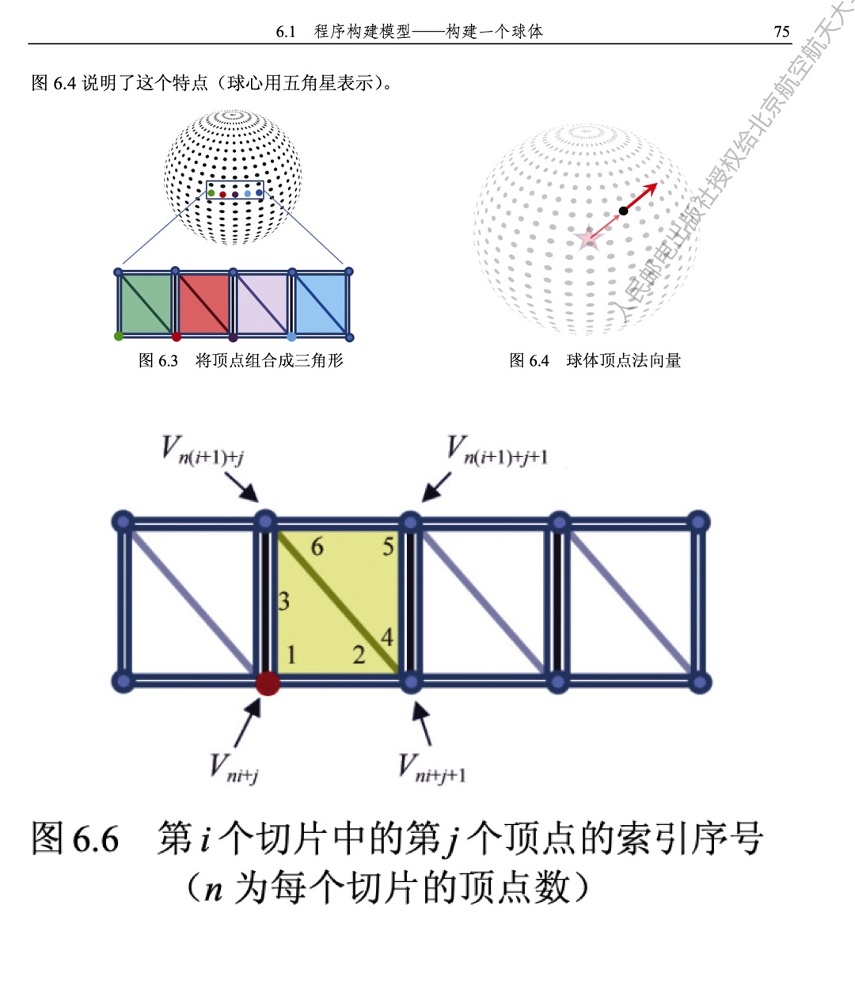
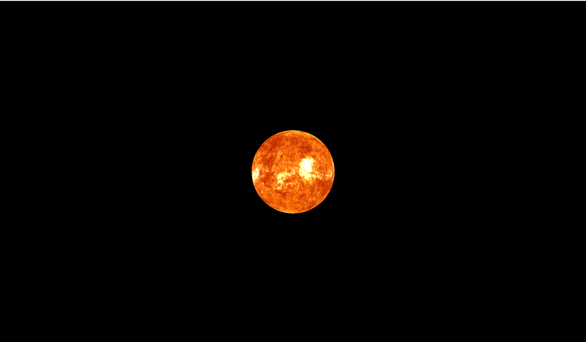
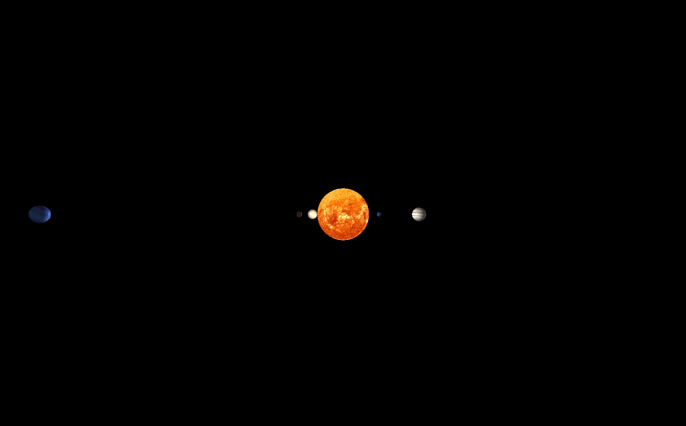
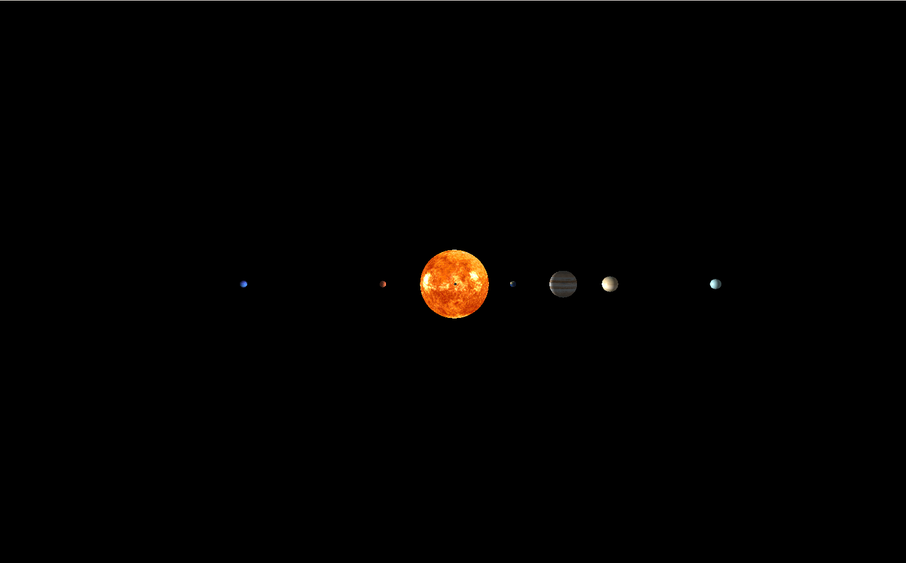
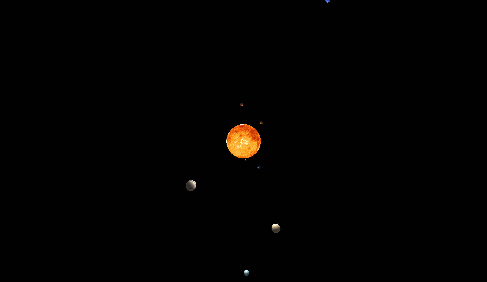
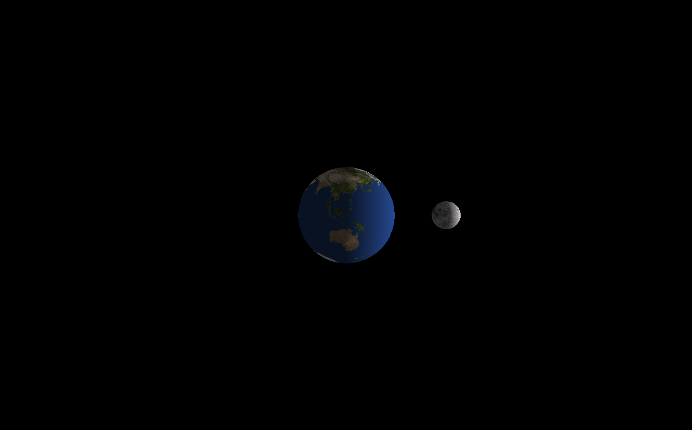
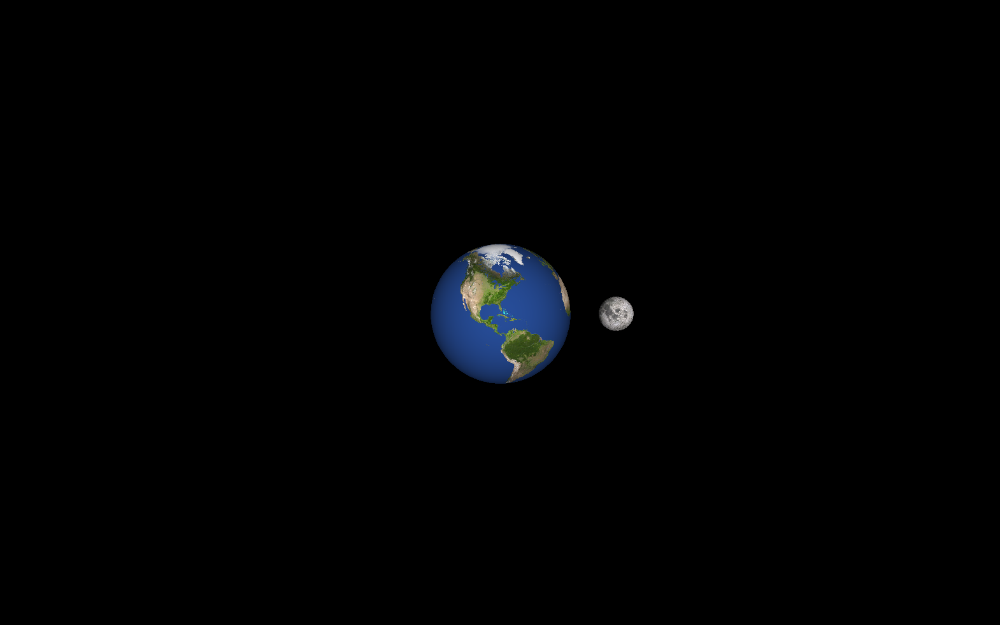
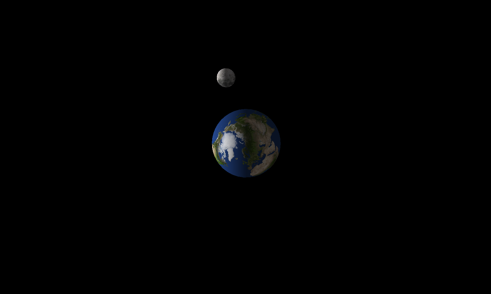

# 大作业： 通过计算机图形学技术实现天体系统运行模拟

李东骏-23371100,李智成-23373285

## 分数分配比例:每人50%

### 分工

李东骏：

1. 键盘控制函数——完整写出键盘控制函数，具体功能包括：视觉移动和缩放、光效移动，控制整个程序的运行
2. 重构行星着色器程序，将Grouad着色改为为Phong着色，提升渲染效果
3. 收集行星以及恒星数据，构建天体系统真实模型，并且采用非线性缩放方法，优化视觉展示效果（更改实际比例为最适宜展示比例）
4. 优化渲染过程中的MVP矩阵算法，提升视觉效果

李智成：

1. 给出代码结构底层框架——```main.py```和```Sphere.py```
2. 添加完善地月系，实现太阳系、地月系双系统展示
3. 创建地球着色器、恒星着色器程序
4. 调整函数接口和其他辅助函数,并保证可在Win/Mac平台上可兼容运行

### 设计背景

计算机图形学这门课讲述了了如何通过代码,实现真实几何体的渲染,从而能够对于一些场景通过电脑绘画创作、模拟仿真.高中地理的开篇内容为我们所处的宇宙,涵盖银河系、太阳系、地月系等内容.而对于这些星球的建模恰恰可以通过计算机图形学中的渲染来实现,从而在电脑上动态展现这样的天体运动系统.
本次大作业制作了太阳系和地月系两个天体系统,并且通过渲染,展示了其相对位置关系,星球运动状况(自转+公转).这两个星系由于其空间尺度之大,我们对真实的星球数据进行了微调,使之能够呈现出更好的视觉效果,不至于用户在茫茫一片漆黑的宇宙中什么也看不见.并且通过键盘控制,可以方便的切换视野位置,自由的观察太阳系、地月系的天体运动.本次大作业作为一个偏项目式的程序,希望能够为学生了解天体知识提供方便.这也是我们这样设计大作业的宗旨.

### 使用说明(李东骏撰写)

1. **库函数安装**

   需安装OpenGL、os、time、numpy、glfw、math、glm、PIL

2. **程序选择&运行方式**
   如在VSCode中打开,请将整个文件夹在工作区中打开，并运行```main.py```.
   根据对话框提示,选择要展示的内容:
   按0-选择展示原始比例的太阳系.
   *这一个不推荐使用,因为展示效果不好,除了太阳之外看不到别的东西*
   按1-展示优化比例后的太阳系.
   按2-展示优化比例后的地月系.

3. **键盘控制**

   **注意:运行窗口后,请将输入法调整为英文,防止一边按键改变视点,另一边中文输入法开始打字**

   1：展示调整星球比例，优化视觉效果后的太阳系系统

   2：展示地月系统

   W：视野向上平移

   A：视野向左平移

   S：视野向下平移

   D：视野向右平移

   -：视野放大（前进）

   +(无需Shift)：视野缩小（后退）

   J：切换为从X轴正方向看向星系

   K：切换为从Y轴正方向看向星系

   L：切换为从Z轴正方向看向星系

   ↑：视线向上偏移

   ←：视线向左偏移

   ↓：视线向下偏移

   →：视线向右偏移

   ESC：退出程序

4. 文件夹内容说明

​ ├── AuxFunc.py 存储辅助函数.

​ ├── Data.py 存储天体数据,包含名称、天体半径、轨道半径、自转周期、公转周期.
​ ├── Pic 存储天体纹理贴图照片.
​ ├── Shader.py 存储着色器glsl语言字符串,以及负责生成着色器程序
​ ├── Sphere.py 定义了球体类,便于实例化天体.
​ ├── main.py 运行的主程序.可以选择渲染帧率、展示的天体对象(太阳系/地月系),自行 设置初始观察位置(请注意数值量级,否则可能 什么都看不到)
​ ├── Md-Pic markdown/pdf中使用的图片
​ ├── 视频效果展示.mp4
​ └── 大作业报告汇总.md

### 技术细节和难点

#### 底层渲染框架(李智成撰写)

所提交的几个python文件中,较为重要的是```Sphere.py.```这个文件写了一个球的类,从而能够实现对于一切天体的统一管理,几大的简化了工作流程.Sphere类的主要功能和运行模式如下:

1. ```__init()__```初始化函数
   根据下图所示方式,生成球的顶点数据,包含顶点坐标、纹理坐标、索引列表和法向量.这些为创建一个球并且给其贴上正确的纹理图提供了保障,从而能够让球正常展现.
   
   图片参考资料:《计算机图形学编程》,[美]V.Scott Gordon和John Clevenger著,人民邮电出版社
2. ```LoadTexture()```函数:家在并且绑定纹理.
3. ```Draw()```函数和```calc_and_update_mvp()```函数:
   后者用来处理随着视角移动和球体运动带来的MVP矩阵变化,前者则是在后者算出的矩阵的基础上,绘制符合视觉效果的天体.
   在```calc_and_update_mvp()```函数中,采用了透视投影的方式将三维物体投射到二维平面上.由于天体数据数字量级均较大,因此Clipping Space的参数——near和far的差异也相对大.far的参数可在```main.py```中调节,初始值默认为 $10^8$.如果far调整到过近的位置,可能导致在Clipping Space之外的部分天体(比如距离太阳较远的天王星和海王星)
   calc_and_update_mvp()中处理天体的运动分为两种:自转和公转.在太阳系的绘制中,我们不考虑太阳的自转,并且认为一切行星都既自转又公转;地月系中,我们只局部考虑地球的自转,以及月球的自转公转.在最终展示的时候,可能会感觉自转过快,或者相比之下公转过慢,可以调整参数.自转过程考虑了各个星球自转平面和公转平面的夹角```self.angle```,以增加模拟的真实性.
   其次就是```Shader.py```.这个函数中记录了所有的着色器,以及相关链接着色器形成着色器程序的函数.其具体介绍如下:
   ```CreateWindow()```:创建glfw窗口,进行窗口初始化.
   ```PLANET_VERTEX_SHADER```和```PLANET_FRAGMENT_SHADER```行星的顶点着色器和片段着色器.相对应的着色器程序通过```CreatePlanetShader()```函数创建,并且返回创建好的着色器程序.行星着色器应用了Phong Shading,提升了效果展示,光效更平滑.
   ```STAR_VERTEX_SHADER```和```STAR_FRAGMENT_SHADER```行星的顶点着色器和片段着色器.相对应的着色器程序通过```CreateStarShader()```函数创建,并且返回创建好的着色器程序.这个着色器给太阳使用.
   ```EARTH_VERTEX_SHADER```和```EARTH_FRAGMENT_SHADER```行星的顶点着色器和片段着色器.相对应的着色器程序通过```CreateEarthShader()```函数创建,并且返回创建好的着色器程序.这个着色器主要给模拟地月系中的地球和月球时展现.函数中的```LightRadius```和```LightColor```参数用来模拟从太阳发出的平行光照在地球上视觉效果.通过调整太阳和地球之间的距离以及光照参数,可以尽可能还原地月系统的光照条件,从而更好的模拟地球的晨昏变化、日月食现象.

##### 细节与注意事项

1. 在这些函数中,我们都将着色器作为函数的参数传了进去.这样是为了解决不同类型的天体可以拥有不同的渲染效果,比如,区分恒星和行星,区分行星(地球)和月亮(卫星).
2. OpenGL的操作流程大部分需要依赖于上下文,因此在编程的过程中,需要对格外注意.比如实现渲染/绑定```VBO```的过程中,一定要明确当前是在是哪个```VAO```和着色器程序下.本文涉及不同着色器对象的不同渲染,因此在代码撰写,如果遇到渲染对象发生变化,一定要注意加上```glUseProgram()```函数来明确此时的上下文.

完成了以上几步之后,剩余的操作就是将几个代码文件正确地连接起来,调试,运行测试.在```main.py```,主要的任务就是进行参数设置、实例化,以及在glfw主循环中进行渲染,并实时通过操作键盘让视角移动,从不同方位观察太阳系/地月系.

##### Shading Model(李东骏撰写)

为太阳和八大行星分别搭建了恒星着色器和行星着色器。

恒星着色器：点光源位置设置在太阳中心，故无需考虑光照效果，实现了太阳表面的纹理贴图效果。

行星着色器：实现了不同行星表面的纹理贴图效果，并且在太阳作为光源的前提下，基于Phong光照模型，实现ADS光照计算，形成有真实感的光照效果。

#### 辅助函数

介绍一些其他的辅助函数,全部可以在```AuxFunc.py```中找到.

##### 键盘控制函数（李东骏撰写）

为用户观察、使用天体模拟系统更为便捷，搭建了键盘控制函数，使用键盘上不同键位可实现视角的变换和视野的移动和放缩。具体的键位设置可参考**使用说明-键盘控制**部分。

视野平移、缩放效果实现：根据设定的```TranslateSpeed```，向指定方向同时改变```eye```和```center```向量。

视线偏移效果实现：根据设定的```RotationSpeed```，在对应坐标轴上平移```center```向量，并重新归一化。
参数```TranslateSpeed```和```RotationSpeed```可以在 ```AuxFunc.py/KeyboardControl()```函数中修改参数.

##### 其他函数（李智成撰写）

```Terminate()```:终止一切运行的程序,释放资源.
```FrameAdjust()```:根据用户对运行程序的窗口的大小的变化,调整视觉比例,防止渲染结果受到拉伸而变形.默认运行程序框长宽均为分辨率的$\frac{\sqrt5-1}{2}$倍.这个函数发挥功效需要和```mian.py```中的如下两行代码:

```python
width, height = glfw.get_framebuffer_size(window) # 获取窗口实际帧缓冲区尺寸
glViewport(0, 0, width, height) # 更新视口大小
```

共同使用.获取并且实时更新窗口大小,并且在```FrameAdjust()```函数中重新计算对应的投影矩阵,从而得到正确的渲染比例.

### 效果展示

图片：李东骏制作



<center>原始比例太阳系</center>

|  |  |  |
| --- | --- | --- |
| 优化比例太阳系-x轴视角 | 优化比例太阳系-y轴视角 | 优化比例太阳系-z轴视角 |
|  |  |  |
| 地月系-x轴视角 | 地月系-y轴视角 | 地月系-z轴视角 |

视频：李智成制作

详见文件夹中```视频效果展示.mp4```
