# 计算机图形学作业一报告

李东骏 23371100

## 一、函数实现过程

### 1. LookAt 函数实现过程（Line 5-18）

LookAt 函数用于生成一个观察矩阵，将场景中的坐标转换为相机视角。首先，计算“前向”向量 forward，表示从相机位置 eye 指向目标位置 center 的方向，并将其归一化为单位向量。接着，通过“前向”向量和给定的“上”向量 up 计算“右”向量 right，并归一化，使其与“前向”向量正交。然后，再次通过“右”向量和“前向”向量的叉积重新计算“上”向量，以确保三个向量构成正交坐标系。随后，将 right、up 和 -forward 赋给一个 4x4 单位矩阵 rot 的前三行，用于描述旋转变换。为了实现平移，将一个新的平移矩阵 trans 的前三行最后一列设置为 -eye，以便将视点移到坐标系原点。最后，将旋转矩阵 rot 和平移矩阵 trans 相乘，得到最终的观察矩阵 mat，用于将世界坐标系中的点转换到相机坐标系。

### 2. Perspective 函数实现过程（Line 20-28）

此段代码的 Perspective 函数用于创建一个透视投影矩阵。函数接收四个参数：视场角 fov、纵横比 aspect、近裁剪面 near 和远裁剪面 far。首先，计算焦距 f，它是视场角的一半的切线值的倒数，用于将场景压缩到透视视角中。接着，构建一个 4x4 的单位矩阵 mat，并将透视投影参数填入对应位置。矩阵的第一行和第二行用于缩放水平和垂直视角，第三行设置近远平面的裁剪，确保视点内的对象符合深度缓冲要求。最后，第四行的设置表明这是一个透视投影矩阵，将三维坐标映射到二维视图。

### 3. Ortho 函数实现过程（Line 30-39）

Ortho 函数实现了一个正交投影矩阵的生成，使用视锥体的六个边界参数：左右、上下、远近平面。首先，函数创建一个 4x4 的单位矩阵 mat，然后对其各项赋值以完成正交投影变换。通过左右边界确定 x 方向的缩放系数；y 方向使用上下边界；z 方向通过远近平面，且添加负号以适应深度的映射方向。接着是平移因子，用于将视锥体的中心映射到原点：x 方向上，函数将该项设置为左右边界之和的相反数，平移至 [-1, 1] 区间；y 方向上采用上下边界，z 方向则使用远近平面的相对距离，将 z 轴平移到 [-1, 1]。最终，Ortho 函数返回的 mat 是一个正交投影矩阵，用于将场景中的坐标转换为标准化的 3D 空间坐标。

### 4. inside 函数实现过程（Line 55-72）

inside 函数主要用于判断一个三维点是否位于一个三角形内部。首先，从三角形的三个顶点 A、B 和 C 中提取出其坐标，并将待检查的点 P 的坐标表示为一个 numpy 数组。接着，通过计算边 AB 和 AC 的向量，利用这两个向量的叉积计算出法线向量，并将其归一化，以确保它是单位向量。随后，通过计算点 P 与顶点 A 之间的差向量与法线的点积，来检查点 P 是否在三角形所在的平面上。如果点积不为零，则说明点 P 不在该平面内，因此直接返回 False。接下来，函数将三维坐标投影到二维平面上，分别提取出 A、B 和 C 的前两个坐标。利用这三个顶点计算出三角形的总面积，并根据面积来计算点 P 在三角形内的重心坐标（alpha、beta 和 gamma）。这三个坐标分别表示点 P 在三角形 ABC 内的重心坐标。最后，通过检查 alpha、beta 和 gamma 是否都大于等于零，来确定点 P 是否在三角形内部。如果是，则返回 True，同时也返回计算得到的重心坐标；否则返回 False。这一过程确保了只有在点 P 确实位于三角形内部时，才会返回 True。

### 5. rotate_norm 函数实现过程（Line 75-90）

该函数对三角形的三个顶点绕其法线进行旋转。首先计算三角形的中心点，并将两个向量 AB 和 AC 进行叉乘，得到法向量。然后，将法向量归一化并利用其分量 u、v、w 创建一个旋转矩阵 rot。旋转角度 theta 先被转换为弧度，再用于计算 cos 和 sin 值，填入旋转矩阵。之后，函数将三角形的每个顶点都从中心点平移至原点，应用旋转矩阵进行旋转，再将旋转后的点平移回中心位置，从而完成绕法线的旋转。

## 二、图像生成过程

### a. 透视投影图像和正交投影图像（Line 133-145, 160-172）

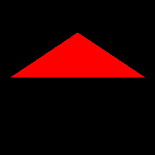

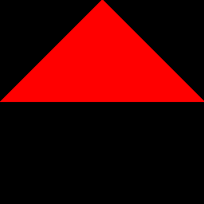

### b. 三角形绕其自身中点旋转 45、90、135、180 度后的透视投影图像（Line 175-191）

45 度

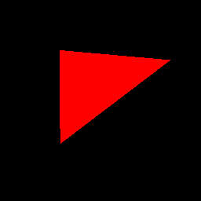

90 度

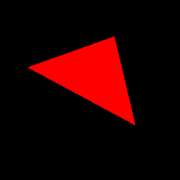

135 度

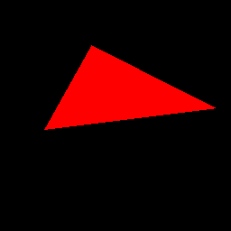

180 度

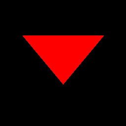

### c. 颜色插值（Line 148-157）

实现过程：仿照 a 问中步骤，在渲染过程中加入按照距定点距离比例加入颜色插值步骤。

0

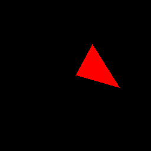

0.25

0.5

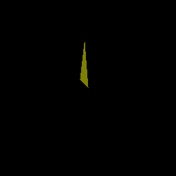

0.75

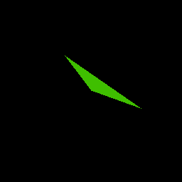

1

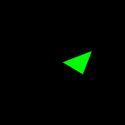

### d. 深度测试（Line 194-213）

实现过程：仿照 a 问中步骤，按照透视矩阵投影渲染两个三角形，形成红绿两个三角形图像。

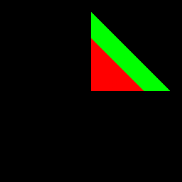

### e. 旋转插值（Line 219-257）

实现过程：

首先定义了三个函数，分别用于生成绕 X 轴、Y 轴和 Z 轴旋转的旋转矩阵。每个旋转函数都接受一个角度参数，将其转换为弧度，并计算相应的余弦和正弦值。接着，这些值被用来构建相应的旋转矩阵，返回一个三维数组表示旋转变换。

随后，创建了一个名为 interp_tri 的 Triangle 实例，并通过 setVertex 方法设置了其三个顶点的坐标。这些顶点形成一个三角形。在接下来的循环中，使用 numpy 的 linspace 函数生成一个从 0 到 1 的等间距数列，并遍历这个数列。每次迭代中，利用当前的 t 值设置三角形的颜色，使得颜色在红色和绿色之间渐变。

接着，计算一个复合旋转矩阵 r，该矩阵由绕 X 轴旋转 30 度、Y 轴旋转 60 度和 Z 轴旋转 30 度的旋转矩阵相乘得到。通过调用 rotate_mat 方法，使用这个复合旋转矩阵更新三角形的顶点位置。

接下来，实例化一个 Rasterization 对象 R_interp，并设置视图矩阵和投影矩阵。视图矩阵通过 LookAt 函数生成，设置观察者的位置、目标和上方向；投影矩阵通过 Perspective 函数生成，定义视野角度。最后，调用 render 方法对三角形进行渲染，并将生成的颜色缓冲区转换为图像，保存为 PNG 文件。这个过程被重复执行，生成多个不同颜色和姿态的三角形图像。
