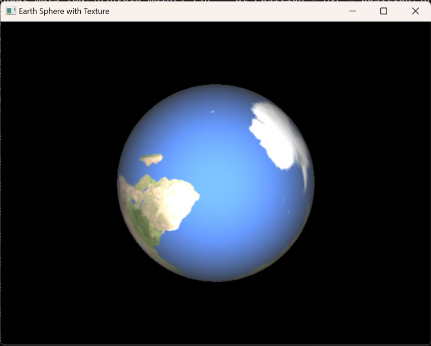
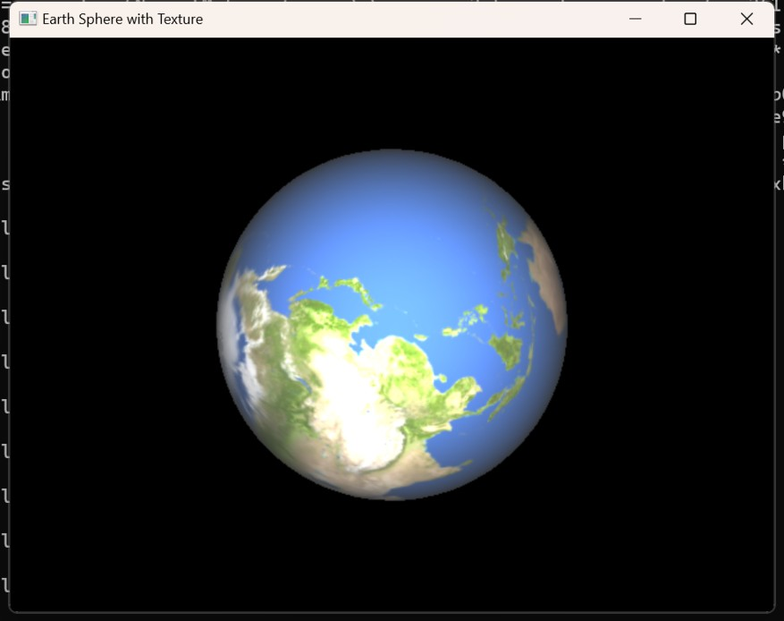
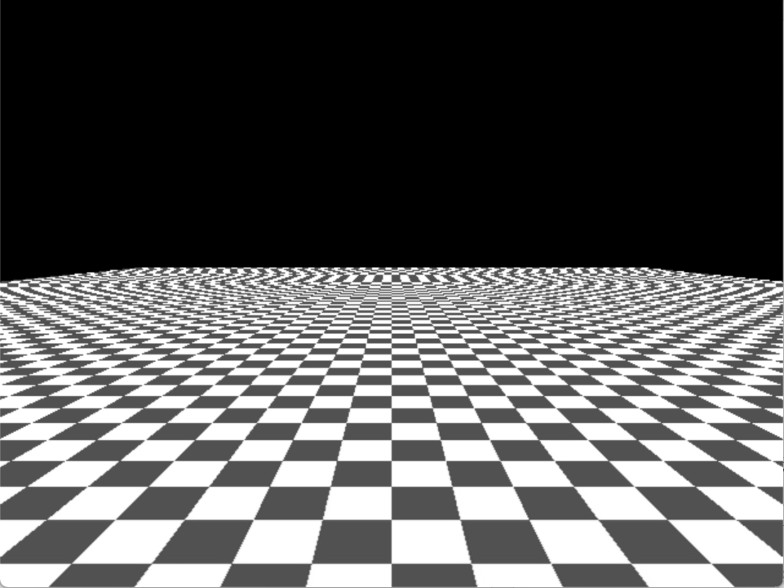
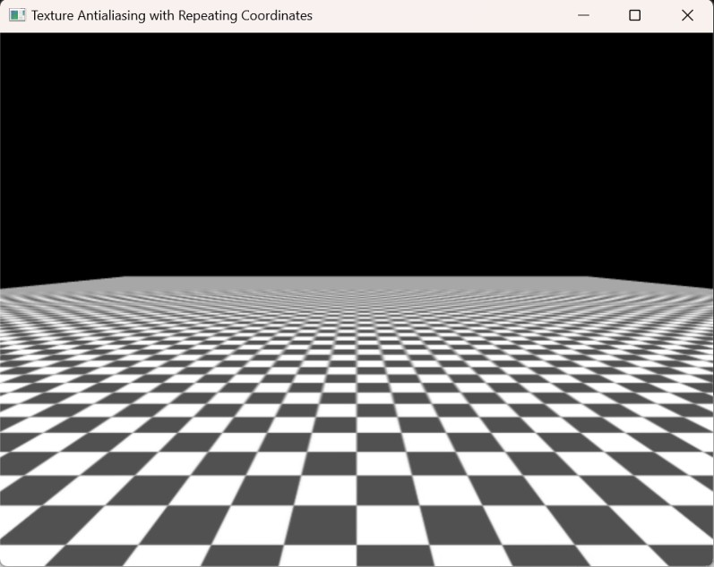
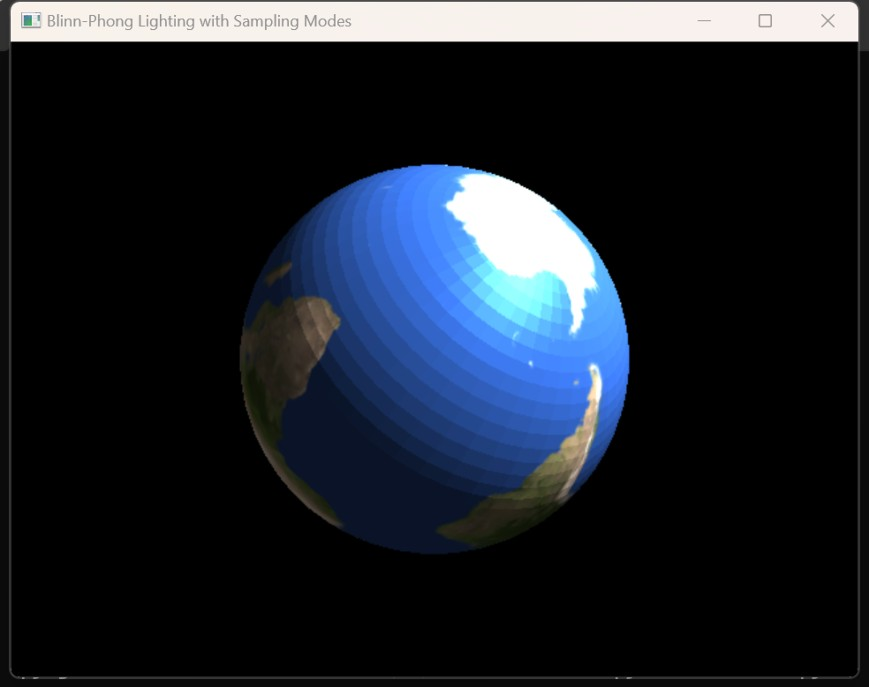
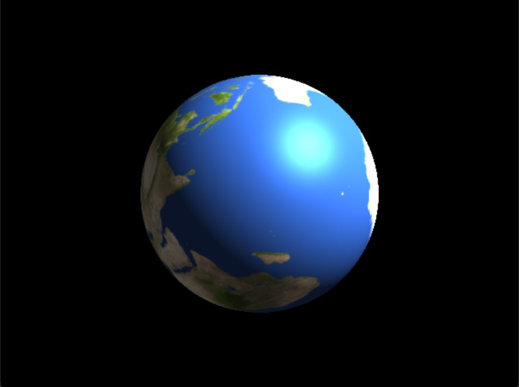
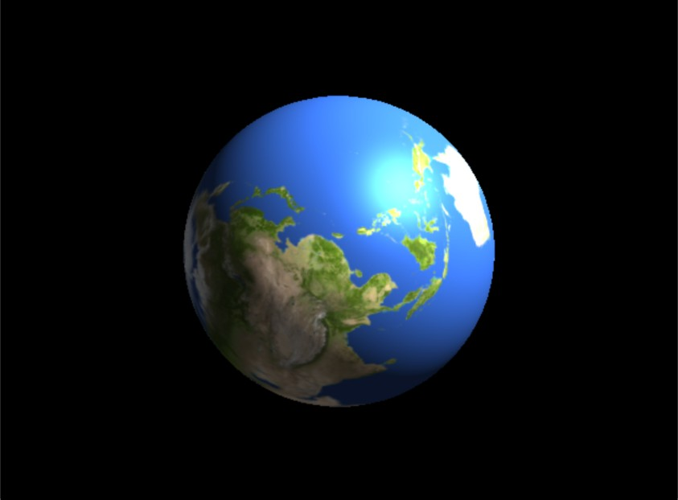
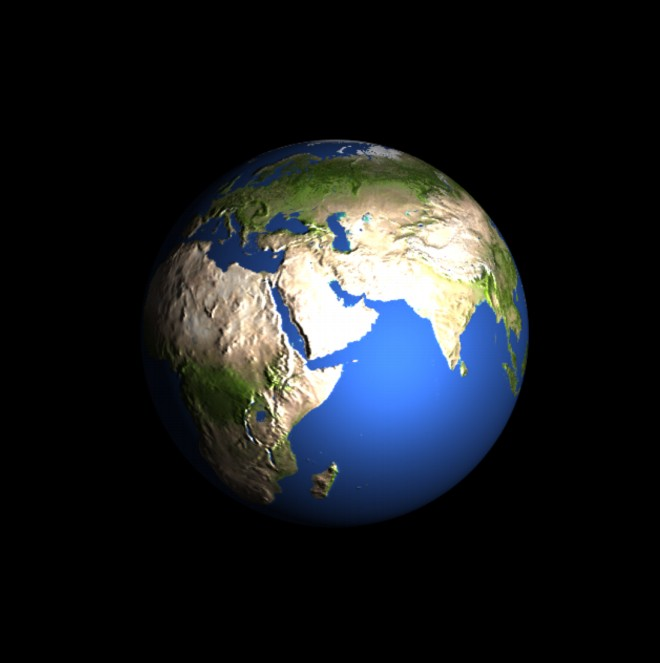

# 计算机图形学作业二报告

李东骏 23371100

## 任务一：球面三角化及纹理贴图

将球面进行三角化（用多个三角形表示球面），并将图片 earthmap.jpg 作为纹理图贴到球面上进行绘制。（3 分）ps：邻近的经纬线会交叉形成多个 4 边形，将四边形其中一对角点连接，形成 2 个三角形。

### 1. 实现步骤

首先，仿照 shading.py 中的 cube 函数，搭建 sphere_mesh(stacks=50, slices=50) 函数，实现球面三角化。

其次，加载图片 earthmap.jpg，并将其作为纹理贴图应用到球面。

然后，实现简单的光照模型（环境光 + 漫反射），结合纹理颜色绘制球面。

最后，使用现代 OpenGL 管线渲染地球。

### 2. 渲染结果

## 任务二：纹理反走样

纹理贴图反走样，解决 texture.py 里的走样问题。（2 分）

### 1. 实现步骤

（1）修改纹理过滤模式：将 GL_NEAREST 调整为 GL_LINEAR，并启用 Mipmap，使用 GL_LINEAR_MIPMAP_LINEAR 进行多级纹理采样。

（2）多重采样：GLUT_MULTISAMPLE 和 glEnable(GL_MULTISAMPLE)，进一步减少锯齿问题。

### 2. 渲染结果

## 任务三：光照计算模型

实现光照计算（Blinn-Phong）模型。几何可以用球面，实现三种不同采样频率（三角形、顶点、像素）。（3 分）

### 1. 实现步骤

首先，计算光照模型 Blinn-Phong 光照模型：环境光、漫反射光、镜面反射光。

其次，根据不同的采样频率（三角形级别、顶点级别、像素级别），分别在顶点着色器和片元着色器中进行了调整。

最后，在渲染函数中，通过 shadingMode 来控制使用哪种采样频率：0（三角形级别）、1（顶点级别）和 2（像素级别）。

### 2. 渲染结果

## 任务四：凹凸效果

Bump Mapping 的实现，利用纹理实现球面的凹凸效果。（1 分）

### 1. 实现步骤

（1）法线扰动计算：从灰度贴图计算梯度。使用梯度生成切线空间的扰动法线。

（2）切线空间到世界空间：使用 TBN 矩阵将切线空间法线转换到世界空间。

（3）光照计算：使用扰动后的法线进行 Blinn-Phong 光照计算。

（4）最终渲染：加载并绑定漫反射贴图和法线扰动贴图，结合片元着色器完成渲染。

### 2. 渲染结果

## 任务五：平面阴影效果

在球面的下方，放一个大的平面，然后实现阴影的效果。（1 分）

### 1. 实现步骤

（1）添加平面几何体：首先，我们需要为平面创建顶点数据。由于平面会位于球体的下方，我们将平面放置在世界坐标系的下部，并使它足够大，以便它能投射阴影。

（2）计算阴影投射：为了计算阴影，我们将使用简单的阴影投射方法：将物体的投影通过平面计算。在此实现中，我们使用与光源位置相关的简单投影。

（3）更新片元着色器：在片元着色器中，我们将计算该平面是否接收到来自球体的阴影。如果球体与平面之间存在遮挡，那么该位置将变暗，表示阴影。

### 2. 渲染结果

未完成
