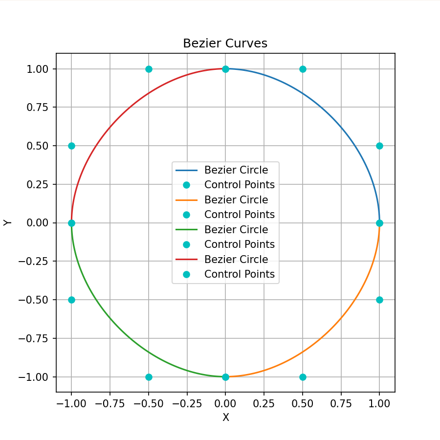
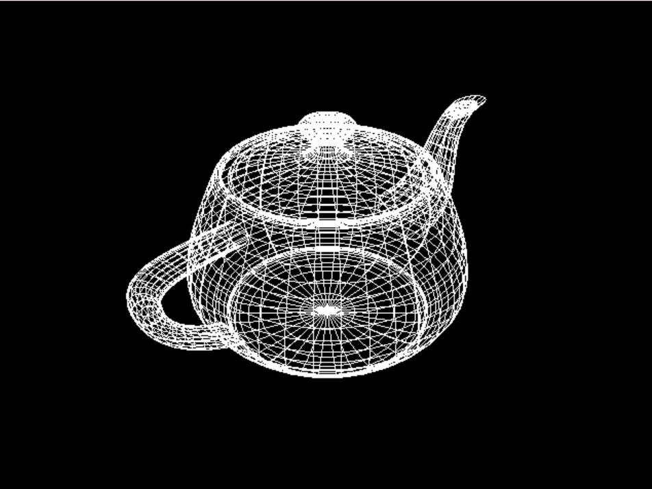

# 计算机图形学作业三报告

李东骏 23371100

## 一、Bezier 曲线表示圆

利用 Bezier 曲线（可以分段）表示一个圆，简要描述原理，并用 de Casteljau 算法绘制封闭曲线及控制点。

### 1. 原理

将一个圆分为四个圆弧对应平面直角坐标系的四个象限，分别使用三次 Bezier 曲线近似四分之一圆弧。并用 de Casteljau 算法分别进行绘制。

### 2. 结果

如图所示：

### 3. 代码

详见 task1.py 文件。

## 二、Utah Teapot 曲面渲染

著名的 Utah Teapot 是用双三次 Bezier 曲面几何建模的经典案例，请根据 teapot.py 给出的 32 个分块 Bezier 曲面的控制点，渲染出 Utah Teapot 的曲面。

### 1. 实现过程

（1）将 kTeapotNumPatches 中的 16 个一组控制点转化为 4×4 的形式

（2）bezier 函数中根据双三次 bezier 曲面公式计算 u、v 值对应的坐标

（3）利用 OpenGL 相关函数进行图像绘制

### 2. 运行结果

如图所示：

### 3. 代码

详见 task2.py 文件。
